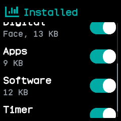

# Software

BattleTime's own app manager, after the app list of InfiniTime's settings and wasp-os's Software app.
It lists every installed app and watch face with a switch to turn it on or off.

## Using it

- Each row shows the name, **Face** for a watch face, and the memory it needs while open. The top
  line, which scrolls away with the list, says how much memory each app may use.
- **Tap** a row to turn it on or off. **Swipe up** and **down** to scroll the list.
- The watch checks each change first. A row that cannot change opens a screen saying why: the app
  needs more memory than an app can have, the launcher would run out of memory, the launcher and the
  last watch face stay on, or the app is open now.
- When the app is too large, that screen also says how much memory it needs against how much an app
  may use.
- Tap **OK**, or click the side button, to go back to the list.

## Screens

The top of the list, under how much memory each app may use: Atlas and Dice off, the Digital face on.

The end of the list, scrolled down, with every app on.

After tapping Atlas, which needs 41 KB where an app may use 27 KB.

After tapping Digital, the only watch face, which stays on.

## With the companion app

The companion's **Apps** screen, under On the watch, lists the same apps and faces with their memory,
and can hide one from the launcher or show it again, install one from a file, or remove one with what
it saved.
