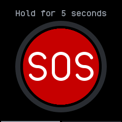
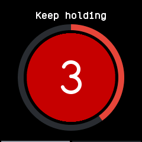
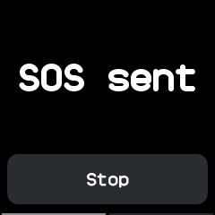
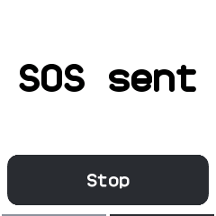
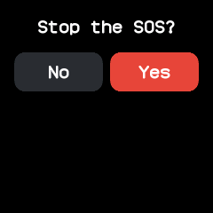
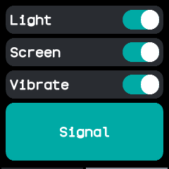
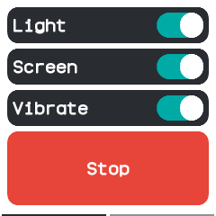
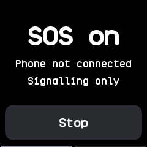

# SOS

Hold the red button for five seconds to tell the phone you need help, while the heart rate sensor's
light, the screen and the motor flash SOS in Morse code. The signals also run on their own, without
the phone.

## Using it

- **Press and hold** the red **SOS** button. The watch buzzes quickly, the ring around the button
  fills and the button counts down the seconds left. Lifting your finger before the end cancels it
  and sends nothing.
- After five seconds the watch sends the phone an SOS, buzzes once for a second and shows
  **SOS sent**. The chosen signals start after a short pause and repeat "... --- ..." until stopped.
- Without a phone connected it shows **SOS on**, **Phone not connected** and **Signalling only**,
  and sends the SOS as soon as the phone connects while the app is open.
- Tap **Stop** and answer **Yes** to end the SOS: the phone is told and the signals stop.
- The SOS stays on when you leave the app; the signals stop until you open it again, which shows
  **Stop** and starts them once more. Leaving never tells the phone the SOS is over.
- Swipe left for the **Signals** page. **Light** flashes the green LED of the heart rate sensor,
  **Screen** flashes the whole screen white at full brightness and keeps it on, and **Vibrate** buzzes
  each dot and dash. All three start on and are remembered.
- Tap **Signal** to flash SOS with the chosen signals without contacting the phone, and **Stop** to
  end it. The button is dimmed while an SOS is on, because the signals already run.
- It needs the heart rate permission for the light and the phone messages permission for the SOS.

## Screens

Ready, with the instruction above the button.

Held for two seconds: the ring is two fifths full and three seconds are left.

The SOS sent, in the pause before the pattern starts.

The screen lit white for the first dot.

**Stop** asks first.

The second page, with all three signals on.

Signalling alone after tapping **Signal**, during a flash.

Held with no phone connected, so the watch only signals.

## With the companion app

The watch sends `{"t":"app","ch":"sos","d":{"on":1}}` when the SOS starts, and
`{"t":"app","ch":"sos","d":{"on":0}}` when it is stopped on the watch. When the SOS is stopped on the
phone instead, the companion rewrites the app's state with `is_active` and `reached_phone` false, as
[app state](../companion-protocol.md#app-state-served) describes; an open app opens again on it,
back at the hold button with the signals stopped.
