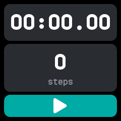
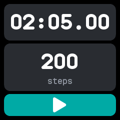

# Sports

A stopwatch that also counts the steps taken while it runs, ported from wasp-os's sports app.

## Using it

- Tap **play** to start. The screen stays on while it runs.
- The top card shows the time, to the hundredth of a second for the first hour and then in hours,
  minutes and seconds. The bottom card shows the steps since it was cleared. A run past midnight
  keeps counting.
- Tap **pause** to stop. Tap play again to carry on, adding to the same time and steps.
- While stopped, tap anywhere else on the screen to **clear** the time and steps.
- A cleared session is kept, with when it started, its time and its steps. The last five are
  kept, newest first; clearing a session that never ran keeps nothing.

## Screens

Cleared, before the first start.

Running, just over two minutes and 200 steps in, with the pause button.

Stopped, with the play button back; a tap on the cards clears it.

## With the companion app

The companion syncs the last five cleared sessions. The Sports plugin's page shows them, each with
when it started, its time and its steps, beside the last two weeks of the watch's daily steps.
