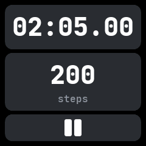
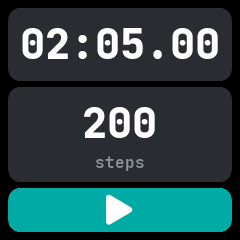

# Sports

A stopwatch that also counts the steps taken while it runs, ported from wasp-os's sports app.

## Using it

- Tap **play** to start. The screen stays on while it runs.
- The top card shows the time and the bottom card the steps since it was cleared. A run past
  midnight keeps counting.
- Tap **pause** to stop. Tap play again to carry on, adding to the same time and steps.
- While stopped, tap anywhere else on the screen to **clear** the time and steps.

## Screens

Cleared, before the first start.

Running, two minutes and 200 steps in.

Stopped, with the play button back; a tap on the cards clears it.
