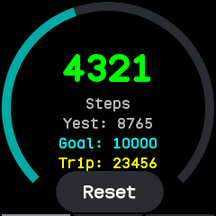
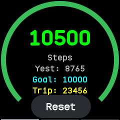
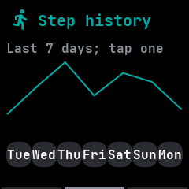
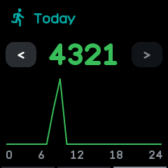

# Steps

A step counter, merged from InfiniTime's Steps and wasp-os's step_counter and steplogger. The
system keeps the step history, so nothing here runs in the background.

## Using it

- The first page shows today's steps on a ring that fills towards the goal and turns green once it
  is met. Below are yesterday's total, the goal and the trip meter.
- Tap **Reset** to set the trip meter back to zero.
- The goal is the step goal setting.
- Swipe **left** for the last seven days as a chart. Tap a **day** under it, or swipe left again,
  for that day by hour.
- On a day, tap **<** for the day before and **>** for the day after.
- Swipe **right** to go back a page.

## Screens

Today's steps, short of the goal.

The ring turns green once the goal is met.

The week, after a swipe left.

One day by hour, after a second swipe left or a tap on a day.
