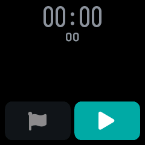
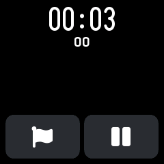
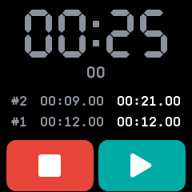

# Stopwatch

A stopwatch with laps, merged from InfiniTime's StopWatch and wasp-os's stopwatch. It counts from
the moment it started, so it keeps running while the app is closed or the watch sleeps.

## Using it

- Tap **play**, the right button, to start. The screen stays on while the stopwatch runs.
- Tap the **flag**, the left button, to take a lap. The last four laps show above the buttons:
  the lap number, the lap's own time and the total time when it was taken.
- Tap **pause** to stop counting. The time blinks while paused; tap play to carry on.
- While paused, the left button turns red: tap it to **reset** the time and the laps.
- After an hour the time shows hours, and only three laps fit.

## Screens

Cleared, before the first start.

Running: the time with its hundredths below, and the lap and pause buttons.

Two laps taken, newest first.

Paused, with the reset button in red.
