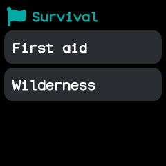
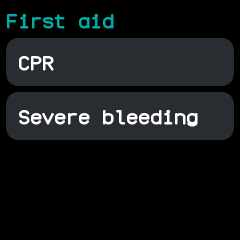
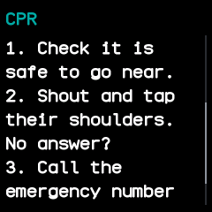
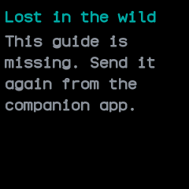
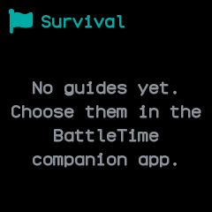

# Survival

Short guides to what to do in an emergency, such as CPR, being lost in the wild or protesting safely, kept on the
watch so they can be read without a phone or a signal. Choose which guides the watch carries in the BattleTime
companion app.

The guides are reminders of common first aid and outdoor training, not a replacement for a course. Call your
emergency number first whenever you can.

## Using it

- Open the app to see the topics the guides on the watch fall under: first aid, wilderness, disasters
  and personal safety. A topic with no guide on the watch is left out.
- Tap a topic to list its guides by title. Drag up and down when there are more than fit.
- Tap a guide to read it. Drag up and down to scroll through it; a bar at the right edge shows where you are.
- Click the side button to go back to the topic's guides, and again to the topics.
- Without any guides the app says to choose them in the companion app.
- The watch reads only the lines of a guide on screen, so a long guide costs no more memory than a short one.

## Screens

The topics of the guides on the watch.

A topic, opened: its guides.

A guide, opened from its topic: its title, then its text.

The same guide dragged further down.

A guide listed but whose text is not on the watch, with a reminder to send it again.

No guides yet, with a reminder to choose them in the companion app.

## With the companion app

- The companion app's **Survival** screen lists every guide it carries under the same topics, each with a switch and a **Read it** link to read the text first.
- Tick the guides to carry and choose **Send**. The watch then holds exactly those guides: the new ones are sent,
  the ones unticked are taken off, and the ones already there are not sent again.
- The guides it carries now:
  - first aid: CPR, severe bleeding, choking, burns, broken bones, stroke and allergic reaction;
  - wilderness: hypothermia, heat illness, lost in the wild, finding water, shelter and fire, and
    signalling for help;
  - disasters: earthquake;
  - personal safety: protesting safely, nonviolent action, de-escalating violence (agitators included), crowds and
    tear gas, and police and arrest.
- From the command line, `battletime survival` lists the guides and ticks the ones on the watch, and
  `battletime survival set`, `add` and `remove` change them.
