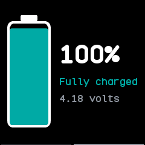

# System

How the watch is doing and its battery, on two pages. The system page is InfiniTime's SystemInfo;
the battery page merges InfiniTime's BatteryInfo with PinetimeLite's charging and low battery
screens.

## Using it

- **Swipe left** for the battery page and **right** to go back. The bar along the bottom shows which
  page is on show.
- The system page shows the **firmware** version, the **uptime**, why the watch **last restarted**
  and the **free storage**.
- The battery page shows the charge, whether it is charging, full, low or critical in its own
  colour, and the voltage. Below 10 % off the charger it says **Charge now**.
- While charging, the battery on the left fills up again and again.
- The watch opens it straight on the battery page when the charger is plugged in or out, or the
  charge goes low.

## Screens

The system page, where the app opens.

The battery page, a swipe left, while discharging.

On the charger.

Fully charged.

Low, below 10 %, with the warning to charge.

Critical, at 5 % or less.
