# System

How the watch is doing, on seven pages, as InfiniTime's SystemInfo screens show it: the system, the
battery, memory, the bootloader, the hardware, the tasks and the licence. The battery page merges
InfiniTime's BatteryInfo with PinetimeLite's charging and low battery screens.

## Using it

- **Swipe left** for the next page and **right** to go back. The bar along the bottom shows which
  page is on show. A page too long for the screen scrolls up and down.
- The system page shows the **firmware** version and commit, the day it was **built**, its
  **state**, the **uptime** and why the watch **last restarted**.
- The state is **Confirmed** when the bootloader keeps the firmware, **On trial** after an update
  until something confirms it, and **Rolled back** when the last update never confirmed itself and
  the firmware before it came back. A phone writing the time or reading anything over Bluetooth
  confirms an update by itself, so the state is mostly Confirmed.
- While the firmware is on trial the page warns that **any restart rolls back** and offers two
  buttons, as InfiniTime's firmware validation screen does: **Confirm** keeps it, and **Roll back**
  restarts at once into the firmware before it.
- The battery page shows the charge, whether it is charging, full, discharging, low (15 % or less)
  or almost empty (5 % or less) in its own colour, and the voltage. Below 10 % off the charger it
  also says **Charge now**.
- While charging, the battery on the left fills up again and again.
- The watch opens it straight on the battery page when the charger is plugged in or out, or the
  charge goes low.
- The memory page shows the **free storage**, the **free heap** now and the **least** it has been
  since the watch started, how many **allocations** the heap refused, and how many times the
  **stack overflowed** into its guard, counted across restarts until the power goes.
- The bootloader page shows the bootloader's **version** and the day it was **built**. A bootloader
  older than the version record shows `CRC` and the start of its checksum instead, as the status
  page does, and one that cannot be read shows **Unreadable**.
- The hardware page shows the **Bluetooth address**, the external **flash** chip and its JEDEC ID,
  the **touch panel**'s chip and firmware, and the **accelerometer**. A chip that never answered
  shows **No answer**.
- The tasks page lists the firmware's tasks: how many times each has **run** and its share of the
  time since the watch started (**CPU**).
- The licence page says BattleTime is free software under the GNU GPL, version 3 or later, with no
  warranty.
- The memory, hardware and tasks pages show the values as they were when the app opened.

## Screens

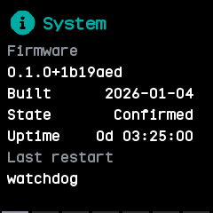

The system page, where the app opens: the firmware version, build day, state, uptime and why the watch last restarted.

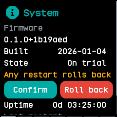

A firmware on trial, with the warning that any restart rolls back, and Confirm and Roll back.

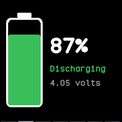

The battery page, a swipe left, discharging at 87 %.

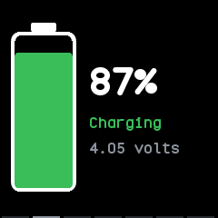

On the charger: the battery fills up from the charge again and again.

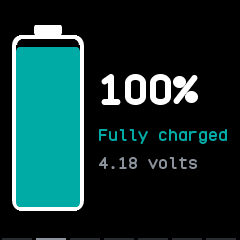

Fully charged, at 100 %.

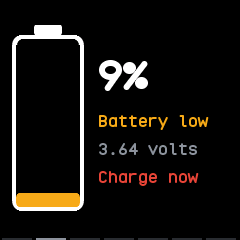

Low at 9 %, with the warning to charge.

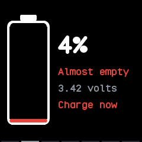

Critical, at 5 % or less, where it says **Almost empty**.

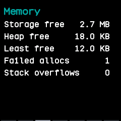

The memory page, the third: free storage and heap, the least free heap, refused allocations and stack overflows.

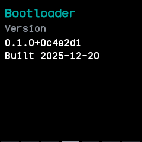

The bootloader page, with its version and build day.

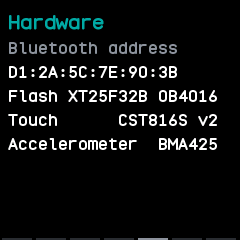

The hardware page: the Bluetooth address, the flash chip, the touch panel and the accelerometer.

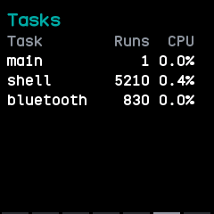

The tasks page: each task's runs and share of the time.

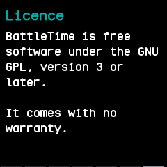

The licence page, the last.

## With the companion app

The companion syncs the watch's battery log, the charge at the end of every six minutes and whether
it was charging. The System plugin's page lists each of the last two weeks' days with its average,
lowest and highest charge.
