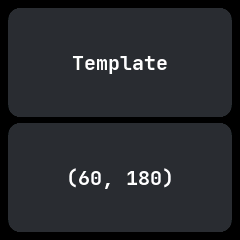

# Template

The app template, from wasp-os's template: a starting point for a new app that answers every kind of
input. See [app-runtime.md](../app-runtime.md) for how apps are written.

## Using it

- Tap anywhere: the lower card shows where the touch landed, as x and y.
- Swipe in any direction: the lower card names the swipe.
- The side button leaves, as in every app.

## Screens

As it opens, with the lower card empty.

After a touch, showing where it landed.

After a swipe to the left.
