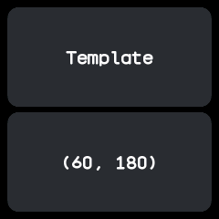
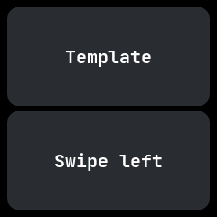

# Template

A starting point for a new app that answers every kind of input, showing the last touch or swipe it
received. From wasp-os's template.

## Using it

- Tap anywhere: the lower card shows where the touch landed, as x and y.
- Swipe in any direction: the lower card names the swipe.
- Clicking the side button leaves, as in every app; the app never hears it.
- Each time it opens the lower card starts empty.
- [Writing an app](../writing-apps.md) explains how apps like this one are written.

## Screens

As it opens: its name on the upper card and the lower card empty.

After a touch low on the left, showing where it landed: (60, 180).

After a swipe to the left: "Swipe left".
