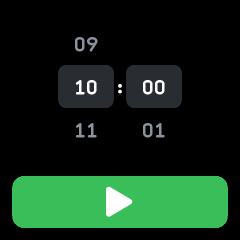
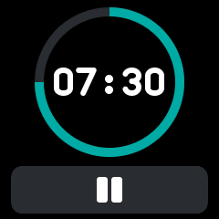
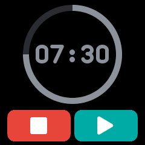
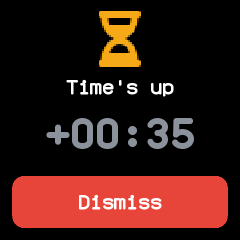

# Timer

A countdown timer of up to 99 minutes, merged from wasp-os's timer and InfiniTime's Timer. It stores
when it ends, so it keeps running while the app is closed or the watch sleeps.

## Using it

- Roll the **minutes** and **seconds** to the length, then tap **play** to start.
- While it runs, tap **pause** to hold the time. While paused, tap **play** to carry on, or the red
  **stop** button to go back to the rollers.
- When the time runs out the watch wakes and buzzes, and shows how long ago it ended. Tap
  **Dismiss**, or anywhere on the screen, to silence it. The buzzing stops on its own after a minute,
  and leaving the app with the side button dismisses it too.
- The rollers keep the last length chosen. The play button is greyed out at zero.

## Screens

Choosing a length, here ten minutes.

Running, with the time left inside a ring that empties as it counts down, and the pause button.

Paused: the time and the ring grey out, with stop and play buttons.

Time's up, 35 seconds after the end, with Dismiss.

## With the companion app

The Timer plugin's page shows the chosen length and whether the timer is running, paused or ringing,
with the time left counting down between syncs. **Set on the watch** changes the length the rollers
start from, in minutes and seconds up to 99:59.
