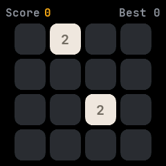
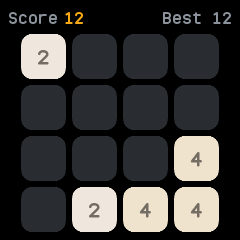
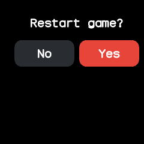
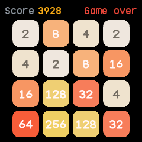

# 2048

The sliding number game 2048, merged from InfiniTime's Twos and wasp-os's play2048. Slide the tiles
so equal numbers join, and try to make 2048.

## Using it

- **Swipe** left, right, up or down to slide every tile that way. Two equal tiles that meet join into
  one with their sum, which adds to the score.
- Each slide that moves anything adds a new tile, a 2 or, one time in ten, a 4.
- The top shows the score and your best score.
- **Tap** to ask to restart, then tap **Yes** to start again or **No** to carry on.
- When no slide can move anything the game is over: the watch buzzes and the top says **Game over,
  tap**. Tap to start a new game.
- The board, the score and the best are kept for next time.

## Screens

A new game with its first two tiles.

A few slides in, with the score and the best.

The question a tap asks before restarting.

Game over: the board is full and no slide can join two tiles.
