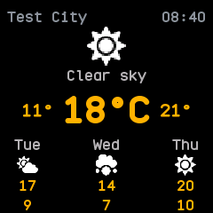
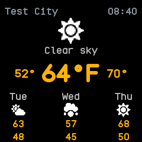
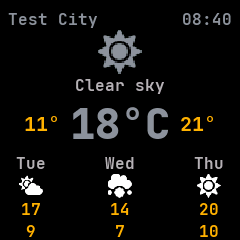
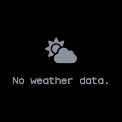

# Weather

The weather from the phone: the place, the sky, the temperature now and the day's low and high, with
a row of coming days when the phone sends them. Merged from InfiniTime's Weather and wasp-os's
weather app.

## Using it

- The phone sends the weather; the watch has no way to fetch it itself. Until it has, the app says
  **No weather data.**
- The top row shows the place and the time the watch received the weather. Below it are the sky's
  icon and condition, then the day's low, the temperature now and the high, each coloured blue at
  freezing, cyan when cold, amber when mild and orange-red when hot.
- The bottom row shows up to five coming days: the day, its sky, its high and its low. It stays
  empty when the phone sends no forecast.
- Temperatures are in Celsius, or in Fahrenheit if **Metric units** is off in
  [Settings](settings.md).
- Weather received more than three hours ago is dimmed, as it may no longer be true.
- There are no buttons; the side button goes back.

## Screens

Clear sky at 18°C, with the day's low and high and three coming days.

The same weather in Fahrenheit, with **Metric units** off.

Four hours later: the sky and the temperature now are dimmed, as they may be out of date.

Before the phone has sent any weather.

## With the companion app

When **Weather** is on in its Notifications settings, the companion app fetches the current
conditions and the day's low and high from Open-Meteo, for a place you choose or, on a phone, for
where the phone is. It sends them when the watch connects and every half hour after that. It sends
no coming days, so the forecast row stays empty.
