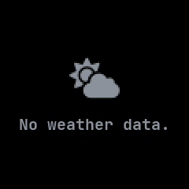

# Weather

The current weather and the coming days' forecast from the phone, merged from InfiniTime's Weather
and wasp-os's weather app.

## Using it

- The phone sends the weather through the NeoTime companion app; the watch has no way to fetch it
  itself.
- The top row shows the place and the time the weather was sent. Below it are the sky's icon and
  condition, then the day's low, the temperature now and the high, each coloured blue at freezing,
  cyan when cold, amber when mild and orange-red when hot.
- The bottom row shows up to five coming days: the day, its sky, its high and its low.
- Temperatures are in Celsius, or in Fahrenheit if the watch is set to imperial units in Settings.
- Weather sent more than three hours ago is dimmed, as it may no longer be true.
- There are no buttons; the side button goes back.

## Screens

The weather the phone sent 20 minutes ago, with a three-day forecast.

The same weather with imperial units chosen in Settings.

Four hours later, dimmed because it may be out of date.

Before the phone has sent any weather.
