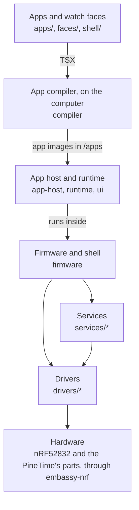

# Architecture

BattleTime is a Rust firmware for the PineTime, built on [Embassy](https://embassy.dev). Its apps and
watch faces are Preact components compiled on a computer into small bytecode images, which the
watch keeps in its external flash and runs one at a time. This page is the overview: the hardware,
the layers, the tasks and where the code lives, with a short section on each part that points to its
own page.

## Where to read next

- [Drivers](drivers.md): the screen, touch panel, button, motor, sensors, radio and flash.
- [Services](services.md): the flash store, settings, clock, logs, packages, updates and the
  phone's messages.
- [Firmware](firmware.md): start-up, the tasks, the shell, drawing, Bluetooth and crash handling.
- [App runtime](app-runtime.md) and [App reference](app-reference.md): how apps are written,
  stored and run, and what they can use.
- [The app compiler](compiler.md), [Testing apps](testing.md) and the [Simulator](simulator.md).
- [Bootloader](bootloader.md) and [Firmware updates](updates.md): starting, updating, recovery and
  moving a watch onto BattleTime.
- [Bluetooth controller](bluetooth.md), [Storage](storage.md), [Flash store](flash-store.md) and
  the [Memory map](memory-map.md).
- [Companion protocol](companion-protocol.md): how a phone talks to the watch.
- [Coding guidelines](coding-guidelines.md): how the code is written.
- The [wearer's guide](guide/index.md): what the watch does, from the wrist.

## The hardware

The PineTime is built around a Nordic nRF52832 chip: a 64 MHz Arm Cortex-M4F with 64 KB of RAM and
512 KB of flash. Around it are:

| Part | Chip | Connected by |
|---|---|---|
| Screen, 240x240 | Sitronix ST7789 | SPI |
| Touch panel | Hynitron CST816S | I2C |
| Accelerometer and step counter | Bosch BMA421 or BMA425 | I2C |
| Heart rate sensor | HRS3300 | I2C |
| External flash, 4 MB | XTX XT25F32B SPI NOR | SPI, shared with the screen |
| Vibration motor | | GPIO P0.16, on while low |
| Backlight | | GPIO P0.14, P0.22 and P0.23, each lit while low |
| Side button | | GPIO P0.13, high while held; powered by P0.15 |
| Battery, charging | | ADC on P0.31; power present on P0.19, charging on P0.12 |

[memory-map.md](memory-map.md) shows how the RAM and both flashes are divided.

## Layers



Each layer uses only the layers below it.

- **Drivers** speak to one part each through the `embedded-hal` traits and never touch the chip
  directly, so the same driver runs on the watch, in tests and in the simulator. The one exception
  is the Bluetooth controller, because the radio is inside the chip; it keeps all register access in
  one file behind a small trait. See [drivers.md](drivers.md).
- **Services** keep the watch's state and speak its protocols, with no hardware in them: the flash
  store, settings, the clock, the step and health logs, installed apps, updates, notifications and
  the phone's messages. See [services.md](services.md).
- **Firmware** is the program the watch runs. It holds the PineTime's wiring, starts the drivers
  and services, and spawns the tasks; its shell is the system loop that runs the face, the launcher
  and the apps, sleeps and wakes, and turns button, touch and motion into events. Bluetooth runs
  the [TrouBLE](https://github.com/embassy-rs/trouble) host on BattleTime's own controller. See
  [firmware.md](firmware.md).
- **App host, runtime and UI toolkit** run one open app: the runtime checks and interprets its
  bytecode, the host builds its widgets, sends it events and draws what changed, and the UI toolkit
  draws shapes and text into strips of the screen.
- **Apps and watch faces** are Preact and Signals source, compiled on the computer by the app
  compiler. None is built into the firmware except the notifications and quick settings screens.

Beside the layers sit the programs that run before the firmware (the bootloader and the
reloader, which share the flash layout in `battletime-boot`) and the ones that run on a computer (the
compiler, the simulator and the test harness).

## Tasks

The firmware runs on Embassy, so each long-running job is an `async` task on one executor, and the
chip sleeps whenever every task is waiting. The tasks are the shell, Bluetooth, storage, touch,
button, watchdog, motion, heart rate, battery and vibrator. Drivers expose `async` functions, so a
slow job, such as a vibration pattern, waits without blocking the others.
[firmware.md](firmware.md#tasks) lists what each does and how events flow to the shell.

## Repository layout

```text
BattleTime/
├── flake.nix           development shells, the simulator package and checks
├── README.md
├── companion/          the phone and desktop companion app; see companion/README.md
├── docs/               these pages, the wearer's guide in guide/ and a page per app in apps/
├── tools/              scripts that build, package, measure and check in the emulator
└── battletime/            the watch
    ├── Cargo.toml      one workspace for the watch's crates; the bootloader, its updater,
    │                   the firmware and the reloader build on their own
    ├── package.json    the npm workspace for apps/, faces/, shell/ and sdk/battletime
    ├── rust-toolchain.toml  the Rust version and the watch's target
    ├── app-host/       battletime-app-host: runs an open app and draws its widgets
    ├── apps/           the apps in the app language, one folder each; see apps.md
    ├── boot/           battletime-boot: the flash layout, image header, slot table, version record and migration plan
    ├── bootloader/     battletime-bootloader: the bootloader program, built only for the watch
    ├── bootloader-updater/  battletime-bootloader-updater: a firmware update that replaces the bootloader
    ├── compiler/       battletime-compiler: compiles apps, faces and the shared library; see compiler.md
    ├── drivers/
    │   ├── accelerometer/    battletime-accelerometer: the BMA421 or BMA425, steps, wake gestures and shakes
    │   ├── battery_reading/  battletime-battery-reading: one blocking battery reading for the programs before the firmware
    │   ├── bluetooth/        battletime-bluetooth: the Bluetooth LE controller for the chip's radio
    │   ├── button/           battletime-button: the side button
    │   ├── display/          battletime-display: the ST7789 screen and the backlight
    │   ├── external_flash/   battletime-external-flash: the 4 MB SPI NOR flash
    │   ├── heart_rate/       battletime-heart-rate: the HRS3300 and its pulse processing
    │   ├── status_screen/    battletime-status-screen: the status page's layout, and the bootloader's small ST7789 driver
    │   ├── touch/            battletime-touch: the CST816S touch panel and its gestures
    │   └── vibrator/         battletime-vibrator: the vibration motor
    ├── faces/          the watch faces in the app language, one folder each; see faces.md
    ├── firmware/       battletime-firmware: the firmware program, built only for the watch
    ├── harness/        battletime-app-testing: a test watch that runs apps on the real app host; see testing.md
    ├── reloader/       battletime-reloader: the one-time image that moves a watch over from InfiniTime or wasp-os
    ├── runtime/        battletime-runtime: app images, their checks, the interpreter and bindings
    ├── sdk/battletime/    the battletime package apps and faces import, and the browser preview
    ├── services/
    │   ├── battery/        battletime-battery: the charge and battery events from each reading
    │   ├── blefs/          battletime-blefs: Adafruit BLE file transfer, InfiniTime's file service
    │   ├── companion/      battletime-companion: the companion's JSON lines, advertising and standard services' content
    │   ├── crash_record/   battletime-crash-record: reset reasons, the crash record and the crash screen
    │   ├── current_time/   battletime-current-time: the wall clock and the Current Time service's values
    │   ├── dfu/            battletime-dfu: the legacy DFU update protocol
    │   ├── flash_store/    battletime-flash-store: files, records and logs in the external flash
    │   ├── foreground/     battletime-foreground: whether background work should wait for a pause
    │   ├── liveness/       battletime-liveness: whether the shell and the radio still make progress
    │   ├── notifications/  battletime-notifications: the latest notifications from the phone and apps
    │   ├── packages/       battletime-packages: the apps installed in /apps, their checks and the launcher's order
    │   ├── phone_client/   battletime-phone-client: the GATT client for the phone's own services
    │   ├── settings/       battletime-settings: the watch-wide settings, their limits and their file
    │   ├── slot_log/       battletime-slot-log: days of six-minute slots in blocks programmed in place, for the step, heart rate and battery logs
    │   ├── steps/          battletime-steps: the step history by hour, the trip count and the step log
    │   ├── task_table/     battletime-task-table: the firmware's tasks with their runs and busy time
    │   └── updates/        battletime-updates: stores an uploaded firmware and hands it to the bootloader
    ├── shell/          the notifications and quick settings, built into the firmware
    ├── simulator/      battletime-simulator: the drivers and the app host in a desktop window
    ├── site/           the website's MkDocs config, front page and colours
    ├── tests/
    │   ├── emulator/   Robot Framework suites run against the PineTime emulator
    │   ├── scripts/    app scripts the harness runs end to end
    │   └── tours/      a tour per app that snapshots each of its screens
    ├── third_party/
    │   ├── trouble-host/         TrouBLE with its GATT table in flash, full 128-bit UUIDs in discovery, and raw ATT for a small client
    │   ├── trouble-host-macros/  TrouBLE's GATT macros, building the attribute table in a constant
    │   └── font-awesome/, material-icons/, infinitime/  artwork the compiler draws the library's icons from
    └── ui/             battletime-ui: renderer, shapes and strips that draw on the screen
```

Each driver, service, the runtime, the app host and the UI crate is a `no_std` crate with its code
in `src/lib.rs` and its tests beside it (`src/tests.rs` or `src/<module>_tests.rs`). The compiler,
the simulator and the harness are `std` crates, members of the workspace but not default members,
so a build for the watch leaves them out.

## Drivers (`drivers`)

One crate per part: the display and backlight, the touch panel and its gestures, the button, the
vibrator, the accelerometer with its step counter and motion detectors, the heart rate sensor, the
Bluetooth controller, the external flash, a blocking battery reading and the status page. See
[drivers.md](drivers.md).

## Services (`services`)

The flash store and the slot logs; the settings and the clock; the companion's messages, the
phone's own services and the notifications; steps and battery; the package manager, updates, DFU
and file transfer; and the crash record, liveness, foreground and task table that keep the watch
healthy. See [services.md](services.md).

## Firmware (`firmware`)

The firmware starts everything, runs the tasks, and holds the shell: navigation and the way back,
the side button, transitions, screen power, closed apps, sensors, drawing by DMA, storage,
Bluetooth, the watchdog and crash handling. See [firmware.md](firmware.md).

## App runtime (`runtime`)

`battletime-runtime` is the core of the app runtime, with no hardware and no dependencies, so it is
tested entirely on the computer. [app-runtime.md](app-runtime.md) gives the full design and the
byte-level format.

- **Images.** `AppImage::parse` reads an app image where it lies and checks its header, CRC,
  sections, strings and state variables.
- **Checks.** `verify` makes one pass over every expression and handler. Ordinary jumps only go
  forward, and a loop must start and end with an empty stack, so that one pass proves the stack
  never underflows or overflows.
- **Interpreter.** `Interpreter` runs an expression to get a widget's value, or a handler to answer
  an event. A handler's changes are applied only when it finishes, and its effects are returned,
  so a failure part way changes nothing. Loops stop after 200,000 steps.
- **Widgets.** `WidgetTree` reads an app's widgets in place: its screens, each widget's children,
  and each property as a constant, an expression or a handler.
- **Bindings.** `Bindings` works out from the code what each expression reads and how often the
  clock changes it, so the host redraws only what changed and sleeps otherwise.
- **State.** `AppState` packs an app's variables and arrays into 2 KB, each array element in as few
  bytes as the image asks.
- **Theming.** A colour is a fixed RGB565 value or a reference to one of the theme's eight named
  colours, looked up only when drawn, so changing the theme is one redraw.
- **Events and patterns.** `events` fixes which fields each event carries and in what order, for
  the compiler and the runtime alike. Times and durations are written with patterns such as
  `dddd D MMMM`, checked at install.
- **Memory need.** `memory_need` works out from an image how much heap the app needs, which the
  package manager and the shell check against the budget.
- **Writer.** With the `writer` feature, `ImageWriter` and `CodeWriter` write images and assemble
  bytecode with labels, for the compiler and tests. `share_repeated_code` turns code that repeats
  with only its constants changed into calls to one function.

It never panics on bad input. Its working memory is sized to the open app's image: the interpreter
is 1,156 B on the watch plus scratch room as large as the app's variables (at most 1 KB), the
bindings 16 B for each expression (at most 128), and the state the variables' bytes (at most 2 KB)
plus 6 B for each variable's place.

## UI toolkit (`ui`)

`battletime-ui` is the drawing layer every widget goes through. `geometry` holds `Rect`, `PointF` and
`Color`; `renderer` holds the `Renderer` trait widgets draw through, the `FontMetrics` trait fonts
implement, and `ClipRenderer`, which drops every pixel outside a rectangle; `raster` works out how
much of each pixel a disc, a line or part of a ring covers, a row at a time and only inside the
clip, visiting in each row only the columns between the shape's edges (and, for a ring, outside its
hole) with a pixel to spare; and `shapes` builds rounded boxes and borders with soft corners from plain fills. The
rasterizers and shapes follow [rlvgl](https://github.com/softoboros/rlvgl)'s (MIT licensed).

- **Strips instead of a screen buffer.** A full 240x240 picture takes 115 KB, more than the watch's
  64 KB of RAM. A `Strip` holds a few rows of the screen in a small buffer and is a `DrawTarget`
  itself, so a part of the screen is drawn there, background first and widgets on top, and sent to
  the display in one go. The panel never shows a half-drawn widget, and each pixel crosses the bus
  once.
- **Drawing into a strip.** The app host draws each widget through a `StripRenderer`, which writes
  straight into the strip's pixels, clipped to the widget and faded by its opacity. A partly
  transparent colour, such as the soft edge of a letter, is mixed with the pixel really underneath,
  so text on a coloured button has clean edges; shares out of 255 are divided by shifts and rounded
  to the nearest step. Every call works on whole runs of a row, and
  `visible_area` tells widgets which rows and columns the strip holds, so glyphs, images, circles,
  lines and arcs skip the rest; a sideways wipe paints 16-column strips, and a glyph or image works
  out only the columns inside one.
- **Drawing on a screen.** `ScreenRenderer` wraps any `embedded-graphics` `DrawTarget` for `Rgb565`,
  such as the display driver's `Display`. It cannot read a screen back, so it mixes a partly
  transparent colour with a set background colour (`with_background_color`, black by default).
  Its `draw_text` uses an `embedded-graphics` mono font, 10x20 by default (`with_font`). Drawing
  calls cannot fail, so the first error from the screen is kept and returned by `finish`.
- **Hardware scrolling.** `ScrollingScreen` is a screen whose panel can move a band of rows by
  itself, as the ST7789 does; `Display` implements it. A `ScrollBand` names the rows that move, and
  `scroll_by` turns them round like a ring, while drawing still takes screen positions. A new band
  can only be set while the ring is unturned, or the picture must be drawn again, because the
  panel's memory stays where it was. `FixedScreen` wraps any other `DrawTarget`, such as a picture in
  memory, as a screen that cannot scroll.

## App host (`app-host`)

`battletime-app-host` runs one open app. It ties the runtime to the UI toolkit and to whatever embeds
it: the firmware's shell on the watch, or the simulator and the test harness on a computer. It is
`no_std` with `alloc`, for the open app's nodes and state. [app-runtime.md](app-runtime.md#the-app-host)
describes its calls, the layout rules and what each property value means.

- **Opening.** `AppHost::open` checks the image, sets up the state and bindings, and builds the
  first screen: one node per widget whose parents are all visible, each drawn from its values by a
  function of the host (`drawing.rs`, and `widgets.rs` for arcs, bars, LEDs, switches and sliders),
  laid out by a small flexbox. Showing or hiding a widget builds or frees the nodes inside it.
- **Events.** A touch goes to the topmost widget under it that has a handler for it. The handler's
  effects go to the embedder through the `System` trait, except `go` and `back`, which the host
  carries out itself. A swipe goes only to the screen's `onSwipe`; one the handler ignores is left
  to the embedder. `go_back_a_screen`, which the side button calls, returns to the previous screen,
  and is left to the embedder on the first one.
- **Redrawing.** Only the expressions a change affects are worked out again, and only the widgets
  whose value, place or visibility changed are drawn again: where each was and where it is now.
  `draw_step` paints each such region a strip at a time through a buffer the caller lends it
  (`STRIP_PIXELS`, four rows), from the background up. Each step paints at most
  `PAINT_STEP_PIXELS` (48 full rows, about 23 ms over the bus) and keeps the rest for the steps
  that follow, so the watch's other tasks run between slices.
- **Scrolling.** A drag on a Scroll or List moves its content with the finger, and only a lift ends
  it. A drag lifted at 300 px/s or more, by the `Fling` before the lift, glides on: `tick` moves the
  list every 20 ms, its speed falling by about two thirds each 325 ms, until it slows under
  40 px/s or reaches an end, and only then is `onScrollEnd` sent. A finger landing stops a glide
  where it is. A list set to scroll by pages settles on a whole page instead. A scroll moves the
  list's content by the rows it scrolled rather than laying the screen out again, unless a list
  nested inside it clips its own content or the screen shows a text file. On a
  `ScrollingScreen` the panel moves the list's rows, and the host draws only the rows coming into
  view and the edges the move put out of place; it falls back to drawing the list again when
  anything else crosses those rows, the move is more than half the band, or the panel has another
  band turned.
- **Transitions.** A whole new screen comes in by a `Transition`, drawn a step per `draw_step`
  call. `Up` and `Down` slide the new screen in over the old one by turning the whole screen's
  band, as InfiniTime does; `Left` and `Right` wipe it in. `go` wipes from the right, `back` from
  the left. `draw_step_at` paces a transition by the clock, so it takes
  `TRANSITION_TIME_IN_MILLISECONDS` (250 ms) however long other work held up its steps.
- **Time and subscriptions.** `tick` runs due timers and redraws what the clock changed, and
  `next_wakeup` says when that next happens, so the watch can sleep in between. `deliver` hands
  sensor and phone events to the app's subscriptions; `listens_for` and `shortest_period_of` say
  which the running subscriptions wait for, so the embedder only watches for those.
  `open_in_background` and `closed_apps` let a closed app's subscriptions run.
- **Saved state.** `save_changed_state` writes the persistent variables when they change, and
  `open_with_saved_state` puts them back.
- **Files.** `folder::FolderListing` is the folder an app opened with `open_folder`, up to 64
  entries, folders first and then by name. A `TextFile` reads its file a chunk at a time through
  `SystemValues::read_file`, wraps it once and holds only the lines near the view, so a long note
  costs about the same RAM as a short one. A `BitmapFile` reads a picture from a file.
- **Fonts.** Every text size is one font drawn from lines, arcs and dots: 192 glyphs, printable
  ASCII, the Latin-1 letters and signs, curly quotes, dashes, the ellipsis, bullet and euro sign.
  `tools/generate_fonts.py` makes it from `app-host/fonts/geometric.txt`, and it lives in the
  shared library; `fonts::install_from_library` takes it from there, so the firmware carries none
  of its own. Each size puts the glyph's straight strokes and arc edges on whole pixels. Each strip
  a glyph crosses draws it again, so the last glyph placed is kept (about 400 B of RAM) and reused
  while the same glyph is drawn from the same pen position. The dot-matrix font is worked out from
  its dots as it is drawn, each pixel's ink from its distance to the nearest dot's centre. See
  [app-runtime.md](app-runtime.md#property-values).
- **Rules for the shell.** `swipes`, `side_button`, `way_back`, `quick_apps`, `wake`, `haptics`,
  `motion`, `phone` and `settings` hold the system's rules, so the firmware's shell follows them and
  they are tested on the computer; [firmware.md](firmware.md#the-shell) describes them.
- **Theme and failures.** `set_theme` redraws every colour from the values already held, without
  running app code. A failing handler or expression is reported through `System::app_failed`, and
  the app stays open with its state unchanged.
- **Demo.** With the `demo` feature, `demo::stopwatch_image` builds a stopwatch image with the
  runtime's writer, for the simulator and tests without the compiler.

On the watch, `AppHost` keeps its state, interpreter and bindings on the UI heap, about 1.2 KB
plus what the image's expressions and variables take. The interpreter is boxed from a constant and
the rest are slices of the image's size, never built on the stack, so opening an app needs under
1 KB of stack; each widget of the open screen takes 128 B more plus its text. See
[memory-map.md](memory-map.md#how-much-heap-an-app-needs).

## App compiler (`compiler`)

`battletime-compiler` turns an app or watch face, written as Preact components with signals, into an
app image, and builds the shared library. It is a `std` library and command, never built for the
watch. [oxc](https://oxc.rs) reads the TSX; constants are worked out while compiling, each screen's
component is run once into a fixed widget tree, changing properties become expressions and event
functions handlers, and signals become state variables with the narrowest element width their
values fit. Every image is parsed and verified with the runtime's own checks before it is written.
[compiler.md](compiler.md) describes the language it accepts.

## Apps and watch faces (`apps`, `faces`, `shell`, `sdk`)

Apps and watch faces are Preact and Signals source, written to [app-reference.md](app-reference.md)
and kept as npm packages: `apps/`, `faces/` and `shell/`. The first ones are ports of InfiniTime's
and wasp-os's, merged where both firmwares have the same one, and of PinetimeLite's watch faces.
[apps.md](apps.md) and [faces.md](faces.md) list each, with a page per app in `docs/apps/`.

- **One folder each,** named by its id: an app's source is `apps/<id>/app.tsx` and a face's is
  `faces/<id>/face.tsx`.
- **On the watch.** `tools/build_store.py` compiles each into `dist/store/`, and the companion app
  installs it in `/apps/<id>/` over Bluetooth ([app-store.md](app-store.md)). Only `shell/`'s
  notifications and quick settings are compiled into the firmware.
- **`sdk/battletime`** is the `battletime` package both import: its widgets, components, icons and
  shared functions, which the compiler turns into the image's parts, and a browser stand-in for the
  watch, so apps type-check and preview in a browser.
- **Tests.** Behaviour is tested in `harness/` on the real app host, with a tour per app in
  `tests/tours/` that snapshots each screen ([testing.md](testing.md)). `npm run check` runs
  TypeScript over everything.

## Simulator (`simulator`)

`battletime-simulator` runs the drivers on a desktop in a 240x240 window, against a model of the
ST7789 and a motor pin. With `--app` or `--demo` it runs an app image through `battletime-app-host`,
with the computer's clock and a stand-in system. It is a `std` program, never built for the watch.
See [simulator.md](simulator.md).

## Reloader (`reloader`)

`battletime-reloader` moves a watch from InfiniTime or wasp-os onto BattleTime. It is an app for the old
system, sent through that system's own update path, which stages the firmware and the small
recovery firmware in the external flash, writes BattleTime's bootloader over the first pages of
internal flash, and marks the swap. The order, from `battletime_boot::migration`, keeps to about a
quarter of a second the time in which a power cut would leave the watch unable to start. Two
builds, `from-wasp-os` and `from-infinitime`, link where each old system starts apps; the first has
moved a real watch, the second has run only in the emulator. See [updates.md](updates.md).

## Bootloader (`bootloader` and `boot`)

The bootloader is built on [embassy-boot](https://embassy.dev). It swaps in a waiting firmware
update from external flash, rolls back a new firmware that never marked itself booted, and installs
the recovery firmware or the previous one from a menu the side button opens and drives. While it
works it shows the status page, with the battery, and it leaves the firmware a note in RAM. It never
starts a firmware whose image header is missing or damaged. It fills about 18.6 KB of its 20 KB.
`battletime-bootloader-updater` is a firmware update that replaces the bootloader, and writes it only
with power present and enough charge.

`battletime-boot` holds the flash layout: in internal flash the bootloader, the slot table, its state
page, the running firmware and the shared library apps draw on; in external flash the default
update and recovery slots and the file system. It also holds the 256-byte image header every
firmware image starts with (`image_header`), the slot table log that says where the external slots
sit (`slot_table`), the version record and the migration plan. Every program builds on it, so every
side agrees. See [bootloader.md](bootloader.md).

## Building and testing

`flake.nix` at the top of the repository holds everything needed. `nix develop` opens a shell with
the Rust toolchain from `battletime/rust-toolchain.toml`, which includes the watch's
`thumbv7em-none-eabihf` target, SDL2 for the simulator, and probe-rs. Run cargo and npm from inside
`battletime/`.

Every crate is tested on the computer, the drivers against fake hardware and the services against
the flash store in RAM. Test the crate you changed, such as `cargo test -p battletime-settings`; CI
runs the whole workspace, clippy, formatting, coverage, the memory measurements and the emulator
suites. To check that the `no_std` crates build for the watch:

```sh
cargo build --release --target thumbv7em-none-eabihf
```

The bootloader, the firmware and the reloader are outside the workspace and build only for the
watch, each from its own folder (`cd firmware && cargo build --release`). `tools/build_images.sh`
builds all of them and packs the update zips into `dist/`, and `tools/build_store.py` compiles every
app, face and plugin into `dist/store/` for the companion's store. `nix flake check` runs the tests,
the watch build, clippy and two headless simulator screenshots in a clean sandbox. The emulator
suites in `tests/emulator/` and the `tools/check_*.py` scripts run whole firmware images in the
PineTime emulator; see [testing.md](testing.md#the-emulator). [updates.md](updates.md) says how to
put the images on a watch.

## Website

The GitHub Pages site at <https://beatlink.github.io/BattleTime/> is built with MkDocs Material from
`battletime/site/`: `site/home.md` is the front page, the README is the About page, and these docs
follow, with a page for each app from `docs/apps`. `tools/build_site.sh` builds it into
`battletime/target/site/out`, and `.github/workflows/pages.yml` builds it on every pull request and
publishes it from `master`. Every page in `docs/` must be in the nav in `site/mkdocs.yml`, while the
build adds each app's page to the Apps tab itself. Mermaid diagrams in ```` ```mermaid ```` fences
are drawn on the site. The build is strict, so a broken link or a renamed screenshot fails it.
