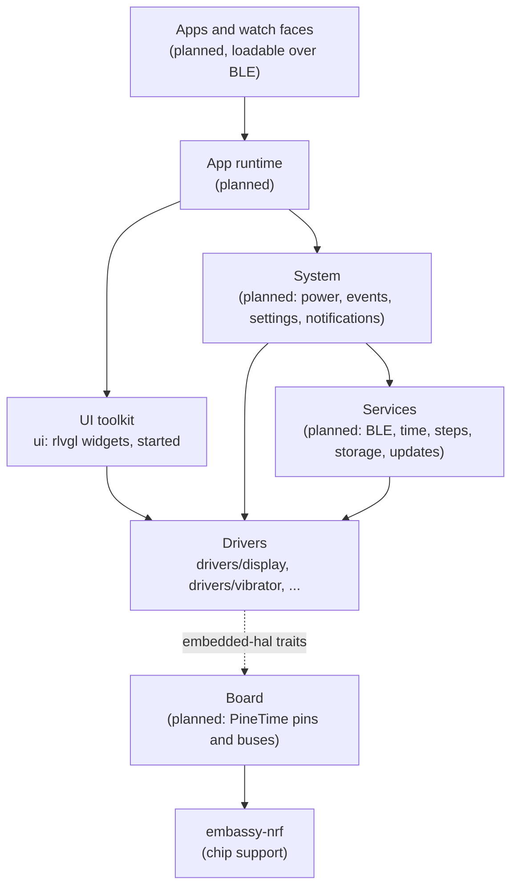

# Architecture

NeoTime is a Rust firmware for the PineTime. This page shows how the code is laid out, what each
part does and how the parts fit together. Parts marked **planned** do not exist yet. Their shape
may change as they are built.

## The hardware

The PineTime is built around a Nordic nRF52832 chip: a 64 MHz Arm Cortex-M4F with 64 KB of RAM and
512 KB of flash. Around it are:

| Part | Chip | Connected by |
|---|---|---|
| Screen, 240x240 | Sitronix ST7789 | SPI |
| Touch panel | Hynitron CST816S | I2C |
| Accelerometer and step counter | Bosch BMA421 or BMA425 | I2C |
| Heart rate sensor | HRS3300 | I2C |
| External flash, 4 MB | SPI NOR | SPI, shared with the screen |
| Vibration motor | | GPIO P0.16, on while low |
| Backlight | | Three GPIO pins |
| Button, battery, charging | | GPIO and ADC |

## Layers



Each layer uses only the layers below it.

- **Drivers** speak to one part each through the `embedded-hal` traits and never touch the chip
  directly. That lets the same driver run on the watch, in tests and in a desktop simulator.
- **Board** is the one place that knows the PineTime's wiring. It sets up the chip's SPI, I2C and
  pins with `embassy-nrf`, then hands them to the drivers. **(planned)**
- **Services** keep the watch's state: the BLE link and the GATT services companion apps use, the
  clock, the step count, files on the external flash, and firmware updates. **(planned)**
- **System** runs the watch: it sleeps and wakes, turns button, touch and motion into events, and
  holds settings and notifications. **(planned)**
- **UI toolkit** gives apps widgets, fonts and page transitions. Widgets come from
  [rlvgl](https://github.com/softoboros/rlvgl), a pure Rust rewrite of LVGL, and are drawn through
  `embedded-graphics` onto the display driver. **(started: drawing works, nothing else yet)**
- **App runtime** loads apps installed over BLE, starts and stops them, and passes them events.
  **(planned)**

## Tasks

The firmware runs on [Embassy](https://embassy.dev), so each long-running job is an `async` task,
and the chip sleeps whenever every task is waiting. The expected tasks are the BLE stack, the
system loop and the screen. Drivers expose `async` functions so that a slow job, such as a
vibration pattern, waits without blocking the others. **(planned)**

## Repository layout

```text
NeoTime/
├── Cargo.toml        one Cargo workspace for every crate
├── rustfmt.toml      formatting rules
├── docs/
│   ├── architecture.md
│   └── coding-guidelines.md
├── drivers/
│   ├── display/      neotime-display: the ST7789 screen
│   └── vibrator/     neotime-vibrator: the vibration motor
└── ui/               neotime-ui: draws rlvgl widgets on the screen
```

Each driver, and the UI crate, is a `no_std` crate with its code in `src/lib.rs` and its tests in `src/tests.rs`. See
[coding-guidelines.md](coding-guidelines.md) for how the code is written.

## Drivers

### Display (`drivers/display`)

`neotime-display` drives the ST7789 screen. It builds on
[`mipidsi`](https://crates.io/crates/mipidsi), which sends the panel's commands, and adds what the
PineTime needs on top:

- **Hardware vertical scrolling.** `scroll(offset)` moves the picture with the panel's own scroll,
  which costs one short command instead of a redraw. `set_scroll_area(top, bottom)` keeps fixed
  areas, such as a status bar, still.
- **Drawing follows the scroll.** The ST7789 holds 320 rows of memory but shows only 240. After a
  scroll, drawing at a screen row lands on whichever memory row is on screen there, and a drawing
  that crosses the end of memory is split in two.
- **embedded-graphics.** `Display` is a `DrawTarget` for `Rgb565`, so any `embedded-graphics`
  shape, text or image draws on it.
- **Power.** `sleep` and `wake` turn the panel off and on and keep its memory.

The board passes in the SPI interface, the reset pin and a delay. The scrolling is what page
slides will be built on: draw the next page into memory that is off screen, then scroll it in.

### Vibrator (`drivers/vibrator`)

`neotime-vibrator` drives the vibration motor:

- **Two kinds of wiring.** `OnOffMotor` uses a plain pin, which is either on or off. `PwmMotor` uses
  a PWM channel, so it can buzz at any `Strength` from 0 to 100 percent.
- **Patterns.** A pattern is a list of `Step`s, each a strength and a duration. `TAP` is one short
  buzz, and `RING` is one second of ringing that is played again to keep ringing.
- **Async and safe to cancel.** `vibrate` and `play` wait with an async delay, so other tasks keep
  running. If a pattern is cancelled part way, the motor is turned off.

## UI toolkit (`ui`)

`neotime-ui` lets [rlvgl](https://github.com/softoboros/rlvgl) widgets draw on the watch.
`ScreenRenderer` wraps any `embedded-graphics` `DrawTarget` for `Rgb565`, such as the display
driver's `Display`, and carries out rlvgl's drawing calls on it:

- **No screen buffer.** A full 240x240 picture takes 115 KB, more than the watch's 64 KB of RAM, so
  each rectangle, text run and image row goes straight to the display.
- **See-through colours.** The display cannot be read back, so a partly transparent colour, such as
  the soft edge of a letter, is mixed with a set background colour (`with_background_color`, black
  by default). Fully transparent pixels are skipped, so what is underneath stays.
- **Plain text.** `draw_text` uses an `embedded-graphics` mono font, 10x20 by default
  (`with_font`). Widgets that use rlvgl's own fonts draw through its anti-aliased glyph path.
- **Errors.** rlvgl's drawing calls cannot fail, so the first error from the screen is kept and
  returned by `finish`.
- **Scrolling.** Drawing goes through the display driver, so it follows the hardware scroll.

rlvgl needs a heap (`alloc`), which the firmware will have to provide. Still to do: sizing that heap,
touch input, page slides on the hardware scroll, and a desktop simulator.

## Building and testing

The drivers are tested on the computer against fake hardware:

```sh
cargo test
```

To check that they build for the watch:

```sh
rustup target add thumbv7em-none-eabihf
cargo build --release --target thumbv7em-none-eabihf
```

There is no firmware image to flash yet. That arrives with the board layer.
