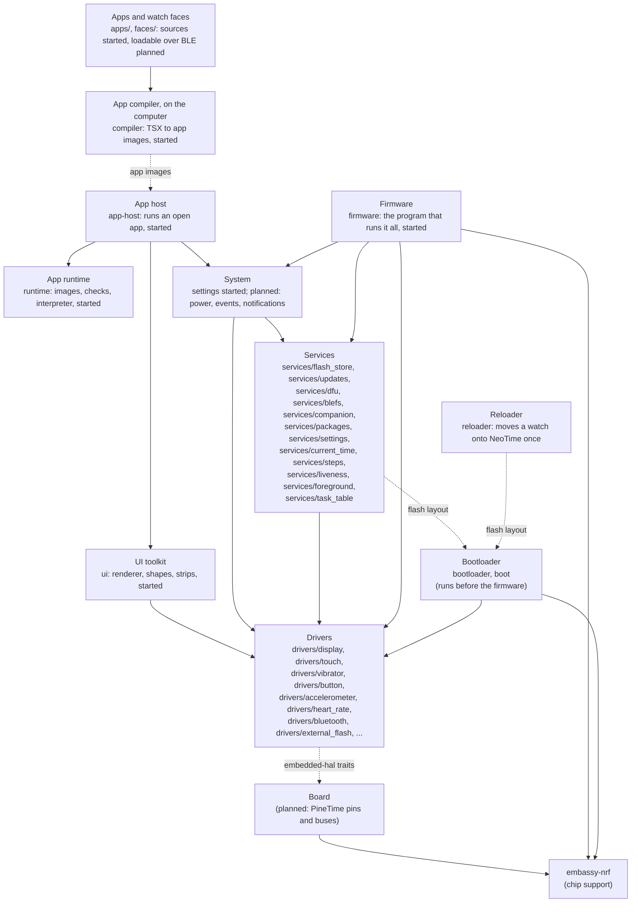

# Architecture

NeoTime is a Rust firmware for the PineTime. This page shows how the code is laid out, what each
part does and how the parts fit together. Parts marked **planned** do not exist yet. Their shape
may change as they are built.

## The hardware

The PineTime is built around a Nordic nRF52832 chip: a 64 MHz Arm Cortex-M4F with 64 KB of RAM and
512 KB of flash. Around it are:

| Part | Chip | Connected by |
|---|---|---|
| Screen, 240x240 | Sitronix ST7789 | SPI |
| Touch panel | Hynitron CST816S | I2C |
| Accelerometer and step counter | Bosch BMA421 or BMA425 | I2C |
| Heart rate sensor | HRS3300 | I2C |
| External flash, 4 MB | XTX XT25F32B SPI NOR | SPI, shared with the screen |
| Vibration motor | | GPIO P0.16, on while low |
| Backlight | | GPIO P0.14, P0.22 and P0.23, each lit while low |
| Side button | | GPIO P0.13, high while held; powered by P0.15 |
| Battery, charging | | GPIO and ADC |

[memory-map.md](memory-map.md) shows how the RAM and both flashes are divided.

## Layers



Each layer uses only the layers below it.

- **Drivers** speak to one part each through the `embedded-hal` traits and never touch the chip
  directly. That lets the same driver run on the watch, in tests and in a desktop simulator. The
  one exception is the Bluetooth controller, because the radio is inside the chip; it keeps all
  register access in one file behind a small trait.
- **Board** is the one place that knows the PineTime's wiring. It sets up the chip's SPI, I2C and
  pins with `embassy-nrf`, then hands them to the drivers. **(planned)**
- **Services** keep the watch's state: the BLE link and the GATT services companion apps use, the
  clock, the step count, files on the external flash, and firmware updates. The BLE link runs
  the [TrouBLE](https://github.com/embassy-rs/trouble) host on NeoTime's own controller in
  `drivers/bluetooth`. **(started: files on the external flash, and the on-watch half of firmware
  updates)**
- **System** runs the watch: it sleeps and wakes, turns button, touch and motion into events, and
  holds settings and notifications. **(started: the watch-wide settings, in `services/settings` and
  the firmware's `settings.rs`)**
- **UI toolkit** gives apps widgets, fonts and page transitions. Its own renderer, soft-edged
  shapes and strips draw through `embedded-graphics` onto the display driver. **(started: drawing works, nothing else yet)**
- **App runtime** loads apps installed over BLE, starts and stops them, and passes them events.
  Apps are written as Preact components with signals and compiled on the computer into images
  that a small bytecode interpreter runs; see [app-runtime.md](app-runtime.md). **(started: the
  image format, its checks, the interpreter and the bindings work)**
- **App host** runs one open app on top of the runtime: it builds the screen's widgets, sends
  touches to handlers, hands effects to the system and redraws what changed. **(started: runs apps
  in the simulator; not yet on the watch)**
- **App compiler** runs on the computer, not the watch. It turns an app's source into an image
  and checks it with the runtime's own checks. **(started)**
- **Firmware** is the program the watch runs: it starts the drivers and services on Embassy and
  spawns the tasks. For now it does what an update needs: watchdog, screen, file system, Bluetooth
  with the DFU service. It stands in for the board layer until there is more than one board.
  **(started)**
- **Bootloader** is a separate program that runs before the firmware. It installs updates and the
  recovery firmware, then starts the firmware. The firmware shares its flash layout through the
  `neotime-boot` crate. See [Bootloader](#bootloader-bootloader-and-boot).

## Tasks

The firmware runs on [Embassy](https://embassy.dev), so each long-running job is an `async` task,
and the chip sleeps whenever every task is waiting. The expected tasks are the BLE stack, the
system loop and the screen. Drivers expose `async` functions so that a slow job, such as a
vibration pattern, waits without blocking the others. **(planned)**

## Repository layout

```text
NeoTime/
├── Cargo.toml        one Cargo workspace for every crate except the bootloader
├── package.json      the npm workspace for apps/, faces/, shell/ and sdk/neotime
├── app-host/         neotime-app-host: runs an open app and draws its widgets
├── apps/             neotime-apps: apps in the app language, one folder each; see apps.md
├── compiler/         neotime-compiler: compiles apps and faces into app images; see compiler.md
├── rustfmt.toml      formatting rules
├── flake.nix       development shell, simulator package and checks
├── rust-toolchain.toml  the Rust version and the watch's target
├── boot/             neotime-boot: the flash layout, image header, slot table and migration plan, shared by every program
├── bootloader/       neotime-bootloader: the bootloader program, built only for the watch
├── bootloader-updater/  neotime-bootloader-updater: a firmware update that replaces the bootloader
├── firmware/         neotime-firmware: the firmware program, built only for the watch
├── docs/
│   ├── app-reference.md the events, widgets and effects apps can use
│   ├── app-runtime.md the proposed app format and runtime
│   ├── apps.md       the apps ported from InfiniTime and wasp-os, with a screenshot of each
│   ├── architecture.md
│   ├── bluetooth.md  the Bluetooth controller
│   ├── bootloader.md
│   ├── coding-guidelines.md
│   ├── companion-protocol.md how a phone talks to the watch: services, JSON lines, files
│   ├── compiler.md   the app compiler: the language subset, types and number mappings
│   ├── faces.md      the watch faces ported from InfiniTime, wasp-os and PinetimeLite
│   ├── features.md   what the watch can do, added as each feature is finished
│   ├── memory-map.md how RAM and both flashes are divided
│   ├── memory-treemap.html the same as a zoomable treemap, for the website
│   ├── simulator.md
│   ├── storage.md
│   ├── todo.md       work not done yet
│   ├── updates.md    firmware updates over Bluetooth and moving a watch onto NeoTime
│   └── images/       pictures for the docs
├── drivers/
│   ├── accelerometer/  neotime-accelerometer: the BMA421 or BMA425 and its step counter
│   ├── battery_reading/  neotime-battery-reading: one blocking battery reading for the bootloader, its updater and the reloader
│   ├── bluetooth/    neotime-bluetooth: the Bluetooth LE controller for the chip's radio
│   ├── button/       neotime-button: the side button
│   ├── display/      neotime-display: the ST7789 screen
│   ├── status_screen/  neotime-status-screen: the status page's layout, and the bootloader's small ST7789 driver
│   ├── external_flash/  neotime-external-flash: the 4 MB SPI NOR flash
│   ├── heart_rate/   neotime-heart-rate: the HRS3300 heart rate sensor and its pulse processing
│   ├── touch/        neotime-touch: the CST816S touch panel
│   └── vibrator/     neotime-vibrator: the vibration motor
├── faces/            neotime-faces: watch faces in the app language, one folder each; see faces.md
├── reloader/         neotime-reloader: the one-time image that moves a watch over from InfiniTime or wasp-os
├── runtime/          neotime-runtime: app images, their checks, the interpreter and bindings
├── sdk/
│   └── neotime/      the neotime package apps and faces import, as a stand-in for now
├── shell/            the notifications and quick settings, in the app language, built into the firmware; see apps.md
├── services/
│   ├── blefs/        neotime-blefs: Adafruit BLE file transfer, InfiniTime's file service
│   ├── companion/    neotime-companion: the companion app's JSON lines over the UART service
│   ├── crash_record/ neotime-crash-record: reset reasons in words, the crash record kept across a reset, and the crash screen
│   ├── current_time/ neotime-current-time: the Current Time service's values and calendar arithmetic
│   ├── dfu/          neotime-dfu: the legacy DFU update protocol over Bluetooth
│   ├── flash_store/  neotime-flash-store: the watch's files, records and logs in the external flash
│   ├── foreground/   neotime-foreground: whether the wearer watches the screen move, for background work to wait on
│   ├── liveness/     neotime-liveness: whether the shell and the radio still make progress, for the watchdog
│   ├── packages/     neotime-packages: the apps installed in /apps and the shared library's install
│   ├── settings/     neotime-settings: the watch-wide settings, their limits and their file
│   ├── steps/        neotime-steps: the step history by hour, the trip count and the daily step log
│   ├── task_table/   neotime-task-table: the firmware's tasks with their runs and busy time, for the system app
│   └── updates/      neotime-updates: stores an uploaded firmware and hands it to the bootloader
├── simulator/        neotime-simulator: the drivers in a desktop window
├── site/             the GitHub Pages site: its MkDocs config, front page and colours
├── third_party/
│   ├── trouble-host/   TrouBLE with its GATT table in flash and discovery that never cuts a 128-bit UUID short
│   └── trouble-host-macros/  TrouBLE's GATT macros, building the attribute table in a constant
├── tools/            scripts: drawing the memory maps, packaging images, building every image
└── ui/               neotime-ui: renderer, shapes and strips that draw on the screen
```

Each driver, the runtime, the app host and the UI crate is a `no_std` crate with its code in
`src/lib.rs` and its tests in `src/tests.rs`. The compiler is a `std` crate, with its tests in
`src/tests.rs` and `tests/`. See
[coding-guidelines.md](coding-guidelines.md) for how the code is written.

## Drivers

### Display (`drivers/display`)

`neotime-display` drives the ST7789 screen with its own start-up, window, scroll and power
commands. It reaches the panel through `PanelInterface`: commands, and pixels as bytes in the
panel's order, high byte first. `MipidsiInterface` adapts any
[`mipidsi`](https://crates.io/crates/mipidsi) interface, such as its `SpiInterface`, which the
reloaders use. On top it adds what the PineTime needs:

- **Strips sent in the background.** `send_strip` points the panel at a rectangle, split where
  memory wraps, and hands the interface panel pixels to send there, which it may still be doing
  after it returns, such as by DMA; the caller leaves them untouched until the next call.
  `neotime-ui`'s `BufferedScreen` pairs a display with two strip buffers and alternates them.
- **Hardware vertical scrolling.** `scroll(offset)` moves the picture with the panel's own scroll,
  which costs one short command instead of a redraw. `set_scroll_area(top, bottom)` keeps fixed
  areas, such as a status bar, still.
- **Drawing follows the scroll.** The ST7789 holds 320 rows of memory but shows only 240. After a
  scroll, drawing at a screen row lands on whichever memory row is on screen there, and a drawing
  that crosses the end of memory is split in two.
- **embedded-graphics.** `Display` is a `DrawTarget` for `Rgb565`, so any `embedded-graphics`
  shape, text or image draws on it.
- **Power.** `sleep` and `wake` turn the panel off and on and keep its memory.
- **Low-power mode.** `enter_low_power_mode` switches the panel to its idle mode, as InfiniTime
  does for an always-on screen: only 8 colours, the top bit of each channel, refreshed at a quarter
  of the rate. Memory keeps every colour, so `leave_low_power_mode` shows the screen as drawn, and
  drawing works the same in either mode.
- **Backlight.** `Backlight` drives the three backlight pins, P0.14, P0.22 and P0.23, which each
  light while low. `BacklightLevel` is `Off`, `Low`, `Medium` or `High`, and each level lights one
  more pin; `brighter` and `dimmer` step between them.

The board passes in the SPI interface, the reset pin and a delay. The scrolling is what page
slides will be built on: draw the next page into memory that is off screen, then scroll it in.

### Touch panel (`drivers/touch`)

`neotime-touch` drives the CST816S touch panel over I2C at address 0x15. On the PineTime its
interrupt is P0.28 and its reset P0.10, on the I2C bus at SDA P0.06 and SCL P0.07.

- **Reports.** The panel pulses its interrupt pin low when a finger lands, moves or lifts and when
  it sees a gesture, and keeps pulsing while the finger stays down. `wait_for_report` waits for the
  next pulse and reads one `TouchReport`: the position in display columns and rows, the `Gesture`
  (tap, long press, a slide in one of four directions, or a double tap), whether the finger went
  down, lifted or is still touching, and whether anything is touching at all.
- **Garbled reads are dropped.** A report with a position off the 240x240 panel or an unknown
  gesture is skipped, as InfiniTime does.
- **Gestures come from the finger's path.** The panel's own gestures arrive late and only for long
  straight strokes, so `GestureFinder` works out each touch's one gesture from where and when the
  finger lands, moves and lifts. A finger that moves 10 px is dragging; a drag 40 px along one
  direction is a swipe at once, and a flick of 20 px within 250 ms is a swipe when it lifts. A
  finger held still for 500 ms is a long press, and one lifted sooner a tap. A diagonal stroke,
  whose main direction is not half as long again as the other, is no swipe.
- **Double taps are off by default.** With them on, the panel holds back every single tap while it
  waits to see if a second follows. `Settings { report_double_taps: true }` turns them on.
- **Sleep.** `sleep` puts the panel into deep sleep, holding it in reset if it does not answer.
  `sleep_until_double_tap` instead keeps it listening for a double tap only, so a double tap can
  wake the watch. `wake` restarts it with the last settings.
- **Resets.** The panel stops answering on I2C while it is idle, so `start`, `sleep` and
  `sleep_until_double_tap` each begin with a reset: reset low for 5 ms, then 50 ms to settle.
  `read_chip_info` works only right after one of these or right after a touch.

The setup matches InfiniTime's: it turns off the panel's automatic reset after five seconds without
a gesture, which would otherwise cut off a long drag.

Ready-made crates were looked at first. `cst816s` is blocking, and `cst816s-async` reports only
gestures, not finger movement, and forces `defmt` on every user, so NeoTime has its own.

### Vibrator (`drivers/vibrator`)

`neotime-vibrator` drives the vibration motor:

- **Two kinds of wiring.** `OnOffMotor` uses a plain pin, which is either on or off. `PwmMotor` uses
  a PWM channel, so it can buzz at any `Strength` from 0 to 100 percent.
- **Patterns.** A pattern is a list of `Step`s, each a strength and a duration. `TAP` is one short
  buzz, and `RING` is one second of ringing that is played again to keep ringing.
- **Async and safe to cancel.** `vibrate` and `play` wait with an async delay, so other tasks keep
  running. If a pattern is cancelled part way, the motor is turned off.

### Button (`drivers/button`)

`neotime-button` drives the side button:

- **Power.** The button only reads while P0.15 is high, so `Button::new` drives it high. The board
  passes P0.13 as an input with its pull-down on.
- **Debouncing.** A change of level counts only if it still holds 10 ms later, so contact bounce
  and short glitches are ignored.
- **Gestures.** `next_gesture` reports a `Click`, a `DoubleClick` (a second press within 200 ms of
  letting go), a `LongPress` (held 400 ms) and a `LongerPress` (held 2 s), the same timings as
  InfiniTime. A click is reported only once the double click window closes; callers that want
  presses straight away use `wait_for_press` and `wait_for_release`. Long presses are reported
  while the button is still held, and letting go afterwards is not a click. `Timing` changes the
  thresholds.
- **Recovery.** `is_pressed` reads the pin at once. The firmware's watchdog task reads the pin
  itself and feeds the watchdog only while it is low, so holding the button lets the watchdog reset
  the watch into the bootloader.

The driver keeps no buffers: it uses a few bytes of RAM in the task that owns it.

### Accelerometer (`drivers/accelerometer`)

`neotime-accelerometer` drives the Bosch accelerometer over I2C at address 0x18, on the same bus as
the touch panel. PineTimes carry either a BMA421 (chip ID 0x11) or a BMA425 (chip ID 0x13).

- **Configuration file.** The chip counts steps with its own small processor, which runs a 6 KB
  program from Bosch. `start` resets the chip, reads its ID, uploads that chip's file from the
  `Configurations` it is given 16 bytes at a time, and fails with `ConfigurationRejected` if the
  chip does not report it ready 150 ms later, or `NoConfiguration` when it is given none for that
  chip. Starting takes a few tenths of a second.
- **Steps.** `start` turns the step counter on. `read_step_count` reads the count since the last
  `reset_step_count`. The count lives in the chip, so the firmware only reads it.
- **Acceleration.** `read_acceleration` gives the latest sample in milli-g, sampled at 100 Hz with
  4-sample averaging. `Settings.range` picks ±2 g (the default), 4, 8 or 16 g.
- **Watch axes.** The chip is turned on the board, so `Orientation::PINETIME` swaps its x and y
  axes and reverses one, the same as wasp-os. `Orientation::CHIP` gives the chip's own axes.
- **Power saving.** The chip runs in Bosch's advanced power saving mode while counting. Its
  feature memory only takes writes with that mode off, so the driver pauses it around each one.
- **Bus watchdog.** The chip's I2C watchdog is on, so a transfer cut off part way frees the bus
  after 40 ms instead of holding it.
- **Wake gestures.** `wake_gestures::WakeGestureDetector`, ported from InfiniTime's
  `MotionController`, keeps the last eight readings in InfiniTime's units (1024 to a g, the y axis
  reversed) and finds a raised wrist (`ShouldRaiseWake`), a lowered arm (`ShouldLowerSleep`) and a
  shake faster than the threshold, from InfiniTime's shake speed: an average of how far each
  reading moved from the one before. It judges the roll between the mean of the newest two
  readings and of the oldest two with a whole-degree arcsine table, starts afresh after a gap of
  more than 500 ms, and reports one gesture a second at most.

The files are not in the firmware: the shared library carries both, as its data 0 and 1
(`LibraryData`), which saves the firmware 12 KB and keeps one image for every watch. The
`configuration-files` feature gives them to the compiler, which puts them in the library. The
firmware's `motion.rs` passes the files from the library inside the firmware to `start`; a build
without a library never starts the step counter and reports diagnostic state 4.

The configuration files are Bosch's, under the BSD-3-Clause licence in
`src/configuration/LICENSE`, taken from the `BMA42X-Sensor-API` that wasp-os uses.

- **Shakes.** `shake::ShakeDetector` takes readings about ten times a second and finds shakes in
  software: a reading more than 1200 milli-g from the one before, summed over the axes, is a jolt,
  three jolts within a second are a shake, and the next second is ignored, so one shake counts
  once. Readings more than half a second apart are not compared.

Wrist raise is planned in software on top of `read_acceleration`, as InfiniTime and wasp-os do it,
so the chip's own tap and wrist-wear detectors are not set up.

The `bma423` crate was looked at first. It is blocking, accepts only chip ID 0x13, and has no step
counter, so NeoTime has its own.

### Heart rate sensor (`drivers/heart_rate`)

`neotime-heart-rate` drives the Tianyi HRS3300 over I2C at address 0x44, on the bus the touch panel
and the accelerometer share. Its green LED shines into the skin, and the chip measures what comes
back (the pulse channel) beside an ambient light channel.

- **The chip.** `start` checks the ID (0x21), then sets a conversion every 12.5 ms, the LED at
  20 mA, both channels to 16 bits and a gain of one, as wasp-os does, and turns measuring on.
  `stop` turns measuring and the LED off. `read` takes the six data registers, 0x08 to 0x0f, in
  one read, as InfiniTime does. `Command::Flash` lights the LED at one of four drive levels (12.5
  to 40 mA) once every wait time (800 ms down to none) for wasp-os's beacon. All of them go
  through `perform`, so the firmware reaches the chip from one place, which keeps its task small.
- **The pulse (`ppg`).** wasp-os's filter chain, sampled 24 times a second: the first sample's
  level is taken off, then a high-pass filter, a gain control that follows the peaks and drops
  spikes over twice their size, and a low-pass filter leave a signed byte. A window of 200
  samples, about eight seconds, is compared with itself shifted by 7 to 48 samples (205 down to
  30 beats a minute); the first shift where it matches best is one beat, checked again at two,
  three and four beats. The rate comes from the fourth beat, or the third when there is no
  fourth. After each window the newest 104 samples stay, so readings come every four seconds.
  wasp-os counted the beat one sample past the best match, which read about 1% low; this does not.
  On a steady pulse it reads 45 to 180 beats a minute within two.
- **The status (`monitor`).** `Monitor` gives the status apps read in `heart_rate_status`: 2
  (settling) until a window yields a rate, then 3 (measuring), and back to 2 after a window with
  none. As InfiniTime does, each good reading sets an ambient light limit at twice the light
  then; more light than that means the watch left the wrist, so the window starts again and the
  status is 1 (no skin). A reading's confidence is 100% for a rate matched over four beats and 75%
  over three.
- **What it does (`schedule`).** `Schedule::mode` puts the open app first: flashing for a beacon,
  measuring until stopped or for one reading. With no app asking, the heart rate interval setting
  decides, as InfiniTime's does: off, always, or a measurement every 30 seconds, minute, 5, 10 or
  30 minutes. Each lasts until a reading, or gives up after 30 seconds, as off the wrist, and
  the next starts the whole interval later. `flash_request` turns the beacon's brightness and
  period in milliseconds into the chip's drive level and wait time.

### Bluetooth controller (`drivers/bluetooth`)

`neotime-bluetooth` is NeoTime's own Bluetooth LE controller: the half of a Bluetooth stack that
drives the radio. The [TrouBLE](https://github.com/embassy-rs/trouble) host runs on top of it,
connected through `bt-hci`'s `ExternalController` as if it were a separate chip. It replaces
Nordic's closed SoftDevice Controller and saves about 27 KB of flash and 5 KB of RAM.

- **What it does.** Advertising with scan responses, and one connection as the peripheral on the
  1 Mbit PHY, with acknowledgements, flow control, and parameter and channel map updates. There is
  no encryption yet.
- **How it is split.** The HCI interface and the link layer are plain logic that runs in tests on
  a computer, including TrouBLE itself on a fake radio. Only `nrf_radio.rs` touches the chip: the
  radio, TIMER0, the random number generator and five fixed PPI channels.
- **Status.** It runs on the watch, and firmware updates over Bluetooth use it. The checks under
  "Hardware tests" in [todo.md](todo.md) have not been made yet.

See [bluetooth.md](bluetooth.md) for the design, the timing, what it takes from the chip and what is
missing.

The GATT services the firmware serves are declared with TrouBLE's `#[gatt_server]` and
`#[gatt_service]` macros, patched in `third_party/` so the attribute table is built in a constant
and kept in flash: the declarations, UUIDs and `&'static` read-only values cost no RAM. Only the
values that are written or set at run time are in RAM, in one byte array, beside the CCCDs TrouBLE
keeps for each client; see `third_party/trouble-host/NEOTIME.md` and
[memory-map.md](memory-map.md#ram-64-kb-planned).

## App runtime (`runtime`)

`neotime-runtime` is the core of the app runtime, with no hardware and no dependencies, so it is
tested entirely on the computer. [app-runtime.md](app-runtime.md) gives the full design and the
byte-level format.

- **Images.** `AppImage::parse` reads an app image where it lies and checks its header, CRC,
  sections, strings and state variables.
- **Checks.** `verify` makes one pass over every expression and handler. Ordinary jumps only go
  forward, and a loop must start and end with an empty stack, so that one pass proves the stack
  never underflows or overflows.
- **Interpreter.** `Interpreter` runs an expression to get a widget's value, or a handler to answer
  an event. A handler's changes are applied only when it finishes, and its effects are returned,
  so a failure part way changes nothing.
- **Widgets.** `WidgetTree` reads an app's widgets in place: its screens, each widget's children,
  and each property as a constant, an expression or a handler.
- **Format patterns.** Times and durations are written with patterns such as `dddd D MMMM`, checked
  at install.
- **Bindings.** `Bindings` works out from the code what each expression reads and how often the
  clock changes it, so the runtime redraws only what changed and sleeps otherwise.

- **Theming.** A colour is a fixed RGB565 value or a reference to one of the theme's eight named
  colours, looked up only when drawn, so changing the theme is one redraw.
- **Events.** `events` fixes which fields each event carries and in what order, for the compiler
  and the runtime alike.
- **Writer.** With the `writer` feature, `ImageWriter` and `CodeWriter` write images and assemble
  bytecode with labels, for the compiler and tests. `share_repeated_code` turns code that repeats
  with only its constants changed into calls to one function.
- **State and arrays.** `AppState` packs an app's variables and arrays into 2 KB, each array element
  in as few bytes as the image asks. Handlers change copies of what they write, so a failure part
  way changes nothing, and loops stop after 200,000 steps.

It never allocates and never panics on bad input. Its working memory is 2,168 B for the
interpreter, 2,056 B for the bindings of up to 128 expressions and 2,440 B for the state.
### Battery reading (`drivers/battery_reading`)

The bootloader, its updater and the reloader run with no executor and no interrupts, so they read
the battery through this crate rather than embassy's SAADC driver. It sets up P0.31 as the
firmware does, calibrates, averages four samples and gives the voltage, or none when the converter
never answers. `neotime-battery` turns that reading into the status page's battery line and decides
whether there is enough charge to write the bootloader. Its tests run it against a stand-in for
the SAADC's registers.

### External flash (`drivers/external_flash`)

`neotime-external-flash` drives the 4 MB SPI NOR flash as an `embedded-storage` `NorFlash`, the
trait embassy-boot and the flash store are reached through:

- **Any 4 MB chip.** `ExternalFlash::new` wakes the chip from deep power-down, since the firmware
  may have left it asleep before a reset, then checks that it answers as a 4 MB chip. Only standard
  SPI NOR commands are used, so a second-source part works as well as the XT25F32B.
- **Writes of any length.** The chip programs at most 256 bytes at a time, within one page, so
  `write` splits at page boundaries. `erase` takes whole 4 KB sectors.
- **Power.** `sleep` puts the chip in deep power-down once any running erase or program ends, and
  `wake` brings it back. The driver remembers putting it down and wakes it before its own next
  command; `wake_if_asleep` is for anything that reaches the chip past the driver. The firmware's
  `storage::Files` puts the chip down while the screen is off (`let_flash_sleep`), only while it
  holds the store, at the end of each store call and after each storage task request, so no store
  read is under way or can start while the chip is down. `StoreFlash` calls `wake_if_asleep` at
  the start of every read, erase and write, so a read that goes past the driver, such as by DMA,
  still finds the chip awake. The update slots reach the chip through the driver, which wakes it.
- **Blocking and async.** While an erase or a write is in progress, both check the chip every 100
  microseconds and wait in between. `ExternalFlash` blocks, which is what the bootloader, the
  reloader and the firmware's update slots need; it waits on a blocking delay, and the
  watch passes `BusyWait` (the `cortex-m` feature), which spins the CPU without touching a
  peripheral. Back-to-back status reads made the emulator spend most of an erase in its SPI model.
  `AsyncExternalFlash` implements the `embedded-storage-async` traits and waits on an async delay,
  so other tasks run. Both share their commands, range checks and page splitting.
- **Without waiting.** `start_erasing_sector` and `start_programming_page` start an erase or a page
  program and return at once, and `operation_has_finished` reads the chip's status once. Until one
  says it has finished, any other call first waits for it. The firmware's flash store polls these
  with the timer between, so other tasks run while the chip works.
- **Rewrites.** Both mark themselves `MultiwriteNorFlash`, since NOR flash can be written again
  without an erase as long as bits only change from 1 to 0.

It keeps no buffers.

## Flash store (`services/flash_store`)

`neotime-flash-store` keeps the watch's files, records and logs in the 3 MB `FILE_SYSTEM` region of
the external flash, `async` and with no heap. It knows how data is written, not what it is, so a new
kind of data needs no new format:

- **Files** are named by path and written whole, at once or a part at a time as an upload arrives.
  Each is a list of up to 64 sectors in any order, committed by a header written last. Files of
  1 KB or less are kept as records. There are no folders; a path's slashes only name it.
- **Records** are small values rewritten often, keyed by their owner's app number, appended to a
  ring with a table in RAM of each key's newest copy. Writes are refused before the ring is half
  full, and each app may use 4 KB.
- **Logs** are appended over time, batched in RAM, and drop their oldest sector when the ring wraps.
- **`FileAccess`** is the trait the services reach files through, so they need not name the
  store's sizes; `ram_flash` (a feature) gives their tests a flash in RAM.

It survives a power cut at any write or erase, which its tests check exhaustively. Built for the
watch it takes 2,700 B of RAM and about 26 KB of code. The firmware reaches it through its storage
task; see [Firmware](#firmware-firmware) and [flash-store.md](flash-store.md).

## Updates (`services/updates`)

`neotime-updates` is the on-watch half of a firmware update, between the Bluetooth layer that
uploads an image and the bootloader that installs it. It knows nothing of the upload protocol:

- **`UpdateReceiver`** takes a firmware image with `begin(size)`, then `receive(chunk)` in order,
  then `finish()`. It writes through embassy-boot's `FirmwareUpdater` into the update slot, erasing
  each sector just before writing it. `finish` checks that every byte arrived, that the image's
  header is sound and linked for `FIRMWARE`, and that its CRC-32 matches, then marks a swap for the
  next reset. `read_back` lets the
  protocol above check its own checksum first.
- **`confirm_running_firmware`** tells the bootloader the running firmware works. Until it is called
  the next reset rolls back, and no new update is accepted.
- **`RecoveryReceiver`** writes the recovery firmware into its own slot the same way. It erases the
  start of the slot first and writes the header's magic last, so the bootloader never sees a
  half-written recovery firmware.
- **`change_slots`** moves the update and recovery slots by writing a slot table record, refused
  while a firmware is on trial.

## Companion messages (`services/companion`)

`neotime-companion` reads the companion app's messages and writes the watch's replies, as
[companion-protocol.md](companion-protocol.md) sets out: newline-ended JSON lines, `GB({...})` as
Gadgetbridge sends them or bare. `LineAssembler` joins writes into lines and drops one longer than
640 bytes; `parse_line` reads a message with `serde-json-core`, without allocating; and
`settings_report` writes the `settings` reply. It knows nothing of Bluetooth, so its tests run on
a computer. So far it reads `settings` (a preset theme, single colours and every watch-wide
setting, each checked against its limits) and `notify` (a notification's id, app, title and body,
unescaped and cut at a whole character to 24, 32 and 120 bytes), and names every other message by
its `t`. `phone.rs` reads the rest of Gadgetbridge's messages that the watch serves, each with its
own small struct so its parse never adds to the others' stack: `call`, `musicinfo`, `musicstate`,
`weather` (kelvin turned into Celsius, OpenWeatherMap codes into the sky names apps use), `find`,
`vibrate` and `status`. `PhoneUpdates` keeps the latest of each kind until the shell takes them,
the larger ones on the heap, and `PhoneData` keeps the music and weather and answers the system
values apps read them through. It also writes the `status` reply and the `music`, `call` and
`findPhone` lines an app's effects send.

## Current Time (`services/current_time`)

`neotime-current-time` holds the wall clock's logic and turns its milliseconds since 1970 into the
Bluetooth Current Time service's two values and back, so the time handling is tested on a computer.
`WallClock` keeps UTC as an offset from the timer's uptime, which the caller passes in, plus a
`LocalTimeInformation` zone; it gives UTC and local time, and sets either, keeping UTC or the local
time when the zone changes, as [companion-protocol.md](companion-protocol.md#time-and-time-zone)
describes. `parse_time_line` reads Gadgetbridge's `setTime(...)` and `E.setTimeZone(...)` lines.
`encode_current_time` gives the 10 bytes of 0x2A2B: the date, the time, the day of the week from
Monday as 1, the 256ths of a second and an adjust reason of 0. `decode_current_time` reads a write
of at least 7 bytes and refuses a year outside 1970 to 2200 or a date or time that does not exist.
`LocalTimeInformation` holds 0x2A0F's time zone and daylight saving offset in quarter hours and
refuses values the field does not allow, while taking its "unknown" values, which count as 0 in
`offset_in_milliseconds`.

## Settings (`services/settings`)

`neotime-settings` defines the watch-wide settings: the 12 or 24 hour clock, units, the step goal,
the brightness, the screen timeout, the always-on screen, chimes, do not disturb, whether alarms
ring in do not disturb, which touch wakes the screen, Bluetooth, whether updates are taken and how
often the heart rate is measured in the background.

- **One place for limits.** Each `Setting` has a fixed number, the name apps pass to `set_setting`,
  and its lowest, highest and default values. `Settings::set` refuses a value outside them, so
  nothing that reaches the store, from an app or from the phone, can be out of range.
- **The file.** `/settings/system` holds a format byte, then one 5-byte record per setting: its
  number and its value as a little-endian `i32`. A record for an unknown setting or with a bad
  value is skipped, so a file from older or newer firmware still reads. Bluetooth is written but
  never read back (`Setting::survives_restart`), so a restart always turns the radio on: every app,
  the Settings app included, is installed over Bluetooth, so a watch saved with it off could never
  be reached again.
- **Apps.** `neotime-app-host`'s `settings` module maps each setting to the system value apps read,
  such as `settings.chimes`, and hands the open app a `settings_change` event for each change.

The theme is kept apart, as eight colours in `/settings/theme`, since the companion app can set any
colours; the Settings app and `settings.theme` pick and read it by preset number.

## Step history (`services/steps`)

`neotime-steps` keeps the step history the firmware serves to apps as `steps_today` and
`step_history`, and its log in `/steps`, so all of it is tested on a computer against the flash store in
RAM.

- **Readings.** `StepHistory::record` takes the chip's count and the local time. It adds what the
  count gained since the last reading, or the whole count when it is lower, which means the chip
  started again, to the six-minute slot being recorded, to that slot's hour and to the trip count.
  Steps found at a reading belong to the slot of the reading before.
- **Days.** It remembers today and the six days before as 24 hourly counts each, 336 bytes. At
  local midnight each day moves one back. A clock set to another day, such as by the phone after
  a restart, forgets them, and `log::store` reads them again from the log.
- **The log.** When a slot ends with steps, `log::store` adds them to that slot's place in the
  day's file, `/steps/<year>/<month>-<day>`, padding earlier slots with zeros, and saves the trip
  count in `/steps/trip`. Each slot is a little-endian `u16`, as wasp-os's step logger writes them,
  so a full day is 480 bytes, which the flash store keeps as a record. Slots without steps are never
  written, so a quiet night costs no flash writes. When a new day starts, `log::forget_old_days`
  deletes the days older than `DAYS_KEPT` (90), so the log stays within the store's records.
- **Start.** `log::load_history` reads the remembered days and the trip count back. The chip starts
  its count from 0 at every start, so a restart loses only the slot in progress.

Midnight is the clock's local time; the clock holds local time, as the phone writes it.

## Packages (`services/packages`)

`neotime-packages` is the package manager for the apps and watch faces on the external flash. Each
app has a folder, `/apps/<id>/`, with `app.ntapp`, its compiled image, and `state`, what it saved.
The folders are the whole record: there is no list of installed apps to fall out of step with them.

- **`Packages`** works on the mounted file system. `install` checks an image already written to the
  app's folder with the same `AppImage::parse` and `verify` the app host uses, refuses the shared
  library, an image whose id is not the folder's name, and one whose stored facts differ from a
  fresh analysis; a bad image is left where it is, turned off, so the phone can send it again. `remove` deletes the folder with the saved state. `set_enabled`
  hides an app from the launcher with a `disabled` marker, without deleting it. `list` returns
  every app whose image header holds its folder's id, in id order, with the heap it needs from the
  image's stored facts, reading only the header, the section table, the facts and three strings
  through `image_reader`, and `enabled` the ones the launcher shows. `read_icon` reads an app's
  icon alone, for the launcher. `read_image` hands the shell an image to load into RAM. An image larger than the heap an
  app may have is never read: `list` gives it by its id, turned off, and `read_image` refuses it.
  `install` and `change_enabled` turn an app on or off only once `checks` allows it.
  `read_image_in` reads an image from `/temp/<id>/` as well, for a temporary app, which no listing
  sees.
- **`checks`** decides whether an app may be turned on or off, from the list alone. Turning one on
  is refused when its need, with the shell's index of app ids (and its full list of apps for an app
  that reads it), is over
  `APP_HEAP_BUDGET_BYTES`, or when it would push a launcher (an app with an `AppList` or reading
  `installed_apps`) over, since a launcher holds each listed app's name and icon and reads their
  images one at a time. Turning one off is refused for the launcher and the last face on. Other
  apps are not checked again when one is turned on, since only a launcher's need grows with it.
- **`commands`** answers the packages characteristic's JSON lines (`apps`, `install`, `remove`,
  `enable`, `launcher`) and says whether the apps changed, so the shell can read them again.
- **`launcher`** reads `/settings/launcher`, the bytes in which the companion says how the
  launcher looks and where every app goes, and `arrange` puts the listed apps in group order,
  any the file leaves out in a last group, Other. The shell keeps the file, the order and each
  group's run of it, which apps read as `launcher_groups`, and reads the names in place. It walks
  the bytes and the apps rather than parsing text and sorting, which keeps it near 1 KB of flash.
- **`library`** finds the shared library inside a firmware image, where its image header says
  (`firmware_library`), and reads the version it records.

It knows nothing of Bluetooth, so its tests run on a computer against the flash store in RAM.

## Firmware updates over Bluetooth (`services/dfu`)

`neotime-dfu` speaks Nordic's legacy DFU, the protocol InfiniTime uses, so Gadgetbridge, ITD, Siglo
and NeoTime's tools update NeoTime without changes. `LegacyDfu` is the state machine, with no
Bluetooth in it: control point commands and packet writes go in, notifications and a reset request
come out, and the bytes go to `neotime-updates`. Its tests run a whole update through it. The
`trouble` feature adds the GATT service for TrouBLE. See [updates.md](updates.md).

## Files over Bluetooth (`services/blefs`)

`neotime-blefs` speaks Adafruit's BLE file transfer protocol, InfiniTime's `FSService`, so ITD,
Gadgetbridge and the companion app reach the watch's files. `FileTransfer` turns one command into
its answers against the flash store's `FileAccess`, with no Bluetooth in it; it remembers the file
being read or written between commands. The store has no folders, so a folder is the files whose
paths start with it: making one always succeeds, and listing, deleting or moving one acts on what
it holds. Uploads of 1 KB or less are gathered in RAM and written whole, so they become records;
larger ones stream into the store and replace the old file only when the last piece arrives, and
one cut short resumes only while the store still holds it open. A move copies, then deletes. The
firmware's storage task answers each command, and the Bluetooth task sends each answer as a
notification, waiting for a free packet when a folder listing fills the send queue. Its tests run
against the flash store in RAM. The
`trouble` feature adds the GATT service. See [companion-protocol.md](companion-protocol.md#file-transfer).

## Firmware (`firmware`)

`neotime-firmware` takes over the bootloader's watchdog and feeds it only while the button is up,
shows a status page, mounts the flash store, advertises as "NeoTime" with the DFU and Current Time
services, and confirms itself to the bootloader once Bluetooth runs. It is outside the workspace,
like the bootloader, because it only builds for the watch. See [updates.md](updates.md).

The first thing it does after `embassy_nrf::init` is turn on the flash's instruction cache
(`NVMC.ICACHECNF`), which the chip starts with off. Without it every instruction word fetched from
flash waits 2 cycles; with it a fetch from the 2 KB cache waits none. On the emulator, which models
both, opening Settings draws in 222 ms instead of 297 ms.

Two seconds after start-up the **shell** (`firmware/src/shell.rs`) takes the screen and runs the
watch face, the launcher and the apps through `neotime-app-host`:

- **Navigation.** The face shows first. A swipe up the face does not use opens the launcher, an
  ordinary app (`apps/launcher`) that lists `installed_apps` with their icons; a tap opens one.
  The shell answers `installed_apps` from `/apps` and, while the launcher is open, gives the host
  each app's icon. Every swipe goes to the open screen first, and `neotime_app_host::swipes` says
  what the shell does with one it leaves: on the face, down pulls the notifications down and left
  and right step round the quick apps; on the notifications, down pulls quick settings down after
  them; up on either, or down on the launcher, goes back a step. Inside any other app the shell
  takes no swipe. `neotime_app_host::quick_apps` steps round the ring read from
  `/settings/quick_apps` on each step, with the face as the place before the first app, and the
  shell remembers that the open app came from the ring so its own unused swipes step on.
- **The way back.** Each step forward, by a swipe, the launcher, a double click, an app opening
  another or a notification waking the screen, records the screen left and how the new one came in
  (`neotime_app_host::way_back`, the newest 8). Going back, by the button, a swipe up on the
  pulled-down screens, a swipe down on the launcher or an app's `back` or `close`, retraces them in
  exactly the reverse order, each coming in by the opposite movement, so quick settings goes back to
  the notifications and then the face. A step forward onto the screen just left counts as a step
  back. Reaching the face forgets the way back, and so does turning an app on or off, since that
  moves the launcher's places; with nothing recorded, back goes to the face.
- **Built-in screens.** The notifications and quick settings are app sources in `shell/`, compiled
  by `firmware/build.rs` with `neotime-compiler` and included in the firmware, about 2.2 KB
  together. The shell opens them like any app image but straight from flash, never from `/apps`,
  so they are not installed packages and the launcher never lists them.
- **Side button.** `send_button_gestures` owns the `neotime-button` driver and sleeps on the pin's
  edge, sending each click, double click, long press and 2 second press to the shell.
  `neotime_app_host::side_button` decides what each does, so its rules are tested on the host:
  a dark screen only wakes; a click goes back a screen in the open app's history, and from its
  first screen the shell goes back a step along the way back, and the battery screen back to what
  it covered; a
  click on the face puts it to sleep. Apps never hear the button. A long press or a 2 second press
  goes to the face, and a double click opens the notifications, or leaves them for the face. A separate watchdog task reads the pin straight from the port
  every 500 ms and feeds the watchdog only while it is up, so a hold of 4 to 5 seconds resets the
  watch whatever the button task does. It also feeds it only while the shell and the radio make
  progress, as `neotime-liveness` judges: the shell's loop count must move, and a quiet shell is
  woken with an empty system value change to prove it still runs; the radio's interrupt count must
  move while it advertises or holds a connection. A shell stopped for six checks, or a radio with
  work stopped for twelve, lets the watchdog reset the watch. Checks are counted rather than timed,
  so a long job that blocks every task, such as copying the shared library, never counts.
  `tests/emulator/liveness.robot` stops the radio's interrupt and sees the reset.
- **Background work waits for a pause.** Every task shares one executor, and the shell's store
  calls and the internal flash block it while they work, a sector erase for tens of milliseconds. Work the wearer
  is not waiting on first awaits `foreground::wait_for_a_pause`: each packages command, each file
  transfer write from the phone, and each step count reading before it goes to the log. It holds
  back while the shell is part way through a transition or a sliced redraw, or a finger is down,
  checking every 20 ms, and starts anyway after a second, as `neotime-foreground` decides. The
  DFU image check yields every 4 KB, so the radio's host side keeps running while it reads up to
  480 KB back.
- **Transitions.** The launcher and apps slide up over what was open, and the button's way back
  or home slides down. The notifications and quick settings slide down from the top and go back up,
  a step round the quick apps wipes in from the side the finger moved away from, and any screen an
  app goes to from its `onSwipe` moves the way the swipe went. The shell draws a transition's steps, and
  the slices of a large redraw, one after another, yielding to the other tasks between them, and
  takes every touch and button press queued during a step before drawing the next
  (`take_queued_input`), so input waits at most a step, the touch queue never fills and drops a
  lift, and a list follows the finger during a long redraw; nothing is taken while new packages wait
  to be loaded. Once a
  new screen opens, the rest of the touch that opened it is dropped until the finger lifts, so a
  swipe that opens the launcher does not also scroll it.
- **Drawing.** Drawing is async. The shell draws through `DrawingScreen` (`drawing_screen.rs`),
  which owns two static strip buffers of four screen rows (1,920 B apiece) in the panel's byte
  order, and locks the display only for each command, so other tasks, such as the status page's,
  can use it while drawing waits. The host draws a strip straight into the free buffer, awaits the
  bus, and starts it by EasyDMA, then draws the next into the other buffer while it goes out, with
  no copy between them; it awaits before each scroll command too. A drawing step returns as soon as
  its last strip has started. `draw_host`'s future is polled out of line (`OutOfLine`), so its
  frames never sit under the shell task's other work, and the buffers live in a `ConstStaticCell`,
  so they never pass through the stack. A strip is sent as equal pieces of at most 255 bytes, the
  most one EasyDMA transfer moves, in array-list mode; each piece's END starts the next through PPI
  channel 5, which sits in PPI group 0. TIMER1 counts the ENDs through channel 6; one before the
  last its compare disables the group through channel 7, and at the last its second compare raises
  TIMER1's interrupt (`StripSentHandler`), which ends the send in hardware time: it disables the
  group, takes the SPIM out of list mode, deselects the display and wakes whoever awaits
  `bus_is_free`. The bus (`SpiBus`, the SPIM with the display's chip select and the chain) is taken
  for one transaction at a time. The flash store awaits `bus_is_free` before each read, program,
  erase and status poll, so it never waits on a strip either; a caller that cannot await, such as a
  display command from the status page or a store call the shell runs to its end, sleeps in WFE
  until the interrupt. In the emulator, opening the launcher spends 3 ms blocked on the bus
  against 40 ms when each strip was waited for, and the face draws in 114 ms instead of 139 ms.
  Flash reads move by EasyDMA too (`read_flash`, and `start_flash_read`, which returns at once
  with a `FlashReadInProgress` that owns its buffer and whose drop waits for the read to end),
  over up to four extents one after another, a piece of at most 255 bytes at a time: a 4-byte
  read command for each extent, then pieces into RAM, each started by the same TIMER1 interrupt, never chained by
  PPI, so the nRF52832's EasyDMA anomaly 109 cannot touch them. They use the bus only while no strip
  is going out; a display call sets `DISPLAY_IS_WAITING`, and the read stops after its current
  piece and starts again with a fresh command once the display is done. The flash's own commands
  wait for a read to end, so no erase or program lands inside one. A piece never leaves a single
  byte, since a one-byte transfer clocks out an extra byte (anomaly 58).
  An app's `prefetch_file` is one such read: the shell asks the flash store's `file_extents`
  where that part of the file lies, starts the read into a heap buffer and returns, and
  `WatchSystem::read_file` serves the next `file_bytes` of that part from the buffer, then drops it.
  A part kept as a record, never over 1 KB, is read at once instead.
  The status page, the help screen and other `embedded-graphics` drawing go through blocking writes
  of a few pixels at a time. Screenshots of the face, the launcher and a scroll in the emulator
  match the earlier drivers' pixel for pixel.
- **Input.** `touch.rs` turns the panel's reports into the host's touches: press, drag and release
  from the finger, and one click, long press or swipe from each touch's `GestureFinder`. Once a
  swipe is sent the rest of its touch sends no drags, so a screen the swipe opened is not dragged. Touches wait in a
  queue of 4 in which drags never take the last two places, so a lift and its gesture always fit;
  while the queue is that full, only the newest drag is held back. The shell merges the drags
  waiting in the queue into the latest one, so a list follows the finger however far drawing falls
  behind.
- **Sleep.** After the settings' screen timeout without input, 15 seconds at first, the backlight goes off, the display sleeps and the
  app gets `screen_off`, unless it called `keep_screen_on(true)`; the next touch or press turns
  them on without acting on it. Putting the panel to sleep or waking it waits only the 6 ms the
  ST7789 needs before its next command; the shell keeps the two switches at least 125 ms apart,
  as the panel also needs, and blocks for the rest of that gap only when they come closer. The loop sleeps until the next input or until `next_wakeup`;
  while the screen is dark it wakes only for the app's subscriptions (`next_subscription_due`),
  and catches the clock's redraws up when the screen turns on. An app's `wake_screen()` and
  `screen_off()` turn the screen on and off, and waking it restarts the timeout.
- **Closed apps.** `closed_apps.rs` keeps `neotime_app_host::closed_apps::ClosedApps`, a few bytes
  for each listed app with a subscription that runs while closed. It is filled when the apps are
  read, by loading each app whose image has such a subscription (`Packages::runs_while_closed` reads
  only its subscriptions), and again as each app closes. The loop sleeps until the next one too.
  When one comes due the shell loads it with `open_in_background`, `run_while_closed` fires what is
  due, and its state is saved. If the free heap is short of the app's `closed_run_bytes` plus 2 KB,
  the open app is closed first and opened again afterwards. A `wake_screen` from the closed app
  opens it over what is open, on the screen its `go` named, without stopping its vibration, and
  lights the screen. `next_alarm` reads the closed `alarm` app's next ring.
- **Always-on screen.** With the always-on setting, the screen dims instead of turning off: the
  panel enters its 8-colour low-power mode, the backlight drops to a tenth of its low level, and
  the face keeps drawing.
- **Settings.** `settings.rs` holds the one store of watch-wide settings, loaded from
  `/settings/system` at start. `set_setting` from an app and a `settings` message from the phone
  both change it; the shell then redraws what reads them, sends the app `settings_change`, applies
  the brightness unless the open app set its own, and writes the file when the app closes or the
  screen turns off, or at once while it is off. `set_setting("theme", n)` picks preset theme `n`.
- **Waking by touch.** The `wake_on_touch` setting picks what turns a dark screen on besides the
  button. When the screen turns off the shell tells the touch task (`touch.rs`), which puts the
  panel into deep sleep for none, leaves it scanning for a tap, or sleeps it listening for a double
  tap only; `neotime_app_host::settings::touch_wakes_screen` decides which touch wakes the shell.
- **Bluetooth and updates.** Turning the `bluetooth` setting off stops advertising and drops a
  connected phone; turning it on advertises again. With `allows_updates` off, `neotime-dfu` refuses
  a DFU start and the status page says "Updates are off"; an update already running carries on.
- **Chimes.** With chimes on, the shell also wakes on the local hour or half hour and buzzes, twice
  on the hour and once on the half hour, unless do not disturb is on. A chime more than a minute
  late, such as after the phone moved the clock on, is skipped.
- **Vibration.** `neotime_app_host::haptics` decides what the motor plays: `vibrate`,
  `vibrate_pattern`, `stop_vibrating` and `notify` from apps, a notification from the phone, and the
  chimes. In do not disturb only the `alarm` pattern, which the alarm and timer ring with, and a
  stop get through; with the `alarms_in_do_not_disturb` setting off, only a stop does. Each `Vibration` goes to the motor's own task (`vibration.rs`), which turns it
  into `neotime-vibrator` steps, so a pattern never holds up the shell; opening another app stops
  what is playing.
- **Effects.** `set_brightness` sets the backlight
  (`backlight.rs`) to level 1, 2 or 3 until the app closes, through the display driver's
  `Backlight`. The dim always-on level pulses the low pin at 1 kHz, lit 3 ticks of every 32, with
  RTC2, PPI channels 1 and 2 and GPIOTE channel 0, so it runs while the CPU sleeps.
- **Steps.** `motion.rs` reads the accelerometer's own step counter every 30 seconds and hands
  each reading to the step history (see [Step history](#step-history-servicessteps)), which it
  shares with the shell in a thread-mode mutex. It never resets the chip's count. It shares the
  I2C bus with the touch panel. A change redraws what shows the steps and `step_history`, and goes
  to the app's `steps` events. `reset_step_trip` from an app only signals the task, which
  zeroes the trip and saves it, so no file is written from inside an app's handler.
- **Acceleration and shakes.** While the screen is on, the shell asks
  `neotime_app_host::motion::reading_period_in_milliseconds` how often the open app needs readings:
  the shortest `acceleration` period, no faster than ten a second, or a tenth of a second for a
  `shake` event. `motion.rs` reads acceleration only then, so the chip is read for
  steps alone the rest of the time, and feeds each reading to the shake detector. Readings and
  shakes reach the shell through `app_events.rs`, which keeps only the latest of each; the host
  hands the latest reading to `acceleration` events at their period and a shake to `shake` events
  at once.
- **Wake gestures.** `neotime_app_host::wake::gestures_to_watch` says what the accelerometer
  watches for from the settings and the screen: a raised or shaken wrist while it is dark, a
  lowered arm while it is lit and not held on, nothing in sleep mode. The shell hands that to
  `motion.rs` on every pass of its loop, which then reads ten times a second while anything is
  watched, feeds every reading to the wake gesture detector and sends what it finds through
  `app_events.rs`; the shell wakes the screen or turns it off as for any other request. Each
  reading also updates the shake speed, and while the open screen shows `shake_speed`
  (`AppHost::screen_shows`) the accelerometer is read for it and each new speed redraws it.
  `wake::DoubleTapFinder` turns two taps the face does not take, within 500 ms and 40 pixels, or a
  double tap from the panel, into putting the watch to sleep, since the panel reports no double
  taps while the screen is lit. Sleep mode, a setting kept inside do not disturb by
  `neotime-settings`, also makes `app_settings::wake_on_touch` say nothing wakes the screen by
  touch and `screen_dims_instead_of_sleeping` turn the always-on screen off.
  `tools/check_wake_gestures.py` proves raise, lower and the face's double tap in the emulator.
- **Heart rate.** `heart_rate.rs` runs the sensor as `Schedule::mode` says. The open app asks
  with `start_heart_rate` until `stop_heart_rate`, `measure_heart_rate` until the first reading,
  or `set_heart_rate_led` to flash it as a beacon; opening another screen ends what it asked, so
  the sensor never runs for an app that has gone. With no app asking, the `heart_rate_interval`
  setting measures always or now and then, with the screen on or off; the shell wakes the task
  when the setting changes and once the saved settings are read at start. While measuring it
  reads 24 samples a second and feeds them to the `Monitor`; otherwise the LED is off, or flashing
  by itself for a beacon, and the task sleeps until the next background measurement.
  Each reading wakes the shell as a change of `heart_rate`, and the shell hands it to the open
  app's `heart_rate_reading` events; the latest one, its time and the status stay for
  `heart_rate`, `heart_rate_measured_at`, `heart_rate_status` and `is_heart_rate_running`. The
  `Monitor`, about 280 bytes with its 200-sample window, is on the heap only while measuring. The
  feature, background measuring and the beacon included, costs 4,008 B of flash and 320 B of task
  storage, and the UI heap gave up 768 B for it, so static RAM ends 376 B lower than before. `tools/check_heart_rate.py` runs it in the
  emulator: with the Heart app open, the emulated pulse of 84 reads 83, and after a change to 120
  the next reading is 120; with the interval on always and no app open, a pulse of 66 reads 66.
  A third watch checks the Heart Rate service over the Bluetooth bridge.
- **Phone connection.** `phone.rs` holds whether a phone is connected, which the Bluetooth task
  sets when a connection is accepted and clears when it ends. Each change wakes the shell, which
  redraws what reads `is_phone_connected` and sends the app's `phone` subscriptions `connects` or
  `disconnects`, through the host's `report_system_value_changes`.
- **Companion app.** The Nordic UART service carries the companion's JSON lines. The Bluetooth
  task hands each write to `neotime-companion`; a `settings` message goes to the shell, which
  applies the theme to the open app at once, keeps it in `/settings/theme`, passes the other
  settings to the store and sends the settings back as a reply, which waits on the heap. A `notify`
  message goes to the shell through `app_events.rs`, which buzzes the notification pattern, unless
  do not disturb is on, hands it to the open app's `notification` subscriptions, and then keeps it
  in `neotime-notifications` (`services/notifications`). That list holds the latest 5 in RAM, newest
  first, each one's text on the heap (about 200 B each), and answers the `notifications` and
  `unread_notifications` system values; apps' `notify`, `dismiss_notification` and
  `mark_notifications_read` change it, as does a `notify-` dismissal from the phone, and the shell
  tells the open app through `report_system_value_changes` once the host call returns. A
  notification that finds the screen dark, outside do not disturb, opens the notifications
  and asks for the screen to turn on, as an incoming call does, so it counts
  as input for the screen timeout; while `find` rings, a notification neither buzzes nor wakes.
  Calls, music, weather, `find` and `vibrate`
  wait together in `app_events.rs` as one `PhoneUpdates`, the latest of each kind; the shell keeps
  the music and weather in its `PhoneData` for apps to read, and `neotime_app_host::phone` hands
  the open app its `call`, `music` and `weather` events. An incoming call buzzes and lights the
  screen unless do not disturb is on; `find` plays the alarm pattern until `n` is false, the
  wearer touches the watch or presses the button, or a minute passes. `status` is answered at once
  from the Bluetooth task, and `music_control`, `call_control` and `find_phone` send their lines
  through the same reply queue as the settings. Bluetooth
  runs as a task of its own, so its stack frame (5.7 KB) is never added to start-up's; what it keeps
  for the whole run (the update state, the status page and the confirmation) sits once in a static,
  since a task's arguments are stored twice in its state.
- **Diagnostics.** A NeoTime GATT service (`6e540001-…`) has one readable characteristic
  (`6e540002-…`) of eight little-endian `u32` counters from `diagnostics.rs`: shell loops, what
  last woke the shell, whether the screen is lit, the touch panel's state, touch reports, touches
  sent, button presses and the accelerometer's state (4 while it waits for a shared library
  with its configuration). It showed that the touch panel failed to
  start while the accelerometer reset on the same bus, so the panel now starts first, with retries,
  and the accelerometer waits for it. Fourteen more words follow the counters, set once at start:
  the last restart, described next. Writing `01` to the characteristic says the companion app saved
  a debug report holding the crash, which dismisses it as Restart on the crash screen does. Six more
  counters come after the last restart's words. The first two are in microseconds and count
  round: the time
  the shell spent drawing apps, and the time the CPU spent sending to the display or waiting for a
  send to end, the status page and help screen included. In the emulator, with the shared library
  installed so text and icons draw, opening the launcher drew for 1,140 ms and a scroll for 318 ms
  while widgets drew through rlvgl; drawing straight into strips (`StripRenderer`) cut them to
  190 ms, 69 ms of it waiting on the bus, and 46 ms, 12 ms of it waiting. The next two count the sectors the flash store erased
  and the store calls the shell made while another task held the store, which found nothing.
  Two more follow: the heart rate sensor's state (1 started, 2 failed to start, 3 failed to read)
  and its latest reading in beats per minute. The next two count the bytes the external flash's DMA reads moved
  and the times a flash read stopped after a piece to give the bus to the display, and the last the
  app file reads served from a part read ahead with `prefetch_file`.
- **Reset reasons and crash record.** `restart.rs` reads and clears `RESETREAS` at start, and reads
  the crash record the previous run left in `.uninit` RAM (see
  [memory-map.md](memory-map.md#ram-64-kb-planned)). The full firmware keeps the record until the
  wearer picks Restart on the crash screen or the companion app saves a debug report, so a reset in
  between shows the crash again; the recovery firmware, which has no crash screen, clears it at
  start. The clock is kept beside it (`clock::keep`, `clock::restore_kept`), so it survives a soft or
  watchdog reset. The status page's last line shows the crash
  when there was one, or else the reasons in words. The diagnostics characteristic gets
  `neotime_crash_record::last_restart_words`: the `RESETREAS` bits, the kind of crash (0 none, 1
  panic, 2 HardFault, 3 out of memory), eight detail words and four words of the open app's id.
  The shell names the open app, face or launcher to `restart::set_open_app` as it opens one, and
  the handlers copy it into the record. The HardFault handler records the stacked program
  counter and link register, `CFSR` and `BFAR`. The global allocator wraps the heap and tells
  `restart` when it refuses an allocation, with the size asked for and the free bytes; Rust's
  default allocation error handler then panics, and the panic handler records that as running out
  of memory (the size, the free bytes and six return addresses) instead of a plain panic. An
  allocation that succeeds clears the note, so a later unrelated panic is not mistaken for one. Reading a panic's location would keep the file
  name and line of every panic site in the firmware, 26.6 KB of flash (6.7 KB of code, 19.9 KB of
  constants), a quarter of what is free, so the panic handler records instead the first eight words on the stack above it that look like Thumb return
  addresses into the code: odd, and between `__stext` and `__etext`. The first two or three are
  usually inside `core::panicking`; the next is usually the function that panicked. A stale word can
  pass the test too, so look each one up with `addr2line -e <the firmware's ELF> <address>`. Both
  handlers then halt, so the watchdog resets the watch. The record is 60 bytes of little-endian
  words: `CRSH`, the kind, the eight detail words, 16 bytes of the open app's id, and a CRC-32 of
  the rest, so RAM that came up with noise never reads as a crash. `neotime-crash-record`
  (`services/crash_record`) holds the format and the decoding, with host tests;
  `tests/emulator/crash_record.robot` faults the running firmware, poke-calls the panic handler
  after a refused allocation, and checks the next start reports each and shows the crash screen.
  `tests/emulator/screen_power.robot` checks the kept clock across a soft reset, a watchdog reset
  and a power cut, the light lowering before the screen timeout, and the external flash sleeping
  while the screen is off and waking for the step log.
- **Crash screen.** After a start whose previous run crashed, the shell opens no app and shows the
  crash page instead: what stopped NeoTime in plain words ("out of memory", "out of stack space" for
  a stack guard fault, "a processor fault", "a software error") and which app was open, with two
  buttons. Restart dismisses the crash and opens the face; Send debug info shows a page asking for
  the companion app and opens the face once a debug report is saved, or when the wearer skips it
  with the side button or the Skip button, leaving the crash for the companion app and the next
  start. A click of the side button picks the first button on each page. The crash reset already
  stopped every app, and nothing reopens the crashed one. `neotime_crash_record::screen` lays out
  and draws the pages in the status page's font, so they need nothing from the shared library;
  `firmware/src/crash_screen.rs` holds them for the shell. The help screen draws in the same font.
- **Memory check before an app opens.** Before the shell starts an app on the image it has read
  into the heap, it compares the app's need from `neotime_runtime::memory_need` (less the image,
  already allocated) with the heap's free bytes, and when it would not fit shows a page saying how
  much the app needs and how much is free, with OK, instead of opening it and running the heap dry.
  OK opens the face, or the help screen when the face itself was refused. Free bytes are the sum of
  every free block, so a fragmented heap can still refuse a large allocation; that ends as an
  out-of-memory crash, reported as above.
- **Stack guard.** `stack_guard.rs` has the memory protection unit forbid the lowest 256 bytes of
  the stack, so a stack grown too deep faults instead of quietly overwriting the statics below it,
  as a packages command once overwrote the radio's state and froze the link. The MemManage handler
  moves the stack pointer back to the top before it uses any stack, records a HardFault whose
  `CFSR` shows a MemManage fault and whose address is `MMFAR`, inside the guard, and halts for the
  watchdog. A frame bigger than the guard can step over it, so it catches the usual overflow of a
  few hundred bytes rather than every one.
- **Saved state.** An app's persistent variables are written to `/apps/<id>/state` on the external
  flash when it closes or the screen turns off, only when one changed, and put back when it opens.
- **Battery service.** The standard Battery service (0x180F) answers a read of 0x2A19 with the
  charge `battery.rs` last measured, and notifies a subscribed phone whenever that changes.
- **Heart Rate service.** The standard Heart Rate service (0x180D) answers a read of 0x2A37 with
  `neotime_companion::heart_rate_measurement` of the latest reading, a zero flags byte and the
  beats per minute in one byte, as InfiniTime does. `heart_rate.rs` raises `READING_TAKEN` at each
  reading, and the Bluetooth task notifies it beside the battery's change. A subscription never
  starts the sensor, as on InfiniTime, since Gadgetbridge subscribes on every connection and the LED
  would then be lit for as long as the phone is near. The service comes last in the table, so the
  handles of the others stay where they were. It costs about 1.1 KB of flash and 48 B of RAM.
- **Packages characteristic.** Lines written to 6e540003 in the NeoTime service go, once their write
  is answered, to the storage task, which runs them through `storage::Files::run_packages_command`;
  the Bluetooth task notifies each reply in 20-byte pieces,
  waiting for a free packet when a long reply, such as the app list, fills the eight-packet pool.
  The task starts near the top of the stack, while the Bluetooth task's frames under a connection
  take about 2.7 KB, so the verifier inside an install never reaches the end of the stack. A command
  that installs, removes or hides an app, or copies a new shared library into internal flash, raises
  `packages::CHANGED` for the shell. `run` and `stop` raise `packages::TEMPORARY` instead, and the
  shell answers `run` itself once it has opened the temporary app as `Showing::Temporary`, which
  saves no state and closes when the phone disconnects.
  Copying the library erases internal flash pages, each stopping the CPU for about 85 ms.
- **Storage.** `storage/watch.rs` mounts the flash store at start, in place in its static and by
  polling the chip, so no task holds a copy of it. Its flash adapter, `StoreFlash`, reads at once
  and starts each erase and page program without waiting, then waits on the timer, so other tasks
  run while the chip works. The **storage task** (`run_storage`) alone awaits the store: the
  Bluetooth task's file transfers, the packages commands, the step log and the time zone reach it
  as requests (`storage_requests.rs`). Each call's future, up to 1.8 KB, is boxed on the heap while
  it runs, both in the task and in the shell's calls, so it costs neither static RAM nor stack. The shell does not await the store; at the top of each turn of its loop it waits
  until no request is under way, then calls the store directly (`Files::read_now` and the like),
  which run to their end at once by polling the chip, and no other task can take the store before
  the shell next waits. The app host's file reads while drawing go the same way.
- **Clock.** `clock.rs` holds one `WallClock`: UTC counted on from the build time, or from what a
  phone last set through Current Time (0x2A2B), Local Time Information (0x2A0F) or a `setTime`
  line, which `read_companion_line` hands it before reading JSON. `clock::now()` gives local time,
  for drawing, chimes and the midnight step reset; `clock::utc_now()` gives the `now` apps and the
  app host see, with `clock::utc_offset()` as `utc_offset`, and `clock::instant_at` turns a UTC
  time into a timer reading. Setting the clock signals `now`, `utc_offset` and `started_at` as
  changed. A changed zone is written to `/settings/time_zone` by the storage task, which the
  Bluetooth task asks once the write is answered, and the shell reads it back at start unless a
  phone already wrote one.
- **System info.** Apps read `firmware_version` from the build's version, `started_at` from the
  clock's UTC at uptime zero, `reset_reason` from the text `restart.rs` writes once at start into a
  static with `neotime_crash_record::RestartReason`, and `free_storage_kilobytes` from the flash
  store's free file sectors. A read before it is counted gives 0 and asks the shell's loop to count
  it, outside the redraw's deep stack; the app then redraws with the count, which is kept until the
  next app opens.
- **About facts.** `about.rs` keeps what the system app's About pages show as numbers for the app
  to format: the bootloader's CRC-32 from start-up, the external flash's JEDEC ID, which storage
  start reads, the touch panel's chip ID and firmware version, read in one transaction once it
  starts, the accelerometer's chip ID, and the Bluetooth address from FICR. The bootloader's
  version record is looked for the first time an app reads it, from the shell's loop as the free
  storage is counted: `neotime_boot::version::VersionRecord::find` reads the bootloader's pages
  word by word for its magic. The firmware's build date comes from `build.rs`. The heap wrapper
  counts refused allocations and the fewest free bytes after any allocation, and the stack
  guard's fault handler adds one to a count kept in `.uninit` beside the crash record.
- **Task table.** The firmware enables embassy-executor's `trace` feature, and `tasks.rs`
  implements its hooks over a `neotime_task_table::TaskTable`: a task is added when spawned,
  removed when it ends, and each poll adds a run and its time in RTC ticks. The hooks know a task
  only by its address, so every task calls `tasks::name_this_task` first. Only thread mode touches
  the table, the executor's hooks and the tasks it polls, so it takes no lock.
- **Status page.** The start-up lines and an update's progress share the display with the shell;
  while the page is up the shell draws nothing. During an update the page holds the screen lit;
  once the update ends or fails it gives way to the next touch or press, or to the timeout. Its
  layout comes from `neotime_status_screen::page`, the same one the bootloader draws, and the DFU
  state machine reports its step (`LegacyDfu::activity`) and why a step was refused
  (`Outcome::failure`).
- **Version.** `build.rs` sets `FIRMWARE_VERSION` from the package version in `firmware/Cargo.toml`
  and the commit `git rev-parse HEAD` gives, through `neotime_boot::version`: `0.1.0+1b19aed`, with
  a `*` when `git status` shows uncommitted changes. Where there is no `.git`, such as a Nix build,
  it reads the commit from `NEOTIME_GIT_COMMIT`, which takes Nix's `shortRev` or `dirtyShortRev`,
  and says `unknown` without either. The status page's title shows it, and the standard Device
  Information service (0x180A) answers a read of Firmware Revision (0x2A26) with it.
- **Device Information.** The 0x180A service serves the same six strings InfiniTime does:
  manufacturer `PINE64`, model `PineTime`, hardware revision `1.0.0` and software revision
  `NeoTime`, all constants in `neotime_companion`, the firmware revision above, and a serial
  number. The serial number is the chip's 64-bit factory id (FICR DEVICEID) as 16 hex digits,
  written into the table once at start-up.
- **Apps.** None are built in. `apps.rs` reads every installed app from `/apps` through
  `neotime-packages` and keeps the list, turned-off apps included, for the `packages` system
  values: the first face turned on is the watch face, the app with id `launcher` is the launcher,
  and every other app turned on is listed in `installed_apps`. `set_app_enabled` from an app runs
  the package manager's checks on that list, writes the `disabled` marker and tells the open app;
  the open app itself cannot be turned off. Their icons are copied out of their images
  only while the launcher is open, and freed when it closes. The open app's image is read into the heap when it opens and freed once its
  host is gone. The shared library is read in place from the internal-flash region. With no face
  the shell shows `help.rs`: the time and how to install one. `packages::CHANGED` makes the shell read
  everything again after an install.

- **Battery.** `battery.rs` reads the battery's voltage through the SAADC once a minute, and half
  a second after power is plugged in or out, so both charger pins have settled. P0.19 says power
  is present and P0.12 that it is charging. `neotime-battery` (`services/battery`) turns each
  reading into what the watch shows: it moves a smoothed voltage a quarter of the way to each
  reading, reads the charge along InfiniTime's measured curve, lets the charge only rise on the
  charger and only fall off it, caps it at 99 % while charging, and calls the battery full, at
  100 % and not charging, once two readings in a row find power with the charge pin idle, until the
  charger is taken off. Apps read the charge, `is_charging` and `battery_millivolts`.
- **Battery screen.** Each reading also gives events: the charger plugged in (`starts`) or taken
  off (`stops`), the battery full (`completes`), and the charge below 10 % off the charger
  (`low`), once until the charger is next connected, or at start-up when it starts that low.
  They queue in `battery::EVENTS`, and the shell takes them when the battery values change. It
  hands each to the open app's `battery` subscriptions, and for the charger and, outside do not
  disturb, the low warning, it opens the `system` app straight onto its `battery` screen (`AppHost::start_on_screen`, which
  leaves nothing to go back to inside the app) over what is open and lights the screen. An app that keeps the screen
  on, such as a ringing alarm, stays in front, and the screen only lights.
  The app is an ordinary installed app rather than a firmware pop-up, so it costs no firmware
  flash and can be replaced; without it the screen just lights on what is open. When the screen
  sleeps, or the button goes back, the shell reopens what was open before;
  opening anything else forgets it.

Not done yet: the notification count, navigation and the weather forecast's days read
as 0 or empty, and music and weather are lost on a restart; with a tap waking the screen, the
touch panel stays awake while the screen is off.

With the shared library after its code it takes all but about 43 KB of the 480 KB firmware region
(the text font and the accelerometers' configuration files are in the library) and 53 KB of static RAM, 30.25 KB of it heap: 10 KB for the system and 20.25 KB for
the open app's widgets and working memory. It runs on the watch: the face, the launcher, the apps,
the button and the backlight timeout all work.

## Reloader (`reloader`)

`neotime-reloader` moves a watch from InfiniTime or wasp-os onto NeoTime. It is an app for the old
system, sent through that system's own update path, which stages the firmware and the recovery
firmware (both the small recovery build, for space) in the external flash, writes NeoTime's bootloader over the first pages of internal
flash, and marks the swap. The order, from `neotime_boot::migration`, keeps the time when a power
cut would leave the watch unable to start to the bootloader write, about a quarter of a second.
Two builds, `from-wasp-os` and `from-infinitime`, link where each old system starts apps. The
`from-wasp-os` build moved a watch on 2026-10-11; the `from-infinitime` build has run only in the
emulator. See [updates.md](updates.md).

## Bootloader (`bootloader` and `boot`)

The bootloader is built on [embassy-boot](https://embassy.dev). It swaps in a waiting firmware
update from external flash, rolls back a new firmware that never marked itself booted, and installs
the recovery firmware or the previous one from a menu the side button opens and drives. While it works it shows a blue
status screen, and it leaves the firmware a note in RAM. It never starts a firmware whose image
header is missing or damaged; it installs the previous or the recovery firmware instead. It is
about 17.3 KB of its 20 KB.

`neotime-boot` holds the flash layout: in internal flash the bootloader, the slot table, its state
page, the running firmware and the shared library apps draw on; in external flash the default
update and recovery slots and the file system. It also holds the 256-byte image header every
firmware image starts with (`image_header`) and the slot table log that says where the external
slots sit (`slot_table`). The bootloader, the firmware, the updater and the reloaders all build on
it, so every side agrees; [bootloader.md](bootloader.md) has the details.

See [bootloader.md](bootloader.md) for the layout, the start-up steps, recovery and what the firmware
must do.

## App compiler (`compiler`)

`neotime-compiler` turns an app or watch face, written as Preact components with signals, into an
app image. It is a `std` library and command, so it sits beside the layers and is never built for
the watch; the workspace leaves it out of `default-members`. [compiler.md](compiler.md) describes
the language it accepts.

- **Parsing.** [oxc](https://oxc.rs) reads the TSX. The shared components in
  `sdk/neotime/src/components.tsx` are built into the compiler and inlined like the app's own.
- **Constants.** Anything that reads no state, clock or event is worked out while compiling.
- **Widgets.** Each screen's component is run once while compiling, into a fixed widget tree.
- **Code.** Properties that change become expressions and event functions become handlers, written
  with the runtime's `CodeWriter`; functions and `computed` are inlined.
- **Types.** Every value has a type the compiler knows, and names such as fonts and colours are
  stored as the numbers [compiler.md](compiler.md#number-mappings) lists.
- **State.** Signals become state variables, and each array gets the narrowest element width its
  values fit.
- **Checks.** Every image is parsed and verified with the runtime's own checks before it is written.

Its tests compile small apps and run them on the runtime's interpreter, run the compiled stopwatch,
and compile every app and face to report which compile.

## UI toolkit (`ui`)

`neotime-ui` is the drawing layer every widget goes through. `geometry` holds `Rect`, `PointF` and
`Color`; `renderer` holds the `Renderer` trait widgets draw through, the `FontMetrics` trait fonts
implement, and `ClipRenderer`, which drops every pixel outside a rectangle; `raster` works out how
much of each pixel a disc, a line or part of a ring covers, a row at a time and only inside the
clip; and `shapes` builds rounded boxes and borders with soft corners from plain fills. The
rasterizers and shapes follow [rlvgl](https://github.com/softoboros/rlvgl)'s (MIT licensed).
`ScreenRenderer` wraps any `embedded-graphics` `DrawTarget` for
`Rgb565`, such as the display driver's `Display`, and carries out the drawing calls on it:

- **Strips instead of a screen buffer.** A full 240x240 picture takes 115 KB, more than the watch's
  64 KB of RAM. A `Strip` holds a few rows of the screen in a small buffer and is a `DrawTarget`
  itself, so a part of the screen is drawn there, background first and widgets on top, and sent to
  the display in one go. The panel then never shows a half-drawn widget, and each pixel crosses the
  bus once.
- **Drawing into a strip.** The app host draws each widget through a `StripRenderer`, which writes
  straight into the strip's pixels, clipped to the widget and faded by its opacity. A partly
  transparent colour, such as the soft edge of a letter, is mixed with the pixel really underneath,
  so text on a coloured button has clean edges. Every call works on whole runs of a row, and
  `visible_area` tells widgets which rows the strip holds, so glyphs, images, circles, lines and
  arcs skip the rest: a glyph or image reads its packed runs by length alone down to the first row
  it shows.
- **See-through colours on a screen.** `ScreenRenderer` cannot read a screen back, so it mixes a
  partly transparent colour with a set background colour (`with_background_color`, black by
  default). Fully transparent pixels are skipped, so what is underneath stays.
- **Plain text.** `draw_text` uses an `embedded-graphics` mono font, 10x20 by default
  (`with_font`). The app host's fonts draw their own glyphs as rows of coverage.
- **Errors.** Drawing calls cannot fail, so the first error from the screen is kept and
  returned by `finish`.
- **Hardware scrolling.** `ScrollingScreen` is a screen whose panel can move a band of rows by
  itself, as the ST7789 does; `Display` implements it. A `ScrollBand` names the rows that move, and
  `scroll_by` turns them round like a ring, while drawing still takes screen positions. A new band
  can only be set while the ring is unturned, or the picture must be drawn again, because the
  panel's memory stays where it was. `FixedScreen` wraps any other `DrawTarget`, such as a picture in
  memory, as a screen that cannot scroll.

## App host (`app-host`)

`neotime-app-host` runs one open app. It ties the runtime to the UI toolkit and to whatever embeds
it: the firmware's system layer on the watch, or the simulator on a computer. It is `no_std` with
`alloc`, for the open app's nodes and state.

- **Opening.** `AppHost::open` checks the image, sets up the state and bindings, and builds the
  first screen: one node per widget whose parents are all visible, each drawn from its values by a
  function of the host (`drawing.rs`, and `widgets.rs` for arcs, bars, LEDs, switches and sliders),
  laid out by a small flexbox. Showing or hiding a widget builds or frees the nodes inside it.
- **Events.** A touch goes to the topmost widget under it that has a handler for it. The handler's
  effects go to the embedder through the `System` trait, except `go` and `back`, which the host
  carries out itself.
- **Redrawing.** Only the expressions a change affects are worked out again, and only the widgets
  whose value, place or visibility changed are drawn again: where each was and where it is now.
  `draw_step` paints each such region a strip at a time through a buffer the caller lends it
  (`STRIP_PIXELS`, four rows), from the background up; `draw` does the same on any plain screen.
  Each `draw_step` paints at most `PAINT_STEP_PIXELS` (48 full rows, a fifth of the screen, about
  23 ms over the bus) and keeps the rest, along with a whole screen drawn in place, for the steps
  that follow, so the watch's other tasks run between slices. Changes that come in meanwhile wait
  until those parts are painted, and a list scrolled meanwhile is drawn afresh rather than moved in
  the panel, whose rows would otherwise move twice.
- **Scrolling.** A drag on a Scroll or List moves its content with the finger, and only a lift of
  the finger ends it, even when the panel names a slide while the finger is still down; a swipe the drag made is not also sent to
  the screen. A list set to scroll by pages settles on a whole page when the finger lifts. One that
  runs across lays its children and its repeated rows' slots out along x and is drawn again on
  each move, since the panel only moves rows. On a `ScrollingScreen` the panel moves the list's rows: the host sets a band to the
  list's rows, draws the rows coming into view over those about to leave at the other end, turns
  the band, and redraws any rounded or bordered edge rows of the list and the boxes around it, and
  the parts of the scroll bar the move put out of place: the track's ends and the rows where the
  thumb's ends were and are, or all of a paged bar. It
  falls back to drawing the list again when anything else is drawn across those rows, the move is
  more than half the band, or the panel has another band turned. A list given `grow` takes the
  space left in its parent rather than the height of its content.
- **Transitions.** A whole new screen comes in by a `Transition`, set with `set_next_transition`
  and drawn a step per `draw_step` call while `is_in_transition` is true. `Up` and `Down` slide the
  new screen in over the old one 8 rows a step, as InfiniTime does: each step draws the new rows
  over the rows that leave next and turns the whole screen's band, so after 240 rows the band is
  unturned again. `Left` and `Right` wipe the new screen in 16 columns a step. `go` wipes from the
  right, `back` from the left. The watch and the simulator draw with `draw_step_at`, which paces a
  transition by the clock: each step moves at least the sizes above, and more when the step came
  late, so a slide or wipe takes `TRANSITION_TIME_IN_MILLISECONDS` (250 ms) however long other
  work held up the steps between. `draw_step` keeps the fixed sizes, for tests that count steps.
  A slide needs the whole screen as the band; when the old picture
  sits in a turned band that the new screen cannot use, the band is unturned at the start of the
  transition, which shows the outgoing screen out of place while it slides away. On a screen that
  cannot scroll, slides are drawn at once.
- **Going back.** `go_back_a_screen`, which the side button calls, returns to the previous screen,
  and is left to the embedder on the first one. A swipe goes only to the screen's `onSwipe`, and one
the handler ignores, changing no state and carrying out no effect, is left to the embedder too.
- **Time and subscriptions.** `tick` runs due timers and redraws what the clock changed, and
  `next_wakeup` says when that next happens, so the watch can sleep in between. `deliver` hands
  sensor and phone events to the app's subscriptions. `listens_for` and `shortest_period_of` say
  which events and readings the running subscriptions wait for, so the embedder only watches for
  those.
- **Saved state.** `save_changed_state` writes the persistent variables when they change, and
  `open_with_saved_state` puts them back.
- **Text files.** A `TextFile` reads its file through `SystemValues::read_file` a chunk at a time
  (`text_file`): it wraps the whole file once when its screen opens, keeping where every eighth
  line starts, and holds only the lines near the view, so a long note costs about the same RAM as a
  short one. A font file the phone writes can choose its font.
- **Images and fonts.** Images come from the app or the shared library (`set_library`). Every text
  size is one font drawn from lines, arcs and dots, made by `tools/generate_fonts.py` from
  `app-host/fonts/geometric.txt` and kept in the shared library; `fonts::install_from_library`
  takes it from there, so the firmware carries none of its own. Each size puts the glyph's straight
  strokes and arc edges on whole pixels, then takes each pixel's ink from its nearest shape; see
  [app-runtime.md](app-runtime.md#property-values).
- **Theme.** `set_theme` redraws every colour from the values already held, without running app
  code.
- **Failures.** A failing handler or expression is reported through `System::app_failed`, and the
  app stays open with its state unchanged.
- **Demo.** With the `demo` feature, `demo::stopwatch_image` builds a stopwatch image with the
  runtime's writer, so the host runs before the compiler exists.

On the watch, `AppHost` keeps its state, interpreter and bindings on the UI heap, 6,628 B. Each is
boxed empty (`AppState::EMPTY`, `Bindings::EMPTY`) and filled in place, never built on the stack, so
opening an app needs under 1 KB of stack; each widget of the open screen takes 160 B more plus its
text. `neotime_runtime::memory_need` works out from an image how much heap the app needs, which the
package manager checks against the budget; see [memory-map.md](memory-map.md#how-much-heap-an-app-needs). [app-runtime.md](app-runtime.md#the-app-host) describes
the calls, the layout rules and what each property value means.

## Apps and watch faces (`apps`, `faces`, `sdk`)

Apps and watch faces are Preact and Signals source, written to [app-reference.md](app-reference.md)
and kept as two npm packages: `apps/` (`neotime-apps`) and `faces/` (`neotime-faces`). The first
ones are ports of InfiniTime's and wasp-os's, merged where both firmwares have the same one, and
of PinetimeLite's watch faces.
[apps.md](apps.md) and [faces.md](faces.md) list each, where it came from and what it still needs
from the runtime.

- **One folder each,** named by its id: an app's source is `apps/<id>/app.tsx` and a face's is
  `faces/<id>/face.tsx`, with any behaviour tests beside it in `app.test.tsx` or `face.test.tsx`.
- **`sdk/neotime`** is a stand-in for the `neotime` package both import, so they type-check and
  their screens render in tests. It is not the runtime and will be replaced by the real package.
  The tests load its `signals.ts` in place of `@preact/signals`, so that writing one element of an
  array signal, as in `board.value[cell] = 2`, notifies the way the runtime does.
- **Checks.** From the repository root, `npm install`, then `npm run check` runs TypeScript over
  everything and `npm test` renders every screen of every app and face with Vitest. Each package's
  `tests/screens.test.tsx` also checks that apps declare `kind: "app"` and faces `kind: "face"`.

Nothing here runs on the watch yet. That needs the compiler and the runtime in
[app-runtime.md](app-runtime.md#suggested-order-of-work). **(started)**

## Simulator (`simulator`)

`neotime-simulator` runs the drivers on a desktop in a 240x240 window, against simulated
hardware: a model of the ST7789 that follows the commands the display driver sends, and a motor
pin. It is a `std` program, so it sits beside the layers rather than in them and is never built
for the watch. The mouse is the touch panel and the space bar is the side button. With `--app` or
`--demo` it runs an app image through `neotime-app-host`, with the computer's clock and a stand-in
system that prints effects. See [simulator.md](simulator.md).

## Building and testing

`flake.nix` holds everything needed. `nix develop` opens a shell with the Rust toolchain from
`rust-toolchain.toml`, which includes the watch's `thumbv7em-none-eabihf` target, SDL2 for the
simulator, and probe-rs for flashing.

Every crate is tested on the computer, the drivers against fake hardware and the simulator against
its panel model:

```sh
cargo test --workspace
```

To check that the drivers build for the watch:

```sh
cargo build --release --target thumbv7em-none-eabihf
```

The workspace's default members are the `no_std` crates only, so that build leaves the simulator
out. `nix flake check` runs the tests, the watch build, clippy and two headless simulator
screenshots, one of them of the stopwatch app after a click, in a clean sandbox.

The bootloader, the firmware and the reloader are outside the workspace and build only for the
watch. `tools/build_images.sh` builds all of them and packs the update zips into `dist/`, and
`tools/build_store.py` compiles every app, face and plugin into `dist/store/` for the companion's
store ([app-store.md](app-store.md)). The bootloader, firmware and reloader by hand:

```sh
cd bootloader && cargo build --release
cd firmware && cargo build --release
```

[updates.md](updates.md) says how to put these images on a watch.

## Website

The GitHub Pages site at <https://beatlink.github.io/NeoTime/> is built with MkDocs Material from
`site/`: `site/home.md` is the front page, the README is the About page, and these docs follow,
with a page for each app from `docs/apps`. `tools/build_site.sh` builds it into `target/site/out`,
and `.github/workflows/pages.yml` at the top of the repository builds it on every pull request and publishes it from `master`.
Every page in `docs/` must be in the nav in `site/mkdocs.yml`, while the build adds each app's page
to the Apps tab itself. The build is strict, so a broken link or a renamed screenshot fails it.
