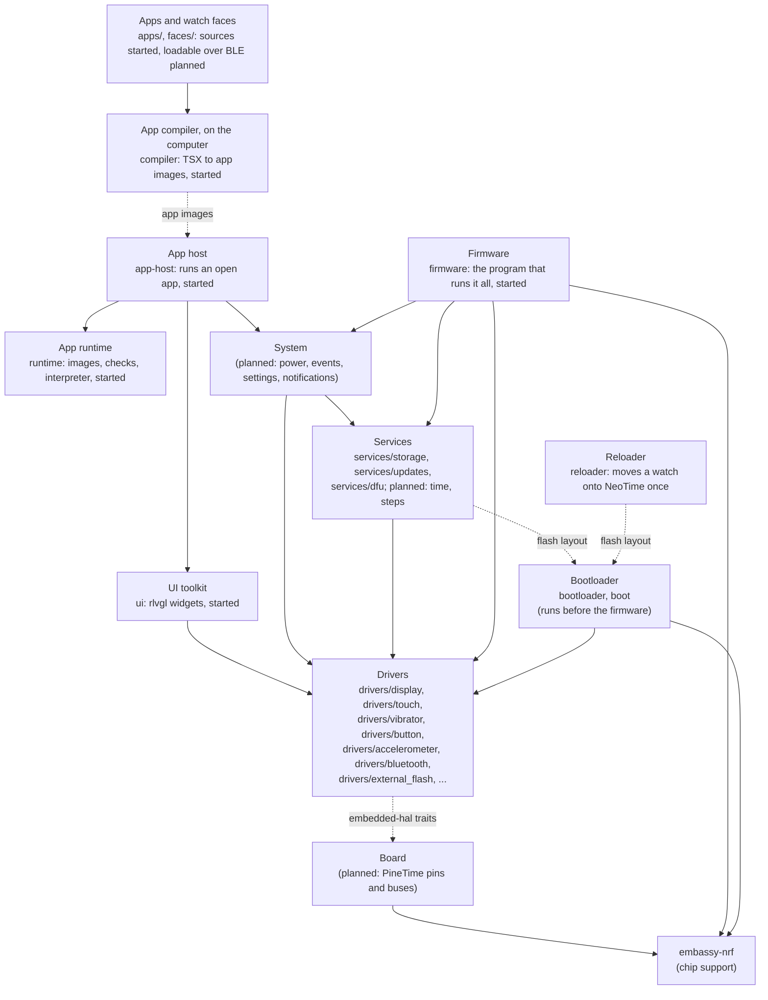

# Architecture

NeoTime is a Rust firmware for the PineTime. This page shows how the code is laid out, what each
part does and how the parts fit together. Parts marked **planned** do not exist yet. Their shape
may change as they are built.

## The hardware

The PineTime is built around a Nordic nRF52832 chip: a 64 MHz Arm Cortex-M4F with 64 KB of RAM and
512 KB of flash. Around it are:

| Part | Chip | Connected by |
|---|---|---|
| Screen, 240x240 | Sitronix ST7789 | SPI |
| Touch panel | Hynitron CST816S | I2C |
| Accelerometer and step counter | Bosch BMA421 or BMA425 | I2C |
| Heart rate sensor | HRS3300 | I2C |
| External flash, 4 MB | XTX XT25F32B SPI NOR | SPI, shared with the screen |
| Vibration motor | | GPIO P0.16, on while low |
| Backlight | | GPIO P0.14, P0.22 and P0.23, each lit while low |
| Side button | | GPIO P0.13, high while held; powered by P0.15 |
| Battery, charging | | GPIO and ADC |

[memory-map.md](memory-map.md) shows how the RAM and both flashes are divided.

## Layers



Each layer uses only the layers below it.

- **Drivers** speak to one part each through the `embedded-hal` traits and never touch the chip
  directly. That lets the same driver run on the watch, in tests and in a desktop simulator. The
  one exception is the Bluetooth controller, because the radio is inside the chip; it keeps all
  register access in one file behind a small trait.
- **Board** is the one place that knows the PineTime's wiring. It sets up the chip's SPI, I2C and
  pins with `embassy-nrf`, then hands them to the drivers. **(planned)**
- **Services** keep the watch's state: the BLE link and the GATT services companion apps use, the
  clock, the step count, files on the external flash, and firmware updates. The BLE link will run
  the [TrouBLE](https://github.com/embassy-rs/trouble) host on NeoTime's own controller in
  `drivers/bluetooth`. **(started: files on the external flash, and the on-watch half of firmware
  updates)**
- **System** runs the watch: it sleeps and wakes, turns button, touch and motion into events, and
  holds settings and notifications. **(planned)**
- **UI toolkit** gives apps widgets, fonts and page transitions. Widgets come from
  [rlvgl](https://github.com/softoboros/rlvgl), a pure Rust rewrite of LVGL, and are drawn through
  `embedded-graphics` onto the display driver. **(started: drawing works, nothing else yet)**
- **App runtime** loads apps installed over BLE, starts and stops them, and passes them events.
  Apps are written as Preact components with signals and compiled on the computer into images
  that a small bytecode interpreter runs; see [app-runtime.md](app-runtime.md). **(started: the
  image format, its checks, the interpreter and the bindings work)**
- **App host** runs one open app on top of the runtime: it builds the screen's rlvgl widgets, sends
  touches to handlers, hands effects to the system and redraws what changed. **(started: runs apps
  in the simulator; not yet on the watch)**
- **App compiler** runs on the computer, not the watch. It turns an app's source into an image
  and checks it with the runtime's own checks. **(started)**
- **Firmware** is the program the watch runs: it starts the drivers and services on Embassy and
  spawns the tasks. For now it does what an update needs: watchdog, screen, file system, Bluetooth
  with the DFU service. It stands in for the board layer until there is more than one board.
  **(started)**
- **Bootloader** is a separate program that runs before the firmware. It installs updates and the
  recovery firmware, then starts the firmware. The firmware shares its flash layout through the
  `neotime-boot` crate. See [Bootloader](#bootloader-bootloader-and-boot).

## Tasks

The firmware runs on [Embassy](https://embassy.dev), so each long-running job is an `async` task,
and the chip sleeps whenever every task is waiting. The expected tasks are the BLE stack, the
system loop and the screen. Drivers expose `async` functions so that a slow job, such as a
vibration pattern, waits without blocking the others. **(planned)**

## Repository layout

```text
NeoTime/
├── Cargo.toml        one Cargo workspace for every crate except the bootloader
├── package.json      the npm workspace for apps/, faces/ and sdk/neotime
├── app-host/         neotime-app-host: runs an open app with rlvgl widgets
├── apps/             neotime-apps: apps in the app language, one folder each; see apps.md
├── compiler/         neotime-compiler: compiles apps and faces into app images; see compiler.md
├── rustfmt.toml      formatting rules
├── flake.nix       development shell, simulator package and checks
├── rust-toolchain.toml  the Rust version and the watch's target
├── boot/             neotime-boot: the flash layout and migration plan, shared by every program
├── bootloader/       neotime-bootloader: the bootloader program, built only for the watch
├── firmware/         neotime-firmware: the firmware program, built only for the watch
├── docs/
│   ├── app-reference.md the events, widgets and effects apps can use
│   ├── app-runtime.md the proposed app format and runtime
│   ├── apps.md       the apps ported from InfiniTime and wasp-os
│   ├── architecture.md
│   ├── bluetooth.md  the Bluetooth controller
│   ├── bootloader.md
│   ├── coding-guidelines.md
│   ├── compiler.md   the app compiler: the language subset, types and number mappings
│   ├── faces.md      the watch faces ported from InfiniTime, wasp-os and PinetimeLite
│   ├── memory-map.md how RAM and both flashes are divided
│   ├── simulator.md
│   ├── storage.md
│   ├── todo.md
│   ├── updates.md    firmware updates over Bluetooth and moving a watch onto NeoTime
│   └── images/       pictures for the docs
├── drivers/
│   ├── accelerometer/  neotime-accelerometer: the BMA421 or BMA425 and its step counter
│   ├── bluetooth/    neotime-bluetooth: the Bluetooth LE controller for the chip's radio
│   ├── button/       neotime-button: the side button
│   ├── display/      neotime-display: the ST7789 screen
│   ├── external_flash/  neotime-external-flash: the 4 MB SPI NOR flash
│   ├── touch/        neotime-touch: the CST816S touch panel
│   └── vibrator/     neotime-vibrator: the vibration motor
├── faces/            neotime-faces: watch faces in the app language, one folder each; see faces.md
├── reloader/         neotime-reloader: the one-time image that moves a watch over from InfiniTime or wasp-os
├── runtime/          neotime-runtime: app images, their checks, the interpreter and bindings
├── sdk/
│   └── neotime/      the neotime package apps and faces import, as a stand-in for now
├── services/
│   ├── dfu/          neotime-dfu: the legacy DFU update protocol over Bluetooth
│   ├── storage/      neotime-storage: the littlefs file system in the external flash
│   └── updates/      neotime-updates: stores an uploaded firmware and hands it to the bootloader
├── simulator/        neotime-simulator: the drivers in a desktop window
├── third_party/
│   ├── littlefs-rust/  littlefs-rust with its panicking loop caps turned off
│   └── trouble-host/   TrouBLE with discovery responses that never cut a 128-bit UUID short
├── tools/            scripts: drawing the memory maps, packaging images, building every image
└── ui/               neotime-ui: draws rlvgl widgets on the screen
```

Each driver, the runtime, the app host and the UI crate is a `no_std` crate with its code in
`src/lib.rs` and its tests in `src/tests.rs`. The compiler is a `std` crate, with its tests in
`src/tests.rs` and `tests/`. See
[coding-guidelines.md](coding-guidelines.md) for how the code is written.

## Drivers

### Display (`drivers/display`)

`neotime-display` drives the ST7789 screen. It builds on
[`mipidsi`](https://crates.io/crates/mipidsi), which sends the panel's commands, and adds what the
PineTime needs on top:

- **Hardware vertical scrolling.** `scroll(offset)` moves the picture with the panel's own scroll,
  which costs one short command instead of a redraw. `set_scroll_area(top, bottom)` keeps fixed
  areas, such as a status bar, still.
- **Drawing follows the scroll.** The ST7789 holds 320 rows of memory but shows only 240. After a
  scroll, drawing at a screen row lands on whichever memory row is on screen there, and a drawing
  that crosses the end of memory is split in two.
- **embedded-graphics.** `Display` is a `DrawTarget` for `Rgb565`, so any `embedded-graphics`
  shape, text or image draws on it.
- **Power.** `sleep` and `wake` turn the panel off and on and keep its memory.
- **Low-power mode.** `enter_low_power_mode` switches the panel to its idle mode, as InfiniTime
  does for an always-on screen: only 8 colours, the top bit of each channel, refreshed at a quarter
  of the rate. Memory keeps every colour, so `leave_low_power_mode` shows the screen as drawn, and
  drawing works the same in either mode.
- **Backlight.** `Backlight` drives the three backlight pins, P0.14, P0.22 and P0.23, which each
  light while low. `BacklightLevel` is `Off`, `Low`, `Medium` or `High`, and each level lights one
  more pin; `brighter` and `dimmer` step between them.

The board passes in the SPI interface, the reset pin and a delay. The scrolling is what page
slides will be built on: draw the next page into memory that is off screen, then scroll it in.

### Touch panel (`drivers/touch`)

`neotime-touch` drives the CST816S touch panel over I2C at address 0x15. On the PineTime its
interrupt is P0.28 and its reset P0.10, on the I2C bus at SDA P0.06 and SCL P0.07.

- **Reports.** The panel pulses its interrupt pin low when a finger lands, moves or lifts and when
  it sees a gesture, and keeps pulsing while the finger stays down. `wait_for_report` waits for the
  next pulse and reads one `TouchReport`: the position in display columns and rows, the `Gesture`
  (tap, long press, a slide in one of four directions, or a double tap), whether the finger went
  down, lifted or is still touching, and whether anything is touching at all.
- **Garbled reads are dropped.** A report with a position off the 240x240 panel or an unknown
  gesture is skipped, as InfiniTime does.
- **Double taps are off by default.** With them on, the panel holds back every single tap while it
  waits to see if a second follows. `Settings { report_double_taps: true }` turns them on.
- **Sleep.** `sleep` puts the panel into deep sleep, holding it in reset if it does not answer.
  `sleep_until_double_tap` instead keeps it listening for a double tap only, so a double tap can
  wake the watch. `wake` restarts it with the last settings.
- **Resets.** The panel stops answering on I2C while it is idle, so `start`, `sleep` and
  `sleep_until_double_tap` each begin with a reset: reset low for 5 ms, then 50 ms to settle.
  `read_chip_info` works only right after one of these or right after a touch.

The setup matches InfiniTime's: it turns off the panel's automatic reset after five seconds without
a gesture, which would otherwise cut off a long drag.

Ready-made crates were looked at first. `cst816s` is blocking, and `cst816s-async` reports only
gestures, not finger movement, and forces `defmt` on every user, so NeoTime has its own.

### Vibrator (`drivers/vibrator`)

`neotime-vibrator` drives the vibration motor:

- **Two kinds of wiring.** `OnOffMotor` uses a plain pin, which is either on or off. `PwmMotor` uses
  a PWM channel, so it can buzz at any `Strength` from 0 to 100 percent.
- **Patterns.** A pattern is a list of `Step`s, each a strength and a duration. `TAP` is one short
  buzz, and `RING` is one second of ringing that is played again to keep ringing.
- **Async and safe to cancel.** `vibrate` and `play` wait with an async delay, so other tasks keep
  running. If a pattern is cancelled part way, the motor is turned off.

### Button (`drivers/button`)

`neotime-button` drives the side button:

- **Power.** The button only reads while P0.15 is high, so `Button::new` drives it high. The board
  passes P0.13 as an input with its pull-down on.
- **Debouncing.** A change of level counts only if it still holds 10 ms later, so contact bounce
  and short glitches are ignored.
- **Gestures.** `next_gesture` reports a `Click`, a `DoubleClick` (a second press within 200 ms of
  letting go), a `LongPress` (held 400 ms) and a `LongerPress` (held 2 s), the same timings as
  InfiniTime. A click is reported only once the double click window closes; callers that want
  presses straight away use `wait_for_press` and `wait_for_release`. Long presses are reported
  while the button is still held, and letting go afterwards is not a click. `Timing` changes the
  thresholds.
- **Recovery.** `is_pressed` reads the pin at once. The system loop feeds the watchdog only while it
  returns false, so holding the button lets the watchdog reset the watch into the bootloader.

The driver keeps no buffers: it uses a few bytes of RAM in the task that owns it.

### Accelerometer (`drivers/accelerometer`)

`neotime-accelerometer` drives the Bosch accelerometer over I2C at address 0x18, on the same bus as
the touch panel. PineTimes carry either a BMA421 (chip ID 0x11) or a BMA425 (chip ID 0x13).

- **Configuration file.** The chip counts steps with its own small processor, which runs a 6 KB
  program from Bosch. `start` resets the chip, reads its ID, uploads that chip's file 16 bytes at
  a time, and fails with `ConfigurationRejected` if the chip does not report it ready 150 ms later.
  Starting takes a few tenths of a second.
- **Steps.** `start` turns the step counter on. `read_step_count` reads the count since the last
  `reset_step_count`. The count lives in the chip, so the firmware only reads it.
- **Acceleration.** `read_acceleration` gives the latest sample in milli-g, sampled at 100 Hz with
  4-sample averaging. `Settings.range` picks ±2 g (the default), 4, 8 or 16 g.
- **Watch axes.** The chip is turned on the board, so `Orientation::PINETIME` swaps its x and y
  axes and reverses one, the same as wasp-os. `Orientation::CHIP` gives the chip's own axes.
- **Power saving.** The chip runs in Bosch's advanced power saving mode while counting. Its
  feature memory only takes writes with that mode off, so the driver pauses it around each one.
- **Bus watchdog.** The chip's I2C watchdog is on, so a transfer cut off part way frees the bus
  after 40 ms instead of holding it.

Each chip's file costs 6 KB of firmware flash. The cargo features `bma421` and `bma425` are both on
by default; a build for one known watch can keep just its chip's. A watch whose chip was left out
fails `start` with `ChipLeftOutOfBuild`.

The configuration files are Bosch's, under the BSD-3-Clause licence in
`src/configuration/LICENSE`, taken from the `BMA42X-Sensor-API` that wasp-os uses.

Wrist raise is planned in software on top of `read_acceleration`, as InfiniTime and wasp-os do it,
so the chip's own tap and wrist-wear detectors are not set up.

The `bma423` crate was looked at first. It is blocking, accepts only chip ID 0x13, and has no step
counter, so NeoTime has its own.

### Bluetooth controller (`drivers/bluetooth`)

`neotime-bluetooth` is NeoTime's own Bluetooth LE controller: the half of a Bluetooth stack that
drives the radio. The [TrouBLE](https://github.com/embassy-rs/trouble) host runs on top of it,
connected through `bt-hci`'s `ExternalController` as if it were a separate chip. It replaces
Nordic's closed SoftDevice Controller and saves about 27 KB of flash and 5 KB of RAM.

- **What it does.** Advertising with scan responses, and one connection as the peripheral on the
  1 Mbit PHY, with acknowledgements, flow control, and parameter and channel map updates. There is
  no encryption yet.
- **How it is split.** The HCI interface and the link layer are plain logic that runs in tests on
  a computer, including TrouBLE itself on a fake radio. Only `nrf_radio.rs` touches the chip: the
  radio, TIMER0, the random number generator and five fixed PPI channels.
- **Status.** Tested on the computer only; it has never run on a watch.

See [bluetooth.md](bluetooth.md) for the design, the timing, what it takes from the chip and what is
missing.

## App runtime (`runtime`)

`neotime-runtime` is the core of the app runtime, with no hardware and no dependencies, so it is
tested entirely on the computer. [app-runtime.md](app-runtime.md) gives the full design and the
byte-level format.

- **Images.** `AppImage::parse` reads an app image where it lies and checks its header, CRC,
  sections, strings and state variables.
- **Checks.** `verify` makes one pass over every expression and handler. Ordinary jumps only go
  forward, and a loop must start and end with an empty stack, so that one pass proves the stack
  never underflows or overflows.
- **Interpreter.** `Interpreter` runs an expression to get a widget's value, or a handler to answer
  an event. A handler's changes are applied only when it finishes, and its effects are returned,
  so a failure part way changes nothing.
- **Widgets.** `WidgetTree` reads an app's widgets in place: its screens, each widget's children,
  and each property as a constant, an expression or a handler.
- **Format patterns.** Times and durations are written with patterns such as `dddd D MMMM`, checked
  at install.
- **Bindings.** `Bindings` works out from the code what each expression reads and how often the
  clock changes it, so the runtime redraws only what changed and sleeps otherwise.

- **Theming.** A colour is a fixed RGB565 value or a reference to one of the theme's eight named
  colours, looked up only when drawn, so changing the theme is one redraw.
- **Events.** `events` fixes which fields each event carries and in what order, for the compiler
  and the runtime alike.
- **Writer.** With the `writer` feature, `ImageWriter` and `CodeWriter` write images and assemble
  bytecode with labels, for the compiler and tests.
- **State and arrays.** `AppState` packs an app's variables and arrays into 2 KB, each array element
  in as few bytes as the image asks. Handlers change copies of what they write, so a failure part
  way changes nothing, and loops stop after 200,000 steps.

It never allocates and never panics on bad input. Its working memory is 1,792 B for the
interpreter, 1,032 B for the bindings of up to 64 expressions and 2,440 B for the state.
### External flash (`drivers/external_flash`)

`neotime-external-flash` drives the 4 MB SPI NOR flash as an `embedded-storage` `NorFlash`, the
trait embassy-boot and littlefs are reached through:

- **Any 4 MB chip.** `ExternalFlash::new` wakes the chip from deep power-down, since the firmware
  may have left it asleep before a reset, then checks that it answers as a 4 MB chip. Only standard
  SPI NOR commands are used, so a second-source part works as well as the XT25F32B.
- **Writes of any length.** The chip programs at most 256 bytes at a time, within one page, so
  `write` splits at page boundaries. `erase` takes whole 4 KB sectors.
- **Power.** `sleep` puts the chip in deep power-down, and `wake` brings it back.
- **Blocking and async.** `ExternalFlash` blocks, which is what the bootloader needs.
  `AsyncExternalFlash` implements the `embedded-storage-async` traits for the firmware: while an
  erase or a write is in progress it checks the chip every 100 microseconds and waits on an async
  delay in between, so other tasks run. Both share their commands, range checks and page splitting.
- **Rewrites.** Both mark themselves `MultiwriteNorFlash`, since NOR flash can be written again
  without an erase as long as bits only change from 1 to 0.

It keeps no buffers.

## Storage (`services/storage`)

`neotime-storage` puts a [littlefs](https://github.com/littlefs-project/littlefs) file system in
the 3 MB `FILE_SYSTEM` region of the external flash, through
[`littlefs-rust`](https://github.com/light-player/littlefs-rust), a pure Rust translation of the C
littlefs with the same on-disk format. littlefs survives a power cut at any point and spreads wear
across the flash; InfiniTime uses it on the same chip.

- **First start.** `prepare_file_system` formats blank flash and makes the top-level folders:
  `/apps`, `/settings` and `/resources`.
- **Never formats by mistake.** It formats only when littlefs finds no file system at all. A read
  error from the flash is returned instead, so a bus fault cannot wipe the watch.
- **Cost.** The buffers live on the heap: under 1 KB while mounted and about 400 bytes per open file.
- **Two fixes.** `littlefs-rust-core` is built without overflow checks, as C behaves, and a patched
  copy of the wrapper in `third_party/littlefs-rust` turns off a 256-entry cap that panics on file
  systems written by the C littlefs.

See [storage.md](storage.md).

## Updates (`services/updates`)

`neotime-updates` is the on-watch half of a firmware update, between the Bluetooth layer that
uploads an image and the bootloader that installs it. It knows nothing of the upload protocol:

- **`UpdateReceiver`** takes a firmware image with `begin(size)`, then `receive(chunk)` in order,
  then `finish()`. It writes through embassy-boot's `FirmwareUpdater` into the update slot, erasing
  each sector just before writing it. `finish` checks that every byte arrived and that the image
  starts with a firmware vector table, then marks a swap for the next reset. `read_back` lets the
  protocol above check its own checksum first.
- **`confirm_running_firmware`** tells the bootloader the running firmware works. Until it is called
  the next reset rolls back, and no new update is accepted.
- **`RecoveryReceiver`** writes the recovery firmware into its own slot the same way. It erases the
  start of the slot first and writes the vector table last, so the bootloader never sees a
  half-written recovery firmware.

## Firmware updates over Bluetooth (`services/dfu`)

`neotime-dfu` speaks Nordic's legacy DFU, the protocol InfiniTime uses, so Gadgetbridge, ITD, Siglo
and NeoTime's tools update NeoTime without changes. `LegacyDfu` is the state machine, with no
Bluetooth in it: control point commands and packet writes go in, notifications and a reset request
come out, and the bytes go to `neotime-updates`. Its tests run a whole update through it. The
`trouble` feature adds the GATT service for TrouBLE. See [updates.md](updates.md).

## Firmware (`firmware`)

`neotime-firmware` takes over the bootloader's watchdog and feeds it only while the button is up,
shows a status page, mounts the file system, advertises as "NeoTime" with the DFU and Current Time
services, and confirms itself to the bootloader once Bluetooth runs. It is outside the workspace,
like the bootloader, because it only builds for the watch. See [updates.md](updates.md).

Two seconds after start-up the **shell** (`firmware/src/shell.rs`) takes the screen and runs the
watch face, the launcher and the apps through `neotime-app-host`:

- **Navigation.** The face shows first. A swipe up the face does not use opens the launcher, a list
  written with `neotime_app_host::launcher` from the built-in apps; a tap opens one. The button,
  or a swipe right the app does not use, goes back a step: app to launcher, launcher to face.
- **Input.** `touch.rs` turns the panel's reports into the host's touches: press, drag and release
  from the finger, and one click, long press or swipe from each touch's gesture. The watchdog task
  reads the button every 20 ms and also reports short and long presses.
- **Sleep.** After 15 seconds without input the backlight goes off and the app gets `screen_off`;
  the next touch or press turns it on without acting on it. The loop sleeps until the next input
  or until `next_wakeup`.
- **Clock.** `clock.rs` counts on from the time a phone last wrote to the Current Time
  characteristic (0x2A2B), or from the build time until one does. It holds local time, with an
  offset from UTC of 0.
- **Status page.** The start-up lines and an update's progress share the display with the shell;
  while the page is up the shell draws nothing, and when the update ends it paints again.
- **Apps.** `tools/build_watch_apps.sh` compiles the face (`digital`), nine apps and the shared
  library into `firmware/apps/`, and the firmware builds them in. They move to the external flash
  once there is a way to send files to the watch.

- **Battery.** `battery.rs` reads the battery's voltage through the SAADC once a minute, and at
  once when power is plugged in or out, and turns it into a charge along a lithium discharge
  curve. P0.19 says power is present and P0.12 that it is charging.

Not done yet: steps, heart rate and the other sensor values read as 0; effects such as
vibration and brightness are ignored; saved state is not written; the screen only dims through the
backlight, without sleeping the display or the touch panel.

It takes 322 KB of the 400 KB firmware slot (the fonts are 47 KB, the built-in apps 29 KB and the
shared library 26 KB) and 46 KB of static RAM, 36 KB of it heap: 16 KB for storage and 20 KB for
the open app's widgets and working memory. It runs on the watch: the face, the launcher, the apps,
the button and the backlight timeout all work.

## Reloader (`reloader`)

`neotime-reloader` moves a watch from InfiniTime or wasp-os onto NeoTime. It is an app for the old
system, sent through that system's own update path, which stages the firmware and the recovery
firmware in the external flash, writes NeoTime's bootloader over the first pages of internal
flash, and marks the swap. The order, from `neotime_boot::migration`, keeps the time when a power
cut would leave the watch unable to start to the bootloader write, about a quarter of a second.
Two builds, `from-wasp-os` and `from-infinitime`, link where each old system starts apps. It has
never run on a watch; see [updates.md](updates.md) for the emulator plan.

## Bootloader (`bootloader` and `boot`)

The bootloader is built on [embassy-boot](https://embassy.dev). It swaps in a waiting firmware
update from external flash, rolls back a new firmware that never marked itself booted, and installs
the recovery firmware when the button is held for about ten seconds. While it works it shows a blue
status screen, and it leaves the firmware a note in RAM. It is about 14 KB.

`neotime-boot` holds the flash layout: in internal flash the bootloader, its state page, the
running firmware and the shared library apps draw on; in external flash the update slot, the
recovery firmware and the file system. The firmware will use the same crate, so both sides agree.

See [bootloader.md](bootloader.md) for the layout, the start-up steps, recovery and what the firmware
must do.

## App compiler (`compiler`)

`neotime-compiler` turns an app or watch face, written as Preact components with signals, into an
app image. It is a `std` library and command, so it sits beside the layers and is never built for
the watch; the workspace leaves it out of `default-members`. [compiler.md](compiler.md) describes
the language it accepts.

- **Parsing.** [oxc](https://oxc.rs) reads the TSX. The shared components in
  `sdk/neotime/src/components.tsx` are built into the compiler and inlined like the app's own.
- **Constants.** Anything that reads no state, clock or event is worked out while compiling.
- **Widgets.** Each screen's component is run once while compiling, into a fixed widget tree.
- **Code.** Properties that change become expressions and event functions become handlers, written
  with the runtime's `CodeWriter`; functions and `computed` are inlined.
- **Types.** Every value has a type the compiler knows, and names such as fonts and colours are
  stored as the numbers [compiler.md](compiler.md#number-mappings) lists.
- **State.** Signals become state variables, and each array gets the narrowest element width its
  values fit.
- **Checks.** Every image is parsed and verified with the runtime's own checks before it is written.

Its tests compile small apps and run them on the runtime's interpreter, run the compiled stopwatch,
and compile every app and face to report which compile.

## UI toolkit (`ui`)

`neotime-ui` lets [rlvgl](https://github.com/softoboros/rlvgl) widgets draw on the watch.
`ScreenRenderer` wraps any `embedded-graphics` `DrawTarget` for `Rgb565`, such as the display
driver's `Display`, and carries out rlvgl's drawing calls on it:

- **No screen buffer.** A full 240x240 picture takes 115 KB, more than the watch's 64 KB of RAM, so
  each rectangle, text run and image row goes straight to the display.
- **See-through colours.** The display cannot be read back, so a partly transparent colour, such as
  the soft edge of a letter, is mixed with a set background colour (`with_background_color`, black
  by default). Fully transparent pixels are skipped, so what is underneath stays.
- **Plain text.** `draw_text` uses an `embedded-graphics` mono font, 10x20 by default
  (`with_font`). Widgets that use rlvgl's own fonts draw through its anti-aliased glyph path.
- **Errors.** rlvgl's drawing calls cannot fail, so the first error from the screen is kept and
  returned by `finish`.
- **Scrolling.** Drawing goes through the display driver, so it follows the hardware scroll.

rlvgl needs a heap (`alloc`), which the firmware will have to provide. Still to do: sizing that heap,
touch input, page slides on the hardware scroll, and a desktop simulator.

## App host (`app-host`)

`neotime-app-host` runs one open app. It ties the runtime to the UI toolkit and to whatever embeds
it: the firmware's system layer on the watch, or the simulator on a computer. It is `no_std` with
`alloc`, because rlvgl's widgets need a heap.

- **Opening.** `AppHost::open` checks the image, sets up the state and bindings, and builds the
  first screen: one node per widget, each drawn by an rlvgl widget, laid out by a small flexbox.
- **Events.** A touch goes to the topmost widget under it that has a handler for it. The handler's
  effects go to the embedder through the `System` trait, except `go` and `back`, which the host
  carries out itself.
- **Redrawing.** Only the expressions a change affects are worked out again, and only the widgets
  whose value, place or visibility changed are drawn again, each region painted from the
  background up. There is no screen buffer.
- **Time and subscriptions.** `tick` runs due timers and redraws what the clock changed, and
  `next_wakeup` says when that next happens, so the watch can sleep in between. `deliver` hands
  sensor and phone events to the app's subscriptions.
- **Saved state.** `save_changed_state` writes the persistent variables when they change, and
  `open_with_saved_state` puts them back.
- **Images and fonts.** Images come from the app or the shared library (`set_library`). The fonts
  are anti-aliased bitmaps built into the crate, made by `tools/generate_fonts.py`.
- **Theme.** `set_theme` redraws every colour from the values already held, without running app
  code.
- **Failures.** A failing handler or expression is reported through `System::app_failed`, and the
  app stays open with its state unchanged.
- **Demo.** With the `demo` feature, `demo::stopwatch_image` builds a stopwatch image with the
  runtime's writer, so the host runs before the compiler exists.

On the watch, `AppHost` keeps its state, interpreter and bindings on the UI heap, 5,264 B, so
opening an app needs only 6.4 KB of stack; each widget of the open screen takes 240 B more plus its
text; see [memory-map.md](memory-map.md). [app-runtime.md](app-runtime.md#the-app-host) describes
the calls, the layout rules and what each property value means.

## Apps and watch faces (`apps`, `faces`, `sdk`)

Apps and watch faces are Preact and Signals source, written to [app-reference.md](app-reference.md)
and kept as two npm packages: `apps/` (`neotime-apps`) and `faces/` (`neotime-faces`). The first
ones are ports of InfiniTime's and wasp-os's, merged where both firmwares have the same one, and
of PinetimeLite's watch faces.
[apps.md](apps.md) and [faces.md](faces.md) list each, where it came from and what it still needs
from the runtime.

- **One folder each,** named by its id: an app's source is `apps/<id>/app.tsx` and a face's is
  `faces/<id>/face.tsx`, with any behaviour tests beside it in `app.test.tsx` or `face.test.tsx`.
- **`sdk/neotime`** is a stand-in for the `neotime` package both import, so they type-check and
  their screens render in tests. It is not the runtime and will be replaced by the real package.
  The tests load its `signals.ts` in place of `@preact/signals`, so that writing one element of an
  array signal, as in `board.value[cell] = 2`, notifies the way the runtime does.
- **Checks.** From the repository root, `npm install`, then `npm run check` runs TypeScript over
  everything and `npm test` renders every screen of every app and face with Vitest. Each package's
  `tests/screens.test.tsx` also checks that apps declare `kind: "app"` and faces `kind: "face"`.

Nothing here runs on the watch yet. That needs the compiler and the runtime in
[app-runtime.md](app-runtime.md#suggested-order-of-work). **(started)**

## Simulator (`simulator`)

`neotime-simulator` runs the drivers on a desktop in a 240x240 window, against simulated
hardware: a model of the ST7789 that follows the commands the display driver sends, and a motor
pin. It is a `std` program, so it sits beside the layers rather than in them and is never built
for the watch. The mouse is the touch panel and the space bar is the side button. With `--app` or
`--demo` it runs an app image through `neotime-app-host`, with the computer's clock and a stand-in
system that prints effects. See [simulator.md](simulator.md).

## Building and testing

`flake.nix` holds everything needed. `nix develop` opens a shell with the Rust toolchain from
`rust-toolchain.toml`, which includes the watch's `thumbv7em-none-eabihf` target, SDL2 for the
simulator, and probe-rs for flashing.

Every crate is tested on the computer, the drivers against fake hardware and the simulator against
its panel model:

```sh
cargo test --workspace
```

To check that the drivers build for the watch:

```sh
cargo build --release --target thumbv7em-none-eabihf
```

The workspace's default members are the `no_std` crates only, so that build leaves the simulator
out. `nix flake check` runs the tests, the watch build, clippy and two headless simulator
screenshots, one of them of the stopwatch app after a click, in a clean sandbox.

The bootloader, the firmware and the reloader are outside the workspace and build only for the
watch. `tools/build_images.sh` builds all of them and packs the update zips into `dist/`; by hand:

```sh
cd bootloader && cargo build --release
cd firmware && cargo build --release
```

There is no firmware image to flash yet. That arrives with the board layer.
