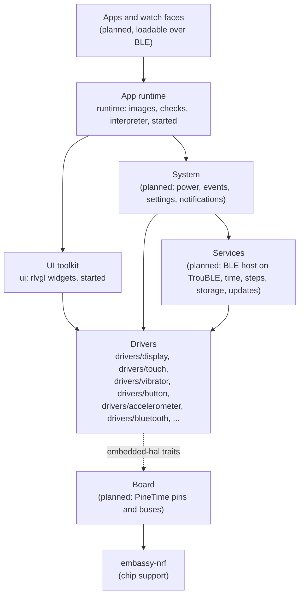

# Architecture

NeoTime is a Rust firmware for the PineTime. This page shows how the code is laid out, what each
part does and how the parts fit together. Parts marked **planned** do not exist yet. Their shape
may change as they are built.

## The hardware

The PineTime is built around a Nordic nRF52832 chip: a 64 MHz Arm Cortex-M4F with 64 KB of RAM and
512 KB of flash. Around it are:

| Part | Chip | Connected by |
|---|---|---|
| Screen, 240x240 | Sitronix ST7789 | SPI |
| Touch panel | Hynitron CST816S | I2C |
| Accelerometer and step counter | Bosch BMA421 or BMA425 | I2C |
| Heart rate sensor | HRS3300 | I2C |
| External flash, 4 MB | SPI NOR | SPI, shared with the screen |
| Vibration motor | | GPIO P0.16, on while low |
| Backlight | | Three GPIO pins |
| Side button | | GPIO P0.13, high while held; powered by P0.15 |
| Battery, charging | | GPIO and ADC |

[memory-map.md](memory-map.md) shows how the RAM and both flashes are divided.

## Layers



Each layer uses only the layers below it.

- **Drivers** speak to one part each through the `embedded-hal` traits and never touch the chip
  directly. That lets the same driver run on the watch, in tests and in a desktop simulator. The
  one exception is the Bluetooth controller, because the radio is inside the chip; it keeps all
  register access in one file behind a small trait.
- **Board** is the one place that knows the PineTime's wiring. It sets up the chip's SPI, I2C and
  pins with `embassy-nrf`, then hands them to the drivers. **(planned)**
- **Services** keep the watch's state: the BLE link and the GATT services companion apps use, the
  clock, the step count, files on the external flash, and firmware updates. The BLE link will run
  the [TrouBLE](https://github.com/embassy-rs/trouble) host on NeoTime's own controller in
  `drivers/bluetooth`. **(planned)**
- **System** runs the watch: it sleeps and wakes, turns button, touch and motion into events, and
  holds settings and notifications. **(planned)**
- **UI toolkit** gives apps widgets, fonts and page transitions. Widgets come from
  [rlvgl](https://github.com/softoboros/rlvgl), a pure Rust rewrite of LVGL, and are drawn through
  `embedded-graphics` onto the display driver. **(started: drawing works, nothing else yet)**
- **App runtime** loads apps installed over BLE, starts and stops them, and passes them events.
  Apps are written as Preact components with signals and compiled on the computer into images
  that a small bytecode interpreter runs; see [app-runtime.md](app-runtime.md). **(started: the
  image format, its checks, the interpreter and the bindings work; nothing runs apps yet)**

## Tasks

The firmware runs on [Embassy](https://embassy.dev), so each long-running job is an `async` task,
and the chip sleeps whenever every task is waiting. The expected tasks are the BLE stack, the
system loop and the screen. Drivers expose `async` functions so that a slow job, such as a
vibration pattern, waits without blocking the others. **(planned)**

## Repository layout

```text
NeoTime/
├── Cargo.toml        one Cargo workspace for every crate
├── rustfmt.toml      formatting rules
├── flake.nix       development shell, simulator package and checks
├── rust-toolchain.toml  the Rust version and the watch's target
├── docs/
│   ├── app-reference.md the events, widgets and effects apps can use
│   ├── app-runtime.md the proposed app format and runtime
│   ├── architecture.md
│   ├── bluetooth.md  the Bluetooth controller
│   ├── coding-guidelines.md
│   ├── memory-map.md how RAM and both flashes are divided
│   ├── simulator.md
│   ├── todo.md
│   └── images/       pictures for the docs
├── drivers/
│   ├── accelerometer/  neotime-accelerometer: the BMA421 or BMA425 and its step counter
│   ├── bluetooth/    neotime-bluetooth: the Bluetooth LE controller for the chip's radio
│   ├── button/       neotime-button: the side button
│   ├── display/      neotime-display: the ST7789 screen
│   ├── touch/        neotime-touch: the CST816S touch panel
│   └── vibrator/     neotime-vibrator: the vibration motor
├── runtime/          neotime-runtime: app images, their checks, the interpreter and bindings
├── simulator/        neotime-simulator: the drivers in a desktop window
├── tools/            scripts for development, such as drawing the memory maps
└── ui/               neotime-ui: draws rlvgl widgets on the screen
```

Each driver, the runtime and the UI crate is a `no_std` crate with its code in `src/lib.rs` and its tests in `src/tests.rs`. See
[coding-guidelines.md](coding-guidelines.md) for how the code is written.

## Drivers

### Display (`drivers/display`)

`neotime-display` drives the ST7789 screen. It builds on
[`mipidsi`](https://crates.io/crates/mipidsi), which sends the panel's commands, and adds what the
PineTime needs on top:

- **Hardware vertical scrolling.** `scroll(offset)` moves the picture with the panel's own scroll,
  which costs one short command instead of a redraw. `set_scroll_area(top, bottom)` keeps fixed
  areas, such as a status bar, still.
- **Drawing follows the scroll.** The ST7789 holds 320 rows of memory but shows only 240. After a
  scroll, drawing at a screen row lands on whichever memory row is on screen there, and a drawing
  that crosses the end of memory is split in two.
- **embedded-graphics.** `Display` is a `DrawTarget` for `Rgb565`, so any `embedded-graphics`
  shape, text or image draws on it.
- **Power.** `sleep` and `wake` turn the panel off and on and keep its memory.

The board passes in the SPI interface, the reset pin and a delay. The scrolling is what page
slides will be built on: draw the next page into memory that is off screen, then scroll it in.

### Touch panel (`drivers/touch`)

`neotime-touch` drives the CST816S touch panel over I2C at address 0x15. On the PineTime its
interrupt is P0.28 and its reset P0.10, on the I2C bus at SDA P0.06 and SCL P0.07.

- **Reports.** The panel pulses its interrupt pin low when a finger lands, moves or lifts and when
  it sees a gesture, and keeps pulsing while the finger stays down. `wait_for_report` waits for the
  next pulse and reads one `TouchReport`: the position in display columns and rows, the `Gesture`
  (tap, long press, a slide in one of four directions, or a double tap), whether the finger went
  down, lifted or is still touching, and whether anything is touching at all.
- **Garbled reads are dropped.** A report with a position off the 240x240 panel or an unknown
  gesture is skipped, as InfiniTime does.
- **Double taps are off by default.** With them on, the panel holds back every single tap while it
  waits to see if a second follows. `Settings { report_double_taps: true }` turns them on.
- **Sleep.** `sleep` puts the panel into deep sleep, holding it in reset if it does not answer.
  `sleep_until_double_tap` instead keeps it listening for a double tap only, so a double tap can
  wake the watch. `wake` restarts it with the last settings.
- **Resets.** The panel stops answering on I2C while it is idle, so `start`, `sleep` and
  `sleep_until_double_tap` each begin with a reset: reset low for 5 ms, then 50 ms to settle.
  `read_chip_info` works only right after one of these or right after a touch.

The setup matches InfiniTime's: it turns off the panel's automatic reset after five seconds without
a gesture, which would otherwise cut off a long drag.

Ready-made crates were looked at first. `cst816s` is blocking, and `cst816s-async` reports only
gestures, not finger movement, and forces `defmt` on every user, so NeoTime has its own.

### Vibrator (`drivers/vibrator`)

`neotime-vibrator` drives the vibration motor:

- **Two kinds of wiring.** `OnOffMotor` uses a plain pin, which is either on or off. `PwmMotor` uses
  a PWM channel, so it can buzz at any `Strength` from 0 to 100 percent.
- **Patterns.** A pattern is a list of `Step`s, each a strength and a duration. `TAP` is one short
  buzz, and `RING` is one second of ringing that is played again to keep ringing.
- **Async and safe to cancel.** `vibrate` and `play` wait with an async delay, so other tasks keep
  running. If a pattern is cancelled part way, the motor is turned off.

### Button (`drivers/button`)

`neotime-button` drives the side button:

- **Power.** The button only reads while P0.15 is high, so `Button::new` drives it high. The board
  passes P0.13 as an input with its pull-down on.
- **Debouncing.** A change of level counts only if it still holds 10 ms later, so contact bounce
  and short glitches are ignored.
- **Gestures.** `next_gesture` reports a `Click`, a `DoubleClick` (a second press within 200 ms of
  letting go), a `LongPress` (held 400 ms) and a `LongerPress` (held 2 s), the same timings as
  InfiniTime. A click is reported only once the double click window closes; callers that want
  presses straight away use `wait_for_press` and `wait_for_release`. Long presses are reported
  while the button is still held, and letting go afterwards is not a click. `Timing` changes the
  thresholds.
- **Recovery.** `is_pressed` reads the pin at once. The system loop feeds the watchdog only while it
  returns false, so holding the button lets the watchdog reset the watch into the bootloader.

The driver keeps no buffers: it uses a few bytes of RAM in the task that owns it.

### Accelerometer (`drivers/accelerometer`)

`neotime-accelerometer` drives the Bosch accelerometer over I2C at address 0x18, on the same bus as
the touch panel. PineTimes carry either a BMA421 (chip ID 0x11) or a BMA425 (chip ID 0x13).

- **Configuration file.** The chip counts steps with its own small processor, which runs a 6 KB
  program from Bosch. `start` resets the chip, reads its ID, uploads that chip's file 16 bytes at
  a time, and fails with `ConfigurationRejected` if the chip does not report it ready 150 ms later.
  Starting takes a few tenths of a second.
- **Steps.** `start` turns the step counter on. `read_step_count` reads the count since the last
  `reset_step_count`. The count lives in the chip, so the firmware only reads it.
- **Acceleration.** `read_acceleration` gives the latest sample in milli-g, sampled at 100 Hz with
  4-sample averaging. `Settings.range` picks ±2 g (the default), 4, 8 or 16 g.
- **Watch axes.** The chip is turned on the board, so `Orientation::PINETIME` swaps its x and y
  axes and reverses one, the same as wasp-os. `Orientation::CHIP` gives the chip's own axes.
- **Power saving.** The chip runs in Bosch's advanced power saving mode while counting. Its
  feature memory only takes writes with that mode off, so the driver pauses it around each one.
- **Bus watchdog.** The chip's I2C watchdog is on, so a transfer cut off part way frees the bus
  after 40 ms instead of holding it.

Each chip's file costs 6 KB of firmware flash. The cargo features `bma421` and `bma425` are both on
by default; a build for one known watch can keep just its chip's. A watch whose chip was left out
fails `start` with `ChipLeftOutOfBuild`.

The configuration files are Bosch's, under the BSD-3-Clause licence in
`src/configuration/LICENSE`, taken from the `BMA42X-Sensor-API` that wasp-os uses.

Wrist raise is planned in software on top of `read_acceleration`, as InfiniTime and wasp-os do it,
so the chip's own tap and wrist-wear detectors are not set up.

The `bma423` crate was looked at first. It is blocking, accepts only chip ID 0x13, and has no step
counter, so NeoTime has its own.

### Bluetooth controller (`drivers/bluetooth`)

`neotime-bluetooth` is NeoTime's own Bluetooth LE controller: the half of a Bluetooth stack that
drives the radio. The [TrouBLE](https://github.com/embassy-rs/trouble) host runs on top of it,
connected through `bt-hci`'s `ExternalController` as if it were a separate chip. It replaces
Nordic's closed SoftDevice Controller and saves about 27 KB of flash and 5 KB of RAM.

- **What it does.** Advertising with scan responses, and one connection as the peripheral on the
  1 Mbit PHY, with acknowledgements, flow control, and parameter and channel map updates. There is
  no encryption yet.
- **How it is split.** The HCI interface and the link layer are plain logic that runs in tests on
  a computer, including TrouBLE itself on a fake radio. Only `nrf_radio.rs` touches the chip: the
  radio, TIMER0, the random number generator and five fixed PPI channels.
- **Status.** Tested on the computer only; it has never run on a watch.

See [bluetooth.md](bluetooth.md) for the design, the timing, what it takes from the chip and what is
missing.

## App runtime (`runtime`)

`neotime-runtime` is the core of the app runtime, with no hardware and no dependencies, so it is
tested entirely on the computer. [app-runtime.md](app-runtime.md) gives the full design and the
byte-level format.

- **Images.** `AppImage::parse` reads an app image where it lies and checks its header, CRC,
  sections, strings and state variables.
- **Checks.** `verify` makes one pass over every expression and handler. Jumps only go forward, so
  that pass proves the stack never underflows or overflows and every call ends.
- **Interpreter.** `Interpreter` runs an expression to get a widget's value, or a handler to answer
  an event. A handler's state writes and effects are returned, not applied, so a failure part way
  changes nothing.
- **Bindings.** `Bindings` works out from the code what each expression reads and how often the
  clock changes it, so the runtime redraws only what changed and sleeps otherwise.

It never allocates and never panics on bad input. Its working memory is 528 B for the interpreter
and 904 B for the bindings of up to 64 expressions.

## UI toolkit (`ui`)

`neotime-ui` lets [rlvgl](https://github.com/softoboros/rlvgl) widgets draw on the watch.
`ScreenRenderer` wraps any `embedded-graphics` `DrawTarget` for `Rgb565`, such as the display
driver's `Display`, and carries out rlvgl's drawing calls on it:

- **No screen buffer.** A full 240x240 picture takes 115 KB, more than the watch's 64 KB of RAM, so
  each rectangle, text run and image row goes straight to the display.
- **See-through colours.** The display cannot be read back, so a partly transparent colour, such as
  the soft edge of a letter, is mixed with a set background colour (`with_background_color`, black
  by default). Fully transparent pixels are skipped, so what is underneath stays.
- **Plain text.** `draw_text` uses an `embedded-graphics` mono font, 10x20 by default
  (`with_font`). Widgets that use rlvgl's own fonts draw through its anti-aliased glyph path.
- **Errors.** rlvgl's drawing calls cannot fail, so the first error from the screen is kept and
  returned by `finish`.
- **Scrolling.** Drawing goes through the display driver, so it follows the hardware scroll.

rlvgl needs a heap (`alloc`), which the firmware will have to provide. Still to do: sizing that heap,
touch input, page slides on the hardware scroll, and a desktop simulator.

## Simulator (`simulator`)

`neotime-simulator` runs the drivers on a desktop in a 240x240 window, against simulated
hardware: a model of the ST7789 that follows the commands the display driver sends, and a motor
pin. It is a `std` program, so it sits beside the layers rather than in them and is never built
for the watch. The mouse is the touch panel and the space bar is the side button. See
[simulator.md](simulator.md).

## Building and testing

`flake.nix` holds everything needed. `nix develop` opens a shell with the Rust toolchain from
`rust-toolchain.toml`, which includes the watch's `thumbv7em-none-eabihf` target, and SDL2 for the
simulator.

Every crate is tested on the computer, the drivers against fake hardware and the simulator against
its panel model:

```sh
cargo test --workspace
```

To check that the drivers build for the watch:

```sh
cargo build --release --target thumbv7em-none-eabihf
```

The workspace's default members are the `no_std` crates only, so that build leaves the simulator
out. `nix flake check` runs the tests, the watch build, clippy and a headless simulator screenshot
in a clean sandbox.

There is no firmware image to flash yet. That arrives with the board layer.
