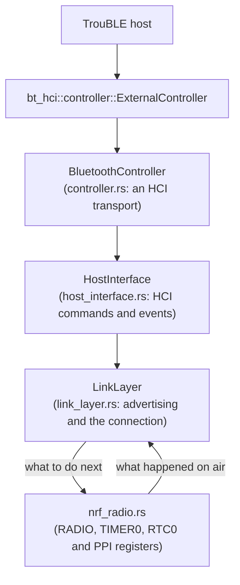
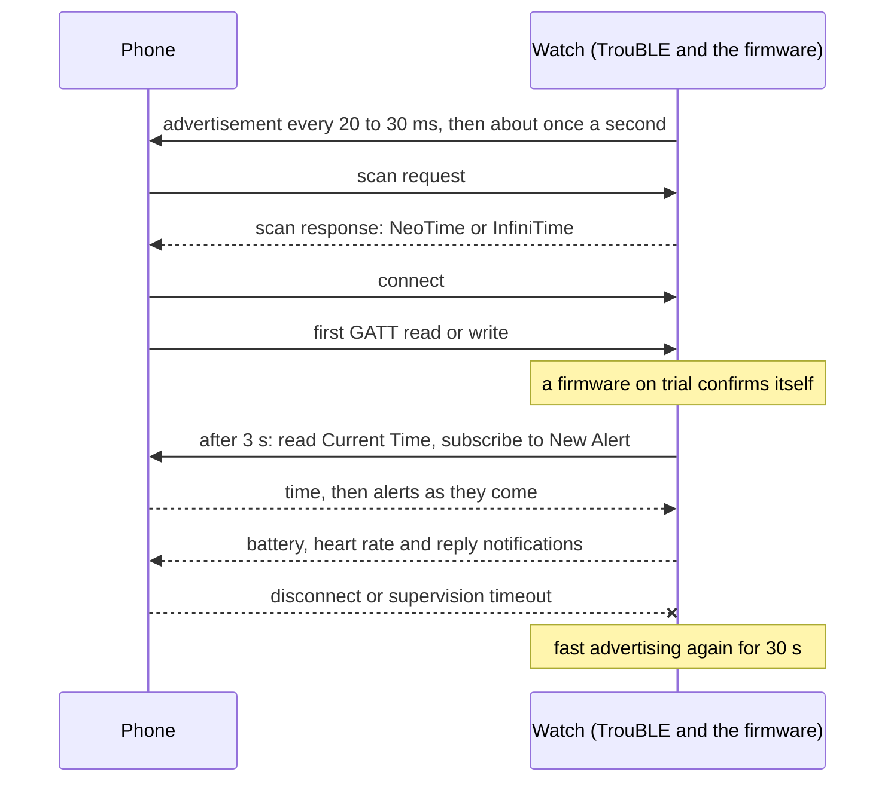

# Bluetooth controller

`neotime-bluetooth` (`drivers/bluetooth/`) is NeoTime's own Bluetooth LE controller, written in
Rust. It drives the nRF52832's radio directly and gives the
[TrouBLE](https://github.com/embassy-rs/trouble) host a standard HCI interface. No Nordic code is
involved: no SoftDevice, no SoftDevice Controller and no MPSL.

**Status:** it passes its tests on the computer, including TrouBLE running against it, and it runs
on the watch, where firmware updates, the companion app and its file transfers use it. The timing
checks under "Hardware tests" in [todo.md](todo.md) have not been made yet.

This page covers the controller first, then what the firmware builds on it: advertising, a
connection, the GATT services and the phone's own services.

## Why NeoTime has its own

A Bluetooth stack has two halves. The *host* handles connections, GATT and pairing; TrouBLE does
that. The *controller* handles the radio: advertising, timing every packet to the microsecond,
hopping channels and acknowledging packets. On the nRF52 the usual controller is Nordic's
SoftDevice Controller (SDC), a closed binary, which TrouBLE reaches through the `nrf-sdc` crate.

Built the same way from TrouBLE's battery-service example (size-optimised, logging off, nRF52832),
the two controllers compare like this:

| Controller | Whole example, flash | Whole example, RAM |
|---|---|---|
| Nordic SDC + MPSL, through `nrf-sdc` | 102.8 KB | 17.3 KB |
| `neotime-bluetooth` | 76.0 KB | 12.0 KB |

So it saves about 27 KB of flash and 5 KB of RAM. The controller's own code is about 7 to 10 KB,
most of it inlined into the radio interrupt. It also keeps the whole firmware in Rust, which is one
of NeoTime's goals.

The other open-source options were weighed first. Rubble, the earlier pure-Rust stack, has been
archived since 2022. The Rust bindings for Apache NimBLE's controller exist only as a personal
fork for the nRF52840. The SoftDevice's own Rust bindings, `nrf-softdevice`, bring their own host
and cannot be used with TrouBLE.

## How it fits together



- **`BluetoothController`** implements `bt-hci`'s `Transport` trait, so TrouBLE wraps it in
  `ExternalController` exactly as it would a controller on a separate chip. HCI packets pass as
  bytes, which keeps the interface to TrouBLE small and standard.
- **`HostInterface`** decodes HCI commands, keeps the event masks, and encodes events and data for
  the host. Unknown commands are refused with the standard "unknown command" status, which TrouBLE
  handles.
- **`LinkLayer`** is the state machine: standby, advertising, or one connection. It never touches
  hardware. The radio driver tells it what happened (a packet sent, a packet received, nothing
  heard) and it answers with the next `RadioOperation`: transmit, receive, or off. That is why the
  whole link layer runs in tests on a computer.
- **`nrf_radio`** is the only part that touches the chip, and the only part built just for the
  watch.

The guideline that drivers reach hardware only through `embedded-hal` cannot hold here: the radio
is part of the nRF52832 itself, and `embedded-hal` has no radio traits. Keeping all register
access in `nrf_radio.rs`, behind the small `Radio` trait, is the substitute.

## What it supports

- **Advertising:** connectable (`ADV_IND`), scannable (`ADV_SCAN_IND`) and non-connectable
  (`ADV_NONCONN_IND`), on any of the three advertising channels, with scan responses and the
  filter accept list (4 entries). Directed advertising is refused.
- **One connection, as the peripheral,** on the 1 Mbit PHY with channel selection algorithm #1.
- **Data** in packets of up to 27 bytes each way, with TrouBLE splitting and joining larger
  messages. Four packets can wait to be sent.
- **Flow control:** a packet from the central is acknowledged only when there is room to pass it
  on, so the central resends it rather than it being lost. The start of each message also needs a
  free packet in TrouBLE's pool beyond those already waiting, since the host drops a message it has
  no packet for; the firmware passes `free_default_packets` to `start` for this, and its long
  replies to the companion wait while fewer than two packets are free.
- **Control procedures:** connection parameter updates and channel map updates at their instants,
  feature exchange, version exchange, ping, and termination from either side. Anything else is
  answered with "unknown response", which tells the central the feature is missing. Up to four
  replies can wait to be sent; a request that needs one while they are full is left unacknowledged
  for the central to resend, while indications that need no reply are always taken.
- **Peripheral latency:** after an event in which the central was heard and the watch had nothing
  to send, it sleeps through as many events as the central's latency allows, with the window
  widening grown over the whole gap. It never skips while host data, a control reply or a
  terminate waits, nor while a connection or channel map update waits for its instant. A packet
  the host queues during the skip brings the listen back to the next event at least 3 ms away.
- **Losing the link:** the supervision timeout, a central that never shows up after connecting,
  and an update whose instant has already passed. The link layer checks these when the radio
  reports something, and the firmware's watchdog task calls `check_supervision` every half second
  too, so a radio that stopped reporting still ends the connection and the host advertises again.
  The radio driver keeps what the radio is doing as a byte, and a value it does not know, which
  only memory overwritten by something else gives, counts as nothing heard rather than leaving the
  radio off.

## Not done yet

| Missing | What it costs |
|---|---|
| **Encryption and pairing** (`LL_ENC_REQ`) | Only unencrypted connections. Gadgetbridge works without bonding, as it does with InfiniTime, but phones that insist on pairing will fail. A Pairing Request is answered at once with Pairing Failed, "pairing not supported", so a phone that only offers pairing gives up straight away and keeps the plain link. The chip's CCM and ECB peripherals do the AES work. |
| **Longer packets** (data length extension), **2 Mbit PHY**, **channel selection #2** | Slower transfers, for example of firmware updates. |
| **A connection parameter request** from the peripheral | TrouBLE falls back to asking over L2CAP, which works. |
| **Being the central**, and more than one connection | Not needed on a watch. |
| **Bluetooth qualification** | It has not been through the Bluetooth SIG's tests. |

## Timing

TIMER0 runs at 1 MHz and times every radio event. Five of the nRF52832's fixed PPI channels
connect it to the radio without the CPU:

| PPI channel | Connects | Used for |
|---|---|---|
| 20 | TIMER0 compare 0 → radio transmit enable | starting a transmission at an exact time |
| 21 | TIMER0 compare 0 → radio receive enable | starting to listen at an exact time |
| 22 | TIMER0 compare 1 → radio disable | giving up when nothing arrives |
| 26 | radio address → TIMER0 capture 1 | when a packet started arriving |
| 27 | radio end → TIMER0 capture 2 | when a packet finished |

Channel 26 also does a second job. A packet that starts arriving overwrites compare 1 with the
current time, which is already past, so the give-up never fires during a reception.

The reply to a received packet must start exactly 150 µs after it ends. The radio interrupt has
about 100 µs to work out the reply and write it to the send buffer, while TIMER0 starts the
transmitter on its own. The radio interrupt runs at the highest priority for this reason, and any
critical section elsewhere in the firmware must stay well under that budget.

Every connection event, it listens a little before the expected time and a little after. That
margin, the *window widening*, grows with the time since the last packet heard, at the central's
clock accuracy plus the watch's own 50 ppm. After a connect request or a connection update the
central may start anywhere in a *transmit window*, and the listen covers that whole window at every
event until the central is heard, capped so it ends before the next event's listen would start.

The first nRF52832 silicon revision has radio errata 102, 106 and 107. The controller applies
Nordic's documented workaround on that revision only. Which revision the PineTime has is not yet
checked.

## Sleeping between events

Between radio events TIMER0 and the 64 MHz crystal are stopped, and RTC0, on the 32768 Hz crystal,
keeps the time. The controller's clock is microseconds since RTC0 started: read from TIMER0 while it
runs, and from RTC0 while it sleeps. Two more PPI channels wake it without the CPU:

| PPI channel | Connects | Used for |
|---|---|---|
| 3 | RTC0 compare 0 → crystal start | starting the crystal 32 ticks (about 1 ms) before it is needed |
| 4 | RTC0 compare 1 → TIMER0 start | starting TIMER0 on an RTC0 tick, about 50 µs before the operation |

TIMER0 always starts on an RTC0 tick, so the clock knows exactly where it counts from, and the link
layer above never sees the difference. Whenever the next operation is at least 2 ms away the
controller sleeps until then; when the link layer turns the radio off it sleeps with no wake at all.
A sleeping controller asked for something sooner than the crystal can start, such as advertising
500 µs from now, moves it to the first moment it can. `wake_plan.rs` holds this planning, which
runs in tests on the computer.

The 64-bit RTC0 count is kept in software from the 24-bit counter, so it needs reading at least
every 512 seconds. Every advertising and connection event reads it; only a radio left off for longer
loses a wrap, which does no harm because nothing is waiting for a time then.

TIMER0 is stopped with SHUTDOWN, as STOP alone leaves it drawing current on the nRF52832 (erratum
78). In the emulator, the crystal runs in about 2 % of the time while the watch advertises.

## What it takes from the chip

- **Peripherals:** `RADIO`, `TIMER0`, `RTC0`, `RNG`, and PPI channels 3, 4, 20, 21, 22, 26 and 27.
  Nothing else in the firmware may use them.
- **The 64 MHz crystal,** started and stopped by the controller around each radio event; nothing
  else in the firmware may stop it.
- **The 32768 Hz clock,** which embassy-nrf starts for its own timer.
- **The `RADIO` interrupt,** at priority 0.
- **RAM:** about 1.5 KB of static state. That covers two 257-byte radio buffers, four queued
  packets each way, and the HCI event queue. TrouBLE's own buffers come on top; see
  [memory-map.md](memory-map.md).

## Using it

```rust
bind_interrupts!(struct Irqs {
    RADIO => neotime_bluetooth::RadioInterruptHandler;
});

let p = embassy_nrf::init(Default::default());
let controller = neotime_bluetooth::start(
    neotime_bluetooth::RadioPeripherals {
        radio: p.RADIO,
        timer: p.TIMER0,
        random_number_generator: p.RNG,
        start_transmit_channel: p.PPI_CH20,
        start_receive_channel: p.PPI_CH21,
        give_up_channel: p.PPI_CH22,
        address_time_channel: p.PPI_CH26,
        end_time_channel: p.PPI_CH27,
        real_time_counter: p.RTC0,
        start_crystal_channel: p.PPI_CH3,
        start_timer_channel: p.PPI_CH4,
    },
    Irqs,
);
let controller: ExternalController<_, 4> = ExternalController::new(controller);
let stack = trouble_host::new(controller, &mut resources).set_random_address(address).build();
```

The controller's own address is the chip's factory address with its top two bits set, which makes
it a valid static random address. TrouBLE usually sets its own with `set_random_address`. The
controller reports no public address.

## Advertising

The firmware advertises as InfiniTime does (`run_bluetooth` in `firmware/src/main.rs`, with the
bytes and intervals in `neotime_companion::advertising`):

- **How often.** Every 20 to 30 ms (32 to 47 units of 625 µs) for 30 seconds after the watch starts,
  a phone leaves or Bluetooth is turned back on, then every 1022 to 1032 ms (1636 to 1651 units).
  The controller uses the shortest of each, plus its random delay of up to 10 ms. When the fast
  time runs out the firmware stops advertising and starts again slow.
- **The advertisement,** 28 bytes: the flags (general discoverable, no classic Bluetooth), the Heart
  Rate service 0x180D as the complete list of 16-bit services, the legacy DFU service
  `00001530-1212-efde-1523-785feabcd123` as the complete list of 128-bit services, and a transmit
  power of 0 dBm.
- **The scan response** holds only the complete name: `NeoTime`, or `InfiniTime` while the
  `gadgetbridge_name` setting is on, so Gadgetbridge's PineTime/InfiniTime coordinator takes the
  watch. Every time it starts advertising the firmware lends the GAP service's Device Name (handle
  3) the same name, so a phone that connects reads it there too. Changing the setting, and reading
  the saved settings at start, raises `BLUETOOTH_SWITCHED`, so advertising starts again with the new
  name at once.
- **The GAP appearance** is 0x00C2, a smartwatch, as InfiniTime sets it.
- **When the controller refuses** to start advertising, the firmware tries again a second later
  rather than stopping, so a refused command never leaves the watch silent.
- **The `bluetooth` setting** off drops the phone and stops advertising until it is turned on again.

`tools/check_advertising.py` checks all of this in the emulator through the Bluetooth bridge's
controller: about 39 advertisements a second at first and under one a second after 30 s, the
advertisement's bytes, both names in the scan response and the GAP service, the appearance, fast
advertising again after a phone leaves, and a saved setting. None of it has run on the watch.

## A connection

One connection at a time, from advertising to the phone leaving:



While a phone is connected the Bluetooth task waits on the next GATT event, the replies to the
message channel and the packages characteristic, the battery's `PERCENT_CHANGED`, the heart rate's
`READING_TAKEN` and `BLUETOOTH_SWITCHED`. When the phone goes away mid-update, the DFU state keeps
what reached the flash, so the same image sent again carries on; see
[updates.md](updates.md#carrying-on-after-a-lost-link).

## The services on top

The firmware's GATT server is declared in `firmware/src/main.rs`, and its attribute table is a
constant in flash. After the GAP service it serves Legacy DFU, Current Time, the NeoTime service,
the Nordic UART, Battery, file transfer, Device Information, Alert Notification and Heart Rate, in
that order, so a new service goes at the end and the others keep their handles. The recovery
firmware serves the same table. What each one carries is in
[companion-protocol.md](companion-protocol.md#at-a-glance).

- **Heart Rate (0x180D)** is InfiniTime's: one characteristic, Heart Rate Measurement (0x2A37), read
  and notify, holding a flags byte of 0 and the latest beats per minute as one byte. The Bluetooth
  task notifies each new reading while the phone is subscribed. A subscription does not turn the
  sensor on, as on InfiniTime: phones such as Gadgetbridge subscribe whenever they connect, so the
  LED would otherwise stay lit all day. The pulse reaches the phone when the Heart app measures or
  the heart rate interval setting measures in the background. `tools/check_heart_rate.py` checks it
  in the emulator.
- **Device Information (0x180A)** serves the same six strings as InfiniTime; the serial number is
  filled from the chip's factory id once the server is built.
- **Battery (0x180F)** notifies the charge whenever it changes.
- **Long answers,** such as a folder listing or the app list, can fill TrouBLE's packets; the task
  then waits 20 ms and tries again, up to 50 times, rather than dropping a notification.

InfiniTime's Music, Navigation, Simple Weather, Motion and Immediate Alert services are not served;
navigation, music and weather arrive as Bangle.js lines on the Nordic UART instead.

## The phone's own services

The watch is also a GATT client of the phone, as InfiniTime is, while it stays the peripheral: ATT
lets either side of a connection ask the other. Three seconds after a phone connects,
`firmware/src/phone_services.rs` looks once for two of the phone's services, one request at a time:

1. **Current Time (0x1805).** It reads 0x2A2B and, when the phone has it, 0x2A0F, and sets the clock
   the way a phone's writes to the watch's own Current Time service do, so the step day, alarms and
   the clock kept across a reset follow. Setting the clock this way confirms a firmware on trial,
   as a phone's write does.
2. **Alert Notification (0x1811).** It writes New Alert's (0x2A46) CCCD to turn its notifications
   on, then writes `02 FF` to the control point (0x2A44), when there is one, to ask for new alerts
   in every category. Each New Alert the phone then notifies is read as the standard lays it out, a
   category byte, a count byte and the text, and shown as a notification, or rings as a call,
   through the same path as a New Alert written to the watch.

What it asks and how it reads the answers is `neotime-phone-client`, a state machine with no I/O,
tested on the computer against a pretend phone. A phone that has neither service answers two
requests with errors and is left alone. Each answer may take 5 seconds; one that misses that ends
the asking for the connection, since a late answer would be taken for the next request's. The
client keeps reading what the phone sends for the rest of the connection, so a late answer or a
notification never holds one of the host's eight packets, and it ends with the connection.

It runs beside the connection's own loop in the Bluetooth task, on the heap: 368 B while a phone is
connected, and only when the heap has that plus 2 KB free. It is polled out of line, so its 268 B
frame is on the stack only while it runs. TrouBLE's own `GattClient` would have cost about 12.6 KB
of flash, so the client sends and receives raw ATT through two calls added to the vendored TrouBLE
([NEOTIME.md](../neotime/third_party/trouble-host/NEOTIME.md)), for about 3 KB in all. The recovery
firmware leaves it out.

It asks only for 16-bit UUIDs and never raises the ATT MTU, so each answer is at most 23 bytes.
An iPhone is expected to refuse the read, since iOS serves its Current Time only over an encrypted
link, which the controller cannot make yet; see [todo.md](todo.md).

## Tests

`cargo test -p neotime-bluetooth` runs 137 tests on the computer:

- **The link layer, against a simulated central:**
  - advertising on each channel in turn;
  - scan responses and the filter accept list;
  - the first transmit window;
  - channel hopping with unused channels skipped;
  - acknowledgements, resends and flow control;
  - each control procedure;
  - both kinds of lost link.
- **Sleep planning:** when the timer keeps running, when it sleeps, the wake ticks, operations moved
  later, and the clock across its 32-bit wrap.
- **The HCI encoding,** checked by decoding our events with `bt-hci`'s own parsers.
- **TrouBLE end to end, on a fake radio:**
  - TrouBLE advertises, accepts a connection from the simulated central, and sees the central
    disconnect with the right reason;
  - the central reads a GATT characteristic: the request goes in through the link layer, TrouBLE's
    attribute server answers, and the answer comes back out through the controller's
    acknowledgements.
  - discovery never cuts a 128-bit UUID short after 16-bit ones;
  - a server laid out as the watch's answers several hundred ATT requests (discovery from every
    handle, reads, blobs, writes, CCCDs and a notification) with exactly the bytes in
    `src/gatt_transcript.txt`, which TrouBLE gave when it built its table in RAM at start-up;
  - only the values that change take RAM, constants and declarations refuse writes, and a server
    is built only once, since its values are a static.

`cargo test -p neotime-phone-client` plays the client against pretend phones: with both
services, with neither, without Local Time Information or the control point, a New Alert without
its own CCCD, declarations over several pages with 128-bit UUIDs between them, answers cut at the
end of the watch's buffer, a refused CCCD write, and a phone that stops answering after each
request. `tools/check_phone_services.py` plays a phone through the emulator's Bluetooth bridge;
see [testing.md](testing.md#bluetooth-without-bluez).

`tests/emulator/bluetooth_sleep.robot` checks in the PineTime emulator that the crystal is off
for most of the time while the firmware advertises. None of this shows that the timing works on
real hardware; the first test on the watch is in [todo.md](todo.md).
