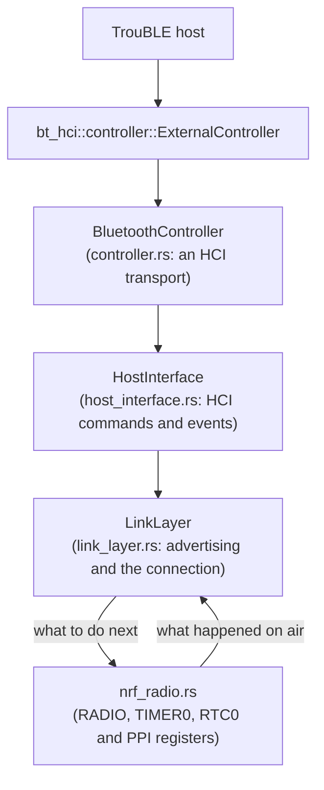

# Bluetooth controller

`neotime-bluetooth` (`drivers/bluetooth/`) is NeoTime's own Bluetooth LE controller, written in
Rust. It drives the nRF52832's radio directly and gives the
[TrouBLE](https://github.com/embassy-rs/trouble) host a standard HCI interface. No Nordic code is
involved: no SoftDevice, no SoftDevice Controller and no MPSL.

**Status:** it passes its tests on the computer, including TrouBLE running against it, and it runs
on the watch, where firmware updates over Bluetooth use it. The checks under "Hardware tests" in
[todo.md](todo.md) have not been made yet.

## Why NeoTime has its own

A Bluetooth stack has two halves. The *host* handles connections, GATT and pairing; TrouBLE does
that. The *controller* handles the radio: advertising, timing every packet to the microsecond,
hopping channels and acknowledging packets. On the nRF52 the usual controller is Nordic's
SoftDevice Controller (SDC), a closed binary, which TrouBLE reaches through the `nrf-sdc` crate.

Built the same way from TrouBLE's battery-service example (size-optimised, logging off, nRF52832),
the two controllers compare like this:

| Controller | Whole example, flash | Whole example, RAM |
|---|---|---|
| Nordic SDC + MPSL, through `nrf-sdc` | 102.8 KB | 17.3 KB |
| `neotime-bluetooth` | 76.0 KB | 12.0 KB |

So it saves about 27 KB of flash and 5 KB of RAM. The controller's own code is about 7 to 10 KB,
most of it inlined into the radio interrupt. It also keeps the whole firmware in Rust, which is one
of NeoTime's goals.

The other open-source options were weighed first. Rubble, the earlier pure-Rust stack, has been
archived since 2022. The Rust bindings for Apache NimBLE's controller exist only as a personal
fork for the nRF52840. The SoftDevice's own Rust bindings, `nrf-softdevice`, bring their own host
and cannot be used with TrouBLE.

## How it fits together



- **`BluetoothController`** implements `bt-hci`'s `Transport` trait, so TrouBLE wraps it in
  `ExternalController` exactly as it would a controller on a separate chip. HCI packets pass as
  bytes, which keeps the interface to TrouBLE small and standard.
- **`HostInterface`** decodes HCI commands, keeps the event masks, and encodes events and data for
  the host. Unknown commands are refused with the standard "unknown command" status, which TrouBLE
  handles.
- **`LinkLayer`** is the state machine: standby, advertising, or one connection. It never touches
  hardware. The radio driver tells it what happened (a packet sent, a packet received, nothing
  heard) and it answers with the next `RadioOperation`: transmit, receive, or off. That is why the
  whole link layer runs in tests on a computer.
- **`nrf_radio`** is the only part that touches the chip, and the only part built just for the
  watch.

The guideline that drivers reach hardware only through `embedded-hal` cannot hold here: the radio
is part of the nRF52832 itself, and `embedded-hal` has no radio traits. Keeping all register
access in `nrf_radio.rs`, behind the small `Radio` trait, is the substitute.

## What it supports

- **Advertising:** connectable (`ADV_IND`), scannable (`ADV_SCAN_IND`) and non-connectable
  (`ADV_NONCONN_IND`), on any of the three advertising channels, with scan responses and the
  filter accept list (4 entries). Directed advertising is refused.
- **One connection, as the peripheral,** on the 1 Mbit PHY with channel selection algorithm #1.
- **Data** in packets of up to 27 bytes each way, with TrouBLE splitting and joining larger
  messages. Four packets can wait to be sent.
- **Flow control:** a packet from the central is acknowledged only when there is room to pass it
  on, so the central resends it rather than it being lost.
- **Control procedures:** connection parameter updates and channel map updates at their instants,
  feature exchange, version exchange, ping, and termination from either side. Anything else is
  answered with "unknown response", which tells the central the feature is missing.
- **Losing the link:** the supervision timeout, a central that never shows up after connecting,
  and an update whose instant has already passed.

## Not done yet

| Missing | What it costs |
|---|---|
| **Encryption and pairing** (`LL_ENC_REQ`) | Only unencrypted connections. Gadgetbridge works without bonding, as it does with InfiniTime, but phones that insist on pairing will fail. The chip's CCM and ECB peripherals do the AES work. |
| **Peripheral latency** | It listens at every connection event even when the central allows it to skip some. |
| **Longer packets** (data length extension), **2 Mbit PHY**, **channel selection #2** | Slower transfers, for example of firmware updates. |
| **A connection parameter request** from the peripheral | TrouBLE falls back to asking over L2CAP, which works. |
| **Being the central**, and more than one connection | Not needed on a watch. |
| **Bluetooth qualification** | It has not been through the Bluetooth SIG's tests. |

## Timing

TIMER0 runs at 1 MHz and times every radio event. Five of the nRF52832's fixed PPI channels
connect it to the radio without the CPU:

| PPI channel | Connects | Used for |
|---|---|---|
| 20 | TIMER0 compare 0 → radio transmit enable | starting a transmission at an exact time |
| 21 | TIMER0 compare 0 → radio receive enable | starting to listen at an exact time |
| 22 | TIMER0 compare 1 → radio disable | giving up when nothing arrives |
| 26 | radio address → TIMER0 capture 1 | when a packet started arriving |
| 27 | radio end → TIMER0 capture 2 | when a packet finished |

Channel 26 also does a second job. A packet that starts arriving overwrites compare 1 with the
current time, which is already past, so the give-up never fires during a reception.

The reply to a received packet must start exactly 150 µs after it ends. The radio interrupt has
about 100 µs to work out the reply and write it to the send buffer, while TIMER0 starts the
transmitter on its own. The radio interrupt runs at the highest priority for this reason, and any
critical section elsewhere in the firmware must stay well under that budget.

Every connection event, it listens a little before the expected time and a little after. That
margin, the *window widening*, grows with the time since the last packet heard, at the central's
clock accuracy plus the watch's own 50 ppm.

The first nRF52832 silicon revision has radio errata 102, 106 and 107. The controller applies
Nordic's documented workaround on that revision only. Which revision the PineTime has is not yet
checked.

## Sleeping between events

Between radio events TIMER0 and the 64 MHz crystal are stopped, and RTC0, on the 32768 Hz crystal,
keeps the time. The controller's clock is microseconds since RTC0 started: read from TIMER0 while it
runs, and from RTC0 while it sleeps. Two more PPI channels wake it without the CPU:

| PPI channel | Connects | Used for |
|---|---|---|
| 3 | RTC0 compare 0 → crystal start | starting the crystal 50 ticks (about 1.5 ms) before it is needed |
| 4 | RTC0 compare 1 → TIMER0 start | starting TIMER0 on an RTC0 tick, about 50 µs before the operation |

TIMER0 always starts on an RTC0 tick, so the clock knows exactly where it counts from, and the link
layer above never sees the difference. Whenever the next operation is at least 2 ms away the
controller sleeps until then; when the link layer turns the radio off it sleeps with no wake at all.
A sleeping controller asked for something sooner than the crystal can start, such as advertising
500 µs from now, moves it to the first moment it can. `wake_plan.rs` holds this planning, which
runs in tests on the computer.

The 64-bit RTC0 count is kept in software from the 24-bit counter, so it needs reading at least
every 512 seconds. Every advertising and connection event reads it; only a radio left off for longer
loses a wrap, which does no harm because nothing is waiting for a time then.

TIMER0 is stopped with SHUTDOWN, as STOP alone leaves it drawing current on the nRF52832 (erratum
78). In the emulator, the crystal runs in about 2 % of the time while the watch advertises.

## What it takes from the chip

- **Peripherals:** `RADIO`, `TIMER0`, `RTC0`, `RNG`, and PPI channels 3, 4, 20, 21, 22, 26 and 27.
  Nothing else in the firmware may use them.
- **The 64 MHz crystal,** started and stopped by the controller around each radio event; nothing
  else in the firmware may stop it.
- **The 32768 Hz clock,** which embassy-nrf starts for its own timer.
- **The `RADIO` interrupt,** at priority 0.
- **RAM:** about 1.5 KB of static state. That covers two 257-byte radio buffers, four queued
  packets each way, and the HCI event queue. TrouBLE's own buffers come on top; see
  [memory-map.md](memory-map.md).

## Using it

```rust
bind_interrupts!(struct Irqs {
    RADIO => neotime_bluetooth::RadioInterruptHandler;
});

let p = embassy_nrf::init(Default::default());
let controller = neotime_bluetooth::start(
    neotime_bluetooth::RadioPeripherals {
        radio: p.RADIO,
        timer: p.TIMER0,
        random_number_generator: p.RNG,
        start_transmit_channel: p.PPI_CH20,
        start_receive_channel: p.PPI_CH21,
        give_up_channel: p.PPI_CH22,
        address_time_channel: p.PPI_CH26,
        end_time_channel: p.PPI_CH27,
        real_time_counter: p.RTC0,
        start_crystal_channel: p.PPI_CH3,
        start_timer_channel: p.PPI_CH4,
    },
    Irqs,
);
let controller: ExternalController<_, 4> = ExternalController::new(controller);
let stack = trouble_host::new(controller, &mut resources).set_random_address(address).build();
```

The controller's own address is the chip's factory address with its top two bits set, which makes
it a valid static random address. TrouBLE usually sets its own with `set_random_address`. The
controller reports no public address.

## Tests

`cargo test -p neotime-bluetooth` runs 129 tests on the computer:

- **The link layer, against a simulated central:**
  - advertising on each channel in turn;
  - scan responses and the filter accept list;
  - the first transmit window;
  - channel hopping with unused channels skipped;
  - acknowledgements, resends and flow control;
  - each control procedure;
  - both kinds of lost link.
- **Sleep planning:** when the timer keeps running, when it sleeps, the wake ticks, operations moved
  later, and the clock across its 32-bit wrap.
- **The HCI encoding,** checked by decoding our events with `bt-hci`'s own parsers.
- **TrouBLE end to end, on a fake radio:**
  - TrouBLE advertises, accepts a connection from the simulated central, and sees the central
    disconnect with the right reason;
  - the central reads a GATT characteristic: the request goes in through the link layer, TrouBLE's
    attribute server answers, and the answer comes back out through the controller's
    acknowledgements.

`tests/emulator/bluetooth_sleep.robot` checks in the PineTime emulator that the crystal is off
for most of the time while the firmware advertises. None of this shows that the timing works on real hardware. The first test on the watch is in
[todo.md](todo.md).
