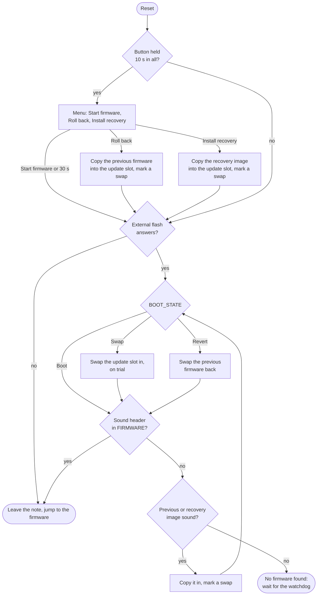

# Bootloader

The bootloader is the first code that runs when the watch starts. It installs a waiting firmware
update or the recovery firmware, then starts the firmware. It is built on
[embassy-boot](https://embassy.dev/book/#_bootloader), so updates survive a power cut part way, and
a new firmware that fails to start is rolled back by itself. Every firmware image carries a
256-byte [header](#the-image-header), and the bootloader never starts one whose header is missing,
damaged or linked for another address. Where the update and recovery slots sit in the external
flash is read from the [slot table](#the-slot-table), which the firmware can change.

It is about 18.1 KB, in a 20 KB region, which leaves about 1.9 KB; its status screen takes
about 6 KB of that, and the battery line on it about 0.7 KB.

The work of an update is split three ways:

- **The bootloader** only acts on the watch: it swaps, rolls back and installs recovery.
- **The firmware's Bluetooth** only uploads: it writes the new image into the update slot, marks it,
  and resets. It speaks Nordic's legacy DFU, as InfiniTime does, so Gadgetbridge and the other
  companion apps update BattleTime unchanged; see [updates.md](updates.md).
- **A reloader image** moves a watch onto BattleTime once, from InfiniTime or wasp-os (below).

## Crates

| Crate | Path | Runs on | What it holds |
|---|---|---|---|
| `battletime-bootloader` | `bootloader/` | the watch only | the bootloader program |
| `battletime-boot` | `boot/` | the watch and in tests | the flash layout, the image header, the slot table, the watchdog timeout, the recovery copy |
| `battletime-external-flash` | `drivers/external_flash/` | the watch and in tests | the external flash driver |
| `battletime-status-screen` | `drivers/status_screen/` | the watch, and in the simulator's tests | the small ST7789 driver for the blue status screen |
| `battletime-battery-reading` | `drivers/battery_reading/` | the watch and in tests | one blocking reading of the battery's voltage, straight from the SAADC's registers |
| `battletime-battery` | `services/battery/` | the watch and in tests | the charge curve, the battery line's words and the lowest voltage for a bootloader write, shared with the firmware |
| `battletime-bootloader-updater` | `bootloader-updater/` | the watch only | the image that replaces this bootloader on a watch already on BattleTime |

`battletime-boot` is shared with the firmware, which must use the same layout and watchdog timeout.
The bootloader's linker memory map is generated from it by `bootloader/build.rs`, so the two
cannot drift apart. The layout rules embassy-boot checks at start-up are also checked when
`battletime-boot` compiles, so a bad layout fails the build instead of the watch.

## Flash layout

The firmware runs from internal flash, because the chip cannot run code straight from the external
flash. Updates and the recovery firmware wait in external flash until they are swapped in.

Internal flash, 512 KB:


| Region | Start | Size | Holds |
|---|---|---|---|
| `BOOTLOADER` | `0x00000` | 20 KB | this bootloader, the first code to run; there is no Nordic MBR or SoftDevice |
| `SLOT_TABLE` | `0x05000` | 8 KB | two pages recording where the external slots sit ([below](#the-slot-table)) |
| `BOOT_STATE` | `0x07000` | 4 KB | embassy-boot's record of what to do at the next start |
| `FIRMWARE` | `0x08000` | 480 KB | the running firmware, to the end of flash: its image header, its code from `FIRMWARE_VECTOR_TABLE` (`0x08100`), where it is linked, then the shared library (images, fonts, components and common code that apps share) where the header says; apps live on the external flash |

The first 32 KB, from the bootloader to the boot state, belong to the bootloader; the firmware never
writes the bootloader's pages, only the slot table and the boot state through their own APIs.

External flash, 4 MB, with the slots where `DEFAULT_SLOTS` puts them:


| Region | Start | Size | Holds |
|---|---|---|---|
| update slot | `0x000000` | 484 KB | a new firmware waiting to be installed, then the one it replaced, one page up; one page more than `FIRMWARE`, which the swap needs |
| (free) | `0x079000` | 308 KB | room the slot table can give to either slot |
| recovery slot | `0x0C6000` | 232 KB | a small firmware that can only receive a new firmware over BLE |
| `FILE_SYSTEM` | `0x100000` | 3 MB | the flash store: apps, settings and shared resources (see [storage.md](storage.md)) |

Both slots must lie in `SLOT_AREA`, everything below `FILE_SYSTEM`, so an image and the file system
never share a sector. `FIRMWARE` cannot move, since the firmware is linked to run there. The code
and the shared library share its 480 KB, so either can grow into the other's room; nothing on the
watch writes the library, which arrives with each firmware update.

## The image header

Every image the bootloader runs, the firmware, the recovery firmware and the bootloader updater,
starts with a 256-byte header (`battletime_boot::image_header`), which `tools/image_header.py` puts in
front of the `.bin` after the build. All numbers are little-endian:

| Offset | Size | Field |
|---:|---:|---|
| 0 | 4 | magic, `NTIM` |
| 4 | 2 | header version, 2 |
| 6 | 2 | header size, 256 |
| 8 | 1 | image type: 1 firmware, 2 recovery, 3 bootloader updater |
| 9 | 3 | version: major, minor, patch |
| 12 | 4 | load address: where the vector table must sit, `0x08100` |
| 16 | 4 | image size, the bytes after the header |
| 20 | 4 | CRC-32 of the image |
| 24 | 4 | build time, seconds since 1970 (the commit's time from `tools/build_images.sh`) |
| 28 | 8 | short commit hash in ASCII, `*` after it for uncommitted changes, zero padded |
| 36 | 4 | where the shared library starts, counted from the start of the header; 0 for none |
| 40 | 4 | the shared library's size; 0 for none |
| 44 | 208 | reserved, zero |
| 252 | 4 | CRC-32 of the 252 bytes before it |

A library must lie wholly inside the image, after the header, or the header counts as unsound.
`tools/image_header.py --library dist/shared.ntlib` appends the library after the code on a word
boundary and fills both fields; the recovery firmware carries none. The firmware finds the library
by reading its own header at `0x08000` (`battletime_packages::library::firmware_library`). A header of
any other version reads as unsound, so the bootloader never runs it.

The vector table follows at offset 256, which is 256-byte aligned as the Cortex-M4 requires, and
the bootloader points VTOR there before it jumps. `python3 tools/image_header.py --describe
dist/firmware.bin` prints a header and checks both CRCs; its `--self-test` and
`the_header_matches_the_one_the_packaging_tool_writes` in `boot/src/tests.rs` check the same bytes,
so the tool and the watch cannot drift apart.

The checks are split by cost. On every start the bootloader reads only the header in `FIRMWARE`:
magic, header CRC and load address. Before it installs the previous or the recovery firmware, it
also reads the whole image in the external flash and checks its CRC. The firmware checks the
header and the image CRC before it marks an uploaded update or keeps an uploaded recovery
firmware, so a damaged upload is refused while the phone is still connected.

## The slot table

`SLOT_TABLE` holds where the update and recovery slots sit, so the firmware can move them without
a new bootloader, for example to size the recovery slot to the recovery image. It is a log of
32-byte records (`battletime_boot::slot_table`): magic `NTST`, a sequence number, the update slot's
start and size, the recovery slot's start and size, a spare word, and a CRC-32 of the rest.

- **Reading** takes the newest record whose CRC matches and whose slots pass `Slots::check`: whole
  pages, inside `SLOT_AREA`, the update slot exactly one page more than `FIRMWARE`, the recovery
  slot between 64 KB and `FIRMWARE`'s size, and no overlap. With no such record, the slots are
  `DEFAULT_SLOTS`, so an erased table, or pages still holding an old system's code, read as the
  defaults.
- **Writing** (`write_slots`) appends a record after the last one, so nothing is erased until a
  page fills. A full page moves the log to the other page, which is erased first; the old page keeps
  the newest record until the new one is whole, so a power cut leaves the old slots or the new ones,
  never neither. Each record is read back after it is written.
- **The firmware** changes the slots with `battletime_updates::change_slots`, which refuses while a
  swap is pending or a firmware is on trial, since moving the update slot then would lose the
  firmware a rollback needs. Moving a slot does not move its contents: send the recovery firmware
  again after moving the recovery slot.

The companion moves them with the `slots` message ([companion-protocol.md](companion-protocol.md#slots-served)),
which the firmware answers with `storage::answer_slots`: it carries the recovery image to a new
recovery slot first (`battletime_boot::move_recovery`), then calls `change_slots` and restarts.

### Why the slot area stays at 1 MB

The slot area ends where the file system starts, at `0x100000`, and that boundary is fixed. It
holds the 484 KB update slot and a recovery slot as large as the firmware, with 60 KB to spare, so
the recovery slot can take either the small recovery build or a full firmware without the file
system moving. Squeezing the recovery slot to the small image would give the file system only
about 300 KB more, while a typical install uses 44 KB of its 2 MB of files.

The update slot already acts as a B slot: after each swap it holds the previous firmware, which a
rollback restores. The recovery firmware is kept apart from that pair on purpose. It is a small
build, rarely rebuilt, so a bug that the running and the previous firmware share, such as one in
DFU or in mounting the store, does not reach it. There is no backup bootloader; the bootloader is
not expected to change, and a watch that cannot reach it needs an SWD probe.

## What happens at start

1. Make sure the NFC pins are plain GPIO, since P0.10 resets the touch panel. If an erased UICR
   has turned NFC back on, embassy-nrf turns it off and resets the watch.
2. Start the watchdog with a 5 second timeout. If the firmware left it running with a different
   timeout, it cannot be changed, so wait for it to reset the watch.
3. If the button is held, show "Keep holding for the menu" and keep watching it for 5 seconds. If
   it is still held, buzz once and open the menu (below).
4. Wake the external flash and check that it answers as a 4 MB chip. If it does not, skip
   straight to step 8 rather than leave the watch unable to start.
5. Read the slot table.
6. Let embassy-boot act on `BOOT_STATE`:
   - **Boot**: nothing to do.
   - **Swap**: show "Installing firmware, Do not unplug", then swap `FIRMWARE` with the update
     slot page by page, recording progress in `BOOT_STATE`, so a power cut resumes where it
     stopped.
   - **Revert**: the last swapped-in firmware never marked itself booted, so swap the old one back.
7. Check the header in `FIRMWARE`. If it is not sound, show "Damaged, Repairing firmware" and
   install the previous firmware, or failing that the recovery firmware, as the menu does (below),
   then run step 6 again. With neither, show "No firmware found, Send an update" and wait for the
   watchdog, which starts the bootloader over.
8. Leave a note for the firmware in RAM (below), turn off every interrupt, point VTOR at
   `FIRMWARE_VECTOR_TABLE` and jump there.

Every flash read, write and erase feeds the watchdog, so a long swap does not trip it.



A firmware on trial that never confirms itself is swapped back out at the next reset, which is the
Revert branch; see [updates.md](updates.md#confirming-or-rolling-back).

## The status screen

On an ordinary start the screen stays dark and the firmware starts at once. Whenever the bootloader
has work to do, it turns the screen blue (`status_colour::BOOTLOADER`) and shows the same page as
the firmware ([updates.md](updates.md#the-status-page)), titled "BattleTime bootloader", with
Bootloader `Working`, Filesystem `Not mounted` and Bluetooth `Off`. Below the progress line it shows
the battery from one fresh reading each time the page changes, such as "Battery 87% charging",
"Battery 100% charged" or "Battery 40% unplugged", with the charge read along the firmware's curve;
the menu's last option covers it while the menu is open. The screen code is its own
small ST7789 driver in `drivers/status_screen`, since the firmware's display driver does not
fit. It draws the 10x20 font straight from its bitmap rather than through embedded-graphics' text
code, which would not fit either. The simulator's tests run it against the simulator's ST7789
model, through the panel's SPI wires.

| When | Firmware / Action / Progress |
|---|---|
| The button is held at start | Unchanged / Keep holding for / the menu |
| The menu | Unchanged, then the three options from the action line down, the selected one marked with `>`, and "Press: next Hold: pick" |
| Rolling back | Swapping / Rolling back / Do not unplug |
| Installing the recovery firmware | Swapping / Installing recovery / Do not unplug |
| No previous firmware, or no valid recovery firmware | Unchanged / No previous firmware or No recovery found / Starting firmware |
| The firmware has no sound header | Damaged / Repairing firmware / Do not unplug |
| Nothing anywhere has a sound header | Damaged / No firmware found / Send an update |
| Swapping in an update, or rolling one back | Swapping / Installing firmware / Do not unplug |

The bootloader updater shows the page titled "BattleTime boot updater", with Firmware `Updater`, and
its Bootloader line goes `Checking`, `Writing`, then `Updated` or `Up to date`.

## The note to the firmware

The firmware cannot tell from `BOOT_STATE` alone that it was just installed as the recovery
firmware, so the bootloader leaves a note in RAM at `BOOT_NOTE_ADDRESS`, the third word of the
alive marker, which every program's linker keeps free. `BootNote::RecoveryInstalled` means the
button hold, or the repair in step 7, installed the recovery firmware on this start, and `BootNote::Normal` means anything
else. The top half of the word is a fixed pattern, so whatever RAM held at power-on never reads
as a note.

## The version record

The bootloader carries its version and build date in a 42-byte record in its constants: the magic
`NTBootV1`, the version text such as `0.1.0+1b19aed`, padded with zeros to 24 bytes, and the UTC
build date as `YYYY-MM-DD`. `bootloader/build.rs` writes it with
`battletime_boot::version::VersionRecord` and the same version text the firmware's build uses, and
the record starts on a word boundary. Nothing in the bootloader reads it, so `main` keeps it with
`black_box`. The firmware's system app shows it: `VersionRecord::find` reads the bootloader's
pages a word at a time for the magic, the first time an app asks. A bootloader built before the
record has none, and the app shows the start of its CRC-32 instead, as the status page does.
Because the record holds the commit, every build of a new commit is a new bootloader to the
updater, which then writes it rather than reporting it up to date.

## Updating the bootloader

Nothing on the watch can replace the bootloader once it is installed, so a new one goes out inside
the bootloader updater (`bootloader-updater/`, built into `dist/bootloader-updater.zip` by
`tools/build_images.sh`). It is sent like any firmware update, and the bootloader swaps it in on
trial. It then:

1. Checks the bootloader it carries: its CRC, and a vector table that starts inside `BOOTLOADER`.
   The updater is itself an image with a header, of type bootloader updater.
   A damaged one is never written; holding the button quits.
2. Compares it with the installed bootloader. If they match, nothing is written.
3. Waits for the charger and enough charge, since a power cut during the write leaves nothing that
   starts: power on P0.19 and at least 3.7 V on the battery (`MINIMUM_MILLIVOLTS_TO_WRITE_BOOTLOADER`),
   read once a second and shown as the battery line. Below that it says "Battery low, charging" and
   waits while the charger fills it. Holding the button meanwhile quits.
4. Erases and writes the bootloader's pages from RAM, then reads them back. On a mismatch it tries
   again, feeding the watchdog whatever the button does, and never resets with a broken bootloader.
5. Leaves a note at `UPDATER_NOTE_ADDRESS`, the alive marker's fourth word, and resets.

The updater never confirms itself, so its reset makes the new bootloader roll back to the firmware
that was running before. That firmware reads the note, clears the rollback's mark with
`battletime_updates::forget_rollback`, and its status page says "Bootloader updated" or "Bootloader up
to date" instead of "Update failed". Quitting leaves no note, so a quit reads as the failed update
it is. The write is five pages, half a second or so, and is the only part with no way back;
[updates.md](updates.md#losing-power-during-the-bootloader-write) sets out what would have to go
wrong for a power cut to land in it.

`tests/emulator/bootloader_update.robot` runs it over a copy of the built bootloader with one byte
of its title changed.

## What the firmware must do

- **Mark itself booted** with `battletime_updates::confirm_running_firmware` once it is sure it works,
  for example after the BLE stack and screen have started. Otherwise the next reset rolls it back,
  and no new update is accepted until it does. It only writes when the firmware is on trial, so
  after a rollback the Revert mark stays until the next update, and the status page can keep saying
  so.
- **Feed the watchdog.** It is still running when the firmware starts. Take it over with the
  same timeout, `WATCHDOG_TIMEOUT_IN_TICKS`, and feed it from the system loop.
- **Install updates** by feeding the new image, a `.bin` with its header, linked at
  `FIRMWARE_VECTOR_TABLE`, to `battletime_updates::UpdateReceiver`, which stores it in the update slot,
  checks its header and CRC, and marks the swap, then resetting.
- **Keep a recovery firmware** in the recovery slot, written with
  `battletime_updates::RecoveryReceiver`, which writes the header's first bytes last.
- **Read the slot table** with `battletime_boot::slot_table::read_slots` before using either slot.

## The menu: rollback and recovery

The menu is for a firmware that starts but is broken badly enough that it cannot take an update,
or one that should be swapped for the firmware before it. It needs only the side button.

The system loop feeds the watchdog only while the button is up, and while the shell and the radio
make progress (see the button driver in [drivers.md](drivers.md)), so the menu opens with
one long hold:

1. Hold the button. After about 5 seconds the watchdog resets the watch.
2. Keep holding. After 5 more seconds in the bootloader (`MENU_BUTTON_HOLD_IN_MILLISECONDS`), the
   watch buzzes once and shows the menu. Let go.
3. A short press moves to the next option: **Start firmware**, **Roll back**, **Install recovery**.
   A press held for a second (`MENU_SELECT_HOLD_IN_MILLISECONDS`) picks the marked one, with a buzz.
   After 30 seconds without a press (`MENU_TIMEOUT_IN_MILLISECONDS`) it starts the firmware, so a
   watch is never left in the menu. Start firmware, picked or timed out, is an ordinary start: a
   firmware still on trial, such as one Roll back just installed that no phone has connected to
   yet, is swapped back out, as on any reset.
4. **Roll back** needs the firmware the last swap replaced, which sits one page up in the update
   slot (`Slots::previous_firmware`). **Install recovery** needs the recovery slot. Either image must
   have a sound header for `FIRMWARE` and a matching CRC; if it does not, the watch buzzes three
   times and starts the firmware it has, with nothing changed.
5. The bootloader marks the running firmware booted, which drops the progress a swap left in
   `BOOT_STATE`, then copies the image to the start of the update slot
   (`copy_previous_into_update_slot` moves it down a page in place; `copy_image_into_update_slot`
   copies the recovery image across, only as far as its header says it runs) and marks a swap. The image is then installed by the same power-cut-safe swap
   as any update, with the screen blue for up to about 30 seconds.

Clearing the state first matters for a firmware still on trial: its swap's progress is still in
`BOOT_STATE`, and marking a swap over it would leave that progress in place, so embassy-boot would
revert from the slot the copy has just overwritten.

A power cut during the copy loses the image in the update slot, but the running firmware is
untouched. One case is not covered: a power cut part way through a swap, then the menu, leaves a
half-swapped firmware for Roll back to replace, and Roll back then copies whatever the half swap
left above it; Install recovery recovers from that.

The firmware that was running ends up in the update slot. The installed firmware runs on trial and
must confirm itself, or the next reset swaps the other one back.

## Building and flashing

```sh
nix develop
cd battletime/bootloader
cargo build --release
```

`bootloader/` is not in the Cargo workspace, because it only builds for the watch.
`cargo run --release` flashes it over SWD with probe-rs, for a watch with a probe attached;
`tools/build_images.sh` builds it, with every other image, into `dist/`.

## Not done yet

- **Signed updates.** embassy-boot's updater can check an ed25519 signature before marking a swap.
  That check runs in the firmware, in `battletime-updates`, so it costs the bootloader nothing; it is
  not used yet.
