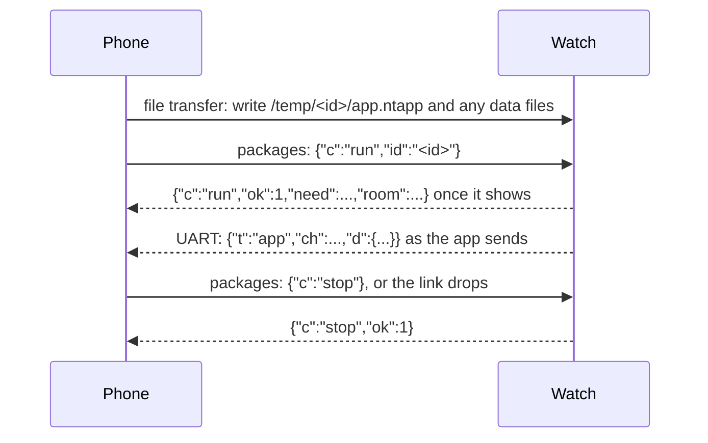

# Companion protocol

How a phone or computer talks to a BattleTime watch over Bluetooth Low Energy. The BattleTime Companion
app mirrors this page in its `src/protocol`, and its Rust core in `core/src/protocol`; this page is
the single source for all of them. Each part says whether the watch serves it yet.

## At a glance

Every build of the firmware, the recovery firmware included, serves the same GATT table, in this
order. A new service goes at the end, so the others keep their handles.

| Service | UUID | Characteristics | For |
|---|---|---|---|
| GAP | `0x1800` | Device Name `0x2A00`, Appearance `0x2A01` | The name (`BattleTime`, or `InfiniTime`) and a smartwatch appearance, 0x00C2 |
| Legacy DFU | `00001530-1212-efde-1523-785feabcd123` | Control point `…1531` (write, notify), packet `…1532` (write without response), version `…1534` (read) | [Firmware updates](updates.md) |
| Current Time | `0x1805` | `0x2A2B` (read, write), `0x2A0F` (read, write) | [Time and time zone](#time-and-time-zone) |
| BattleTime | `6e540001-0000-4000-8000-4e656f54696d` | Diagnostics `6e540002-…` (read, write), packages `6e540003-…` (write, notify) | [The BattleTime service](#the-battletime-service) |
| Nordic UART | `6e400001-b5a3-f393-e0a9-e50e24dcca9e` | Receive `6e400002-…` (write, with or without response), transmit `6e400003-…` (notify) | [The message channel](#the-message-channel) |
| Battery | `0x180F` | Battery Level `0x2A19` (read, notify) | [Standard services](#standard-services) |
| File transfer | `0xFEBB` | Version `adaf0100-4669-6c65-5472-616e73666572` (read), transfer `adaf0200-4669-6c65-5472-616e73666572` (write, notify) | [File transfer](#file-transfer) |
| Device Information | `0x180A` | `0x2A29`, `0x2A24`, `0x2A25`, `0x2A26`, `0x2A27`, `0x2A28` (read) | [Standard services](#standard-services) |
| Alert Notification | `0x1811` | New Alert `0x2A46` (write) | [Standard services](#standard-services) |
| Heart Rate | `0x180D` | Heart Rate Measurement `0x2A37` (read, notify) | [Standard services](#standard-services) |

The watch is also a client of two of the phone's own services, Current Time and Alert
Notification; see [The phone's services the watch uses](#the-phones-services-the-watch-uses).

InfiniTime's Simple Weather and Immediate Alert services are served too. Its Music, Navigation and
Motion services are written but left out of the shipped firmware for want of flash; each is a cargo
feature, as [bluetooth.md](bluetooth.md#infinitimes-own-services) describes. Without them, music
and navigation reach the watch through the Bangle.js lines on the
[message channel](#calls-music-weather-and-the-rest-served).

| Service | UUID | Characteristics | Served |
|---|---|---|---|
| Simple Weather | `00050000-78fc-48fe-8e23-433b3a1942d0` | Data `00050001-…` (write): message type 0 is the current weather, version 0 or 1, as a timestamp, the temperature, low and high in hundredths of a °C, a 32-byte place, an icon (0 clear to 8 mist) and, in version 1, sunrise and sunset in minutes into the local day; type 1 is the forecast, up to 5 days of low, high and icon | Yes |
| Music | `00000000-78fc-48fe-8e23-433b3a1942d0` | Event `00000001-…` (notify), status `…02`, artist `…03`, track `…04`, position `…06` and length `…07` in big-endian seconds (write) | With `music-service` |
| Navigation | `00010000-78fc-48fe-8e23-433b3a1942d0` | Icon name `00010001-…`, instruction `…02`, distance as text `…03`, progress percent `…04` (write) | With `navigation-service` |
| Immediate Alert | `0x1802` | Alert Level `0x2A06` (write, with or without response): 1 or 2 rings to find the watch, 0 stops it | Yes |
| Motion | `00030000-78fc-48fe-8e23-433b3a1942d0` | Step count `00030001-…` (read, notify, 4 bytes), raw x, y and z `…02` (read, notify, three 16-bit milli-g) | With `motion-service` |

| Message family | Where |
|---|---|
| Settings, notifications, calls, music, weather, navigation, find, vibrate, status, slots, app state | JSON lines on the Nordic UART service, from [The message channel](#the-message-channel) on |
| Reading, writing, listing, moving and deleting files | the file transfer service, [File transfer](#file-transfer) |
| Files the companion writes for apps, and records it reads back | [Files the companion writes](#files-the-companion-writes) and [Records the companion reads](#records-the-companion-reads) |
| Installing, listing, enabling and running apps | JSON lines on the packages characteristic, [Packages](#packages-served) |
| Counters and the last crash | the diagnostics characteristic, [Diagnostics](#diagnostics-served) |

## Finding the watch

- The watch advertises as InfiniTime does: the Heart Rate service `0x180D`, the legacy DFU service
  and a transmit power of 0 dBm in the advertisement, and the complete local name `BattleTime` in the
  scan response, so a phone must scan actively to see the name. It advertises every 20 to 30 ms for
  30 seconds after it starts or a phone leaves, then about once a second; see
  [bluetooth.md](bluetooth.md#advertising). Its GAP appearance is 0x00C2, a smartwatch.
- With the `gadgetbridge_name` setting on, the watch advertises and gives its GAP name as
  `InfiniTime` instead, which Gadgetbridge's PineTime/InfiniTime coordinator matches, so Gadgetbridge
  offers its InfiniTime support: notifications, calls, the time, the heart rate, the battery,
  firmware updates and files through the services above. Its music, navigation, weather and find
  features need InfiniTime's own services, which the watch does not serve yet.
- After connecting, a BattleTime watch is recognised by the BattleTime service
  `6e540001-0000-4000-8000-4e656f54696d`.
- A client should check which services are present and offer only the features they support, since
  older firmware serves fewer.
- The first GATT read or write from a phone confirms a firmware that is on trial after an update, as
  does the clock being set from the phone's own Current Time service; see
  [updates.md](updates.md#confirming-or-rolling-back).

## Standard services

| Service | UUID | Characteristic | Use | Served |
|---|---|---|---|---|
| Current Time | `0x1805` | `0x2A2B`, read and write | Writing the 10-byte Current Time value sets the clock to that local time, read in the zone the watch already has; reading it gives the watch's local time, with the day of the week and 256ths of a second. A write that is not a real date and time is ignored. See [Time and time zone](#time-and-time-zone). | Yes |
| | | `0x2A0F`, read and write | Local Time Information: the time zone and daylight saving offset, in quarter hours. Writing it changes the zone and keeps the local time; reading it gives the zone the watch is in, or 0 and 0 until one is written. A value outside the field's range is ignored. Saved, so it survives a restart. | Yes |
| Battery | `0x180F` | `0x2A19`, read and notify | The charge, 0 to 100, notified when it changes. | Yes |
| Heart Rate | `0x180D` | `0x2A37` Heart Rate Measurement, read and notify | Two bytes, as InfiniTime sends: flags `0` (the rate is one byte, no other fields), then the latest reading in beats per minute, held at 255, or 0 before the first. Notified at each new reading while subscribed. Subscribing does not start the sensor; readings come from an app measuring or the `heart_rate_interval` setting. | Yes |
| Device Information | `0x180A` | `0x2A29`, `0x2A24`, `0x2A25`, `0x2A26`, `0x2A27`, `0x2A28`, read | The same six strings InfiniTime serves: manufacturer `PINE64`, model `PineTime`, the serial number as the chip's 64-bit factory id in 16 upper-case hex digits, the firmware version as the status page shows it (such as `0.1.0+1b19aed`), hardware revision `1.0.0` and software revision `BattleTime`. | Yes |
| Alert Notification | `0x1811` | `0x2A46` New Alert, write | Shows a notification, read as InfiniTime reads it: a category byte, two more header bytes, then a title, a zero byte and the body, or only a body when there is no zero byte; at most 125 bytes. The category names the notification's app (`Email`, `Call`, `SMS`, `Messages` and the rest of the standard's list; `Alert` for any other). A write in category 3, an incoming call, opens the call screen and rings as a `call` `incoming` line does, naming the caller from the title, or from the body when there is no title; it is not kept as a notification. A write with no text is ignored. Each other one is kept as a new notification, as in [Notifications](#notifications-served). | Yes |

The legacy DFU service is in [updates.md](updates.md#the-protocol-nordic-legacy-dfu), and the file
transfer service in [File transfer](#file-transfer).

### The phone's services the watch uses

The watch also reads two of the phone's own services, as a GATT client, as InfiniTime does. Three
seconds after a phone connects it looks for them once; a phone that serves neither is left alone,
and one that does needs no app for them. [bluetooth.md](bluetooth.md#the-phones-own-services) says
how the watch asks and how long it waits. The recovery firmware does not look.

| Service | UUID | Characteristic | What the watch does |
|---|---|---|---|
| Current Time | `0x1805` | `0x2A2B`, read | Reads it and sets the clock from it as from a write to its own 0x2A2B; see [Time and time zone](#time-and-time-zone). Setting the clock this way confirms a firmware on trial. |
| | | `0x2A0F`, read | Reads it, when the phone has it and its Current Time was a real date and time, and takes the zone as from a write to its own 0x2A0F. |
| Alert Notification | `0x1811` | `0x2A46` New Alert, notify | Turns its notifications on. Each one is read as the standard lays it out: a category byte, a count byte, then the text, which is a title, a zero byte and the body, or only a body. It is then shown as a New Alert written to the watch is, a call in category 3 included. |
| | | `0x2A44` control point, write | Writes `02 FF`, turning on new alerts in every category, when the phone has it. |

## Time and time zone

The watch counts UTC and keeps a time zone and daylight saving offset beside it. Local time is UTC
plus both offsets, and an unknown time zone (`-128`) or daylight saving (`255`) counts as 0. Apps
see UTC as `now` and the sum as `utc_offset`; faces, alarms, chimes and the midnight step reset use
local time. The zone is saved in `/settings/time_zone` as the two bytes of 0x2A0F. The clock itself
carries on across a soft or watchdog reset, but after a power cut, or on the first start of a new
build, it starts from the firmware's build time, so a phone should set it on every connection.

The ways in treat the zone differently, as their senders expect:

- **Current Time Service.** 0x2A2B carries local time, as the standard says, so the watch keeps
  UTC as that time minus its zone. A 0x2A0F write keeps the local time and moves UTC instead. A
  phone may write the two in either order, as InfiniTime allows, and the watch ends at the same
  time. A client that writes only 0x2A2B leaves the zone as it was, so its local time is right but
  UTC is off by that zone.
- **The phone's own Current Time Service.** When the phone serves 0x1805, the watch reads its
  0x2A2B and then its 0x2A0F a few seconds after connecting and takes them just as the two writes
  above, so a phone with both sets local time and UTC, and one with only 0x2A2B sets local time in
  the zone the watch already has.
- **Gadgetbridge's Bangle.js line.** A message channel line starting `setTime(` or
  `E.setTimeZone(`, optionally after the `0x10` byte Gadgetbridge puts first, is read for those
  two calls, each at the start or after a `;`, and the rest of the line is ignored.
  `setTime(<seconds since 1970, UTC>)` sets UTC, and `E.setTimeZone(<hours>)` sets the whole offset,
  rounded to a quarter hour, as the time zone with no daylight saving, keeping UTC. A call whose
  value is malformed or out of range is skipped. The watch sends no reply. For example
  `\x10setTime(1767603600);E.setTimeZone(1.0);...` sets 10:00 local time at UTC+1. The recovery
  firmware reads these lines too.

The wearer can also set the clock by hand in the Settings app. That takes the local time chosen, at
00 seconds, in the zone the watch already has, as a 0x2A2B write does, and leaves the zone alone.

## The message channel

Messages travel over the Nordic UART service, as Gadgetbridge's Bangle.js driver sends them:

| Characteristic | UUID | Direction |
|---|---|---|
| Service | `6e400001-b5a3-f393-e0a9-e50e24dcca9e` | |
| Receive | `6e400002-b5a3-f393-e0a9-e50e24dcca9e` | Phone writes, with or without response |
| Transmit | `6e400003-b5a3-f393-e0a9-e50e24dcca9e` | Watch notifies |

- Each message is one line of JSON ending in a newline. The phone sends `GB({...})\n`, as
  Gadgetbridge does; a bare `{...}\n` is read the same. The watch sends bare `{...}\n`.
- Every message is an object whose `t` names it.
- Lines are ASCII: write any other character as `\uXXXX`.
- A line may take several writes, and a reply several notifications of up to 20 bytes each; the
  reader joins them until the newline. The watch reads lines of at most 640 bytes and drops a
  longer one; its own lines run to 704, for the full settings reply.
- The watch ignores keys it does not know, and messages it does not handle yet. It answers a line
  it cannot read with `{"t":"error","msg":"..."}`.
- The recovery firmware answers only `status`, refuses `slots`, and reads the time lines above; it
  passes over every other message.

| `t` | From | Section |
|---|---|---|
| `settings` | phone, and the watch's reply | [Settings](#settings-served) |
| `notify`, `notify-` | phone | [Notifications](#notifications-served) |
| `call`, `musicinfo`, `musicstate`, `weather`, `nav`, `find`, `vibrate`, `status` | phone | [Calls, music, weather and the rest](#calls-music-weather-and-the-rest-served) |
| `music`, `call`, `findPhone`, `request`, `app` | watch | [Lines the watch sends](#lines-the-watch-sends) |
| `slots` | phone, and the watch's reply | [Slots](#slots-served) |
| `state` | phone | [App state](#app-state-served) |
| `error` | watch | the answer to a line it cannot read |
| `alarm`, `steps`, `http`, `info` | | [Not served yet](#other-messages-not-served-yet) |

### Settings (served)

`{"t":"settings", ...}` changes the keys it carries and leaves the rest. With no keys besides `t`
it changes nothing. Either way the watch answers with the settings as they now are.

| Key | Value |
|---|---|
| `theme` | A preset's name: `dark`, `light`, `ocean`, `forest`, `sunset` or `contrast`. `custom` keeps the current colours. |
| `theme_colors` | An object with any of the eight theme colours, each `"#rrggbb"`: `background`, `surface`, `text`, `muted`, `accent`, `success`, `warning`, `danger`. Applied after `theme`, so a preset can be adjusted in one message. |
| `brightness` | The backlight level, 1 to 3, used whenever the open app has not set its own. |
| `blank_after` | Seconds without input before the screen turns off, 5 to 300. |
| `clock_24h` | `true` for a 24 hour clock, `false` for 12 hours. |
| `units` | `"Metric"` or `"Imperial"`. |
| `step_goal` | The daily step goal, 1000 to 50000. |
| `always_on` | `true` to dim the screen instead of turning it off. |
| `chimes` | `0` off, `1` a buzz every hour, `2` every half hour. |
| `do_not_disturb` | `true` to silence chimes, notifications and every vibration but alarms. |
| `bluetooth` | `false` drops the phone and stops advertising until the wearer turns it on again or the watch restarts. |
| `updates` | `false` refuses firmware updates, and any change to `/apps` and `/temp` over the file service, until turned on again; `true` lets them through for good. |
| `updates_until_restart` | `true` turns updates on only until the watch next restarts, which then starts with them off, as InfiniTime's "till reboot". It wins over `updates` when both are sent; `false` alone changes nothing. |
| `wake_on_touch` | What turns a dark screen on besides the button: `0` nothing, `1` a tap, `2` a double tap. |
| `alarms_in_dnd` | `false` silences alarms and timers in do not disturb too. |
| `heart_rate_interval` | How often the watch measures the heart rate with no app asking: `0` off, `1` continuously, then `2` to `6` for every 30 seconds, minute, 5, 10 or 30 minutes. |
| `raise_to_wake` | `true` to wake a dark screen when the wrist is raised. |
| `lower_to_sleep` | `true` to turn the screen off when the arm is lowered. |
| `shake_to_wake` | `true` to wake a dark screen with a shake. |
| `shake_threshold` | How fast a shake must be to wake the screen, 0 to 4095, as InfiniTime counts it. |
| `sleep_mode` | `true` for do not disturb that also stops every wake gesture, touch included, and the always-on screen. It turns `do_not_disturb` on, and `do_not_disturb` set `false` ends it. |
| `gadgetbridge_name` | `true` to advertise and name the watch `InfiniTime`, so Gadgetbridge offers its InfiniTime support; `false`, the default, for `BattleTime`. Advertising starts again at once with the new name. |
| `watch_face` | The face to show, by its number: the 32-bit FNV-1a hash of its id with the top bit cleared, or `1` should that be `0`. `0`, the default, chooses none. When the chosen face is not installed or is turned off, the watch shows the first face turned on, in id order. |

An unknown preset, a colour not written `#rrggbb`, `units` other than the two names, or any
value outside its range is refused with an `error` reply, and nothing in that message is applied.

The reply:

```json
{"t":"settings","theme":"dark","theme_colors":{"background":"#000000","surface":"#292c31",
 "text":"#ffffff","muted":"#8c929c","accent":"#00aaa5","success":"#39be5a","warning":"#f7aa18",
 "danger":"#e74539"},"themes":["dark","light","ocean","forest","sunset","contrast"],
 "clock_24h":true,"units":"Metric","step_goal":10000,"brightness":2,"blank_after":15,
 "always_on":false,"chimes":0,"do_not_disturb":false,"bluetooth":true,"updates":true,
 "updates_until_restart":false,
 "wake_on_touch":1,"alarms_in_dnd":true,"heart_rate_interval":0,"raise_to_wake":false,
 "lower_to_sleep":false,"shake_to_wake":false,"shake_threshold":150,"sleep_mode":false,
 "watch_face":0,"gadgetbridge_name":false}
```

`theme` is the preset whose colours match exactly, or `custom`. Colours are stored as RGB565, so a
colour reads back to the nearest one the screen shows. The watch keeps the theme in
`/settings/theme` and every other setting in `/settings/system`, so they survive a restart. The same
settings change from the watch's own Settings app; the phone sees those changes in the next reply.

### Notifications (served)

`{"t":"notify","id":1234,"src":"Messages","title":"Sam","body":"On my way"}` is a notification
that arrived on the phone. The watch buzzes twice, unless do not disturb is on, and hands it to the
open app's `notification` subscriptions, with `src` as its `app`. Escapes such as `\n` and `\"` are
undone, and the watch keeps up to 24 bytes of `src`, 32 of `title` and 120 of `body`, cut at a whole
character. Gadgetbridge's other keys, such as `sender`, are ignored. The watch keeps the latest 5,
newest first, for apps to read as `notifications`; one with the `id` of one already kept replaces
it. While the screen is dark, outside do not disturb, it turns the screen on and opens the
notifications. It sends no reply.

`{"t":"notify-","id":1234}` says the notification with that `id` was dismissed on the phone; the
watch removes it from the list, and sends no reply.

### Calls, music, weather and the rest (served)

These follow Gadgetbridge's Bangle.js messages, so its driver works too. Numbers are whole: before
reading a JSON line the watch rounds every number outside quotes that has a fraction, halves away
from zero, so `"temp":291.6` reads as 292. Lines that are not JSON, such as `setTime(...)`, keep
their fractions, and a number with an exponent stays unreadable. A field of the wrong type makes
the line unreadable, which the watch answers with an `error` reply. Text is unescaped and cut at a
whole character.

| `t` | Fields the watch reads | What it does |
|---|---|---|
| `call` | `cmd`, `name`, `number` | Fills `current_call` and runs the `call` subscriptions with the caller's `name`, or the `number` without one, up to 32 bytes. `incoming` is an incoming call, which opens the `call` app and rings until the call is answered, ended or controlled from the watch, unless do not disturb is on; without that app it buzzes once and turns the screen on. `accept`, `start` and `outgoing` are `answered`; `reject` and `end` are `ended`, and both stop the ring. Another `cmd` is ignored. |
| `musicinfo` | `artist`, `track`, `dur` (seconds) | Fills `current_music`'s artist (32 bytes), track (64 bytes) and length, and runs the `music` subscriptions. `album` is ignored. |
| `musicstate` | `state`, `position` (seconds) | `play` is playing and anything else is not; `position`, when given, is how far into the track. Runs the `music` subscriptions. |
| `weather` | `temp`, `hi`, `lo` (kelvin), `code`, `loc` | Fills `current_weather`: the temperatures in Celsius, the sky from the OpenWeatherMap `code`, the place (32 bytes) and `received_at`, the watch's time when it came. Runs the `weather` subscriptions. The watch has no sunrise, sunset or coming days from it. `hum`, `txt`, `wind` and the rest are ignored. |
| `nav` | `instr`, `distance`, `action` | Fills `current_navigation`, as Gadgetbridge's newer Bangle.js driver sends it, and runs the `navigation` subscriptions; see [Navigation](#navigation). A `nav` with none of the three ends the navigation. |
| `find` | `n` | `true` rings the watch, even in do not disturb, for up to a minute or until the wearer touches the watch or presses the button; `false` stops it. |
| `vibrate` | `n` | Buzzes `n` times, 1 to 5, unless do not disturb is on. |
| `status` | | Replies `{"t":"status","bat":87,"mv":3950,"steps":4321,"charging":false}`: the charge in percent, the battery's voltage in millivolts, smoothed as `battery_millivolts` is, today's steps and whether it is charging. |

The watch keeps the music, weather and navigation until it restarts, and the latest of each message
until the shell takes it, so a burst of messages leaves only the newest of each kind.

#### Navigation

- `instr` is the instruction, up to 64 bytes.
- `distance` is text as the phone shows it, such as `"300 m"`, `"1.2 km"`, `"0,5 mi"`, `"800 ft"`
  or `"100 yd"`, read to one decimal place in whole metres. With no unit it is metres, and another
  unit leaves the distance unknown.
- `action` is the turn: `continue` is `straight`; `left`, `right`, `left_slight`, `right_slight`,
  `left_sharp` and `right_sharp` the turns of those names; `keep_left` and `keep_right` the slight
  turns; `uturn_left` and `uturn_right` `u_turn`; the four `roundabout_` actions `roundabout`;
  `finish` `arrive`; and `offroute` or another leaves the turn unknown.
- `progress_percent` reads 0, since Gadgetbridge sends none, and `eta` is ignored.
- A `nav` with none of the three ends the navigation, and `current_navigation` goes back to its
  values before any came.

#### Lines the watch sends

Watch to phone, sent as apps ask:

| Line | Sent for |
|---|---|
| `{"t":"music","n":...}` with `play`, `pause`, `next`, `previous`, `volumeup` or `volumedown` | `music_control` |
| `{"t":"call","n":...}` with `ACCEPT`, `REJECT` or `IGNORE` | `call_control`'s `answer`, `reject` and `mute`, which also stop the watch ringing; the phone silences its ringer for `IGNORE` and leaves the call ringing |
| `{"t":"findPhone","n":true}` or `false` | `find_phone` |
| `{"t":"request","n":"music"}` or `"nav"` | `request_music_state` and `request_navigation_state` |
| `{"t":"app","ch":"<channel>","d":{"<key>":<number>,...}}` | an app's `send_to_phone(channel, data)` |

In an `app` line the channel and keys are 1 to 32 letters, digits, `_` or `-`, written out in the
app; `d` holds up to 4 whole numbers, in the order the app wrote them, or is `{}`. For example the
remote app's third button sends `{"t":"app","ch":"remote","d":{"button":2}}`. The phone sends no
reply to these, but `request`.

Bangle.js has no message asking the phone again, and Gadgetbridge logs `request` as one it does not
know and sends nothing; it sends the music and navigation whenever they change. The companion app
answers `{"t":"request","n":"music"}` with `musicinfo` and `musicstate` for what the phone plays,
when it forwards music and knows of a track, and `{"t":"request","n":"nav"}` with `{"t":"nav"}`,
since it follows no navigation, which tells the watch there is none.

### Slots (served)

`slots` reports or moves the update and recovery slots in the external flash, which the
[slot table](bootloader.md#the-slot-table) records. The full firmware serves it; the recovery
firmware answers `{"t":"slots","err":"the recovery firmware cannot move the slots"}`, since the
reloaders carry it in wasp-os's app slot and it has no room to spare.

| Line | Answer |
|---|---|
| `{"t":"slots"}` | `{"t":"slots","update":[0,495616],"recovery":[811008,237568],"area":1048576,"firmware":491520,"image":156992,"restart":false}` |
| `{"t":"slots","recovery":[start,size]}`, with `update` as well or instead | The same report naming the new slots, with `"restart":true`; the watch then restarts |

Each slot is `[start, size]` in bytes; one left out stays where it is. `area` is where the file
system starts, which every slot must end by; `firmware` is the firmware slot's size, and the update
slot must be exactly one 4096-byte page more; `image` is the recovery image's length with its
header, or 0 when the slot holds none. The watch checks the slots as the bootloader would (whole
pages, before `area`, a recovery slot between 64 KB and `firmware`, no overlap). It then moves the
recovery image to a recovery slot that starts somewhere new, reading the copy back, so the table
never names an empty slot when there was an image to keep; a slot that keeps its start but shrinks
keeps the image where it is. Only then does it write the table, and it restarts so its update and
recovery receivers use the new slots. Moving the update slot drops the firmware a rollback would
use. A refusal answers `{"t":"slots","err":"..."}` and changes nothing, for example while an update
waits or is on trial, when the image is larger than the new slot, or when the new recovery slot
overlaps the old one at another start.

The companion's command line shows them with `battletime slots`, shrinks the recovery slot to its
image with `battletime slots fit`, and moves one with `battletime slots recovery <start> <size>` or
`battletime slots update <start>`.

### App state (served)

The phone rewrites `/apps/<id>/state` with the file transfer below in three steps, as
[sync.md](sync.md) describes:

1. `{"t":"state","app":"<id>","hold":true}` holds the app's state before the phone reads it. While
   it is held, the watch neither runs the app while closed nor writes its state: a run that comes
   due waits, and a save the open app makes on closing or on the screen turning off is kept aside.
2. The phone reads the file, changes it and writes it back.
3. `{"t":"state","app":"<id>"}` says the phone has written the file, and lets go of it:
   - If that app is open, the watch opens it again on the new state without saving the old one. The
     wearer sees it redrawn in place.
   - If the app is closed but runs while closed, such as an alarm, the watch notes again when it
     next comes due; a run that came due during the hold goes ahead at once, on the new state.
   - Any other app reads the new state the next time it opens.

   A save kept aside during the hold is dropped, since the phone's write replaced it.

If the phone gives up instead, it sends `{"t":"state","app":"<id>","hold":false}`: the watch lets go
and writes any save it kept aside. A hold also ends that way after 30 seconds, or when the link
drops. One app is held at a time; holding another lets go of the first.

The watch sends no reply. A message with no `app`, or an id longer than 32 characters, is answered
with an `error` reply. A watch that knows no `hold` takes every `state` message as step 3.

### Other messages (not served yet)

Phone to watch:

| `t` | Fields | Meaning |
|---|---|---|
| `alarm` | `d`: a list of `{h, m, on, rep}` | Set the alarms; with no `d`, report them. |
| `steps` | `y`, `m`, `d` | The watch replies with that day's steps in 240 six-minute slots, `null` where unknown. |
| `http` | `id`, `resp` or `err` | The answer to a watch's `http` request. |

Watch to phone: `http` with `id`, `url`, `method`, `body`; `info` with `msg`.

The companion does not need `alarm` or `steps`: it reads the step logs and the alarm app's state
with the file transfer below, or from its [sync](sync.md), and changes alarms through
[app state](#app-state-served); see [Records the companion reads](#records-the-companion-reads).

## File transfer

Files move through Adafruit's BLE file transfer protocol, the one InfiniTime's `FSService` serves,
so ITD, Gadgetbridge and InfiniTime's resource loader work with BattleTime unchanged.
`services/blefs` speaks it.

| Characteristic | UUID | Use |
|---|---|---|
| Service | `0xFEBB` | |
| Version | `adaf0100-4669-6c65-5472-616e73666572` | Read: the protocol version, 4, as a little-endian `u32`. |
| Transfer | `adaf0200-4669-6c65-5472-616e73666572` | Write or write without response: one command. Notify: its answers. |

Numbers are little-endian, paths are absolute (`/apps/stopwatch/app.ntapp`), and every command fits
in one write, so the phone must exchange a larger MTU first. The watch's packets allow an MTU of
up to 124, so a command is at most 121 bytes. An answer's second byte is its status: `1` OK, `2`
error, `3` no such file, `4` protocol error (a command cut short, or data with no write in
progress).

| Command | Layout | Answer |
|---|---|---|
| Read `0x10` | `0x10`, pad, path length `u16`, offset `u32`, chunk size `u32`, path | `0x11`, status, pad ×2, offset `u32`, total length `u32`, chunk length `u32`, data |
| Read pacing `0x12` | `0x12`, `1`, pad ×2, offset `u32`, chunk size `u32` | the next `0x11` |
| Write `0x20` | `0x20`, pad, path length `u16`, offset `u32`, time `u64`, total size `u32`, path | `0x21`, status, pad ×2, offset `u32`, time `u64`, bytes it will take next `u32` |
| Write data `0x22` | `0x22`, `1`, pad ×2, offset `u32`, length `u32`, data | `0x21` with the offset of the next write |
| Delete `0x30` | `0x30`, pad, path length `u16`, path | `0x31`, status |
| Make folder `0x40` | `0x40`, pad, path length `u16`, pad ×4, time `u64`, path | `0x41`, status, pad ×6, time `u64` |
| List folder `0x50` | `0x50`, pad, path length `u16`, path | one `0x51` per entry: status, name length `u16`, entry `u32`, total `u32`, flags `u32` (bit 0: folder), time `u64`, size `u32`, name; then a last `0x51` whose entry equals the total and whose name is empty |
| Move `0x60` | `0x60`, pad, old length `u16`, new length `u16`, old path, one separator byte, new path | `0x61`, status |

- **Reading.** Each answer holds as much of the asked-for chunk as fits in one notification. The
  phone asks for the rest with read pacing, from the offset it has reached, until it has the total.
- **Writing.** A write at offset 0 starts the file anew; the phone then sends data pieces in order,
  and the last answer says 0 bytes to come. The old file stays until the last piece arrives, so an
  upload cut short never leaves half a file. A write at a later offset resumes an upload only while
  the watch still holds that upload open, at that offset; otherwise it is refused with status `2`,
  and the phone starts again from 0. A piece sent again is taken as it was the first time.
- **Folders** exist only through the files in them, so making a folder always succeeds, and a
  folder listed after it is made but before a file is put in it reports no file. **Deleting** or
  **moving** a folder acts on every file in it; a move copies, then deletes.
- **Updates off.** While the `updates` setting is off, a write, delete, move or new folder under
  `/apps` or `/temp` is refused with status `2`.
- The watch keeps no file times, so every time it reports is 0.
- **Differences from InfiniTime.** InfiniTime never cuts a file back when it is written again,
  answers a data piece with that piece's own offset, and reports some failures as negative littlefs
  codes. BattleTime follows Adafruit's description: status `3` for a missing file, the next offset in
  write answers, and a written file that ends at its total size.

Each app keeps its folder under `/apps/<id>/`: `app.ntapp` is the compiled image, as
`battletime-compiler` writes it, and `state` is its saved state. A temporary app's image and data go
in `/temp/<id>/`, as [Temporary apps](#temporary-apps-served) describes. Every path the watch keeps
is listed in [storage.md](storage.md).

## Files the companion writes

Some apps show what the companion puts in a file of their own. The companion writes each file
whole with the file transfer above; the watch only reads them.

| File | Read by | Section |
|---|---|---|
| `/notes/note.txt`, `/notes/font` | the notes app | [Notes](#notes) |
| `/qr/list`, `/qr/<slot>` | the `qr-code` app | [QR code](#qr-code) |
| `/survival/list`, `/survival/<slot>` | the `survival` app | [Survival](#survival) |
| `/settings/launcher` | the launcher | [Launcher](#launcher) |
| `/settings/quick_apps` | the watch face's swipes | [Quick apps](#quick-apps) |
| `/remote/buttons` | the remote app | [Remote](#remote) |
| `/apps/<id>/state` | the app, after a `state` line | [App state](#app-state-served) |

### Notes

The notes app shows `/notes/note.txt`, read only. The companion app writes it whenever the note,
typed there or read from a chosen file or URL, is new or has changed, and writes `/notes/font` with
the name of the font to show it in: `small`, `normal`, `medium` or `large`, without quotes. Any
other font file, or none, leaves the app's own font. The text is UTF-8; the watch shows tabs and
carriage returns as spaces and other bytes as `?`, and draws only the characters its fonts have.
Deleting `/notes/note.txt` brings back the app's hint to write or choose a note.

### QR code

The `qr-code` app lists the codes in `/qr/list` and shows the one tapped from `/qr/<slot>`, reading
only that file. The companion app makes each code: adding a code writes its file and then the list,
and renaming, moving or removing one rewrites only the list (removing deletes the code's file
afterwards), so the list never names a missing file.

`/qr/list` holds up to eight codes in the order the watch lists them:

| Bytes | Holds |
|---|---|
| 0 | format version, 1 |
| 1 | how many codes, 0 to 8 |
| 2.. | 26 bytes for each code: its slot (0 to 7), its caption's length (1 to 24), then the caption padded with zeros to 24 bytes |

A caption is printable ASCII only (`0x20` to `0x7e`); the companion drops accents and writes `?`
for anything else. A list in another version shows no codes. Deleting `/qr/list` brings back the
app's hint.

`/qr/<slot>`, such as `/qr/3`, is a 1-bit bitmap of the code's modules with no quiet zone; the
watch paints the white margin itself.

| Bytes | Holds |
|---|---|
| 0 | width in modules, 1 to 120 |
| 1 | height in modules, the same as the width for a QR code |
| 2.. | `height` rows of `ceil(width / 8)` bytes each; the most significant bit is the leftmost module, and a set bit is a dark module |

The watch refuses a code over 120 by 120 modules. Above 74 modules a module is under 3 pixels on
the 240 pixel screen and may not scan, so the companion warns but still sends it.

### Survival

The `survival` app lists the emergency guides in `/survival/list` and shows the one tapped from
`/survival/<slot>`, reading only the lines in view. The guides' texts live in the companion app,
each keeping one slot for good. Sending a choice writes each chosen guide the watch lacks or holds
at another length, then the list, then deletes the guides left out, so the list never names a
missing file.

`/survival/list` has the same layout as `/qr/list`, for up to sixteen guides:

| Bytes | Holds |
|---|---|
| 0 | format version, 1 |
| 1 | how many guides, 0 to 16 |
| 2.. | 26 bytes for each guide: its slot (0 to 15), its title's length (1 to 24), then the title padded with zeros to 24 bytes |

A list in another version shows no guides, and deleting `/survival/list` brings back the app's
hint. `/survival/<slot>`, such as `/survival/9`, is the guide's text, in plain ASCII; a listed
guide whose file is missing or empty shows a reminder to send it again.

### Launcher

The launcher groups the apps as the companion app sets up, in `/settings/launcher`, which the
companion writes and then follows with `{"c":"launcher"}` on the packages characteristic, so the
open launcher shows the change at once. The file says where every app goes; the companion places
each app in the group its image declares (the last field of the `apps` answer) until the wearer
moves it, and writes the file again after installing an app.

| Bytes | Holds |
|---|---|
| 0 | The format version, `1`. |
| 1 | The style: 0 one list, 1 folders, 2 sections, 3 pages. |
| 2 | The view: 0 rows, 1 a grid. |
| 3 | How many groups follow, in the launcher's order. |
| then, per group | Its icon as its place in the shared library's icons (255 for none, which shows its first app's), its id's length and id (such as `games`, kept for the companion; the watch skips it), its name's length and the name in UTF-8, how many apps it holds, then each app's id length and id, in the order the group shows them. |
| then | The companion's sort: 0 by name, 1 the wearer's order. The watch ignores it; the companion writes the groups and apps already in that order, and reads a file without it as by name. |

Apps the file does not name, such as one installed another way, go in a group of their own at the
end, named Other, in order of their names. Ids of apps that are not installed are skipped, and a
group with no installed app is not shown. A group cut short ends the groups there. With no file, or
one of another version, the launcher shows one plain list, in order of the apps' names.

### Quick apps

Swiping left or right on the watch face steps round a ring of quick apps, read from
`/settings/quick_apps` at each step. The file is UTF-8 text with one app id a line, in ring order;
the watch ignores blank lines, spaces and carriage returns, and skips ids that are not installed.
Without the file the ring is `steps`, `stopwatch`, `heart`, `weather` and `music`.

### Remote

The remote app shows the buttons the companion app chose, and the companion app runs each one's
action when the watch says it was tapped. The companion app writes `/remote/buttons` whenever the
buttons change:

| Byte | Holds |
|---|---|
| 0 | The format version, `1`. |
| 1 | How many buttons, `N`, 0 to 9. |
| 2 to 2 + N - 1 | Each button's icon, as its place in the shared library's icons, `ICON_NAMES` in `compiler/src/types.rs` (`phone` is 31, `play` 32). |

The watch reads the file when the app opens and when the screen turns on. A missing file, another
version or no buttons show a hint to choose buttons in the companion app; a count above 9 shows 9,
and an icon beyond the library shows none. A tap sends `{"t":"app","ch":"remote","d":{"button":i}}`,
`i` being the button's place in the file counting from 0.

## Records the companion reads

The watch keeps its history in files, which the companion reads with the file transfer above, or
copies on each [sync](sync.md) pass. Each log holds one value for each six-minute slot from local
midnight, 240 slots a day, written as the slot ends. The days are kept in blocks of whole days,
3,872 bytes each: block `n` holds the days from `n` times the days a block holds, counted from
1970-01-01 in local time, one after another. Each byte is stored flipped by the log's mask, so a
slot never written reads as the empty value once flipped back. A slot is written once and never
changes. The watch deletes a block once all its days are older than 90 days.

| Path | Days a block | Mask | Each slot |
|---|---|---|---|
| `/day_blocks/steps/<n>` | 8 | `0xff` | The steps, a little-endian `u16`, in wasp-os's step logger format; 0 for none. |
| `/day_blocks/heart/<n>` | 16 | `0xff` | The average beats per minute measured in it, one byte, 0 for none. |
| `/day_blocks/battery/<n>` | 16 | `0x00` | The charge in percent at its end, one byte, with the top bit set while charging, or `0xff` for a slot the watch was off. |

Older firmware kept each day as a file of its own, in the same form unflipped, stopping after the
day's last written slot: `/steps/<year>/<month>-<day>`, `/logs/heart/<year>/<month>-<day>` and
`/logs/battery/<year>/<month>-<day>`. A watch updated from it keeps those files until they are 90
days old, and the day it was updated on may have slots in both its file and its block, each slot in
one of them. The companion shows each day under its file's name, its block's slots laid over the
file's.

| Path | Holds |
|---|---|
| `/steps/trip` | The trip count, a little-endian `u32`. |
| `/apps/<id>/state` | An app's saved values, such as the alarm app's alarms or the sports app's last five sessions, in the format [sync.md](sync.md#app-state) decodes. |
| `/apps/<id>/disabled` | Present while the app is turned off. |

Month and day have two digits, as in `/steps/2026/01-05`. The companion changes an app's state by
writing its whole `state` file and then sending a [`state` line](#app-state-served).

## The BattleTime service

Service `6e540001-0000-4000-8000-4e656f54696d`, with its characteristics on the same base:

| Characteristic | UUID | Use | Served |
|---|---|---|---|
| Diagnostics | `6e540002-0000-4000-8000-4e656f54696d` | Read: counters and the last restart, as in [Diagnostics](#diagnostics-served). Write `01` once a debug report holding the crash is saved. | Yes |
| Packages | `6e540003-0000-4000-8000-4e656f54696d` | Write and notify: one JSON command per line, as in [Packages](#packages-served). | Yes |

### Diagnostics (served)

A read gives 33 little-endian `u32` words:

| Words | Hold |
|---|---|
| 0 | Times round the shell's loop |
| 1 | What woke the shell last: 1 touch, 2 button, 3 timer, 4 system values, 5 settings, 6 apps changed, 7 app event, 8 status page, 9 temporary app |
| 2 | Whether the screen is lit, 1 or 0 |
| 3 | The touch panel: 1 started, 2 failed to start |
| 4 to 6 | Reports read from the touch panel, touches sent to the shell, button gestures sent to the shell |
| 7 | The accelerometer: 1 started, 2 failed to start, 3 failed to read, 4 waiting for a shared library with its configuration |
| 8 | The last restart's `RESETREAS` bits |
| 9 | The kind of crash that ended the run before: 0 none, 1 panic, 2 HardFault, 3 out of memory |
| 10 to 17 | The crash's detail words, such as return addresses or the fault registers |
| 18 to 21 | The id of the app that was open, zero-padded |
| 22 | Microseconds spent drawing apps |
| 23 | Microseconds spent sending to the display |
| 24 | Sectors the flash store erased |
| 25 | Store calls the shell made while another task held the store |
| 26, 27 | The heart rate sensor's state (1 started, 2 failed to start, 3 failed to read) and its latest reading |
| 28 | Bytes the external flash's DMA reads moved |
| 29 | Times a flash read paused to give the bus to the display |
| 30 | App file reads served from a part read ahead with `prefetch_file` |
| 31, 32 | Instruction fetches the internal flash's cache answered, and those it missed |

The microsecond and byte counters count round past the largest `u32`; the cache counters stop
there. New counters go at the end, so the words before them keep their places.

Writing `01` once a debug report holding the crash is saved makes the watch forget the crash and
leave its crash screen for the face.

### Packages (served)

An app or face is sent as a file first, to `/apps/<id>/app.ntapp`, then installed with a command on
the packages characteristic. Each command is a JSON line written to it, of at most 256 bytes, and
each answer a JSON line notified on it, in pieces of up to 20 bytes; a failure answers with the
command and `"err":"..."`. The recovery firmware has no apps, so it refuses every command with an
error.

| Command | Answer |
|---|---|
| `{"c":"apps"}` | `{"c":"apps","room":budget,"a":[[id,name,kind,enabled,bytes,need,group],...]}`, `kind` being `app` or `face`, `enabled` 0 or 1, `need` the heap in bytes the app needs while open and `group` the launcher group its image declares, empty when none, in id order; `room` is the most an app may need. Each image's CRC and id are checked, but its code only at install. An image larger than `room` is never read: it is listed by its id, as an app, turned off, with `need` its length. The watch sends the line a piece per app, so a long list never needs one large block of its heap |
| `{"c":"install","id":id}` | `{"c":"install","ok":1,"need":need,"room":budget}` once `/apps/<id>/app.ntapp` passes the app checks, holds that id, is not the shared library, was built against no newer shared library than the one inside the running firmware, and fits the heap, as `enable` checks; the app then appears in `installed_apps`. An app that needs a newer library or does not fit stays installed but turned off, and the answer is a refusal |
| `{"c":"remove","id":id}` | `{"c":"remove","ok":1}`; deletes `/apps/<id>` with its saved state |
| `{"c":"enable","id":id,"on":bool}` | `{"c":"enable","ok":1,"need":need,"room":budget}`; a disabled app stays installed but leaves the launcher. `on` is true when left out |
| `{"c":"launcher"}` | `{"c":"launcher","ok":1}`; reads `/settings/launcher` again and regroups the launcher, as [Launcher](#launcher) describes |
| `{"c":"run","id":id}` | `{"c":"run","ok":1,"need":need,"room":budget}` once the shell has opened the temporary app in `/temp/<id>`, as [Temporary apps](#temporary-apps-served) describes |
| `{"c":"stop"}` | `{"c":"stop","ok":1}`; closes the temporary app if one is open |

Before `install` and `enable` turn an app on, the package manager checks that it fits the heap
beside everything else, and before `enable` turns one off that the watch keeps a launcher and a
face. A refusal answers `{"c":...,"err":text,"why":number}`, with `"need":need,"room":budget` too
when memory is the reason. The numbers are the same as the `refusal` apps read in `packages`:

| `why` | `err` | Meaning |
|---|---|---|
| 1 | `it needs more memory than an app can have` | Its need, with the shell's index of app ids (and its full list for an app that reads it), is over `room` |
| 2 | `the launcher would run out of memory` | The launcher's need, which grows with each app it lists, would go over `room`; `need` is the launcher's |
| 3 | `the launcher stays on` | The launcher is how every other app is reached |
| 4 | `the last watch face stays on` | Another face must be on first |
| 5 | `it is open on the watch` | Only the watch's own Software app meets this; the packages characteristic never answers it |

[memory-map.md](memory-map.md#how-much-heap-an-app-needs) explains how the need is worked out.

An id is 1 to 32 letters, digits, `-` and `_`. The shared library is a single image that
`battletime-compiler library -o shared.ntlib` writes, and `tools/build_images.sh` puts inside the
firmware image, so it arrives with each firmware update rather than as a package.

### Temporary apps (served)

A temporary app is opened on the watch without being installed: a question to answer, a call
screen, a game's score. It never joins the launcher, the Software app or the `apps` answer, and
never saves state.



1. The phone writes the image to `/temp/<id>/app.ntapp` with the file transfer above, `<id>` being
   the id inside the image, and any data files the app reads beside it, such as
   `/temp/prompt/text`. The app reads them by path with `file_bytes` or `TextFile`, as any app reads
   a file.
2. `{"c":"run","id":id}` opens it over whatever shows and turns the screen on. The going back is
   recorded as for any screen, so the side button, or the app going back, returns to what it
   covered. Running it again while it shows starts it afresh, reading its data files again.
3. It closes, going back to what it covered, on `{"c":"stop"}` and when the phone disconnects.

The shell, not the storage task, answers `run`, once it has opened the app, so the answer comes
after the app is on screen. The shell reads and checks the image as it does any app's. When the app
will not open, the wearer stays on the screen they had, and the answer says why:

| Answer | Why |
|---|---|
| `{"c":"run","err":"the image is missing or would not open"}` | No image in the folder, or one that fails the app checks, holds another id, or needs a newer shared library |
| `{"c":"run","err":"it needs more memory than an app can have","why":1,"need":need,"room":budget}` | Its need, less the image already read, is more than the heap has free beside the shell |
| `{"c":"run","err":"an app id is letters, digits, - and _"}` | A malformed id |

`stop` always answers `ok`, whether or not a temporary app was open. The files stay in `/temp`
until the phone deletes them, so a phone can keep an image there and later write only its data
before each `run`; the companion compares the image's first 20 bytes, which hold its length and
CRC, before sending it again. To forget an app, the phone sends `stop`, then deletes its folder with
the file transfer's delete. A restart opens nothing from `/temp`. A watch face's image runs like an
app's; the companion sends only apps.

The companion's `battletime apps run <image> [--data <name>=<file>] [--text <name>=<text>] [--listen]`,
`battletime apps stop` and `battletime apps forget [id]` do these steps, and `battletime ask "<question>"`
runs the `prompt` app with the question as `text` and prints the answer: the app sends
`{"t":"app","ch":"prompt","d":{"answer":1}}` for Yes and `0` for No, then goes back.

## Where the code lives

- `services/companion`: reads lines and messages and writes replies, the advertising data, New
  Alerts, the Heart Rate Measurement and the Device Information strings, with no Bluetooth in it,
  so its tests run on a computer.
- `services/blefs` and `services/dfu`: the file transfer and legacy DFU services, each a state
  machine with its GATT service behind a `trouble` feature.
- `services/phone_client`: the watch's requests to the phone's own services, with no I/O in it.
- `services/packages`: installs, lists and removes apps, and finds the shared library inside the
  firmware image, with no Bluetooth in it.
- `services/slot_log` and `services/steps`: the blocks of days of the heart rate, battery and step logs.
- `services/settings`: each setting's limits and default, and the `/settings/system` file.
- `firmware/src/main.rs`: the GATT server, which hands lines to `services/companion` and sends its
  replies; `firmware/src/phone_services.rs` runs the phone client beside it.
- `firmware/src/settings.rs` and `firmware/src/shell.rs`: apply settings and keep them on the
  external flash.
