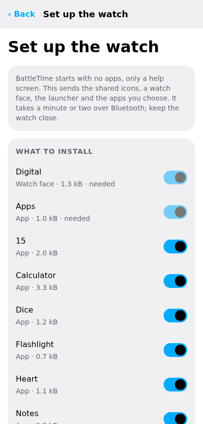
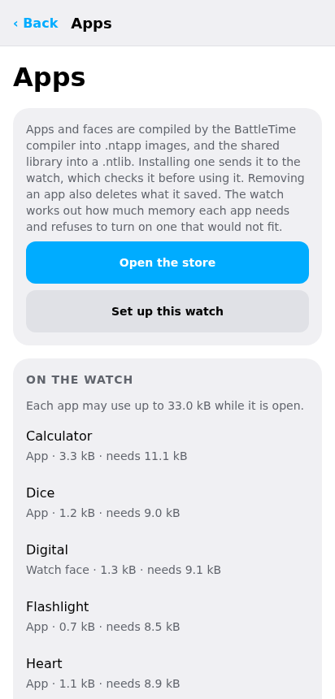
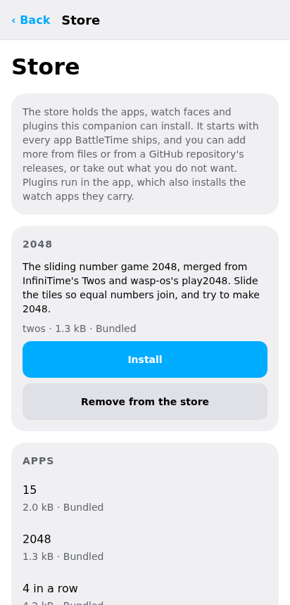
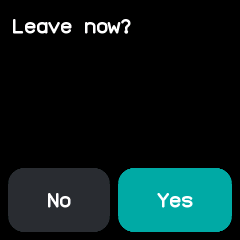

# Apps, faces and the store

A BattleTime watch carries no apps of its own. Every app, watch face and the launcher are installed
from the companion, which carries every app and face in the BattleTime repository and can fetch more
from GitHub. [Apps](../apps.md) and [Watch faces](../faces.md) describe each one.

## Setting up a new watch

A new watch, or one whose apps were all removed, shows only a help screen. When the companion
connects to a watch with no face, the Watch screen says **This watch has no face yet**.

1. Choose **Set up the watch**.
2. Tick the apps to install. The list offers the ones most people keep: the digital face, the
   launcher (named Apps), Calculator, Dice, Flashlight, Heart, Notes, 15, Remote, Snake, Steps, Stopwatch and
   Timer. Everything else waits in the store.
3. Choose **Install** and keep the watch close. It takes a minute or two.

The face and the launcher go first, so the watch shows its face as soon as they land. Swipe up on
the face to open the launcher. Setting up also writes the launcher's default groups.

<div class="screens" markdown>
{ .phone }
{ .phone }
</div>

Setting up a new watch, and the Apps screen once it is done.

The shared library, which holds the icons and fonts every app uses, comes inside the firmware, so
the companion never sends it.

## The store

**Store** on the Watch screen, or **Open the store** on the Apps screen, lists every app, face and
plugin the companion can install, with whether it is on the watch, its size and where it came
from. It opens without a watch, so it can be filled before one is connected.

- **Install** sends an app or face to the watch. The watch checks it and refuses one that would not
  fit in its memory, saying why.
- **Uninstall** removes it from the watch, with what it saved.
- **Remove from the store** takes an entry out of the list. A removed bundled entry comes back with
  **Bring back the bundled entries** at the bottom of the screen.
- **Add from files** adds `.ntapp` apps and faces and `.ntplugin` plugins.
- **Look on GitHub** lists the releases of a repository, `BeatLink/BattleTime` unless changed, that
  carry apps or plugins. Choose one to download it and pick what to add. With a GitHub token in
  Settings, recent Actions builds are listed too.

{ .phone }

An entry added later replaces one with the same id, so adding a newer release and installing again
updates the app on the watch. Added files are kept on the device, so installing needs no download.

[The app store](../app-store.md) describes how releases are built and what they carry.

## Plugins

A plugin is the companion-side half of a watch app: it carries the app, keeps its settings, and
answers it while the watch is connected. Each of BattleTime's own apps has one, and some, such as Alarm,
Timer, Steps, Heart and System, show a page of their own; [Watch data](watch-data.md) describes
those pages.

Installing a plugin from the store installs its watch app too. The **Plugins** screen on the Watch
screen lists the installed plugins. Choose one to see:

- what it is allowed to do, in words: the messages it may send the watch, the websites it may reach
  and the watch data it may read;
- **Install its app on the watch**, to put its app back after it was removed;
- **Turn off** or **Turn on**, which stops or starts its logic in the companion;
- **Remove**, which takes away the plugin and its settings;
- its page, when it has one, and its log.

**Install a plugin** on the same screen installs a `.ntplugin` file directly. Plugins run in the
desktop and Android apps, and keep running while the window is closed. [Plugins](../plugins.md) is
the guide to writing one.

## The Apps screen

**Apps** lists what is installed, each with the memory it needs while open and how much the watch
allows. Choose an app to:

- **Hide from the launcher**, or **Show in the launcher** again. When the watch refuses, it says
  why.
- **Remove** it, with everything it saved. Tap twice to confirm.

**Install from a file** sends a `.ntapp` image straight to the watch, without adding it to the store.

## The launcher

**Launcher** arranges the watch's launcher, the screen that opens with a swipe up the face. Apps sit
in groups: Time, Phone, Communication, Health, Games, Tools, System and Other to start with, each
app in the group it declares.

- **Style** is how the groups show: **folders** (a list of groups, each opening its apps),
  **sections** (one list with a heading for each group), **pages** (a page per group, swiped left and
  right) or one plain **list**.
- **View** is how a group's apps are drawn: a row each, or a grid of icons.
- **Sort** puts groups and apps in order of their names, or, set to **custom**, keeps the order you
  give them. Only a custom order lets groups and apps move up and down.
- Groups can be added, renamed, given an icon from the watch's icons and removed, and any app moved
  to another group.

Each change shows on the watch at once. The layout lives on the watch, so every companion sees the
same groups. An app installed another way lands in Other until the companion next writes the layout.

## Quick apps

A swipe left or right on the watch face opens the next or previous app in its quick-app ring; a
step past either end comes back to the face. Without a choice of yours the ring is Steps,
Stopwatch, Heart, Weather and Music.

**Quick apps** shows the ring beside the installed apps that could join it. Add, remove and move
apps, then **Save**; **Use the default** goes back to the watch's own ring. The watch skips an app
in the ring that is not installed.

## Temporary apps

A temporary app is sent and opened at once, on top of whatever the watch shows, without being
installed. It never appears in the launcher or the app list, saves nothing, and closes when the
wearer goes back, when the companion stops it, or when the link drops. The watch keeps its files as a
cache, so running the same app again sends only its data.

Temporary apps run from the command line for now:

```bash
battletime apps run prompt.ntapp --text text="Lunch now?"    # open an app with a data file
battletime apps run my-app.ntapp --listen                    # stay connected and print what it sends
battletime apps stop                                          # close it
battletime apps forget                                        # close it and delete every cached one
battletime ask "Lunch now?" --timeout 30                      # yes or no from the wearer
```

`battletime ask` shows the question with **Yes** and **No** on the watch, using the bundled
[Prompt](../apps/prompt.md) app. It prints `yes` and exits 0, or prints `no` and exits 1; with no
tap in time it closes the question and exits 2, and it exits 3 when it cannot ask at all. That makes
it handy in scripts:

```bash
battletime ask "Deploy now?" && ./deploy.sh
```


