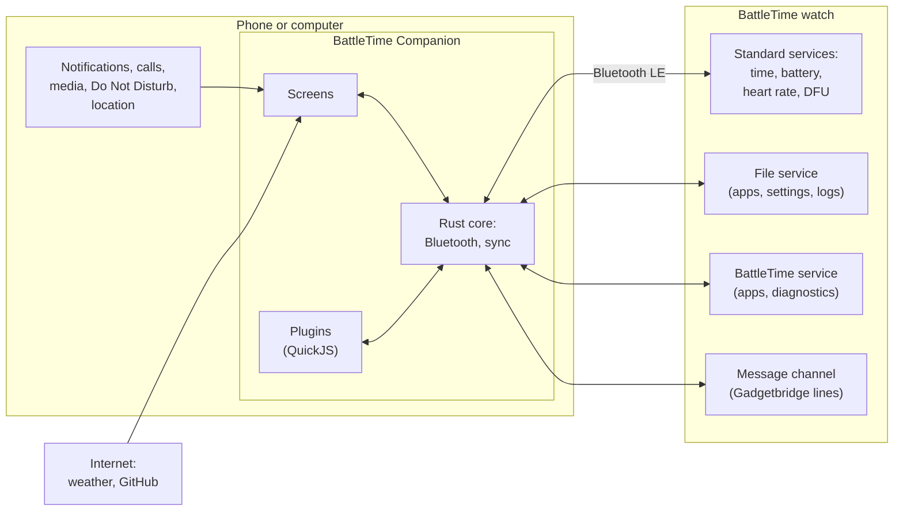

# The BattleTime Companion

The BattleTime Companion is the app that looks after a BattleTime watch from a phone or a computer. It
sets the watch's clock, installs its apps and faces, forwards notifications, calls, music and the
weather, keeps a copy of the watch's steps, heart rate and settings, and sends it new firmware.

A new BattleTime watch has no apps, faces or launcher, only a help screen, so the companion is how a
watch is set up in the first place.

## Ways to run it

| Build | Runs on | Good for |
|---|---|---|
| The desktop app | Linux | Everything, with the computer standing in for a phone |
| The Android app | Android phones | Everything, with the phone's own notifications, calls and location |
| The command line tool, `battletime` | Linux | Scripts and quick jobs from a terminal |

The desktop app and the Android app are the same app, built with Tauri on one Rust core, so their
screens, sync and [plugins](../plugins.md) are the same. The command line tool runs the same
protocol code as the app's screens.

!!! note "Early days"
    The companion is young. The desktop app has scanned, connected and installed apps on a real
    watch; the Android app builds, but has not yet been tried on a phone. Several features have so
    far run only against a stand-in watch in the tests, and
    [companion/TODO.md](../../companion/TODO.md) lists what is still to be tried.

### The desktop app

With Nix, run it straight from the repository:

```bash
nix run github:BeatLink/BattleTime#companion-tauri
```

It opens as **BattleTime Companion**, with a menu entry of the same name once installed with
`nix profile install github:BeatLink/BattleTime#companion-tauri`. On NixOS it can go in
`environment.systemPackages` or `home.packages` as `inputs.battletime.packages.${system}.companion-tauri`.

It needs Bluetooth Low Energy through BlueZ. When the computer has more than one adapter, such as a
built-in radio and a USB dongle, the app uses one that is switched on, and moves to another if the
one it was using is switched off.

### The Android app

Each [BattleTime release](https://github.com/BeatLink/BattleTime/releases) carries a signed APK that
runs on every Android phone; download it on the phone and open it to install. To build one
yourself, [companion/README.md](../../companion/README.md) says how.
The first scan asks for permission to find nearby devices (location, before Android 12), and on
Android 13 and later for notifications, which the app needs to keep running in the background.

### The command line tool

```bash
nix run github:BeatLink/BattleTime#companion-cli -- scan
```

[The command line](command-line.md) describes every command.

## How it fits together



The watch serves a few Bluetooth services, and the companion uses each for its own job:

- **Standard services** set the clock and time zone, read the battery and heart rate, and take
  firmware updates.
- **The file service** carries apps, settings, notes, QR codes, the step and heart rate logs and
  each app's saved state.
- **The BattleTime service** installs, hides and removes apps, opens temporary apps and reads the
  watch's diagnostic counters.
- **The message channel** carries the lines Gadgetbridge's Bangle.js driver sends: notifications,
  calls, music, weather, find, settings and the messages each watch app sends its plugin.

The phone or computer's own notifications, calls and media reach the watch through the companion;
the weather and app downloads come from the internet. The full protocol is in
[companion-protocol.md](../companion-protocol.md).

## A feature appears when the watch serves it

The companion checks what the connected watch serves and shows only what will work. A watch waiting
in its bootloader offers only firmware updates; one without the message channel has no
notifications, steps or alarms. Nothing needs turning on by hand.

## Where to go next

- [Connecting a watch](connecting.md)
- [Apps, faces and the store](apps-and-store.md)
- [Phone features](phone-features.md): notifications, calls, music, weather and the time
- [Watch data](watch-data.md): steps, alarms, heart rate and battery
- [Notes, QR codes, remote and tools](tools.md)
- [Firmware updates](firmware-updates.md)
- [The command line](command-line.md)
