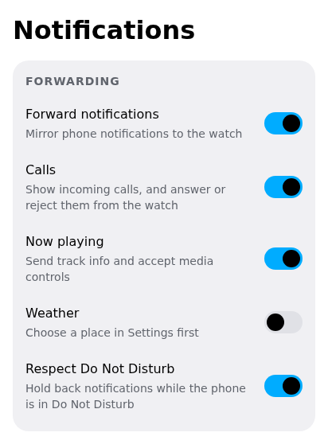
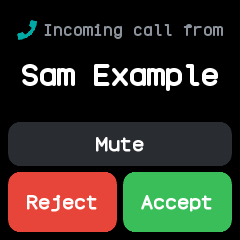

# Phone features

The companion passes what the phone knows on to the watch: notifications, calls, music, the weather
and the time. On a computer the desktop app plays the phone's part with the computer's own
notifications, media players and Do Not Disturb.

The switches are on the **Notifications** screen, under **Forwarding**:

| Switch | What it does |
|---|---|
| **Forward notifications** | Shows the phone's or computer's notifications on the watch |
| **Calls** | Shows incoming calls, and lets the watch answer, reject or mute them (phones only) |
| **Now playing** | Sends the playing track, and takes the watch's music controls |
| **Weather** | Sends the current weather every half hour |
| **Respect Do Not Disturb** | Holds back notifications and calls while the phone or computer is in Do Not Disturb |

{ .phone }

Under **Status** the screen says whether the app has notification access, with **Grant access** to
open the phone's setting, and whether Do Not Disturb is on.

## On a phone and on a computer

| Feature | Android app | Desktop app (Linux) |
|---|---|---|
| Notifications | every app's notifications, once notification access is granted | desktop notifications, overheard as apps send them |
| Calls | incoming calls, answered, rejected or muted from the watch | none; the Calls switch is hidden |
| Music | the active media session | any MPRIS player: browsers, Spotify, VLC and the rest |
| Do Not Disturb | the phone's Do Not Disturb | KDE's, Cinnamon's, GNOME's or dunst's |
| Location for the weather | the phone's location | GeoClue, when it runs |
| The clock | the phone's | the computer's |

The Android app skips ongoing, media and call notifications and its own. While it keeps a watch it
runs in the background with a small notification of its own, even with its window closed, and it
starts again after the phone restarts or when the watch comes back into range. Connecting to a watch
for the first time asks whether the app may treat it as its companion device, which lets Android
start the app for it. Some phones stop background apps anyway; **Battery limits** in **Settings**
asks Android to lift them for the app.

## Notifications

Each forwarded notification shows on the watch with its app's icon, and the watch's notification
preview pops up as it arrives. A notification removed on the phone is removed from the watch too.
[Notifications](../apps/notifications.md) shows them on the watch.

The **Test notification** quick action on the Watch screen sends a sample, to check the link.

## Calls

With **Calls** on, an incoming call opens the watch's [call screen](../apps/call.md), which rings
until the call is answered or ends. From the watch:

- **Answer** picks the call up (Android 8 and later);
- **Reject** ends it (Android 9 and later);
- **Mute** silences the phone's ringer for this call; the call keeps ringing and the ringer comes
  back when it ends.

When an incoming call ends, the watch gets a notification saying **Missed call**, **Ignored call**
(rejected or muted on the watch) or **Accepted call**, with the caller's name. The caller's number
needs the call log permission and the name needs contacts.

## Music

With **Now playing** on, the watch's [Music](../apps/music.md) app shows the track, artist and
whether it plays, and its buttons play, pause, skip and change the volume on the phone or computer.
The Watch screen shows the same track with Previous, Play and Next.

## Weather

The weather comes from Open-Meteo every half hour while the watch is connected, and on the **Send
weather** quick action. Under **Weather** in **Settings**:

- type a town or city and choose **Find this place**; or
- switch on **Use where this phone is** (or computer), which asks the location service each time.

On a computer, the location comes from GeoClue; on NixOS that is `services.geoclue2.enable = true`.
The watch's [Weather](../apps/weather.md) app shows what arrives.

## The time

The companion sets the watch's clock and time zone each time it connects, again whenever the
device's own clock jumps (set by hand, a new time zone, waking from sleep), and every six hours.
The watch also reads the time from a phone that serves the standard Current Time service, with no
app needed.

## Finding the watch and the phone

- **Find watch** on the Watch screen makes the watch vibrate until it is touched.
- The watch's [Finder](../apps/phone-finder.md) app tells the companion it is looking, and the
  Watch screen then says **The watch is looking for this phone**. The companion shows this card but
  does not ring.

## Navigation

The companion follows no navigation app yet, so when the watch's [Navigation](../apps/navigation.md)
app asks, it answers that there is no route. The watch reads turn-by-turn directions in the form
Gadgetbridge's Bangle.js driver sends them.

## Using Gadgetbridge instead

With **Show as InfiniTime** on (the **Bluetooth** section of **Watch settings** in the companion),
the watch advertises the name InfiniTime, so Gadgetbridge on Android offers its InfiniTime support:
notifications, calls, the time, the heart rate, firmware updates and files. Gadgetbridge's music,
navigation, weather and find features use InfiniTime services the watch does not serve yet.

Only one app can hold the watch at a time, and installing apps, sync and plugins need the companion.

## Internet for watch apps

A watch app can ask the companion to fetch a web page. **Internet for watch apps** in **Settings**
switches this on, lists the hosts allowed (each with its subdomains), and sends back only the first
1024 characters. With no hosts listed, every request is refused.
