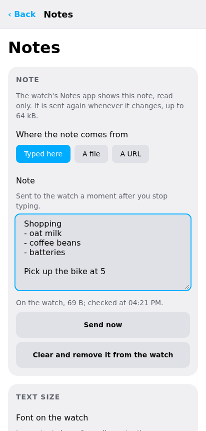
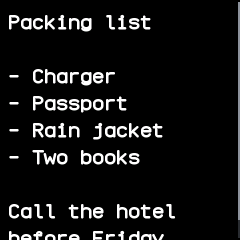
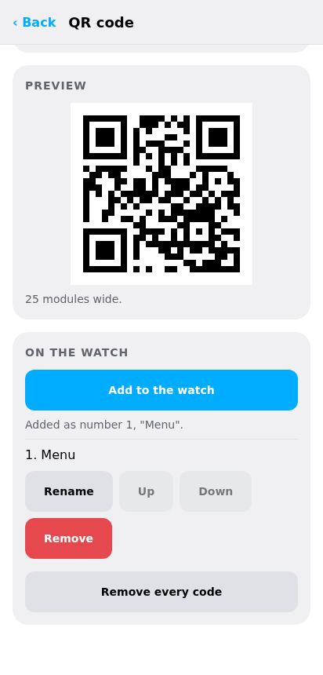
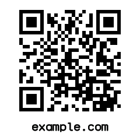
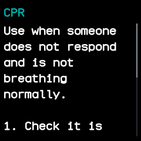
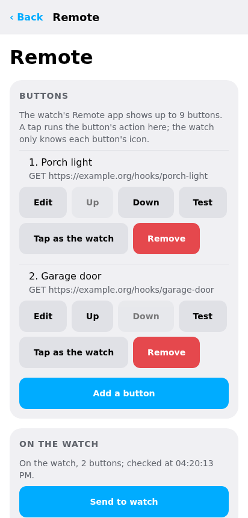
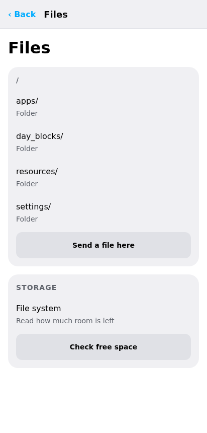

# Notes, QR codes, survival guides, remote and tools

These screens, under **On the watch** on the Watch screen, feed watch apps that get their content
from the companion, and look after the watch's files.

## Notes

The watch's [Notes](../apps/notes.md) app shows one note, read only, that the companion keeps up to
date. On the **Notes** screen choose where it comes from:

- **Typed here**: it is sent a moment after you stop typing.
- **A file**, a text file: the desktop app watches the file and sends it again within a moment of each
  save. On a phone the file is read again every minute.
- **A URL**: fetched again every minute, with optional extra headers, a login and a choice
  of certificate (see [Web requests](#web-requests)).

Under **Text size**, choose the font the watch shows it in: small, normal, medium or large. A note
may be up to 64 kB. **Send now** sends it at once, and **Clear and remove it from the watch** takes
it off. The companion sends the note only when it has changed,
and sends it again if it was deleted on the watch.

{ .phone }

## QR codes

The watch's [QR code](../apps/qr-code.md) app keeps up to eight codes, so another phone can scan
them from the watch. On the **QR code** screen make one from:

- text or a link;
- a Wi-Fi network: its name, password, security and whether it is hidden. A phone's camera then
  offers to join it.

Give it a caption of up to 24 characters to name it in the watch's list; without one the text or
the network's name is used. Below the form the screen lists the codes on the watch, each with
**Rename**, **Up**, **Down** and **Remove**, and a button that removes them all. A very long text
makes a code too dense to scan from the small screen; the companion warns, and refuses one that
would not fit at all.

{ .phone }

## Survival guides

The watch's [Survival](../apps/survival.md) app carries short emergency guides, to read without a
phone or a signal. The **Survival** screen lists every guide the companion has, under first aid,
outdoors and disasters, each with a switch and **Read it** to see its text first. Tick the guides
to carry and choose **Send**: the watch then holds exactly those, with only new ones sent. The
switches start ticked for the guides already on the watch.

The guides are reminders of common first aid and outdoor training, not a replacement for a course.

## Remote

The watch's [Remote](../apps/remote.md) app shows up to nine buttons; tapping one runs an action on
the phone or computer. On the **Remote** screen give each button an icon, a label (shown only in
the companion) and an action:

| Action | Where it runs |
|---|---|
| **Web request**: a method, address, headers, body and login | everywhere |
| **Command**: a shell command, stopped after 30 seconds | the desktop app |
| **Android**: open a link, start an activity or send a broadcast | the Android app |
| **Media**: play/pause, play, pause, next, previous, volume | the Android and desktop apps |
| **Find this device**: shows the same card as the watch's Finder | everywhere |

An action the device cannot run is marked unavailable. The watch only says which button was tapped;
the action itself stays in the companion, so the watch can never send a command or an address. The
screen keeps a log of recent taps.

{ .phone }

## Web requests

Note addresses and remote buttons share the same settings for reaching a server: extra headers,
a basic-auth login, and which HTTPS certificate to trust. That is the usual check, a self-signed
certificate pinned by its SHA-256 fingerprint, or any certificate. A pinned certificate is checked
before anything is sent, so the headers and login never reach a server that fails it. Logins are
kept unencrypted in the app's settings.

## Files

**Files** browses the watch's file system: open folders, **Download** a file, **Send a file
here**, delete files and folders, and **Check free space**. Changing files by hand can break an app;
the other screens are the safer way to change what they look after.

{ .phone }

## Debug report

After a crash the watch waits on its crash screen. **Save debug report**, in the Debug report card
on the Watch screen, saves why the watch last restarted, its firmware version, counters, installed
apps and free storage as a file, and the watch then leaves its crash screen. Attach the file to a bug
report.

## Console

The **Console** tab shows every message line to and from the watch, and sends a line typed there
as it is. It is meant for checking what the watch says, not for everyday use.
