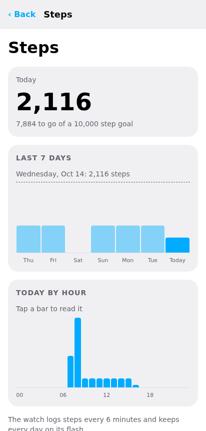
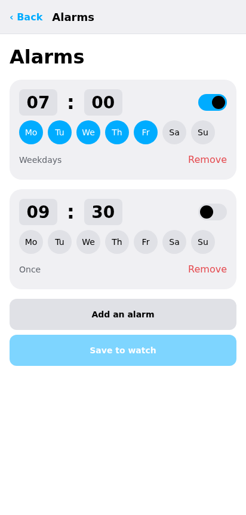
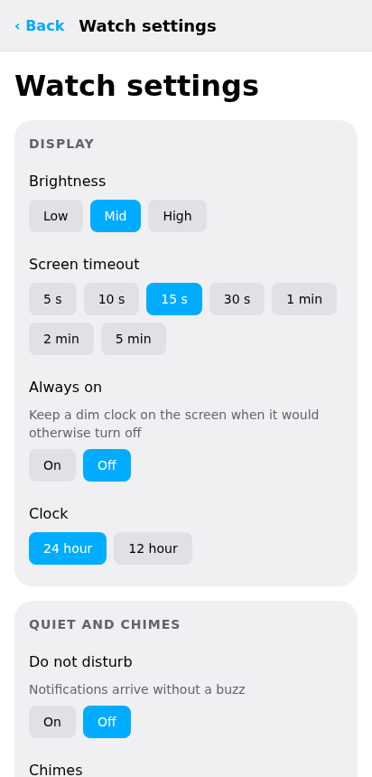

# Watch data

The watch logs steps, heart rate and battery charge, and each app saves its own state, such as the
alarms. The companion keeps a copy of all of it and lets you read and change it from the phone or
computer.

## Sync

While the watch is connected, the companion reads every setting and record again on an interval.
Choose it under **Sync** in **Settings**: every 1, 5 (the default), 15 or 30 minutes, or every hour.
**Sync now**, in Settings or on the Watch screen's Status card, reads everything at once.

A past day's log is read again only when it has grown, so a sync after the first is quick. The watch
saves an app's state when the app closes or the screen turns off, so the copy of an app that is open
can be a little behind.

[Companion sync](../sync.md) describes what is copied and how changes go back to the watch.

## Steps

**Steps** on the Watch screen shows the last seven days, day by day, and the chosen day hour by
hour. **Read again** fetches them now. Today's count is also on the Watch screen's Status card.

The **Steps** plugin's page draws the last two weeks and today's steps in six-minute slots.

{ .phone }


## Alarms

**Alarms** lists the watch's alarms. Each has a time, the weekdays it repeats on (none for an
alarm that rings once) and a switch. **Add an alarm**, change the times and days, remove the ones
you no longer need, then **Save to watch**. The watch takes up the new alarms at once, even while
its Alarm app is open.

{ .phone }

The **Alarm** plugin's page does the same: each alarm with a time picker, weekday buttons and a
switch.

## Timer, sports and other apps

Every app has a plugin whose page shows what the app saved and lets you change it: a stopwatch's
laps, a pomodoro's lengths, a game's score. Times show as dates, and lengths are edited in seconds.
Some have pages of their own:

- **Timer** shows the length chosen and whether the timer is running.
- **Sports** lists the last two weeks of steps and the app's last five sessions, each with its
  start, length and steps.
- **Settings** shows and changes the watch's settings.

Plugins run in the desktop and Android apps; [Apps, faces and the store](apps-and-store.md#plugins)
says how to open their pages.

## Heart rate

The **Heart** plugin's page lists the last two weeks of heart rate from the watch's log: each day's
average, lowest and highest. The watch logs heart rate when an app measures it, or on its own when
the heart rate interval is set in the watch's settings.


## Battery

The Watch screen's Status card shows the charge, the voltage and whether the watch is charging.
The **System** plugin's page lists the last two weeks of battery charge from the watch's log: each
day's average, lowest and highest.

## Watch settings

**Watch settings** changes the watch's own settings:

- **Display**: brightness, screen timeout, always on (a dim clock while the screen would be off) and
  the clock format;
- **Quiet and chimes**: do not disturb, so notifications arrive without a buzz, and chimes;
- **Units and goals**: metric or imperial units, and the daily step goal;
- **Bluetooth**: **Show as InfiniTime**, for Gadgetbridge;
- **Theme**: a preset, or your own colours, then **Save colours**.

{ .phone }

## Backups

**Backup** copies the watch's settings and everything its apps saved. Firmware and apps are left
out, since they can be installed again.

- **Back up now** keeps a backup on the phone or computer, listed under **Saved on this device**.
- **Save as a file** exports one; **Load a backup file** brings one back.
- **Restore to the watch** writes a backup's settings and app state back.

## From the command line

```bash
battletime status                    # battery, voltage and today's steps
battletime steps 14                  # the last two weeks of steps
battletime alarms                    # list the alarms
battletime alarms 07:30/12345 09:00/67/off   # weekdays at 7:30, and a weekend alarm switched off
battletime settings                  # print the watch's settings
battletime settings brightness=3     # change one
battletime backup watch.json
battletime restore watch.json
```

[The command line](command-line.md) has the rest.
