# Watch faces

NeoTime ships every face from [InfiniTime](https://github.com/InfiniTimeOrg/InfiniTime),
[wasp-os](https://github.com/wasp-os/wasp-os) and
[PinetimeLite](https://github.com/joaquimorg/PinetimeLite), each redrawn for NeoTime. Faces install
and uninstall from the companion app's store like any app, and [Software](apps/software.md) turns
each one on or off.

## Choosing a face

- Open [Settings](apps/settings.md) and tap **Face**, then step through the faces with the arrows.
  Only faces turned on in Software are offered.
- If the chosen face is uninstalled or turned off, the watch shows the first face that is turned
  on, in order of their ids.
- From the face, a swipe down opens the [notifications](apps/notifications.md), a swipe up the
  [launcher](apps/launcher.md), and a swipe left or right steps round the quick apps.
- A few faces do something on a long press, noted below. PineTimeStyle, Infineat and the pride flag
  open a settings screen; its tick button goes back to the face.

## Gallery

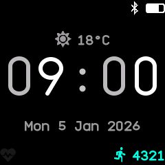{ .screen }
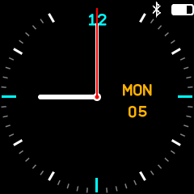{ .screen }
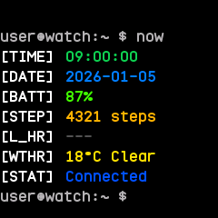{ .screen }
{ .screen }
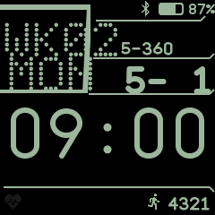{ .screen }
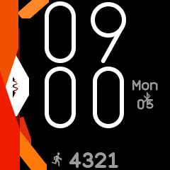{ .screen }
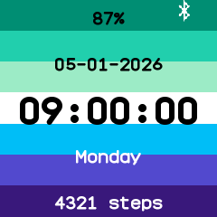{ .screen }
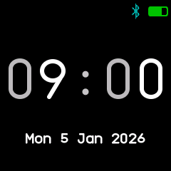{ .screen }
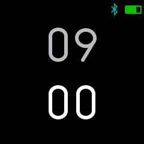{ .screen }
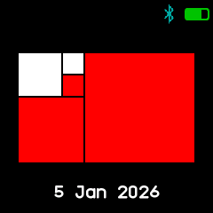{ .screen }
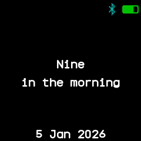{ .screen }
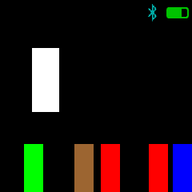{ .screen }
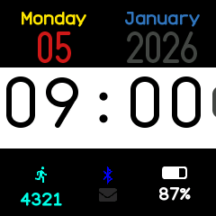{ .screen }
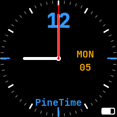{ .screen }
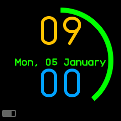{ .screen }
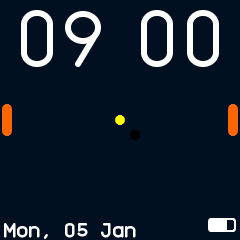{ .screen }
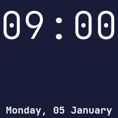{ .screen }
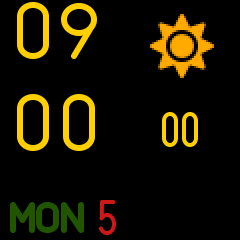{ .screen }

In order: Digital, Analog, Terminal, PineTimeStyle, Casio G7710, Infineat, Pride flag, Week clock,
Dual clock, Fibonacci clock, Word clock, Resistor clock, Lite Digital, Lite Analog, Lite Rings,
Lite Pong, Lite Photo and Lite Weather.

## Every face

The Notes column is also each face's description in the companion app's store.

| Face | From | Notes |
|---|---|---|
| `digital` | InfiniTime WatchFaceDigital, wasp-os clock | The time in big two-tone digits, with the date, weather, status icons, heart rate and steps. |
| `analog` | InfiniTime WatchFaceAnalog, wasp-os chrono | A dial with hour, minute and second hands, the weekday and date; a long press turns the second hand off and on to save power. |
| `terminal` | InfiniTime WatchFaceTerminal | A shell prompt listing the time, date, battery, steps, heart rate, weather and connection. |
| `pinetime-style` | InfiniTime WatchFacePineTimeStyle | Giant digits beside a sidebar with battery, weather, a calendar and a step gauge; a long press sets its colours, gauge and weather. |
| `casio` | InfiniTime WatchFaceCasioStyleG7710 | Casio G-7710 style, with the weekday, week number, day of the year and days left, the date and a big time. |
| `infineat` | InfiniTime WatchFaceInfineat | Big digits beside coloured stripes and a pine logo that shows the battery; a long press picks the colours and side cover. |
| `pride-flag` | InfiniTime WatchFacePrideFlag | The time, date, weekday, battery and steps over a pride flag; a long press chooses the gay, trans, bi or lesbian flag. |
| `week-clock` | wasp-os week_clock | Big two-tone digits over the weekday and date, with a status bar above. |
| `dual-clock` | wasp-os dual_clock | The hours above the minutes in big digits, the hours dimmer, with a status bar above. |
| `fibonacci-clock` | wasp-os fibonacci_clock | Five coloured squares that add up to the time: red for hours, green for minutes in fives, blue for both. |
| `word-clock` | wasp-os word_clock | The time written out in words, such as "nine in the morning", over the date. |
| `resistor-clock` | wasp-os resistor_clock | The time and date as bands in the resistor colour code. |
| `lite-digital` | PinetimeLite WatchFaceDigital | The time on a white band with a bar that grows with the seconds, the date above and steps, Bluetooth, notifications and battery below. |
| `lite-analog` | PinetimeLite WatchFaceAnalog | Two dials, a classic one and a rays one with steps; a long press switches dial and a double tap hides the second hand. |
| `lite-rings` | PinetimeLite WatchFaceMinimal | Rings for the hour, minute and second around the time and date. |
| `lite-pong` | PinetimeLite WatchFacePong | Two rackets play an endless rally under the time. |
| `lite-photo` | PinetimeLite WatchFaceCustom | The time with a blinking colon and the full date over a coloured backdrop; a long press picks the next backdrop. |
| `lite-weather` | PinetimeLite WatchFaceWeather | Big stacked digits with the seconds, the weather icon, and the weekday and day. |

## Differences from the originals

- Faces with settings open them as a second screen on a long press, in place of the buttons that
  pop up over the face in InfiniTime.
- Lite Photo shows plain coloured backdrops in place of PinetimeLite's photos.
- Lite Weather draws its big digits plain rather than striped, and Lite Analog uses plain hands.
- Faces that show seconds redraw every second; the others redraw once a minute, as does Analog
  while its second hand is off.

Faces are written like apps; see [writing an app](writing-apps.md) and the
[app reference](app-reference.md) for how to write one.
