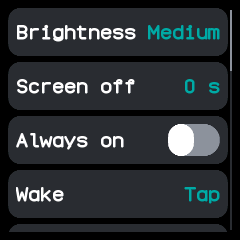
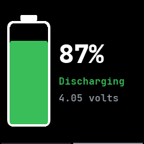
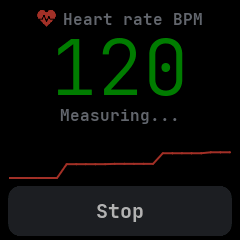
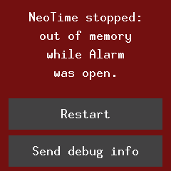
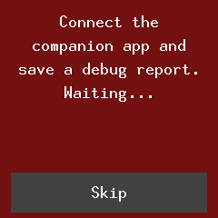

# Features

What NeoTime can do, added as each feature is finished. Work not done yet is in
[todo.md](todo.md); how the parts are built is in [architecture.md](architecture.md).

## On the watch

- **A watch face, a launcher and apps, installed from the phone.** The firmware carries none of
  its own: the companion app installs a face, the launcher and any apps into the watch's storage.
  The launcher, itself an ordinary app that another could replace, lists them with their icons,
  however many are installed.
- **Apps in groups,** such as games, tools, communication, time, phone, health, and system and
  settings together. Each app starts in the group it declares; the companion app renames, adds
  and removes groups, gives each an icon, and moves apps between them. Groups and the apps in each
  are in order of their names, or in an order the wearer sets in the companion app. The launcher shows the
  groups as folders, as sections of one list, or as pages swiped left and right, or leaves them
  out for one plain list, and draws a group's apps as rows or as a grid of icons.
  Touches and swipes reach the open app; the side button belongs to the shell.
- **A help screen** with the time and how to install a face, shown while no face is installed.
- **Screens slide and wipe in, as on InfiniTime.** The launcher slides up over the face, an app
  slides up over the launcher, and going back with the button slides the way back down. Going
  forward to another screen of an app wipes it in from the right, and going back wipes in from the
  left, as does a swipe to the right. A screen an app goes to on a swipe moves the way the finger
  did, so pages swiped up slide up and swiped down slide down.
- **Smooth scrolling.** A list follows the finger as it drags: the display moves the rows itself,
  and only the few rows that come into view are drawn. Lists below a heading, as in Settings,
  scroll to their last row with the heading kept still.
- **Scroll bars, as on wasp-os.** The launcher, a list, scroll view or text file longer than the screen shows a
  thin bar on its right edge: a light thumb over a dim track, or a segment per page for a list
  that turns a page at a time. Lists can also run across and scroll sideways, with the bar along
  the bottom. After a panel scroll only the ends of the thumb are drawn again.
  
- **Swipes belong to the app.** Inside an app every swipe is the app's own, and a right swipe no
  longer goes back. A swipe the app ignores goes on to the shell, and an app with pages, such as
  steps, passes on the swipes past its first and last page, so they still step round the quick
  apps.
- **Pages left and right.** An app's pages sit side by side: a swipe left wipes to the next and a
  swipe right back to the one before, and a bar along the bottom marks the page on show, a segment
  for each. A list on a page still scrolls up and down, and a drag across never moves it.
  
- **Swipes on the watch face.** A swipe up opens the launcher, and a swipe down in the launcher
  closes it again. A swipe down pulls the notifications down from the top, and a second swipe down
  pulls quick settings down after them; a swipe up goes back a step. Swipes left and right step
  round the quick apps, as on wasp-os: the next or previous app in the ring, and back to the face
  past either end. A quick app's own unused left and right swipes step on round the ring. The ring
  is steps, stopwatch, heart, weather and music until the companion app writes another to
  `/settings/quick_apps`, one app id a line; apps not installed are skipped.
- **Notifications and quick settings are part of the firmware.** They are written like apps but
  compiled into the firmware, so they are always there and never in the launcher. Quick settings
  shows the time and battery over six buttons: brightness, the flashlight, do not disturb,
  Bluetooth, the always-on screen and Settings.
- **Only what changed is drawn,** each part composed in memory first, so the screen never shows a
  half-drawn widget.
- **Going back retraces the way.** Every way back, the button, a swipe up on the pulled-down
  screens or a swipe down on the launcher, revisits each screen passed on the way, in exactly the
  reverse order and moving the opposite way: quick settings goes back to the notifications and then
  the face, Settings opened from quick settings goes back to quick settings, and a quick app goes
  back through the ones stepped past.
- **Side button gestures.** Any press wakes a dark screen. A click always means back: a screen
  within an app, then a step back along the way the wearer came, and on the face it puts the watch
  to sleep. Apps never hear the button. A long press or holding for 2 seconds
  goes to the face, and a double click opens the notifications, or goes from them to the face.
  While the phone rings the watch to find it, the first gesture only stops the ring.
- **The screen sleeps on its own.** It turns off after the time chosen in settings, 15 seconds at
  first, unless the open app keeps it on. Two seconds before it turns off the light drops to its
  low level, as on InfiniTime, and a touch or a button press in those seconds brings it back and
  starts the time again. While it is dark the watch stays idle until the open app
  has something to do, and the clock is up to date the moment the screen comes back. The open app
  can also turn the screen on, such as when its timer rings, or off. While the screen is off the
  external flash sleeps in deep power-down between uses, and wakes before each one.
- **The clock survives a reset.** Twice a second the time is kept in RAM a reset leaves alone, so
  after a crash, a watchdog reset or a restart the watch counts on from where it was, losing only
  the moment the bootloader takes. After a power cut, or the first start of a new firmware, it
  starts from when the firmware was built until a phone sets it.
- **Alarms and timers ring while their app is closed.** An app's timers, alarms, daily times, clock
  changes and heart rate periods go on running after it closes. When one comes due the watch loads
  the app without a screen just long enough to run it. An alarm or timer that rings lights the
  screen and opens its app over what was open, on its ringing screen, as InfiniTime's do. Going
  back returns to what was open. While an alarm is set, faces show the bell through `next_alarm`.
- **Brightness.** The backlight has off, low, medium and high levels.
- **An always-on screen,** turned on in settings. When the screen times out it dims and switches to
  the panel's low-power mode, and the face keeps drawing. It has not been tried on the watch yet.
- **Settings, on the watch and from the companion app.** The Settings app and the companion app
  change the same watch-wide settings: brightness, how soon the screen turns off, the always-on
  screen, the 12 or 24 hour clock, metric or imperial units, the daily step goal, chimes, do not
  disturb, whether alarms ring in do not disturb, what wakes the screen, Bluetooth, firmware updates
  and the theme. They are kept through a restart, except Bluetooth, and apps follow them at once.
- **Waking the screen by touch.** A tap, a double tap, or only the button, chosen in settings. With
  only the button, the touch panel sleeps while the screen is off. Not tried on the watch yet.
- **Bluetooth off,** from settings or quick settings, until it is turned on again or the watch restarts, so
  a watch can never be left out of reach. Not tried on the watch yet.
- **Updates off,** so no phone can install firmware until they are turned on again in settings.
- **Chimes.** A buzz every hour, or every half hour, chosen in settings; a double buzz on the hour.
  Do not disturb silences them.
- **Vibration** for apps that buzz, alarms and timers that ring, and notifications from the phone.
  Do not disturb silences everything but alarms and timers, and those too if the wearer chooses.
- **Notifications from the phone.** Gadgetbridge's `notify` message, sent through the companion
  app's UART service, buzzes twice and goes to the open app. The watch keeps the latest 5, from the
  phone and from apps, and the notifications list them newest first, each with an icon for its
  kind (a call, a missed call, a text, a chat, news, voicemail, a calendar event or an alert, and
  an envelope for anything else): a tap reads one in full and Dismiss removes it. A notification dismissed on the phone goes from the watch too. Faces show
  when some are unread.
- **Notifications from any Bluetooth tool.** A New Alert written to the standard Alert Notification
  service shows as a notification, as on InfiniTime, so BlueZ's `bluetoothctl`, ITD or Amazfish can
  send one without the companion app. One in the incoming call category opens the call screen and
  rings, as InfiniTime's does.
- **A notification pops up a preview.** One that arrives lights the screen, if it is dark, on a
  preview of it over whatever was open, with a bar that runs out over 7 seconds before the watch
  goes back there, as InfiniTime's preview does. A tap keeps it and reads it in full. Do not disturb
  keeps the screen dark and the watch still, and the notification is still kept. While the phone
  rings the watch to find it, or a call rings, a notification is kept without a buzz or a preview.
- **Music, weather and calls from the phone.** Gadgetbridge's `musicinfo`, `musicstate` and
  `weather` messages fill the music app, the weather app and the faces that show the weather; the
  music app's buttons control the phone's player. An incoming call opens the [call app](apps/call.md)
  and rings until it is answered, rejected, muted or left, unless do not disturb is on; Accept,
  Reject and Mute go back to the phone. Without the call app it buzzes once and lights the screen.
  Every call also reaches apps that listen for calls. When an incoming call ends, the companion app
  leaves a notification saying whether it was missed, ignored on the watch or accepted, in place of
  the phone's own missed call notification.
- **Find the watch from the phone.** Gadgetbridge's find-device rings the watch for up to a
  minute, even in do not disturb, until the phone stops it or the wearer touches the watch or
  presses the button. The phone can also buzz the watch one to five times, and ask for its battery
  level, voltage, charging state and steps.
- **Step counting and history.** The accelerometer counts today's steps for the steps app and
  faces, from the configuration the shared library inside the firmware carries. The watch keeps the steps of every six minutes in a file for each day, with no limit on
  how many days, and starts a new day at local midnight without any app open. The steps app shows
  today against the daily goal, yesterday, a trip count that the Reset button starts again, the
  last seven days, and any of them hour by hour. The history and the trip count are kept through
  a restart, losing only the six minutes in progress.
- **Heart rate.** The Heart app measures the pulse with the HRS3300 while it is open: it waits for
  enough data, then shows the beats a minute, refreshed every four seconds, with a chart of the
  latest readings, and says when the watch is off the wrist. As on InfiniTime, Settings can have
  the watch measure in the background, with the screen off too: always, or every 30 seconds,
  minute, 5, 10 or 30 minutes, each time until a reading or for 30 seconds at most. Faces show the
  latest reading and how long ago it was taken. The LED is lit only while measuring, or flashing
  for the beacon app, which sets its brightness and how often it flashes. Tried in the emulator,
  not yet on the watch.
  
- **Shake to roll the dice,** and live accelerometer readings for apps such as motion and level.
- **Rollers that show their numbers:** the timer's minutes and seconds and the dice's count and
  sides, which were blank on the watch, and the alarm's time and days, each drawn as one widget.
  The accelerometer is read for these only while such an app is open and the screen is on.
- **A steady battery charge.** The voltage is smoothed and read along InfiniTime's measured curve.
  The charge only rises on the charger and only falls off it, stops at 99 % while charging, and
  reads 100 % and not charging once the charger stays connected after the battery is full.
- **Battery screen.** The second page of the `system` app, a swipe left from its system page, shows a
  tall battery on the left filled to the charge and, on the right, the charge, whether the battery
  is charging, fully charged, discharging, low or critical, and its voltage; while charging the
  battery fills up from the charge again and again.
- **Charging screen and low battery warning.** Plugging the charger in or taking it off lights the
  screen on the system app's battery page, and so does the charge falling below 10 % off the charger, once until
  the next charge, when the app warns to charge the watch. Do not disturb keeps the low warning
  dark, and an app that keeps the screen on, such as a ringing alarm, stays in front. The watch
  goes back to what was open when the screen sleeps or on the button. Apps hear the same changes
  through their `battery` subscriptions while they are open.
- **The time and time zone from the phone,** set through the Bluetooth Current Time service or
  Gadgetbridge's `setTime` line. The watch keeps UTC with the time zone and summer time offsets,
  shows local time, and remembers the zone across restarts. Alarms, chimes and the midnight step
  reset follow local time, and apps can show UTC and other zones. A phone can read the watch's
  time and time zone back.
- **The battery level on the phone,** through the standard Bluetooth Battery service, updated as it
  changes.
- **The heart rate on the phone,** through the standard Bluetooth Heart Rate service, which
  Gadgetbridge and other fitness apps read. Each new reading is sent to a subscribed phone. As on
  InfiniTime, the phone does not start the sensor: readings come while the Heart app measures or
  the background interval setting is on. Tried in the emulator, not yet on the watch.
- **Whether a phone is connected.** Faces show the Bluetooth icon while a phone is connected, and
  phone apps such as the phone finder say when none is. Apps hear the phone connect and go away.
- **Themes.** Six presets (dark, light, ocean, forest, sunset and contrast), picked in the Settings
  app or from the companion app, which can also set any colours. They are kept through a restart,
  and the open app changes colour at once. See [companion-protocol.md](companion-protocol.md).
- **Files over Bluetooth.** Phones and computers read, write, list, move and delete the watch's
  files through the same file service InfiniTime has, so ITD, Gadgetbridge and the companion app
  can use it. See [companion-protocol.md](companion-protocol.md#file-transfer).
- **Apps remember where they were.** An app's saved state is written to the watch's storage when
  it closes or the screen turns off, and put back when it opens.
- **Text in one clear, smooth font at every size,** drawn from lines and arcs with its stems
  and curves on whole pixels, in 2.3 KB where seven bitmap fonts took 48 KB.

## Apps and watch faces

- **Turn apps on and off, with their memory checked.** The Software app lists every installed app
  and face with a switch and the memory it needs while open; the companion app's apps screen and
  `neotime apps` show the same. Before an app is installed or turned on the watch works out from its
  image how much heap it needs, and refuses one that would not fit, or that would leave the launcher
  without room for its longer list, saying why. The launcher and the last face stay on. See
  [apps.md](apps.md) and [memory-map.md](memory-map.md#how-much-heap-an-app-needs).

- **Notes.** Type a note in the companion app, pick a text file, or give a URL it fetches every
  minute, and the note is copied to the watch, again whenever it changes; the notes app shows it, read only and scrolled, in the font chosen in the companion app.
  See [apps.md](apps.md).
- **Remote.** Choose up to 9 buttons in the companion app, each with an icon and an action; the
  remote app shows them full size, 2 by 2 or 3 by 3, and a tap buzzes and tells the phone to run
  that button's action. See [apps.md](apps.md) and
  [companion-protocol.md](companion-protocol.md#remote).
- **Temporary apps from the phone.** The companion app can open an app on the watch without
  installing it, such as a question to answer Yes or No (`neotime ask`). It opens over whatever
  shows and turns the screen on, never joins the launcher or keeps state, and closes when the
  wearer goes back, the phone stops it or the phone disconnects. Its image stays in `/temp` on the
  external flash, so running it again sends only its data. See
  [companion-protocol.md](companion-protocol.md#temporary-apps-served).
- **QR code.** Type a link or text, or fill in a Wi-Fi network, in the companion app, and it makes
  the QR code and adds it to the watch with a caption; the watch keeps up to eight, which the
  companion app renames, reorders and removes. The QR code app lists them by caption, and a tap
  shows one black on white at full brightness for another phone to scan, reading only that code
  from storage. See [apps/qr-code.md](apps/qr-code.md) and
  [companion-protocol.md](companion-protocol.md#qr-code).
- **31 apps** ported from InfiniTime and wasp-os, merged where both firmwares had the same app:
  stopwatch, timer, alarm, pomodoro, calculator, dice, flashlight, phone finder, system, heart rate, steps,
  sports, music, weather, navigation, metronome, motion, level, beacon, 2048, paddle,
  puzzle 15, snake, four in a row, Game of Life, paint, haiku, Morse, settings, hello and a template. Each is
  described in [apps.md](apps.md).
- **18 watch faces** ported from InfiniTime, wasp-os and PinetimeLite, described in
  [faces.md](faces.md).
- **A 5 day weather forecast** in the weather app, read from the forecast the phone last sent.
- **Lines with soft edges.** Clock hands and ticks, chart lines and the level's cross hairs are
  drawn anti-aliased, as are arcs, circles and rounded corners, and soft edges mix with the colour
  really underneath, so text and icons on coloured buttons and stripes have no dark fringes.
- **Screens with room to breathe.** Content keeps 8 pixels from the screen edges and controls keep
  apart, except game boards and dials that fill the screen.

## Updates and recovery

- **Firmware updates over Bluetooth** with Nordic's legacy DFU, the protocol InfiniTime uses, so
  Gadgetbridge, ITD, Siglo and NeoTime's own tools can update the watch unchanged. See
  [updates.md](updates.md). The image's CRC is checked by reading it back from the flash.
- **Update progress you can watch.** While an update arrives the status page takes the screen and
  keeps it lit: which step it is at (starting, receiving, checking, installing), the kilobytes of the
  image received with a percentage, and the reason in words if the watch refuses it or the phone
  goes away. A finished or failed update's page stays until the next touch or press, or until the
  screen times out.
- **A bad update rolls itself back.** A new firmware runs on trial until it confirms itself; if it
  never does, the bootloader puts the previous firmware back.
- **A bootloader menu on the side button.** Hold the button for about 10 seconds and the watch
  restarts into a menu: a short press moves between Start firmware, Roll back and Install recovery,
  and a one-second hold picks one. Roll back puts back the firmware the last update replaced, even
  one that has confirmed itself. The menu starts the firmware by itself after 30 seconds. Starting is an ordinary start, so a
  firmware still on trial that no phone has connected to is swapped back out.
- **A recovery firmware** kept in external flash, installed from the bootloader menu. It is a small
  build that only shows its status and takes a new firmware over Bluetooth. The companion's
  `neotime recovery recovery.zip` replaces it over Bluetooth while the watch keeps running, and
  `neotime slots fit` shrinks its slot to the image, leaving the rest free for the slots to move into;
  `neotime slots` shows where the update and recovery slots sit.
- **The side button stops a stuck watch.** The firmware feeds the watchdog only while the button
  is up, so holding it restarts the watch.
- **Status on screen.** The firmware, the recovery firmware, the bootloader and the bootloader
  updater all show the same page: the version, then labelled lines for the bootloader, the
  firmware, the file system and Bluetooth, then what the watch is doing and how far along it is.
  The colour gives the mode: black when confirmed, amber on trial, red after a rollback, purple for
  the recovery firmware, and blue while the bootloader works. The bootloader line names the
  installed bootloader by a CRC-32, such as `OK 1a2b3c4`.
- **The battery while the bootloader works.** The bootloader, the bootloader updater and the
  reloader show a battery line, such as "Battery 87% charging" or "Battery 40% unplugged". The
  updater and the reloader write the bootloader only on the charger with at least 3.7 V in the
  battery, and say "Battery low, charging" while they wait. It has run only in the emulator.
- **The version on screen and over Bluetooth.** The status page's first line and the Device
  Information service give the firmware's version and the commit it was built from, such as
  `NeoTime 0.1.0+1b19aed`, with a `*` when the build had uncommitted changes.
- **Why the watch restarted.** The status page's last line says why the watch last started, such
  as "Reset: watchdog" or "Reset: power on", or, when the run before crashed, "Fault at 0x0001a2b4"
  or "Last run panicked". The diagnostics service carries the same, with the addresses a panic
  passed through. It has run only in the emulator.
- **A crash screen.** After a crash the watch starts on a page that says what stopped it, such as
  "out of memory" or "out of stack space", and which app was open, instead of the face. Restart
  goes on to the face; Send debug info waits for the companion app to save a debug report
  (`neotime debug` or the app's Debug report card), then goes on to the face. Nothing reopens the
  app that crashed. It has run only in the emulator.

  
  

- **No app opens without the memory it needs.** An app whose estimated need is more than the free
  heap is not opened; a page says how much it needs and how much is free.

  

- **A system page,** the first page of the `system` app, showing the firmware's version and
  commit, the day it was built, how long the watch has run since it started and why it last
  restarted, as InfiniTime's System Info screen does. A scroll bar down the right edge marks the
  page on show, as on wasp-os.
- **About pages** after the battery page in the `system` app, as InfiniTime's System Info screens:
  memory (free storage, free heap and the least it has been, refused allocations and stack
  overflows), the bootloader's version and build date, the hardware (Bluetooth address, the flash
  chip and its JEDEC ID, the touch panel's chip and firmware, the accelerometer), a task table with
  each task's runs and share of the time, and the licence.
- **Bootloader updates over Bluetooth,** with the bootloader updater: sent like any firmware
  update, it writes the new bootloader only on the charger and hands the watch back to the firmware
  that was running. It replaced the first watch's bootloader on 2026-10-11.
- **Moving a watch from InfiniTime or wasp-os onto NeoTime** through that system's own update
  path, with the reloader. It moved a watch from wasp-os on 2026-10-11; the InfiniTime path has
  run only in the emulator.

## For app makers

- **Apps written in Preact.** Apps and faces are TSX with Preact signals, compiled ahead of time to
  small app images by `neotime-compiler`. The language is in [app-reference.md](app-reference.md)
  and [compiler.md](compiler.md).
- **Small app images.** The compiler calls a function used in several places instead of copying
  it, shares code that repeats with only its constants changed, and names a library icon rather
  than copying it, so an app takes less RAM while it is open: the 49 apps and faces fell from
  197 KB to 105 KB, four-in-a-row from 32 KB to 7 KB.
- **A stand-in `neotime` package** in `sdk/neotime`, so apps type-check and their screens render in
  tests on the computer, with `npm run check` and `npm test`.
- **A simulator** that runs the drivers and app images in a desktop window, and saves screenshots.
  See [simulator.md](simulator.md).
