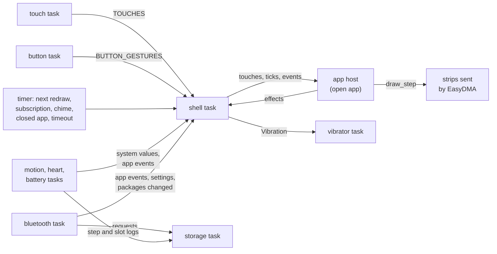

# Firmware

`neotime-firmware` (`neotime/firmware/`) is the program the watch runs. It takes over the
bootloader's watchdog, starts the [drivers](drivers.md) and [services](services.md) on
[Embassy](https://embassy.dev), and spawns the tasks that run the watch. Its shell shows the watch
face, the launcher and the apps through the [app host](app-runtime.md#the-app-host). It is outside
the Cargo workspace, like the bootloader, because it only builds for the watch.

The `recovery` feature builds the small recovery firmware: the status page, Bluetooth, storage and
updates, without the shell, the app host or the runtime. [updates.md](updates.md) says how either
reaches a watch; what the wearer sees is in the [guide](guide/index.md).

## Start-up

`main.rs` starts the watch in this order:

1. Turns on the memory protection unit's [stack guard](#stack-guard), then `embassy_nrf::init`.
2. Turns on the flash's instruction cache (`NVMC.ICACHECNF`), which the chip starts with off, with
   its hit and miss counting on for the diagnostics. Without it every instruction word fetched from
   flash waits 2 cycles; with it a fetch from the 2 KB cache waits none. In the emulator, opening
   Settings draws in 222 ms with it and 297 ms without.
3. Starts the heap, takes over the watchdog with the bootloader's settings, and spawns the watchdog
   and button tasks. The chip's DCDC regulator is on from `embassy_nrf::init`, since the PineTime
   board carries its inductor and it draws less than the LDO while the radio runs.
4. Sets up the SPI bus the screen and the external flash share, starts the screen and the
   backlight, and draws the status page: the version, the last restart and the files starting.
   The clock kept across a reset comes back here.
5. Mounts the flash store and reads the boot state, which sets the page's colour and mode.
6. Sets up the I2C bus at 400 kHz and spawns the touch, battery, motion, heart rate, vibrator and
   shell tasks.
7. Starts the radio and spawns the storage and Bluetooth tasks, from a function of its own so their
   futures never share start-up's stack frame.

Two seconds after start-up the shell takes the screen from the status page, loads the settings, the
time zone and the shared library's font, reads the theme and the installed apps, and opens the
face.

## Tasks

Every task shares one executor, and the chip sleeps whenever every task is waiting. Each long job is
an `async` task, so a slow job, such as a vibration pattern, waits without blocking the others.

| Task | Where | What it does |
|---|---|---|
| `shell` | `shell.rs` | Runs the face, the launcher and the apps, the screen's power and every system rule. |
| `bluetooth` | `main.rs` | Advertises, serves the GATT services, takes updates, and uses the phone's own services. |
| `storage` | `storage/watch.rs` | Alone awaits the flash store, for the other tasks' requests. |
| `touch` | `touch.rs` | Reads the touch panel and sends touches and gestures to the shell. |
| `button` | `main.rs` | Sends each side button gesture to the shell. |
| `watchdog` | `main.rs` | Feeds the watchdog while the button is up and the shell and radio make progress. |
| `motion` | `motion.rs` | Reads the step count, acceleration, shakes and wake gestures. |
| `heart` | `heart_rate.rs` | Runs the heart rate sensor as the open app and the settings ask. |
| `battery` | `battery.rs` | Reads the battery and ends each six-minute slot of the health logs. |
| `vibrator` | `vibration.rs` | Plays each vibration pattern the shell asks for. |

The shell sleeps on a `select` of its inputs and wakes for the first: a touch, a button gesture,
the timer of its next due moment, or a change from another task. Each time round it hands what woke
it to the app host, follows what the app asked for, and draws what changed.

## The shell

`shell.rs` is the system's main loop. Many of its rules live in small modules of `neotime-app-host`
(`swipes`, `side_button`, `way_back`, `quick_apps`, `wake`, `haptics`, `motion`, `phone`,
`settings`, `closed_apps`), so they are tested on the computer.

### Navigation and the way back

- **Moving around.** The face shows first. A swipe up the face does not use opens the launcher, an
  ordinary app (`apps/launcher`) that lists `installed_apps` with their icons; a tap opens one.
  Every swipe goes to the open screen first, and `neotime_app_host::swipes` says what the shell does
  with one it leaves: on the face, down pulls the notifications down and left and right step round
  the quick apps; on the notifications, down pulls quick settings down after them; up on either,
  or down on the launcher, goes back a step. Inside any other app the shell takes no swipe.
- **Quick apps.** `neotime_app_host::quick_apps` steps round the ring read from
  `/settings/quick_apps` on each step, with the face as the place before the first app, and the
  shell remembers that the open app came from the ring so its own unused swipes step on.
- **The way back.** Each step forward, by a swipe, the launcher, a double click, an app opening
  another or a notification waking the screen, records the screen left and how the new one came in
  (`neotime_app_host::way_back`, the newest 8). Going back, by the button, a swipe up on the
  pulled-down screens, a swipe down on the launcher or an app's `back` or `close`, retraces them in
  exactly the reverse order, each coming in by the opposite movement, so quick settings goes back to
  the notifications and then the face. A step forward onto the screen just left counts as a step
  back. Reaching the face forgets the way back, and so does turning an app on or off, since that
  moves the launcher's places; with nothing recorded, back goes to the face.
- **Built-in screens.** The notifications and quick settings are app sources in `shell/`, compiled
  by `firmware/build.rs` with `neotime-compiler` and included in the firmware, about 2.2 KB
  together. The shell opens them like any app image but straight from flash, never from `/apps`,
  so they are not installed packages and the launcher never lists them.

### Side button

`send_button_gestures` owns the `neotime-button` driver and sleeps on the pin's edge, sending each
click, double click, long press and 2 second press to the shell. `neotime_app_host::side_button`
decides what each does:

- A dark screen only wakes.
- A click goes back a screen in the open app's history; from its first screen the shell goes back a
  step along the way back, and the battery screen back to what it covered. A click on the face puts
  the watch to sleep.
- A long press or a 2 second press goes to the face.
- A double click opens the notifications, or leaves them for the face.

Apps never hear the button.

### Transitions

The launcher and apps slide up over what was open, and the button's way back or home slides down.
The notifications and quick settings slide down from the top and go back up, a step round the quick
apps wipes in from the side the finger moved away from, and any screen an app goes to from its
`onSwipe` moves the way the swipe went.

The shell draws a transition's steps, and the slices of a large redraw, one after another, yielding
to the other tasks between them. It takes every touch and button press queued during a step before
drawing the next (`take_queued_input`), so input waits at most a step, the touch queue never fills
and drops a lift, and a list follows the finger during a long redraw; nothing is taken while new
packages wait to be loaded. Once a new screen opens, the rest of the touch that opened it is dropped
until the finger lifts, so a swipe that opens the launcher does not also scroll it.

### Touch input

`touch.rs` turns the panel's reports into the host's touches: press, drag and release from the
finger, a `Fling` with the finger's speed just before the lift of a drag, and one click, long press
or swipe from each touch's `GestureFinder` (see [drivers.md](drivers.md#touch-panel-driverstouch)).

- Each report is timed when its interrupt pulse comes, not after the I2C read, so speeds come out
  right.
- A drag's start is where the finger crossed the 10 px threshold, so dragged content does not jump
  by it.
- The panel reports again and again while a finger is down, about every 10 ms even when it is
  still, so 100 ms without a report ends the touch as if it had lifted.
- Touches wait in a queue of 5 in which drags never take the last three places, so a lift's fling,
  the lift and its gesture always fit; while the queue is that full, only the newest drag is held
  back. The shell merges the drags waiting in the queue into the latest one, so a list follows the
  finger however far drawing falls behind.

### Screen power

- **Sleep.** After the settings' screen timeout without input, 15 seconds at first, the backlight
  goes off, the display sleeps and the app gets `screen_off`, unless it called
  `keep_screen_on(true)`. Two seconds before the timeout the light drops to its low level, and any
  input then brings it back and starts the timeout again. The next touch or press turns the screen
  on without acting on it, and `WakingTouch` holds back the rest of a touch that woke it.
- **The panel's timing.** Putting the panel to sleep or waking it waits only the 6 ms the ST7789
  needs before its next command; the shell keeps the two switches at least 125 ms apart, as the
  panel also needs, and blocks for the rest of that gap only when they come closer.
- **Sleeping between wake-ups.** The loop sleeps until the next input or `next_wakeup`; while the
  screen is dark it wakes only for the app's subscriptions (`next_subscription_due`), closed apps
  and chimes, and catches the clock's redraws up when the screen turns on. An app's `wake_screen()`
  and `screen_off()` turn the screen on and off, and waking it restarts the timeout.
- **Always-on screen.** With the always-on setting, the screen dims instead of turning off: the
  panel enters its 8-colour low-power mode, the backlight drops to a tenth of its low level, and
  the face keeps drawing. The dim level pulses the low pin at 1 kHz, lit 3 ticks of every 32, with
  RTC2, PPI channels 1 and 2 and GPIOTE channel 0 (`backlight.rs`), so it runs while the CPU sleeps.
- **Brightness.** An app's `set_brightness` sets the backlight to level 1, 2 or 3 until it closes.
- **Waking by touch.** The `wake_on_touch` setting picks what turns a dark screen on besides the
  button. When the screen turns off the shell tells the touch task, which puts the panel into deep
  sleep for none, leaves it scanning for a tap, or sleeps it listening for a double tap only;
  `neotime_app_host::settings::touch_wakes_screen` decides which touch wakes the shell. With a tap
  waking the screen, the panel stays awake while the screen is off until the motion task finds the
  wrist still for a minute, reading it every 2 s if nothing else does; it then sleeps the panel
  as for none and wakes it again when the wrist moves or the screen turns on.
- **Wake gestures.** `neotime_app_host::wake::gestures_to_watch` says what the accelerometer
  watches for from the settings and the screen: a raised or shaken wrist while it is dark, a
  lowered arm while it is lit and not held on, nothing in sleep mode. The shell hands that to the
  motion task on every pass of its loop, which then reads ten times a second while lowering is
  watched and five times a second for raising and shaking alone, and sends what it finds through `app_events.rs`; the shell wakes the screen or turns it
  off as for any other request. `wake::DoubleTapFinder` turns two taps the face does not take,
  within 500 ms and 40 pixels, or a double tap from the panel, into putting the watch to sleep,
  since the panel reports no double taps while the screen is lit. Sleep mode, kept inside do not
  disturb by `neotime-settings`, also stops touch waking the screen and turns the always-on
  screen off. `tools/check_wake_gestures.py` proves raise, lower and the face's double tap in the
  emulator.

### Apps

- **The list.** `apps.rs` reads every installed app from `/apps` through `neotime-packages` and
  keeps the list, turned-off apps included, for the `packages` system values: the watch face is the
  one the `watch_face` setting names, or else the first face turned on, the app with id `launcher`
  is the launcher, and every other app turned on is listed in `installed_apps`. The ids of the
  faces turned on and the shown face's name stay when the full list is dropped, so
  `step_watch_face` and a changed `watch_face` pick a face with no list. Icons are copied out of
  their images only while the launcher is open. `packages::CHANGED` makes the shell read everything
  again after an install. With no face the shell shows `help.rs`: the time and how to install one.
- **Turning apps on and off.** `set_app_enabled` from an app runs the package manager's checks on
  that list, writes the `disabled` marker and tells the open app; the open app itself cannot be
  turned off.
- **Images.** The open app's image is read into the heap when it opens and freed once its host is
  gone. The shared library is read in place from the internal flash, after the firmware's code.
- **Memory check before an app opens.** Before the shell starts an app, it compares the app's need
  from `neotime_runtime::memory_need` (less the image, already allocated) with the heap's free
  bytes, and when it would not fit shows a page saying how much the app needs and how much is free,
  with OK, instead of opening it. OK opens the face, or the help screen when the face itself was
  refused. Free bytes are the sum of every free block, so a fragmented heap can still refuse a
  large allocation; that ends as an out-of-memory crash.
- **Saved state.** An app's persistent variables are written to `/apps/<id>/state` when it closes or
  the screen turns off, only when one changed, and put back when it opens. A `state` message from
  the companion, which follows its write of that file, opens the open app again on the new state
  without saving over it.
- **Closed apps.** `closed_apps.rs` keeps `neotime_app_host::closed_apps::ClosedApps`, a few bytes
  for each listed app with a subscription that runs while closed, filled when the apps are read and
  again as each app closes. The loop sleeps until the next one too. When one comes due, and no store
  write is under way, the shell loads it with `open_in_background`, `run_while_closed` fires what is
  due, and its state is saved. If the free heap is short of the app's `closed_run_bytes` plus 2 KB,
  the open app is closed first and opened again afterwards. A `wake_screen` from the closed app
  opens it over what is open, on the screen its `go` named, without stopping its vibration, and
  lights the screen. `next_alarm` reads the closed `alarm` app's next ring.
- **Temporary apps.** The packages commands `run` and `stop` raise `packages::TEMPORARY`; the shell
  opens the app from `/temp/<id>/` as `Showing::Temporary`, answers `run` once it is open, saves no
  state for it and closes it when the phone disconnects.
- **Firmware on trial.** `firmware_state` comes from the boot state read at start, and turns
  confirmed when the Bluetooth task or the shell confirms. `confirm_firmware` makes the shell mark
  the boot state booted itself, a blocking write of one page; `roll_back_firmware` saves the
  settings and, if the boot state still says on trial, resets, so the bootloader's ordinary revert
  brings the firmware before back. A closed app's `roll_back_firmware` is dropped.

### Settings, clock and chimes

- **Settings.** `settings.rs` holds the one store of watch-wide settings, loaded from
  `/settings/system` at start. `set_setting` from an app and a `settings` message from the phone
  both change it; the shell then redraws what reads them, sends the app `settings_change`, applies
  the brightness unless the open app set its own, and writes the file when the app closes or the
  screen turns off, or at once while it is off. `set_setting("theme", n)` picks preset theme `n`.
- **Clock.** `clock.rs` holds one `WallClock`: UTC counted on from the build time, or from what a
  phone last set through Current Time (0x2A2B), Local Time Information (0x2A0F), the phone's own
  Current Time service or a `setTime` line, or from an app's `set_clock` effect, which the shell
  hands `clock::set_by_hand`. `clock::now()` gives local time, for drawing, chimes and the midnight
  step reset; `clock::utc_now()` gives the `now` apps and the app host see, with
  `clock::utc_offset()` as `utc_offset`, and `clock::instant_at` turns a UTC time into a timer
  reading. Setting the clock signals `now`, `utc_offset` and `started_at` as changed. A changed
  zone is written to `/settings/time_zone` by the storage task, and the shell reads it back at
  start unless a phone already wrote one. The clock is kept beside the crash record
  (`clock::keep`, `clock::restore_kept`), so it survives a soft or watchdog reset.
- **Chimes.** With chimes on, the shell also wakes on the local hour or half hour and buzzes, twice
  on the hour and once on the half hour, unless do not disturb is on. A chime more than a minute
  late, such as after the phone moved the clock on, is skipped.

### Vibration

`neotime_app_host::haptics` decides what the motor plays: `vibrate`, `vibrate_pattern`,
`stop_vibrating` and `notify` from apps, a notification or call from the phone, and the chimes. In
do not disturb only the `alarm` pattern, which the alarm and timer ring with, and a stop get
through; with the `alarms_in_do_not_disturb` setting off, only a stop does. Each `Vibration` goes to
the vibrator task, which turns it into `neotime-vibrator` steps, so a pattern never holds up the
shell; opening another app stops what is playing.

## Sensors

### Steps, acceleration and shakes

- **Steps.** `motion.rs` reads the accelerometer's own step counter every 30 seconds and hands each
  reading to the [step history](services.md#steps-servicessteps), which it shares with the shell in
  a thread-mode mutex. It never resets the chip's count. A change redraws what shows the steps and
  `step_history`, and goes to the app's `steps` events. `reset_step_trip` from an app only signals
  the task, which zeroes the trip and saves it, so no file is written from inside an app's handler.
- **Acceleration and shakes.** While the screen is on, the shell asks
  `neotime_app_host::motion::reading_period_in_milliseconds` how often the open app needs readings:
  the shortest `acceleration` period, no faster than ten a second, or a tenth of a second for a
  `shake` event. The motion task reads acceleration only then, so the chip is read for steps alone
  the rest of the time, and feeds each reading to the shake detector. Readings and shakes reach the
  shell through `app_events.rs`, which keeps only the latest of each; the host hands the latest
  reading to `acceleration` events at their period and a shake to `shake` events at once. Each
  reading also updates the shake speed, and while the open screen shows `shake_speed`
  (`AppHost::screen_shows`) the accelerometer is read for it.
- **Sharing the bus.** The touch panel, the accelerometer and the heart rate sensor share the I2C
  bus. The touch panel starts first, with retries, and the accelerometer waits for it, since a
  reset of one while the other starts stops the panel answering.
  `i2c_bus::SleepingTwim` wraps TWIM1 behind the bus: after every transfer it disables the TWIM
  and writes its power register 0 then 1, since a TWIM that has used EasyDMA otherwise keeps
  drawing about 400 µA (nRF52832 anomaly 89), and puts the pins, speed and enable back before the
  next.

### Heart rate

`heart_rate.rs` runs the sensor as `Schedule::mode` says. The open app asks with
`start_heart_rate` until `stop_heart_rate`, `measure_heart_rate` until the first reading, or
`set_heart_rate_led` to flash it as a beacon; opening another screen ends what it asked, so the
sensor never runs for an app that has gone. With no app asking, the `heart_rate_interval` setting
measures always or now and then, with the screen on or off.

While measuring it reads 24 samples a second and feeds them to the `Monitor`, which is on the heap
only then (about 280 bytes with its 200-sample window); otherwise the LED is off, or flashing by
itself for a beacon, and the task sleeps until the next background measurement. Each reading wakes
the shell as a change of `heart_rate`, goes to the open app's `heart_rate_reading` events, adds to
the slot's average for the heart rate log, and raises `READING_TAKEN` for the Heart Rate service.
The latest one, its time and the status stay for `heart_rate`, `heart_rate_measured_at`,
`heart_rate_status` and `is_heart_rate_running`. The feature costs about 4 KB of flash and 320 B of
task storage. `tools/check_heart_rate.py` runs it in the emulator against an emulated pulse.

### Battery

`battery.rs` reads the battery's voltage through the SAADC once a minute, and half a second after
power is plugged in or out, so both charger pins have settled. P0.19 says power is present and P0.12
that it is charging. [`neotime-battery`](services.md#battery-servicesbattery) turns each reading
into the charge; apps read it, `is_charging` and `battery_millivolts`.

- **Battery screen.** The events of each reading (the charger plugged in or taken off, the battery
  full, the charge low) queue in `battery::EVENTS`, and the shell takes them when the battery values
  change. It hands each to the open app's `battery` subscriptions, and for the charger and, outside
  do not disturb, the low warning, it opens the `system` app straight onto its `battery` screen
  (`AppHost::start_on_screen`, which leaves nothing to go back to inside the app) over what is open
  and lights the screen. An app that keeps the screen on, such as a ringing alarm, stays in front,
  and the screen only lights. Without the app the screen just lights on what is open. When the
  screen sleeps, or the button goes back, the shell reopens what was open before; opening anything
  else forgets it.
- **Health logs.** The task holds a `SlotClock`; when a six-minute slot ends it takes the heart
  rate task's average of that slot and the charge, and hands them to the storage task as
  `StoreSlotLogs`, which writes them to the [slot logs](services.md#slot-logs-servicesslot_log).
  Nothing is written while a slot is in progress.

## Drawing

The shell draws through `DrawingScreen` (`drawing_screen.rs`) and the DMA code in `display_dma.rs`.

- **Two strip buffers.** `DrawingScreen` owns two static strip buffers of four screen rows (1,920 B
  apiece) in the panel's byte order, in a `ConstStaticCell` so they never pass through the stack,
  and locks the display only for each command, so other tasks, such as the status page's, can use
  it while drawing waits. The host draws a strip straight into the free buffer, awaits the bus, and
  starts it by EasyDMA, then draws the next into the other buffer while it goes out, with no copy
  between them; it awaits before each scroll command too. A drawing step returns as soon as its
  last strip has started, and the shell does not await the bus before a host step, so the first
  strip is drawn while the last one of the previous step is still going out; only the shell's own
  blocking draws (the full clear, firmware pages, the help screen) await it first. `draw_host`'s future is polled out of line (`OutOfLine`), so its frames
  never sit under the shell task's other work.
- **Sending a strip.** A strip is sent as equal pieces of at most 255 bytes, the most one EasyDMA
  transfer moves, in array-list mode; each piece's END starts the next through PPI channel 5, which
  sits in PPI group 0. TIMER1 counts the ENDs through channel 6; one before the last its compare
  disables the group through channel 7, and at the last its second compare raises TIMER1's
  interrupt (`StripSentHandler`), which ends the send in hardware time: it disables the group,
  takes the SPIM out of list mode, deselects the display, wakes whoever awaits `bus_is_free` and
  sends SEV, so a waiter in WFE always wakes.
- **Sharing the bus.** The bus (`SpiBus`, the SPIM with the display's chip select and the chain) is
  taken for one transaction at a time. The flash store awaits `bus_is_free` before each read,
  program, erase and status poll, so it never waits on a strip either; a caller that cannot await,
  such as a display command from the status page or a store call the shell runs to its end, sleeps
  in WFE until the interrupt.
- **Flash reads by DMA.** `read_flash`, and `start_flash_read`, which returns at once with a
  `FlashReadInProgress` that owns its buffer and whose drop waits for the read to end, read up to
  four extents one after another, a piece of at most 255 bytes at a time: a 4-byte read command for
  each extent, then pieces into RAM, each started by the same TIMER1 interrupt and never chained by
  PPI, so the nRF52832's EasyDMA anomaly 109 cannot touch them. They use the bus only while no
  strip is going out; a display call sets `DISPLAY_IS_WAITING`, and the read stops after its
  current piece and starts again with a fresh command once the display is done. The flash's own
  commands wait for a read to end, so no erase or program lands inside one. A piece never leaves a
  single byte, since a one-byte transfer clocks out an extra byte (anomaly 58).
- **Prefetch.** An app's `prefetch_file` is one such read: the shell asks the flash store's
  `file_extents` where that part of the file lies, starts the read into a heap buffer and returns,
  and `WatchSystem::read_file` serves the next `file_bytes` of that part from the buffer, then drops
  it. A part kept as a record, never over 1 KB, is read at once instead.
- **Other drawing.** The status page, the help screen and other `embedded-graphics` drawing go
  through blocking writes of a few pixels at a time.

## Storage

`storage/watch.rs` mounts the flash store at start, in place in its static and by polling the chip,
so no task holds a copy of it. Its flash adapter, `StoreFlash`, reads at once and starts each erase
and page program without waiting, then waits on the timer, so other tasks run while the chip works.
[storage.md](storage.md) lists what the watch keeps there.

- **The storage task** (`run_storage`) alone awaits the store: the Bluetooth task's file transfers
  and packages commands, the step and slot logs and the time zone reach it as requests
  (`storage_requests.rs`). Each call's future, up to 1.8 KB, is boxed on the heap while it runs,
  both in the task and in the shell's calls, so it costs neither static RAM nor stack.
- **The shell** does not await the store. At the top of each turn of its loop it waits until no
  request is under way, then calls the store directly (`Files::read_now` and the like), which run
  to their end at once by polling the chip, and no other task can take the store before the shell
  next waits. The app host's file reads while drawing go the same way.
- **Flash sleep.** While the screen is off, `storage::Files` puts the external flash into deep
  power-down (`let_flash_sleep`), only while it holds the store, at the end of each store call and
  after each storage task request, so no store read is under way or can start while the chip is
  down. `StoreFlash` calls `wake_if_asleep` at the start of every read, erase and write, so a read
  that goes past the driver, such as by DMA, still finds the chip awake. The update slots reach the
  chip through the driver, which wakes it.

### Background work waits for a pause

The shell's store calls and the internal flash block the one executor while they work, a sector
erase for tens of milliseconds. Work the wearer is not waiting on first awaits
`foreground::wait_for_a_pause`: each packages command, each file transfer write from the phone, and
each step count reading before it goes to the log. It holds back while the shell is part way
through a transition or a sliced redraw, or a finger is down, checking every 20 ms, and starts
anyway after a second, as [`neotime-foreground`](services.md#foreground-servicesforeground)
decides. The DFU image check yields every 4 KB, so the radio's host side keeps running while it
reads up to 480 KB back.

## Bluetooth

Bluetooth runs as a task of its own, so its stack frame (5.7 KB) is never added to start-up's; what
it keeps for the whole run (the update state, the status page and the confirmation) sits once in a
static, since a task's arguments are stored twice in its state.

### Advertising

The watch advertises as InfiniTime does, so phones find the two the same way: fast, 20 to 30 ms,
for 30 seconds after start, a disconnect or Bluetooth coming back on, then about once a second.
The advertisement carries the flags, the Heart Rate and legacy DFU services and a transmit power of
0 dBm, and the scan response carries the name; the GAP appearance is a smartwatch. The name is
"NeoTime", or "InfiniTime" with the `gadgetbridge_name` setting on, so Gadgetbridge's InfiniTime
support takes the watch; the GAP device name follows it. A refused advertise retries a second
later. Turning the `bluetooth` setting off stops advertising and drops a connected phone; turning
it on advertises again. `tools/check_advertising.py` proves the advertising and the names in the
emulator.

### GATT services

The services are declared with TrouBLE's `#[gatt_server]` and `#[gatt_service]` macros, patched in
`third_party/` so the attribute table is built in a constant and kept in flash: the declarations,
UUIDs and `&'static` read-only values cost no RAM. Only the values written or set at run time are
in RAM, in one byte array, beside the CCCDs TrouBLE keeps for each client; see
`third_party/trouble-host/NEOTIME.md` and [memory-map.md](memory-map.md#ram-64-kb-planned).

| Service | UUID | What it serves |
|---|---|---|
| Legacy DFU | `00001530-…` | Firmware updates through [`neotime-dfu`](services.md#firmware-updates-over-bluetooth-servicesdfu). |
| Current Time | 0x1805 | The time (0x2A2B) and time zone (0x2A0F), read and written. |
| NeoTime | `6e540001-…` | The [diagnostics](#diagnostics) (`6e540002`) and the packages commands (`6e540003`). |
| Nordic UART | `6e400001-…` | The companion app's JSON lines. |
| Battery | 0x180F | The charge (0x2A19), read or notified when it changes. |
| File transfer | Adafruit's | Files through [`neotime-blefs`](services.md#files-over-bluetooth-servicesblefs). |
| Device Information | 0x180A | The six strings InfiniTime serves. |
| Alert Notification | 0x1811 | New Alert (0x2A46), written by any Bluetooth tool to show a notification. |
| Heart Rate | 0x180D | The latest reading (0x2A37), read or notified as each is taken. |

- **Device Information.** Manufacturer `PINE64`, model `PineTime`, hardware revision `1.0.0` and
  software revision `NeoTime`, all constants in `neotime_companion`, the firmware revision (the
  [version](#version)), and a serial number: the chip's 64-bit factory id (FICR DEVICEID) as 16 hex
  digits, written into the table once at start-up.
- **Heart Rate.** A read gives `neotime_companion::heart_rate_measurement` of the latest reading.
  A subscription never starts the sensor, as on InfiniTime, since Gadgetbridge subscribes on every
  connection and the LED would then be lit for as long as the phone is near. The service comes last
  in the table, so the handles of the others stay where they are.
- **Packages characteristic.** Lines written to 6e540003 go, once their write is answered, to the
  storage task, which runs them through `storage::Files::run_packages_command`; the Bluetooth task
  notifies each reply in 20-byte pieces, waiting for a free packet when a long reply, such as the
  app list, fills the eight-packet pool. A command that installs, removes or hides an app raises
  `packages::CHANGED` for the shell; `run` and `stop` raise `packages::TEMPORARY`.
- **File transfer.** The storage task answers each command, and the Bluetooth task sends each
  answer as a notification, waiting for a free packet when a folder listing fills the send queue.

### Updates and confirming

The first data a phone exchanges proves the radio works end to end, so that is when the firmware
confirms itself to the bootloader, and the status page says so. With `allows_updates` off,
`neotime-dfu` refuses a DFU start and the status page says "Updates are off"; an update already
running carries on. The storage task also locks `/apps` and `/temp` in `neotime-blefs` then. The
third value, on until the next restart, lets both through, and `/settings/system` reads it back as
off.

### Companion messages

The Nordic UART service carries the companion's JSON lines. The Bluetooth task hands each write to
`read_companion_line`, which gives a `setTime` line to the clock and the rest to
[`neotime-companion`](services.md#companion-messages-servicescompanion):

- **`settings`** goes to the shell, which applies the theme to the open app at once, keeps it in
  `/settings/theme`, passes the other settings to the store and sends the settings back as a reply,
  which waits on the heap.
- **`notify`** goes to the shell through `app_events.rs`. The shell hands it to the open app's
  `notification` subscriptions, keeps it in
  [`neotime-notifications`](services.md#notifications-servicesnotifications), buzzes the
  notification pattern unless do not disturb is on, and opens the notifications on their preview of
  it over what is open, lighting a dark screen; the preview goes back by itself after 7 seconds.
  While `find` rings or a call rings, a notification neither buzzes nor opens anything. Apps'
  `notify`, `dismiss_notification` and `mark_notifications_read`, and a `notify-` dismissal from the
  phone, change the list, and the shell tells the open app through `report_system_value_changes`
  once the host call returns.
- **Calls, music, weather, navigation, `find` and `vibrate`** wait together in `app_events.rs` as
  one `PhoneUpdates`, the latest of each kind; the shell keeps the music, weather and navigation in
  its `PhoneData` for apps to read, and `neotime_app_host::phone` hands the open app its `call`,
  `music`, `weather` and `navigation` events. An incoming call opens the `call` app over what is
  open and rings for up to two minutes, until it is answered, rejected, muted or ended; without the
  call app it buzzes once and lights the screen. `find` plays the alarm pattern until `n` is false,
  the wearer touches the watch or presses the button, or a minute passes.
- **`status`** is answered at once from the Bluetooth task, and **`slots`** by the Bluetooth task,
  which holds the flash. `music_control`, `call_control`, `find_phone` and the requests for the
  music and navigation state send their lines through the same reply queue as the settings.
- **`state`** opens the open app again on the state the companion wrote, and a closed app that runs
  while closed notes its next time again.

`phone.rs` holds whether a phone is connected, which the Bluetooth task sets when a connection is
accepted and clears when it ends. Each change wakes the shell, which redraws what reads
`is_phone_connected` and sends the app's `phone` subscriptions `connects` or `disconnects`.

### The phone's own services

Three seconds after a phone connects, `phone_services.rs` looks once for the phone's Current Time
service and sets the clock from 0x2A2B and 0x2A0F along the path a phone's time write takes, then
for its Alert Notification service, turns New Alert notifications on and writes the control point
for every category. Notified alerts show as notifications or ring as calls, as a New Alert written
to the watch does. [`neotime-phone-client`](services.md#the-phones-services-servicesphone_client)
builds the requests and reads the answers; the firmware carries them through two raw ATT calls in
the vendored TrouBLE, with a 5 second limit on each answer, and keeps reading what the phone sends
for the rest of the connection. It starts only with 2 KB of heap to spare, keeps 368 B on the heap
while connected, and is left out of the recovery build. `tools/check_phone_services.py` plays the
phone through the emulator's Bluetooth bridge.

## Watchdog and liveness

A separate watchdog task reads the side button's pin straight from the port every second and feeds
the watchdog only while it is up, so a hold of 4 to 5 seconds resets the watch into the bootloader
whatever the button task does. It also feeds it only while the shell and the radio make progress,
as [`neotime-liveness`](services.md#liveness-servicesliveness) judges: the shell's loop count must
move, and a quiet shell is woken with an empty system value change to prove it still runs; the
radio's interrupt count must move while it advertises or holds a connection. A shell stopped for three
checks, or a radio with work stopped for six, lets the watchdog reset the watch.
`tests/emulator/liveness.robot` stops the radio's interrupt and sees the reset.

## Crashes

### Reset reasons and the crash record

`restart.rs` reads and clears `RESETREAS` at start, and reads the crash record the previous run
left in `.uninit` RAM (see [memory-map.md](memory-map.md#ram-64-kb-planned)). The status page's
last line shows the crash when there was one, or else the reasons in words. The full firmware keeps
the record until the wearer picks Restart on the crash screen or the companion app saves a debug
report, so a reset in between shows the crash again; the recovery firmware, which has no crash
screen, clears it at start.

- **The open app.** The shell names the open app, face or launcher to `restart::set_open_app` as it
  opens one, and the handlers copy it into the record.
- **HardFault.** The handler records the stacked program counter and link register, `CFSR` and
  `BFAR`.
- **Out of memory.** The global allocator wraps the heap and tells `restart` when it refuses an
  allocation, with the size asked for and the free bytes; Rust's default allocation error handler
  then panics, and the panic handler records that as running out of memory instead of a plain
  panic. An allocation that succeeds clears the note, so a later unrelated panic is not mistaken
  for one.
- **Panic.** Reading a panic's location would keep the file name and line of every panic site in the
  firmware, about 26.6 KB of flash. The panic handler records instead the first eight words on the
  stack above it that look like Thumb return addresses into the code: odd, and between `__stext`
  and `__etext`. The first two or three are usually inside `core::panicking`; the next is usually
  the function that panicked. A stale word can pass the test too, so look each one up with
  `addr2line -e <the firmware's ELF> <address>`.

Both handlers then halt, so the watchdog resets the watch. The format and its decoding are in
[`neotime-crash-record`](services.md#crash-record-servicescrash_record).
`tests/emulator/crash_record.robot` faults the running firmware, poke-calls the panic handler after
a refused allocation, and checks the next start reports each and shows the crash screen;
`tests/emulator/screen_power.robot` checks the kept clock across a soft reset, a watchdog reset and
a power cut, the light lowering before the screen timeout, and the external flash sleeping while the
screen is off.

### Crash screen

After a start whose previous run crashed, the shell opens no app and shows the crash page instead:
what stopped NeoTime in plain words ("out of memory", "out of stack space" for a stack guard fault,
"a processor fault", "a software error") and which app was open, with two buttons. Restart dismisses
the crash and opens the face; Send debug info shows a page asking for the companion app and opens
the face once a debug report is saved, or when the wearer skips it with the side button or the Skip
button, leaving the crash for the companion app and the next start. A click of the side button
picks the first button on each page. Nothing reopens the crashed app. `firmware/src/crash_screen.rs`
holds the pages for the shell; the help screen draws in the same font.

### Stack guard

`stack_guard.rs` has the memory protection unit forbid the lowest 256 bytes of the stack, so a
stack grown too deep faults instead of quietly overwriting the statics below it, such as the
radio's state. The MemManage handler moves the stack pointer back to the top before it uses any
stack, records a HardFault whose `CFSR` shows a MemManage fault and whose address is `MMFAR`,
inside the guard, and halts for the watchdog. A frame bigger than the guard can step over it, so it
catches the usual overflow of a few hundred bytes rather than every one.

## What the firmware reports

### Diagnostics

The NeoTime service's diagnostics characteristic (`6e540002-…`) is little-endian `u32` words from
`diagnostics.rs`. Writing `01` to it says the companion app saved a debug report holding the crash,
which dismisses it as Restart on the crash screen does.

| Words | What they hold |
|---|---|
| 0 to 7 | Shell loops; what last woke the shell (1 touch, 2 button, 3 timer, 4 system values, 5 settings, 6 apps changed, 7 app event, 8 status page, 9 temporary app); whether the screen is lit; the touch panel's state; touch reports; touches sent; button presses; the accelerometer's state (4 while it waits for a shared library with its configuration). |
| 8 to 21 | The last restart: `neotime_crash_record::last_restart_words`, the `RESETREAS` bits, the kind of crash (0 none, 1 panic, 2 HardFault, 3 out of memory), eight detail words and four words of the open app's id. Set once at start. |
| 22, 23 | Microseconds the shell spent drawing apps, and the CPU spent sending to the display or waiting for a send to end, both counting round. |
| 24, 25 | Sectors the flash store erased, and store calls the shell made while another task held the store. |
| 26, 27 | The heart rate sensor's state (1 started, 2 failed to start, 3 failed to read) and its latest reading. |
| 28, 29 | Bytes the external flash's DMA reads moved, and times a flash read stopped to give the bus to the display. |
| 30 | App file reads served from a part read ahead with `prefetch_file`. |
| 31, 32 | The flash cache's hits and misses since start (`NVMC.IHIT` and `IMISS`, copied each time round the shell's loop), to check the emulator's model of the cache against the chip. |

### System info and About facts

- **System values.** Apps read `firmware_version` from the build's version, `started_at` from the
  clock's UTC at uptime zero, `reset_reason` from the text `restart.rs` writes once at start, and
  `free_storage_kilobytes` from the flash store's free file sectors. A read before it is counted
  gives 0 and asks the shell's loop to count it, outside the redraw's deep stack; the app then
  redraws with the count, which is kept until the next app opens. An app's `open_folder` is listed
  the same way, once its handler has returned.
- **About facts.** `about.rs` keeps what the System app's About pages show as numbers for the app
  to format: the bootloader's CRC-32 from start-up, the external flash's JEDEC ID, the touch
  panel's chip ID and firmware version, read in one transaction once it starts, the
  accelerometer's chip ID, and the Bluetooth address from FICR. The bootloader's version record is
  looked for the first time an app reads it, from the shell's loop:
  `neotime_boot::version::VersionRecord::find` reads the bootloader's pages word by word for its
  magic. The firmware's build date comes from `build.rs`. The heap wrapper counts refused
  allocations and the fewest free bytes after any allocation, and the stack guard's fault handler
  adds one to a count kept in `.uninit` beside the crash record.
- **Task table.** The firmware enables embassy-executor's `trace` feature, and `tasks.rs`
  implements its hooks over a [`TaskTable`](services.md#task-table-servicestask_table). Every task
  calls `tasks::name_this_task` first. Only thread mode touches the table, so it takes no lock.

### Status page

The start-up lines and an update's progress share the display with the shell; while the page is up
the shell draws nothing. During an update the page holds the screen lit; once the update ends or
fails it gives way to the next touch or press, or to the timeout. Its layout comes from
[`neotime_status_screen::page`](drivers.md#status-screen-driversstatus_screen), the same one the
bootloader draws, and the DFU state machine reports its step (`LegacyDfu::activity`) and why a step
was refused (`Outcome::failure`).

### Version

`build.rs` sets `FIRMWARE_VERSION` from the package version in `firmware/Cargo.toml` and the commit
`git rev-parse HEAD` gives, through `neotime_boot::version`: `0.1.0+1b19aed`, with a `*` when
`git status` shows uncommitted changes. Where there is no `.git`, such as a Nix build, it reads the
commit from `NEOTIME_GIT_COMMIT`, which takes Nix's `shortRev` or `dirtyShortRev`, and says
`unknown` without either. The status page's title shows it, and Device Information's Firmware
Revision (0x2A26) answers with it.

## Size and limits

With the shared library after its code, the full firmware all but fills its 480 KB region, and it
takes about 55 KB of static RAM, 30.25 KB of it heap: 10 KB for the system and 20.25 KB for the open
app's widgets and working memory. [memory-map.md](memory-map.md#what-fills-the-firmware) has the
measured split.

Not done yet: the weather forecast's coming days and the navigation's progress stay empty, because
Gadgetbridge's lines carry none, and music, weather and navigation are lost on a restart. See
[todo.md](todo.md).
