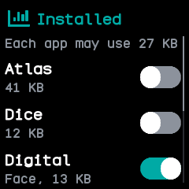
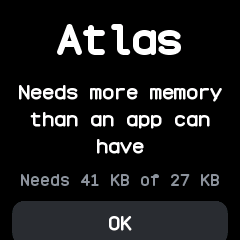
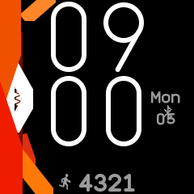
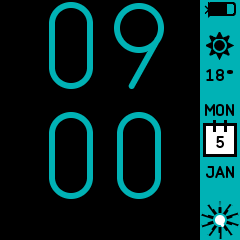
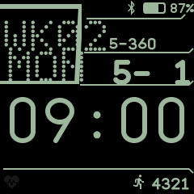
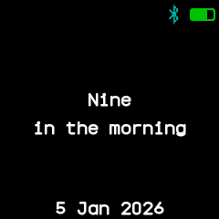

# Apps and watch faces

The firmware carries no apps, faces or launcher of its own. Everything you see apart from the
notifications and quick settings is installed from the companion app into the watch's storage, so
you choose what is on your watch.

## Installing from the store

The companion app has a store with every app, face and plugin made in the BattleTime repository, ready
to install or uninstall, plus any you add from a file or download from a GitHub repository's
releases. Plugins are the phone-side halves of watch apps. See
[app-store.md](../app-store.md).

A new watch starts with a help screen that shows the time and asks you to install a face; the
companion app's setup installs a face, the launcher and a set of apps in one go.

## Turning apps on and off

The [Software app](../apps/software.md) lists every installed app and face with a switch and the
memory it needs while open; the companion app's apps screen shows the same. Before an app is
installed or turned on, the watch works out how much memory it needs, and refuses one that would
not fit, or that would leave the launcher without room for its longer list, saying why. The launcher
and the last face always stay on.

An app opened without enough free memory does not start; a page says how much it needs and how much
is free. Apps remember where they were: an app's state is saved when it closes or the screen turns
off, and put back when it opens.

{ .screen }
{ .screen }

## The apps

There are 39 apps, ported from InfiniTime and wasp-os and merged where both had the same one, plus
apps of BattleTime's own. Each has a page under [apps.md](../apps.md). Among them:

- **Time:** alarm, timer, stopwatch, pomodoro and sports.
- **Health:** steps and heart rate.
- **Phone:** call, music, weather, navigation, phone finder, notes, remote and QR code.
- **Tools:** calculator, flashlight, metronome, level, beacon, Morse, haiku and more.
- **Games:** 2048, snake, paddle, puzzle 15, four in a row, Game of Life, dice and paint.
- **System:** the launcher, Settings, Software, System and Files.

A few work hand in hand with the companion app:

- **[Notes](../apps/notes.md)** shows a note you type in the companion app, a text file, or a web
  page it fetches every minute, copied to the watch again whenever it changes.
- **[Remote](../apps/remote.md)** shows up to nine buttons you set up in the companion app, each
  with an icon and an action such as a web request, which the phone runs when you tap it.
- **[QR code](../apps/qr-code.md)** keeps up to eight codes made in the companion app from a link,
  text or a Wi-Fi network, and shows one black on white at full brightness for another phone to
  scan.
- **Temporary apps** open on the watch without being installed, such as a question to answer Yes or
  No with the [prompt](../apps/prompt.md). One opens over whatever shows, and closes when you go
  back, the phone stops it or the phone disconnects.

## Watch faces

There are 18 faces, ported from InfiniTime, wasp-os and PinetimeLite and listed in
[faces.md](../faces.md). **Face** in Settings steps back and on through the faces turned on in
Software, as InfiniTime's watch face setting does, and the companion app can choose one too. The
chosen face shows at once and after a restart; if it is turned off or removed, the first face
turned on shows instead. Some faces open their own settings on a long press.

{ .screen }
{ .screen }
{ .screen }
{ .screen }

