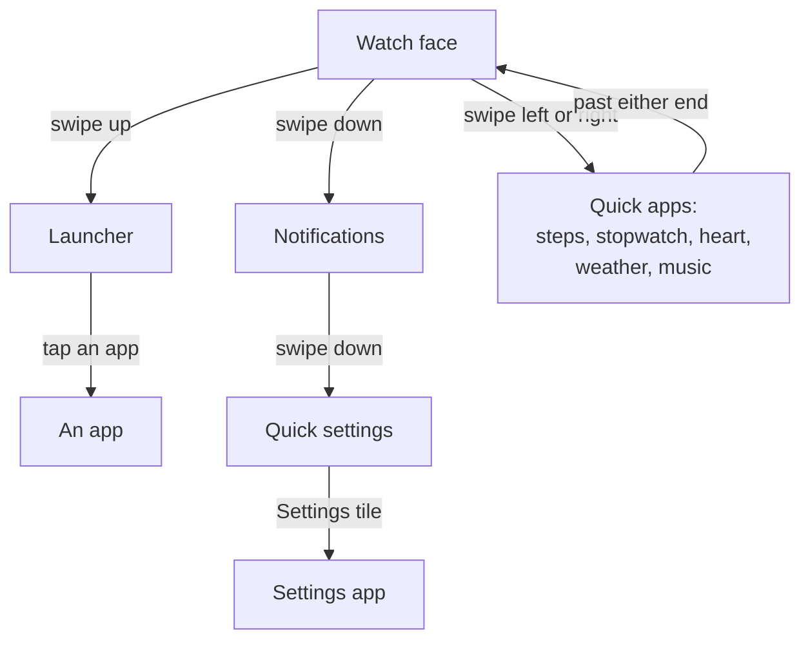
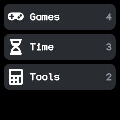
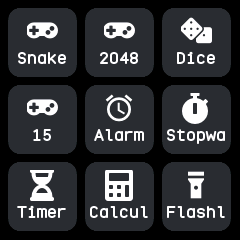
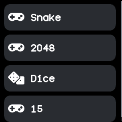

# Getting around

The watch face is home. Everything else is a swipe or a button press away from it, and going back
always retraces the way you came.

Every arrow goes back the way it came with a click of the side button, and the pulled-down
screens and the launcher also go back with the opposite swipe.

## The watch face

The face shows the time and, depending on the face, the date, the battery, whether a phone is
connected, unread notifications, the next alarm, steps, heart rate and the weather. Some faces
open their own settings, such as colours or a layout, on a long press. You choose the face in
Settings or the companion app; see [Apps and watch faces](apps-and-faces.md#watch-faces).

While no face is installed, the watch shows the time and a note to install one with the BattleTime
companion app.

## Swipes on the face

| Swipe | Does |
|---|---|
| Up | Opens the launcher. |
| Down | Pulls the notifications down from the top. |
| Down again | Pulls quick settings down after the notifications. |
| Left or right | Steps to the next or previous quick app. |

A swipe up on the notifications or quick settings, or down on the launcher, goes back a step.

## The side button

| Press | Does |
|---|---|
| Any press on a dark screen | Wakes the screen, and nothing else. |
| Click | Goes back: first a screen within the app, then a step back the way you came. On the face it puts the watch to sleep. |
| Double click | Opens the notifications, or goes from them to the face. |
| Long press, or holding for 2 seconds | Goes straight to the face. |

Apps never hear the button, so it always means the same thing. While the phone is ringing the
watch to find it, the first press only stops the ring. Holding the button much longer restarts
the watch; see [Updates and recovery](updates-and-recovery.md#the-side-button-menu).

## The launcher

The launcher slides up over the face and lists every installed app with its icon. Tap one to open
it. It is an ordinary app, installed like any other.

Apps sit in groups, such as games, tools, time, phone, health and system. The companion app
chooses how the launcher shows them:

- **Style:** one plain list, a **folder** per group, one list with a **heading** per group, or a
  **page** per group. In an open folder or the pages style, swipe left and right for the next or
  previous group.
- **View:** a row per app, or a grid of icons three across.
- **Order:** groups and their apps by name, or in an order you set.

The companion app can also rename, add and remove groups, give each an icon, and move apps between
them. See the [launcher's page](../apps/launcher.md).

{ .screen }
{ .screen }
{ .screen }

## Quick apps

A swipe left or right on the face steps round a ring of quick apps, as on wasp-os: the next or
previous app, and back to the face past either end. Inside a quick app, the left and right swipes
it does not use itself carry on round the ring, so you can flick through steps, the stopwatch and
the rest without going back. An app with pages, such as steps, turns its own pages first and
passes on the swipes past its first and last page.

The ring is steps, stopwatch, heart, weather and music until you choose your own apps and their
order on the companion app's Quick apps screen. Apps that are not installed are skipped.

## Notifications and quick settings

These two screens are part of the firmware, so they are always there and never in the launcher.
The notifications are covered in [Notifications and calls](notifications-and-calls.md).

Quick settings shows the time and the battery over six tiles: brightness, the flashlight, do not
disturb (off, silent and sleep), Bluetooth, the always-on screen and the full Settings app. A tile
that is on is filled in the accent colour. See the [quick settings page](../apps/quick-settings.md).

## Inside an app

- **Swipes belong to the app.** Inside an app every swipe is the app's own, and a swipe right
  never means back. A swipe the app does not use goes on to the watch, as on the quick apps.
- **Pages run left and right.** An app with several pages, such as System or Steps, shows one at a
  time: swipe left for the next and right for the one before. A bar along the bottom has a segment
  for each page and marks the one on show.
- **Lists scroll up and down.** A list follows your finger as you drag it. Flicked, it glides on
  and slows to a stop; a touch stops it where it is without pressing a row. Lists under a heading,
  as in Settings, scroll with the heading kept still.
- **Scroll bars, as on wasp-os.** A list, page or text longer than the screen shows a thin bar on
  its right edge, or a segment per page for a list that turns a page at a time. Lists that run
  across have the bar along the bottom.

## Touches

The watch works out each touch from the finger's path, so swipes respond while your finger is
still on the glass:

- A **tap** is a short touch that stays put.
- A **long press** is a touch held still for half a second.
- A **swipe** is a stroke of about 40 pixels, or a shorter quick flick, judged by how fast the
  finger leaves the glass.

The touch that wakes a dark screen only wakes it; the rest of it goes nowhere, so it never presses
a button you could not see. Touches and button presses made while the screen is still drawing are
kept and acted on in turn.

## Going back retraces the way

Every way back, whether the button, a swipe up on the pulled-down screens or a swipe down on the
launcher, revisits each screen you passed on the way, in exactly the reverse order and moving the
opposite way:

- Quick settings goes back to the notifications, then the face.
- Settings opened from quick settings goes back to quick settings.
- A quick app goes back through the ones you stepped past.
- An app opened over another, such as a ringing alarm, goes back to what was open.

The watch remembers the last eight screens on the way, and going to the face starts afresh.

## Movement on screen

Screens slide and wipe in, as on InfiniTime. The launcher slides up over the face and an app
slides up over the launcher; going back slides the way down again. Going to another screen of an
app wipes it in from the right, and going back wipes in from the left. A screen reached by a swipe
moves the way your finger did.

Only what changes is drawn, and each part is composed in memory first, so the screen never shows a
half-drawn widget.
