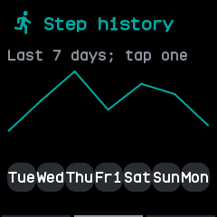
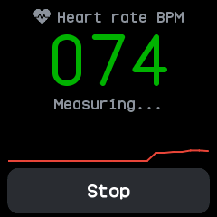
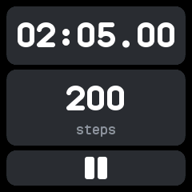

# Health and fitness

## Steps

The accelerometer counts your steps all day, with no app open. Faces show today's count, and the
[steps app](../apps/steps.md) shows more:

- Today's steps on a ring that fills towards your daily goal and turns green once it is met, with
  yesterday's total and a trip count that **Reset** starts again.
- A swipe left for the last seven days as a chart, and a tap on a day, or another swipe, for that
  day hour by hour.

The watch keeps the steps of every six minutes in a file for each day, for 90 days, and starts a
new day at local midnight. The history and the trip count are kept through a restart, losing only
the six minutes in progress. The daily goal is **Step goal** in Settings, from 1,000 to 50,000.

{ .screen }
{ .screen }

## Heart rate

The [heart app](../apps/heart.md) measures your pulse with the watch's optical sensor while it is
open. It waits for enough data, then shows the beats a minute, refreshed every four seconds, with a
chart of the latest readings, and says when the watch is off your wrist. Wear the watch snugly and
keep still.

As on InfiniTime, **Heart rate** in Settings can have the watch measure in the background, with the
screen off too: always, or every 30 seconds, minute, 5, 10 or 30 minutes. Each measurement lasts
until a reading, or 15 seconds at most. After one finds no pulse, as with the watch lying off your
wrist, the next waits until the watch has moved. Faces show the latest reading and how long ago it was
taken, and a phone app such as Gadgetbridge receives each reading through the standard Heart Rate
service while the heart app or the background setting is measuring.

Heart rate has run in the emulator but not yet on a real watch.

{ .screen }

## Heart rate and battery logs

For every six minutes the watch logs the average heart rate measured in them, and the battery's
charge at their end with whether it was charging, in a file for each day, kept for 90 days. The
companion app syncs these logs and shows each day's average, lowest and highest on its Heart and
System pages. They have run in tests but not yet on a real watch.

## Sports

The [sports app](../apps/sports.md) is a stopwatch that also counts the steps taken while it runs,
from wasp-os. The screen stays on while it runs. Pause and carry on as often as you like; once
stopped, a tap clears it. The watch keeps your last five sessions, each with when it started, its
time and its steps, and the companion app syncs them.

{ .screen }

## Motion

Shaking the watch rolls the [dice](../apps/dice.md), and the [motion](../apps/motion.md) and
[level](../apps/level.md) apps show the accelerometer's readings live. The accelerometer is read for
these only while such an app is open and the screen is on.
