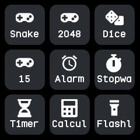
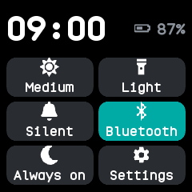
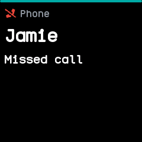

# What NeoTime does

NeoTime turns a PineTime into a watch that merges the best of InfiniTime and wasp-os: a face and
apps you choose and install from the phone, swipes and a side button that always take you back
the way you came, and the phone's notifications, calls, music and weather on your wrist. This
guide walks through it by topic. Work not done yet is in [todo.md](../todo.md), and how the parts
are built is in [architecture.md](../architecture.md).

{ .screen }
{ .screen }
{ .screen }
{ .screen }

## Getting around

The watch face is home. Swipe up for the launcher, down for the notifications and again for quick
settings, and left or right to step through a ring of favourite apps. A click of the side button
always goes back, retracing every screen you passed. See [Getting around](getting-around.md).

## Screen and battery

The screen turns itself off after a set time and wakes on the button, a tap, a raised wrist or a
shake, as you choose. There is an always-on screen, three brightness levels, six colour themes
and a steady battery reading with a warning when it runs low. See
[Screen and battery](screen-and-battery.md).

## Time and alarms

The phone sets the clock and time zone, the watch keeps counting through a restart, and the date
and time can also be set by hand. Hourly chimes, alarms, timers and the stopwatch ring even when
their app is closed. See [Time and alarms](time-and-alarms.md).

## Notifications and calls

Notifications from the phone pop up as they arrive, each kind with its own icon and colour, and an
incoming call rings on the watch, where you can answer, reject or mute it. Do not disturb and a
sleep mode keep it quiet. See [Notifications and calls](notifications-and-calls.md).

## Health and fitness

The watch counts your steps and keeps 90 days of them, measures your heart rate when asked or in
the background, logs heart rate and battery through the day, and times workouts with the sports
app. See [Health and fitness](health-and-fitness.md).

## Phone and Bluetooth

The NeoTime companion app, Gadgetbridge and the other InfiniTime companions all work with the
watch. Between them they set the time, send notifications, weather, music and directions, find
the watch or the phone, and keep a copy of everything the watch records. See
[Phone and Bluetooth](phone-and-bluetooth.md).

## Apps and watch faces

The watch carries no apps of its own: you install the face, the launcher and the apps you want
from the companion app's store, and turn them on and off on the watch. See
[Apps and watch faces](apps-and-faces.md).

## Updates and recovery

Firmware updates arrive over Bluetooth, a bad one rolls itself back, and holding the side button
reaches a menu that can roll back or install a recovery firmware. After a crash the watch says
what went wrong. See [Updates and recovery](updates-and-recovery.md).
