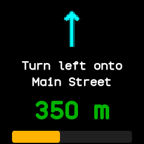

# Phone and Bluetooth

## Which phone apps work

- **The BattleTime companion app** does everything on this page and installs the watch's face, launcher
  and apps. See [The BattleTime Companion](../companion/index.md).
- **Gadgetbridge** sends notifications, calls, music, weather and directions with the same
  messages it uses for a Bangle.js, reads the heart rate and battery, and updates the firmware.
- **Other InfiniTime companions,** such as ITD, Siglo and Amazfish, use the standard services the
  watch shares with InfiniTime: the time, the battery, heart rate, alert notifications, the file
  service and firmware updates.

The watch advertises as InfiniTime does: quickly for 30 seconds after it starts, after a phone
leaves or when Bluetooth comes back on, then about once a second to save power. With
**Show as InfiniTime** turned on in the companion app's watch settings (or
`battletime settings gadgetbridge_name=true`), the watch names itself "InfiniTime", so Gadgetbridge's
PineTime support recognises it. Settings on the watch has no row for this.

Faces show the Bluetooth icon while a phone is connected, and phone apps such as the phone finder
say when none is.

## The time

Connecting a phone sets the clock and time zone; see
[Time and alarms](time-and-alarms.md#setting-the-time-from-the-phone).

## Weather

The phone sends the weather, and the [weather app](../apps/weather.md) shows the place, the sky,
the temperature now with the day's low and high, and up to five coming days. Gadgetbridge's
InfiniTime support sends the coming days, sunrise and sunset through InfiniTime's weather service,
which the watch serves; its Bangle.js line carries only today. Faces that show the weather use the
same report. Weather more than three hours old is dimmed. Temperatures follow the
**Metric units** setting.

## Music

The [music app](../apps/music.md) shows what the phone is playing, with the track's position and
length. Its buttons play, pause and skip on the phone's player, and a swipe up swaps them for
volume down and up. When it opens it asks the phone what is playing.

{ .screen }

## Navigation

The [navigation app](../apps/navigation.md) shows turn-by-turn directions from the phone: the next
turn's arrow, what to do there, the distance to it and how much of the route is done. When it opens
it asks the phone for the current step.

{ .screen }

## Finding the watch or the phone

- **Find the watch:** Gadgetbridge's find device rings the watch for up to a minute, even in do not
  disturb, until the phone stops it or you touch the watch or press the button. Phones that use the
  standard Immediate Alert service to find a watch ring it the same way.
- **Find the phone:** the [phone finder](../apps/phone-finder.md) app rings the phone until you tap
  **Stop** or leave the app.
- The phone can also buzz the watch one to five times, and ask for its battery level, voltage,
  charging state and steps.

## What the companion app keeps

While connected, the companion app reads every setting, every app's saved state, the step, heart
rate and battery logs and the sports app's last five sessions, every five minutes or as often as
its Sync setting says. Changing a setting or an app's state in the companion app reaches the watch
at once, and an open app redraws with the change. See [sync.md](../sync.md).

Settings on the watch and in the companion app are the same: brightness, the screen timeout, the
always-on screen, the 12 or 24 hour clock, units, the step goal, chimes, do not disturb, alarms in
do not disturb, the wake gestures, heart rate in the background, the watch face, Bluetooth,
updates and the theme. They are kept through a restart, except Bluetooth, and apps follow them at
once.

## Files over Bluetooth

Phones and computers read, write, list, move and delete the watch's files through the same file
service InfiniTime has, so ITD, Gadgetbridge and the companion app can all use it. On the watch,
the [Files app](../apps/files.md) lists what is stored, a folder at a time, with sizes. See
[companion-protocol.md](../companion-protocol.md#file-transfer).
