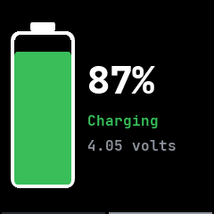
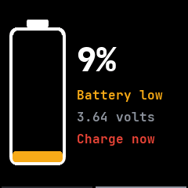

# Screen and battery

The screen is the watch's biggest use of power, so it turns itself off soon after you stop using
it and wakes the way you choose. Most of these settings are in the [Settings app](../apps/settings.md)
and quick settings, and the companion app can change them too.

## The screen sleeping

- The screen turns off after the time set under **Screen off** in Settings, 15 seconds at first
  and anywhere from 5 seconds to 2 minutes.
- Two seconds before it turns off the light drops to its low level, as on InfiniTime. A touch or a
  press in those seconds brings it back and starts the time again.
- An app can keep the screen on while it needs to, such as the sports timer while it runs or the
  heart app while it measures, and can light it up, such as when a timer rings.
- A click of the side button on the face puts the watch to sleep at once, and so does a double tap
  on the face, unless the face uses taps itself.
- When the screen comes back the clock is already up to date.

## Waking the screen

Any press of the side button wakes the screen. Under **Wake** in Settings you can add more ways,
ported from InfiniTime:

- **Touch:** a tap, a double tap, or the button only. With the button only, the touch panel sleeps
  while the screen is off, saving power. With a tap, it also sleeps once the watch has lain still
  for a minute, so after setting the watch down, move it before tapping it awake.
- **Raise wrist:** turning the watch towards you wakes it.
- **Shake:** shaking your wrist harder than the **Shake strength** wakes it. The strength screen
  shows the setting as an arc you can drag, over a live arc of how hard your wrist is moving, and
  **Calibrate** records a shake and sets the strength just below it.
- **Lower to sleep:** letting your arm fall turns the screen off, unless the open app is keeping it
  on.

Raise, lower and shake have run in the emulator but not yet on a real watch; touch wake has not
yet been tried on a real watch either.

{ .screen }
{ .screen }

## Sleep mode

Sleep mode is the third state of the do not disturb tile in quick settings, after off and silent,
and also a row in Settings. It silences the watch like do not disturb, and also stops touch, raise
and shake from waking the screen and turns the always-on screen off, so only the button wakes the
watch. A moon shows in quick settings while it is on. See also
[Do not disturb](notifications-and-calls.md#do-not-disturb).

## The always-on screen

With **Always on** turned on, in Settings or quick settings, the screen dims instead of turning off
and switches the panel to its low-power mode, and the face keeps drawing. Sleep mode turns it off.
It has not yet been tried on a real watch.

## Brightness

The backlight has low, medium and high levels. The brightness tile in quick settings steps through
them, and Settings has them as a list.

## Themes and text

- **Six themes:** dark, light, ocean, forest, sunset and contrast, picked in Settings or the
  companion app, which can also set colours of your own. The open app changes colour at once.
- **One clear font at every size,** drawn from lines and arcs with its stems and curves on whole
  pixels. It has the accented letters of Western European languages and the curly quotes, dashes
  and ellipsis that notifications use.
- **Soft edges.** Clock hands, ticks, chart lines, arcs, circles and rounded corners are drawn
  smooth, and text on coloured buttons has no dark fringe.
- **Room to breathe.** Content keeps 8 pixels from the edges of the screen and controls keep apart,
  except game boards and dials that fill the screen.

## The battery

The charge is read along InfiniTime's measured curve and smoothed, so it holds steady: it only
rises on the charger and only falls off it, stops at 99 % while charging, and reads 100 % once the
battery is full and the charger is still on.

The **System** app's battery page shows a tall battery filled to the charge, the percentage,
whether it is charging, full, discharging, low or critical, and the voltage. While charging, the
battery fills up again and again.

- Plugging the charger in or taking it off lights the screen on that page.
- When the charge falls below 10 % off the charger, the watch lights up once on that page and says
  **Charge now**. It warns again only after the next charge, and do not disturb keeps the warning
  dark.
- An app that is keeping the screen on, such as a ringing alarm, stays in front of either page.
- The page goes back to what was open when the screen sleeps or on a click of the button.

The phone sees the charge too, through the standard Bluetooth Battery service, and the watch logs
it every six minutes; see [Health and fitness](health-and-fitness.md#heart-rate-and-battery-logs).

{ .screen }
{ .screen }

## Saving power

The watch does as little as it can while you are not looking at it:

- While the screen is dark the watch stays idle until something is due, such as an alarm.
- The external flash sleeps in deep power-down between uses while the screen is off.
- The accelerometer is read for wake gestures only while one of them could act, and for apps only
  while such an app is open and the screen is on.
- The heart rate sensor's light is on only while it measures.
- After a phone leaves, Bluetooth advertises quickly for 30 seconds and then about once a second.
- **Bluetooth** in Settings or quick settings turns the radio off until you turn it on again or the
  watch restarts, so the watch can never be left out of reach.
