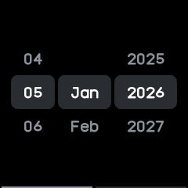
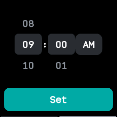
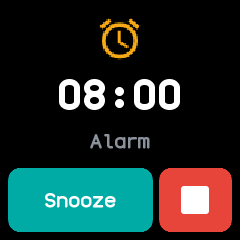

# Time and alarms

## The clock

The watch keeps the time in UTC together with your time zone and summer time, and shows local
time. Alarms, chimes and the step count's new day at midnight all follow local time, and apps can
show UTC and other zones too. **24 hour clock** in Settings switches between the 24 and 12 hour
clock everywhere.

## Setting the time from the phone

The phone sets the clock and time zone whenever it connects, in any of these ways:

- The NeoTime companion app writes the time when it connects.
- Gadgetbridge and other InfiniTime companions write it through the standard Bluetooth Current
  Time service, or with Gadgetbridge's `setTime` message.
- A phone that serves the Current Time service itself sets the clock with no app at all: a few
  seconds after it connects the watch reads the phone's time, and its time zone when it has one,
  as InfiniTime does.

The watch remembers the time zone across restarts, and a phone can read the watch's time and zone
back.

## Keeping time over a restart

Once a second the watch keeps the time in memory that a restart leaves alone, so after a crash, a
watchdog reset or a restart it counts on from where it was, losing only the moment the bootloader
takes. After the battery runs flat, or the first start of a new firmware, it starts from the time
the firmware was built until a phone sets it.

## Setting the date and time on the watch

For when no phone has set it, **Date & time** at the end of the Settings list sets the clock by
hand, as InfiniTime's date and time screens do:

1. The first page has rollers for the day, month and year. The day stays within the month, and
   leap years are counted.
2. Swipe left for the hour and minute, with an **AM**/**PM** button on a 12 hour clock.
3. Tap **Set**. The clock takes that time at 00 seconds in the watch's time zone, and everything
   that follows the clock behaves as if a phone had set it.

{ .screen }
{ .screen }

## Chimes

**Chimes** in Settings gives a buzz every hour, or every half hour, with a double buzz on the hour.
Do not disturb silences them.

## Alarms, timers and the stopwatch

| App | What it does |
|---|---|
| [Alarm](../apps/alarm.md) | Up to twelve alarms, once, every day, on weekdays, at the weekend or on days you pick, with snooze. |
| [Timer](../apps/timer.md) | Counts down minutes and seconds and buzzes at the end. |
| [Stopwatch](../apps/stopwatch.md) | Counts up, with laps. |
| [Pomodoro](../apps/pomodoro.md) | Work sessions with short and long breaks, each length set on its own page. |
| [Sports](../apps/sports.md) | A stopwatch that also counts steps; see [Health and fitness](health-and-fitness.md#sports). |

Alarms and timers ring while their app is closed. When one comes due, the watch lights the screen
and opens its app on the ringing screen over whatever was open, as InfiniTime's do; going back
returns to what was open. While an alarm is set, faces show a bell.

Do not disturb silences everything but alarms and timers, and those too if you turn off
**Alarms in DND** in Settings.

{ .screen }
