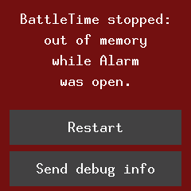
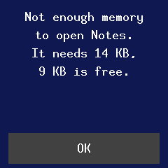

# Updates and recovery

The watch cannot be repaired by wire, so every update is built to be undone. This page covers what
you see and do; [updates.md](../updates.md) and [bootloader.md](../bootloader.md) have the
technical detail.

## Updating the firmware

Firmware updates arrive over Bluetooth with Nordic's legacy DFU, the protocol InfiniTime uses, so
Gadgetbridge, ITD, Siglo and the BattleTime companion app can all update the watch. The companion app
lists release and test builds from GitHub.

- While an update arrives, a status page takes the screen and keeps it lit: the step it is at
  (starting, receiving, checking, installing), the kilobytes received with a percentage, and the
  reason in words if the watch refuses the update or the phone goes away. A finished or failed
  update's page stays until the next touch or press, or until the screen times out.
- If the link drops, the watch keeps what it has received. The companion app reconnects up to four
  times and sends only the rest, and the page says **Update paused** with how much was kept.
- The watch checks the image before installing it, and the bootloader swaps it in at the next
  start.

**Updates** in Settings steps through **On**, **Temporary** and **Off**. Off refuses firmware
updates and any change to the installed apps over Bluetooth. Temporary, InfiniTime's "till
reboot", lets them through only until the watch restarts.

## A new firmware on trial

A new firmware runs on trial until something confirms it. A phone writing the time or reading
anything over Bluetooth confirms it by itself, so most updates are confirmed within moments. If it
never is, the next restart puts the previous firmware back.

The first page of the [About app](../apps/about.md) shows the firmware's version and commit and
whether it is confirmed, on trial or rolled back to. While it is on trial the page warns that any
restart rolls back, and offers **Confirm**, which keeps it, and **Roll back**, which restarts at
once into the firmware before it, as InfiniTime's firmware validation screen does.

{ .screen }

## The side button menu

Holding the side button stops even a stuck watch: the firmware lets the watchdog restart the
watch whenever the button stays down for about 5 seconds. Keep holding for about 5 seconds more and
the watch buzzes and shows the bootloader's menu:

1. A short press moves between **Start firmware**, **Roll back** and **Install recovery**.
2. A one-second hold picks the marked option.
3. With no press for 30 seconds, it starts the firmware by itself.

**Roll back** puts back the firmware the last update replaced, even one that has confirmed itself.
**Install recovery** installs the recovery firmware, a small build kept in the watch's storage that
only shows its status and takes a new firmware over Bluetooth. Starting the firmware is an ordinary
start, so a firmware still on trial that no phone has connected to is swapped back out.

## The status page

The firmware, the recovery firmware and the bootloader all show the same status page: the version,
then lines for the bootloader, the firmware, the storage and Bluetooth, the battery while the
bootloader works, and what the watch is doing. Its colour gives the mode: black when the firmware
is confirmed, amber on trial, red after a rollback, purple for the recovery firmware and blue while
the bootloader works. The last line says why the watch last started, such as "Reset: watchdog", or
what stopped it when it crashed. The firmware writes it in the same soft-edged letters as the
apps; the recovery firmware and the bootloader use a plainer, blockier font of their own.

## After a crash

After a crash the watch starts on a page that says what stopped it, such as running out of memory
or stack space, and which app was open, instead of the face. **Restart** goes on to the face.
**Send debug info** waits for the companion app to save a debug report, then goes on to the face.
Nothing reopens the app that crashed. The crash screen has run in the emulator but not yet on a
real watch.

{ .screen }
{ .screen }
{ .screen }

## About the watch

The About app's pages, swiped left from the system page, show the battery; the memory (free
storage, free memory and the least it has been); the bootloader's version; the hardware (the
Bluetooth address, the flash chip, the touch panel and the accelerometer); the firmware's tasks and
their share of the time; and the licence.

## Moving onto BattleTime

A watch running InfiniTime or wasp-os moves onto BattleTime through that system's own update path,
with the reloader, and a watch already on BattleTime can have its bootloader updated the same way as
the firmware, only while it is on the charger. See
[The reloader](../updates.md#the-reloader-getting-onto-battletime) and
[Updating the bootloader](../bootloader.md#updating-the-bootloader).
