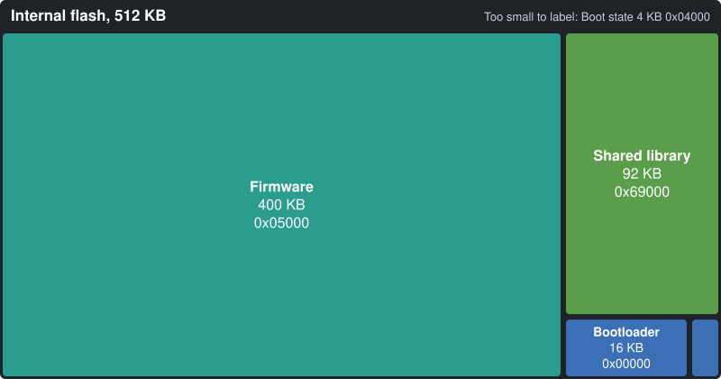
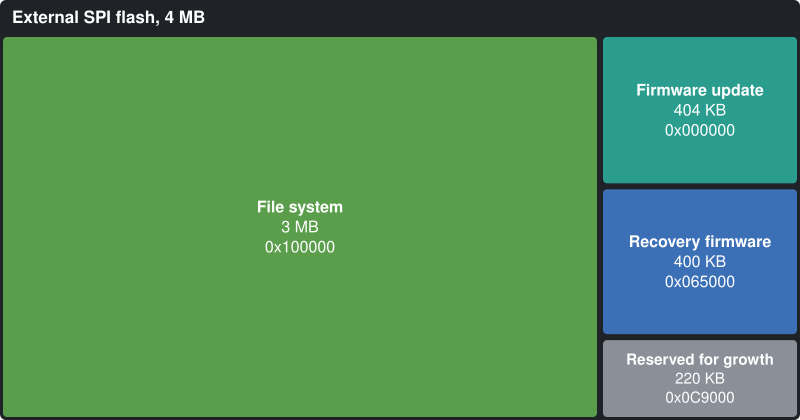
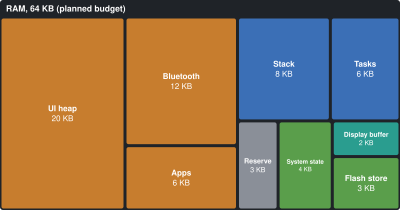

# Memory map

The PineTime has three kinds of memory: 512 KB of internal flash, 4 MB of external SPI flash and 64
KB of RAM. This page shows how NeoTime divides each one. Each box is drawn in proportion to its
size.

The flash layouts are set in code by the `neotime-boot` crate (`boot/src/lib.rs`), which the
bootloader and the firmware share, so that is the source of truth. [bootloader.md](bootloader.md)
explains how the bootloader uses them. The RAM layout is a planned budget, and each figure gets
replaced by a measurement as its part is built.

To redraw the pictures after a change, edit the sizes in `tools/draw_memory_maps.py` and run:

```sh
python3 tools/draw_memory_maps.py
```

## Internal flash (512 KB)



| Region | Start | Size | Holds |
|---|---|---|---|
| Bootloader | `0x00000` | 16 KB | The `embassy-boot` bootloader with its status screen and button menu, 16,056 bytes of it used. There is no SoftDevice and no MBR. |
| Boot state | `0x04000` | 4 KB | The bootloader's record of an update in progress, for swapping and rolling back. |
| Firmware | `0x05000` | 400 KB | The running firmware. It is linked to start here. No app, face, icon or font is built in; [What fills the firmware](#what-fills-the-firmware) shows what is. |
| Shared library | `0x69000` | 92 KB | What apps share, up to the end of flash: images, the app host's text fonts (47,919 B; the library with them is 74,333 B), components, common functions and the preset themes. No apps are kept here; they live in `/apps` on the external flash. An installed library starts with an 8-byte header, `NTLB` and its length, which `neotime-packages` writes. See [app-runtime.md](app-runtime.md#the-shared-library). |


### What fills the firmware

Measured on the release builds of `firmware/` by `tools/measure_memory.py` (see
[Measuring again](#measuring-again)). Each symbol counts towards the crate that owns it; the
firmware is linked with LTO into a single object, so the crate comes from the symbol's name, and
the files the firmware embeds, such as the Bosch configuration, are found by their bytes.

<!-- measure_memory:firmware -->
| Component | Full build | Recovery build |
|---|---:|---:|
| Firmware (start-up, shell, tasks) | 75.9 KB | 40.5 KB |
| App host (with `neotime-ui` and rlvgl) | 71.1 KB | 0.0 KB |
| Bluetooth (controller and TrouBLE) | 42.2 KB | 42.2 KB |
| core, alloc and compiler builtins | 24.9 KB | 11.1 KB |
| App runtime | 24.1 KB | 0.1 KB |
| Storage (littlefs) | 21.5 KB | 21.0 KB |
| Embassy, allocator and Cortex-M | 17.7 KB | 15.9 KB |
| Accelerometer configuration (BMA421 and BMA425) | 12.0 KB | 0.0 KB |
| Settings, companion and notifications (with serde) | 10.9 KB | 8.7 KB |
| Display, graphics and drivers | 5.9 KB | 3.1 KB |
| Packages | 2.7 KB | 2.1 KB |
| Updates (DFU) | 2.4 KB | 2.4 KB |
| BLEFS file service | 2.1 KB | 2.2 KB |
| Other constants and padding | 18.2 KB | 10.7 KB |
| **Used** | **331.5 KB** | **159.9 KB** |
| Free of 400 KB | 68.5 KB | 240.1 KB |
<!-- /measure_memory:firmware -->

The accelerometer's configuration is the largest piece of data left in it; each watch could build
in only its own chip's. The recovery build (`--features recovery`) leaves out the shell, so the app
host and the runtime go with it.

The watch face, the launcher and the apps live in `/apps` on the external flash, and the icons and
the app host's text fonts in the shared-library region; none is inside the firmware. See
[app-runtime.md](app-runtime.md#property-values).

Also inside the firmware, the accelerometer's configuration files from Bosch take 6 KB for each chip
built in, 12 KB with both the BMA421 and the BMA425 (see the `neotime-accelerometer` cargo
features).

## External SPI flash (4 MB)



The chip is an XT25F32B, on the same SPI bus as the screen.

| Region | Start | Size | Holds |
|---|---|---|---|
| Firmware update | `0x000000` | 404 KB | A new firmware received over Bluetooth, waiting for the bootloader to swap it in: the firmware's 400 KB plus one page. |
| Recovery firmware | `0x065000` | 400 KB | A known-good firmware to fall back to. |
| Reserved for growth | `0x0C9000` | 220 KB | Kept free so the slots above can grow, up to `0x100000`. |
| File system | `0x100000` | 3 MB | A littlefs file system, with the folders `/apps`, `/settings`, `/notifications` and `/resources`. |

Anything that changes often, such as settings, notifications and app state, is kept here, because
littlefs spreads its writes across the chip. The internal flash changes only when the firmware or
the shared library is updated.

### What the file system holds

littlefs works in 4 KB blocks, one erase sector each; the 3 MB region is 768 of them. Every folder
is a metadata pair, two blocks, and a file small enough to fit in its folder's metadata, up to
256 bytes here, costs no block of its own. Larger files take whole blocks, plus a few bytes per
block for littlefs's list of them. So an app costs 8 KB for its folder before its image, more than
most images.

| Path | Holds |
|---|---|
| `/apps/<id>/app.ntapp` | The compiled app or face, as `neotime-compiler` writes it. |
| `/apps/<id>/state` | What the app saved, written by the shell; small, so it lives in the folder's metadata. |
| `/apps/<id>/disabled` | Present when the app is installed but hidden from the launcher. |
| `/settings/system` | The watch-wide settings, 41 bytes. |
| `/settings/theme` | The theme's colours, 16 bytes. |
| `/resources/` | For resource packages; empty for now. |
| `/steps/<year>/<month>-<day>` | One day's steps in six-minute slots, up to 480 bytes. A day logged past 12:48 is too large for its folder's metadata and takes a block of its own, so a year of days takes about 1.4 MB. |
| `/steps/trip` | The trip count, 4 bytes. |

A typical install is the digital face, the launcher and ten everyday apps (alarm, timer,
stopwatch, settings, weather, steps, heart, flashlight, music and calculator), which
`tools/measure_memory.py` installs into a file system formatted as the watch formats it:

<!-- measure_memory:file-system -->
| What | Bytes | Blocks |
|---|---:|---:|
| Formatting: the root and the three top-level folders | | 8 |
| `/settings/system` and `/settings/theme` | 57 | 0 |
| 12 app folders | | 24 |
| 12 app images, 194 B (launcher) to 3,765 B (alarm) | 23,114 | 11 |
| **In use** | | **43 of 768: 172 KB of 3 MB** |
<!-- /measure_memory:file-system -->

The rest, about 2.8 MB, is free for apps, saved state and resources.

## RAM (64 KB, planned)



While the bootloader runs it uses all 64 KB from `0x20000000`. Nothing is kept when it jumps to the
firmware, which then has the whole of RAM but its last 16 bytes, the alive marker
(`FIRMWARE_ALIVE_MARKER`) an emulator reads; the bootloader and the reloader keep their stacks
below it too, so the marker survives from one firmware start to the next. Its third word is the
bootloader's note to the firmware (`BOOT_NOTE_ADDRESS`), which says whether the recovery firmware
was just installed, and its fourth is the bootloader updater's (`UPDATER_NOTE_ADDRESS`), which says
the rollback after it was meant. The firmware measures 51 KB of static RAM:
37 KB of heap (16 KB for storage and the 21 KB UI heap), and
the Bluetooth host with its eight 128-byte packets, controller, display buffer and task state. The
Bluetooth task's state is 4.8 KB: its GATT table (2.1 KB) and TrouBLE's runner (1.6 KB) are most of
it; replies to the companion app and half-received lines wait on the heap, and the update state,
status page and confirmation are held once in a static. That leaves 12.2 KB (12,508 B) for the
stack. Measured in the emulator by painting the stack before start, the launcher path peaks at
8.0 KB (8,188 B), 4.2 KB spare. The alarm, the deepest app, peaked at 10.5 KB in an earlier
measurement that the tool cannot repeat, since it cannot open the alarm; against today's stack that
would leave under 2 KB, so measure it again before the stack shrinks further. Drawing borrows a
1,920 B strip of four screen rows from the stack while it runs. With it, a typical install (the digital face, the launcher and ten apps,
built with `filesystem_use --image` and loaded into the emulator with the shared library) peaked at
9.1 KB while sliding to the launcher and scrolling it, and at 10.3 KB (10,516 B) with the alarm
open, 1,920 B spare: below the 2 KB this page asks for, so room must be found before the stack or
the statics grow again. The Bluetooth task's
deepest path, a file command that makes littlefs compact a folder, adds up to about 9.1 KB from its
functions' frames, below that peak.

The last 44 bytes of the firmware's static RAM, in the `.uninit` section just below the stack, are
the crash record (`firmware/src/restart.rs`, laid out by `neotime-crash-record`). Start-up does not
zero `.uninit`, so a panic or HardFault written there survives the reset that follows. It sits at
about `0x2000CE30`, wherever the linker puts the end of the other statics, so each build has its own
address and a record from another build fails its checksum. The bootloader runs between the two
starts but keeps clear of it: its statics are 336 B at the bottom of RAM and its stack reaches about
4.7 KB below the alive marker in an ordinary start, measured in the emulator, against the record's
12.4 KB. A stack that grew into the record would only happen after the firmware's own stack had
already overflowed.
To measure it again after a change, build the firmware and run, inside `nix develop`:

```sh
(ulimit -v 8000000; python3 -I tools/measure_stack.py firmware/target/thumbv7em-none-eabihf/release/neotime-firmware 8 --launcher)
```

It fills the stack with a pattern in the PineTime emulator, starts the firmware without the reset
its first start would cause, swipes to the launcher, and prints the peak, the spare bytes and any
resets. Keep at least 2 KB spare.

Static RAM by owner, from `tools/measure_memory.py`. The firmware's own share is mostly Embassy's
task storage, which holds each task's state, and the Bluetooth host's packet pool:

<!-- measure_memory:ram -->
| Owner | Full build | Recovery build |
|---|---:|---:|
| Heap (storage 16 KB, UI 21 KB; the recovery build has no UI heap) | 37,888 B | 16,384 B |
| Firmware: task storage, the Bluetooth host's resources and packet pool | 12,514 B | 9,497 B |
| Bluetooth controller | 2,525 B | 2,525 B |
| Display, graphics and drivers | 372 B | 372 B |
| BLEFS file service | 122 B | 122 B |
| App host (with `neotime-ui` and rlvgl) | 56 B | 0 B |
| Other | 1 B | 1 B |
| **Static RAM** (`.data` and `.bss`) | **53,528 B** | **28,928 B** |
| Left for the stack | 11,992 B | 36,592 B |
<!-- /measure_memory:ram -->

The table below is the budget:

| Region | Budget | Holds | Status |
|---|---|---|---|
| UI heap | 21 KB | The heap that `rlvgl`'s widgets allocate from. The `neotime-ui` crate keeps no screen buffer of its own. `neotime-app-host` keeps the open app's state, interpreter and bindings here (6,612 B), one 160 B node per widget of the open screen that is not inside a hidden one, each its own allocation so no large free block is needed, plus its text, and the open app's image read from `/apps`. Storage shares the same heap. The alarm peaked at 36,188 B of the 37,888 B heap with its 15 KB image and 67 widgets; calls and shared code have since cut its image to 6.1 KB, so measure it again. The stopwatch demo's screen holds 1,016 B on the computer and peaks at 1,080 B while drawing. | Partly measured: node size with `size_of` for the watch, the heap peaks in the emulator, the demo screen with a counting allocator on the computer |
| Bluetooth | 12 KB | The controller and the TrouBLE host: connection state, packet buffers and the GATT tables. | Partly measured: the controller is 1.5 KB; TrouBLE's example with it is 12.0 KB in all, executor included |
| Apps | 6 KB | Memory for the app that is open beyond the UI heap, such as the parts of its file read from `/apps`. The runtime's working memory in it is measured: 2,152 B for the interpreter, 2,056 B for the bindings and 2,440 B for the state. `AppHost` keeps all three on the UI heap. | Partly measured |
| Stack | 8 KB | The main stack, for interrupts and code that is not in a task. | Planned |
| Tasks | 6 KB | Embassy's tasks. Each task's state is fixed in size when the firmware is built. | Planned |
| Reserve | 4 KB | Left free, so a budget that runs over does not crash the watch. | Planned |
| System state | 4 KB | Settings, notifications, alarms and the step count. The latest 5 notifications are kept on the heap, about 200 B each, beside about 200 B of the shell task's state. | Planned |
| Display buffer | 2 KB | The buffer `neotime-display` fills before each SPI transfer. | Planned |
| File system buffers | 2 KB | littlefs-rust, allocated from the heap: 944 B while mounted, plus 408 B for each open file; room for two open at once. | Measured on a 64-bit computer; the watch needs a little less |

The 64 KB is all the chip has, so a part that needs more must take it from another row of this
table.

## Measuring again

The firmware, RAM and file-system tables above come from one script, which writes them into
this page between the `<!-- measure_memory:... -->` markers. Run it inside `nix develop`;
`--check` only reports whether the tables are out of date:

```sh
python3 -I tools/measure_memory.py
```

CI's Memory map job (`.github/workflows/ci.yml`) runs it on every push and pull request and keeps
the measured page as an artifact. On master, when the tables change, it commits this page as
`docs(memory-map): measure <commit>`, so nobody needs to run it before landing; rebase over that
commit as over any other. The prose around the tables, and the artifact the page is published as,
still need updating by hand.

It builds the full and the recovery firmware, sorts their symbols by crate, and runs the
`filesystem_use` example of `neotime-packages`. That example also writes the whole 4 MB external
flash with `--image <file>`, for the emulator to load with
`externalFlashMemory LoadBinary @<file> 0`:

```sh
cargo run -p neotime-packages --example filesystem_use -- --image external.bin digital=firmware/apps/face.ntapp launcher=firmware/apps/launcher.ntapp
```

## Watchdog

The bootloader leaves the watchdog running when it starts the firmware, with a 5 second timeout.
It keeps counting while the chip sleeps and pauses while a debugger has it halted. The firmware
must take it over with exactly those settings, because `embassy-nrf` refuses different ones.

The firmware feeds it only while the button is up, so holding the button for about 5 seconds
resets the watch into the bootloader, and holding it 5 seconds more installs the recovery firmware.
If the firmware hangs, the watch resets, and an update that never confirms itself is rolled back.
See [bootloader.md](bootloader.md) for the details.
