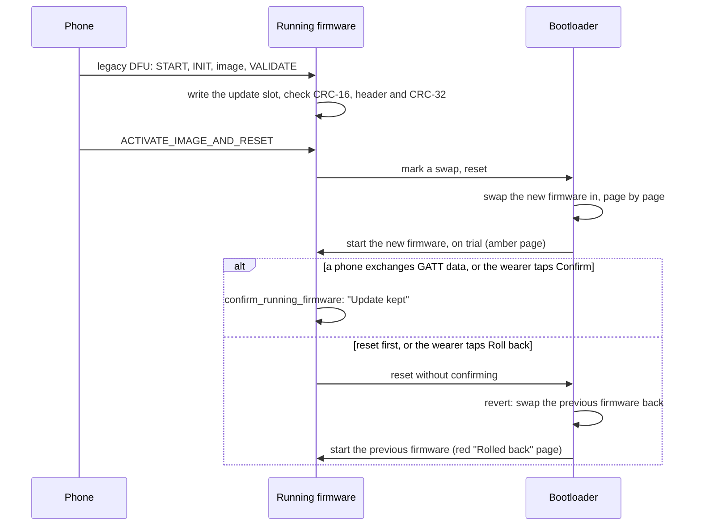

# Firmware updates

How a new firmware gets onto the watch, and how a watch gets onto BattleTime in the first place.
Four pieces share the work:

| Piece | Where | Does |
|---|---|---|
| Bluetooth upload | `services/dfu`, in the firmware | takes the image from the phone and hands it to the receivers |
| Receivers | `services/updates`, in the firmware | store the image in the right slot and mark it for the bootloader |
| Bootloader | `bootloader/` | swaps the image in at the next start and rolls back a bad one |
| Reloader | `reloader/` | a one-time image that moves a watch from InfiniTime or wasp-os onto BattleTime |

[bootloader.md](bootloader.md) covers the bootloader and the flash layout. This page covers the
rest.

## The protocol: Nordic legacy DFU

BattleTime speaks the same update protocol as InfiniTime: Nordic's legacy DFU, the one the nRF5 SDK
bootloaders spoke before secure DFU. Gadgetbridge, ITD, Siglo and BattleTime's own tools all have it,
so they update BattleTime without changes.

Three characteristics under the service `00001530-1212-efde-1523-785feabcd123`:

| Characteristic | UUID ends in | The phone | The watch |
|---|---|---|---|
| Control point | `1531` | writes a command | answers with a notification |
| Packet | `1532` | writes data, 20 bytes at a time, no response | |
| Version | `1534` | reads it | answers `08 00`, as the Nordic bootloader does |

One update, as the companion app and Gadgetbridge drive it:

1. `START_DFU` (1) with the image type, then on the packet characteristic three 4-byte sizes:
   SoftDevice, bootloader, application. Only the application size may be non-zero. The watch
   erases the slot and answers success.
2. `INITIALIZE_DFU` (2) with 0, the init packet on the packet characteristic, then
   `INITIALIZE_DFU` with 1. The init packet is Nordic's `.dat`: device type, revision, version, a
   list of SoftDevice IDs, and a CRC-16 of the image. The watch keeps the CRC and ignores the rest.
3. Optionally `SET_RECEIPT_INTERVAL` (8) with a count, so the watch reports progress every that
   many packets.
4. `RECEIVE_FIRMWARE_IMAGE` (3), then the image on the packet characteristic. The watch collects
   packets into 240-byte pieces before writing them to flash, sends a receipt (17) every interval,
   and answers success when the last byte is in.
5. `VALIDATE_FIRMWARE` (4). The watch reads the whole slot back, computes the CRC-16 and compares
   it with the init packet's. A mismatch answers `CRC_ERROR` and forgets the upload.
6. `ACTIVATE_IMAGE_AND_RESET` (5). The watch checks the image is whole, that its
   [header](bootloader.md#the-image-header) is sound and linked for `FIRMWARE`, and that the image's
   CRC-32 matches the header's, marks it for the bootloader, and resets. The bootloader swaps it in.

Responses are three bytes: 16, the command, and a result (1 success, 2 wrong state, 3 not
supported, 4 too large, 5 CRC error, 6 failed). A command out of turn gets "wrong state"; an
image larger than the slot gets "too large" at step 1; a SoftDevice or bootloader image gets "not
supported".

### Carrying on after a lost link

When the link drops partway through the image, the watch keeps what reached the flash instead of
throwing it away. The phone reconnects and starts again from step 1 with the same image. After step
2 it sends `REPORT_RECEIVED_IMAGE_SIZE` (7), and the watch answers with how many bytes it kept. That
is a multiple of 240, since the bytes still waiting to be written are lost. The phone then sends
`RECEIVE_FIRMWARE_IMAGE` and the image from that byte on. The same image means the same image type,
size and init packet, and the init packet carries the image's CRC-16. A different image, or a phone
that skips step 7, starts from the first byte as before. So Gadgetbridge and other clients work
unchanged. The checks at steps 5 and 6 still cover the whole slot, so a resumed image is held to
the same checksums as one sent in one go. The kept upload lives in RAM, so a restart forgets it.

BattleTime's other addition is an image type for the recovery slot: `START_DFU` with type `0x08` (the
standard types are 1, 2 and 4) sends the image to the recovery slot instead of the update slot.
The companion's command line tool sends it with `battletime recovery dist/recovery.zip`, which
`tools/build_images.sh` packages; the running firmware stores the image and restarts, with nothing
swapped, and the bootloader menu's Install recovery puts it in when it is needed.

`battletime-dfu` is the state machine, with no Bluetooth in it, so its tests drive a whole update
through it against fake receivers. The `trouble` feature adds the GATT service definition the
firmware registers with TrouBLE.

### Packaging an image

`tools/package_dfu.py firmware.bin firmware.zip` makes the zip the clients expect: a manifest, the
init packet with the CRC-16, and the image. The companion app and Gadgetbridge open it as they
would an InfiniTime release.

## The receivers

`battletime-updates` is the on-watch half, with no protocol in it:

- **`UpdateReceiver`** takes an image with `begin(size)`, `receive(chunk)` in order, and
  `finish()`, writing through embassy-boot's updater into the update slot and erasing each sector
  just before it is first written. `finish` checks the size, the header and the image's CRC-32,
  and marks the swap. `read_back` serves the protocol's CRC check.
- **`RecoveryReceiver`** does the same into the recovery slot, whose size it takes from the
  partition it is given. It erases the first sector before anything else and writes the header's
  first 8 bytes, its magic, last, so a half-written image never passes for a whole one when the
  bootloader looks.
- **`change_slots`** writes a new [slot table](bootloader.md#the-slot-table) record, and refuses
  while a firmware is on trial.
- **`confirm_running_firmware`** marks the running firmware as working. Until it is called the
  bootloader rolls the firmware back at the next reset, and no new update is accepted.
- **`Receivers`** holds both behind the `UpdateTargets` trait, which the protocol drives with an
  `ImageKind`.

## The firmware's part

Besides serving the DFU service on every connection, the firmware (`firmware/`) does what keeps an
update safe:

- takes over the bootloader's watchdog with the same settings and feeds it only while the side
  button is up, so holding the button for about five seconds always gets back to the bootloader;
- advertises the legacy DFU service as InfiniTime does ([bluetooth.md](bluetooth.md#advertising)),
  so any DFU client finds it;
- shows progress on the status page, and resets when the protocol asks;
- refuses an update, and changes to `/apps` and `/temp` over the file service, while the `updates`
  setting is off, or after a restart when it was on only until then;
- mounts the file system, so that an update which breaks storage is noticed on the screen;
- writes an alive marker into the last words of RAM, which an emulator checks;
- confirms a new firmware, or lets the wearer roll it back, as below.

## Confirming or rolling back

A firmware the bootloader has just swapped in runs on trial. Until it is confirmed, every reset
swaps the firmware before it back, and no new update is accepted.



- **A phone confirms it.** The first GATT read or write from a phone, or the clock being set from
  the phone's own Current Time service, confirms the firmware, so a firmware whose radio does not
  really work rolls back by itself. Advertising alone proves nothing, since the host is told it
  started whether or not anything went out on air. The companion writes the time on every
  connection, which is enough.
- **The wearer can decide.** The System app's first page says whether the bootloader keeps the
  running firmware, and while it is on trial offers Confirm and Roll back, as InfiniTime's firmware
  validation screen does. Roll back restarts without confirming, so the bootloader's ordinary revert
  puts the firmware before back. The first Bluetooth exchange still confirms by itself: waiting for
  the wearer instead would roll back every update whose wearer restarted before thinking of the
  screen, and a phone that can talk to the new firmware is the proof that matters most, since a
  firmware that cannot take the next update is the one that strands a watch. So the buttons mostly
  matter for an update sent from a phone that went away at once, or one the wearer wants gone before
  any phone reconnects.
- **Some firmware confirms itself at start,** when a rollback could not help: when the replaced
  firmware, which embassy-boot keeps one page into the update slot (`Slots::previous_firmware`), has
  no sound header at all, as after a migration, or when the running image is the recovery image,
  which must stay.
- **A rollback stays visible.** After a revert the boot state says so until the next update, and
  the status page shows the red Rolled back mode. The bootloader's menu can also roll back or
  install the recovery firmware by hand; see [bootloader.md](bootloader.md#the-menu-rollback-and-recovery).

## The status page

At start, and again while an update arrives, the firmware shows a status page. The firmware, the
recovery firmware, the bootloader and the bootloader updater all lay it out through
`battletime_status_screen::page`, so it looks the same whichever is running:

```
BattleTime
0.1.0+1b19aed
Bootloader OK 1a2b3c4
Firmware   On trial
Filesystem OK
Bluetooth  Connected
Receiving firmware
150 / 470 KB  31%
```

| Line | Says |
|---|---|
| Name | `BattleTime`, on every page |
| Title | the firmware's version; the bootloader and its updater name themselves instead |
| Bootloader | `OK` or, after the updater wrote it, `New`, then the first 7 hex digits of the CRC-32 of the installed bootloader with its erased tail left off, which match `zlib.crc32` of its `.bin`; `Not found` or `Unreadable` otherwise |
| Firmware | the mode, below |
| Filesystem | `OK`, `Formatted`, `Damaged` or `No chip` |
| Bluetooth | `Off`, `Advertising` or `Connected` |
| Action | what the mode means while idle; during an update `Starting`, `Receiving`, `Checking` or `Installing` with `firmware` or `recovery`, then `Restarting to install`, `Update failed` or `Update paused` |
| Progress | `received / size KB  percent`, or why the update stopped: `Steps out of order`, `Image not supported`, `Image too large`, `Checksum did not match`, `Could not store image`, or `Kept N KB` when the phone went away mid-image |

The background colour and the Firmware and Action lines say which mode the firmware is in
(`firmware/src/status.rs`, colours in `battletime_boot::status_colour`):

| Mode | Background | Firmware / Action | How the firmware knows |
|---|---|---|---|
| Confirmed | black | OK / Idle | `BOOT_STATE` says booted |
| On trial | dark amber | On trial / Connect to keep it | `BOOT_STATE` says swap; after the first Bluetooth exchange it turns black with "Update kept" |
| Rolled back | dark red | Rolled back / Previous one restored | `BOOT_STATE` says revert, which stays until the next update |
| Recovery | purple | Recovery / Send a new firmware | the bootloader's note, or a build with the `recovery` feature |

When the first packet of an update arrives the page takes the screen from the shell, wakes it if it
was dark or dimmed, and holds it lit (`shell::show_status`). When the update fails or the phone goes
away the page stays up but lets go (`shell::release_status`): the next touch or press, or the
screen timeout, puts the shell back. A successful update restarts into the bootloader's blue page,
described in [bootloader.md](bootloader.md#the-status-screen).

## The recovery firmware

A recovery firmware installed by the button hold shows as recovery only until its next restart,
because the note is not kept. A firmware built with `--profile recovery --features recovery` always does, and it is
the image meant for the recovery slot. That build leaves out the shell, touch, the step counter,
the apps and the phone's messages, keeping the status page, the file system, Bluetooth and DFU,
answering only `status` and the time lines from the companion and refusing `slots`, and carries no
shared library. It serves the same GATT table as the full firmware. Its profile builds for size
(`opt-level = "z"`), so it is about 153 KB against the full firmware's 480 KB with its library
([memory-map.md](memory-map.md)). `tools/build_images.sh` writes it to `dist/recovery.bin`.

## When the firmware crashes

A panic or a fault is recorded in RAM a reset keeps, then halts rather than resets, so the watchdog
brings the watch back to the bootloader instead of the firmware restarting in a loop. The next
start shows the crash, and the companion reads it from the diagnostics.

## The reloader: getting onto BattleTime

A watch running InfiniTime or wasp-os has their bootloader at the start of flash. The reloader is
an ordinary app image for the old system, sent through its own update path, that replaces that
bootloader with BattleTime's. It carries three images: BattleTime's bootloader, the firmware, and the
recovery firmware. The full firmware no longer fits beside the bootloader in wasp-os's 380 KB app
slot, so `tools/build_images.sh` gives it the small recovery firmware for both, and the full
firmware follows as an ordinary update once the watch is on BattleTime. When both are the same
image, the reloader's build keeps one copy for both slots, since two copies overflow that slot.

### What it does

The order comes from `battletime_boot::migration`, and its tests hold it to these rules:

1. **Wait for the charger and enough charge.** It does nothing until power is present on P0.19 and
   the battery reads at least 3.7 V, and shows why. A line under the progress bar shows the battery
   from a reading each second, such as "Battery 87% charging".
2. **Check its cargo.** Each image carries a CRC-32 from the build; a damaged download stops here.
3. **Stage the recovery firmware** in the default recovery slot and **the firmware** in the
   default update slot, both in the external flash. The old system still starts during this; it has
   only lost its own files in the external flash.
4. **Write the bootloader** over the first pages of internal flash, after checking the charger and
   the charge again, since staging takes minutes. From the first erase until the
   last word is in place, nothing on the watch starts. The bootloader is about 18 KB, five pages:
   about half a second. Each copy is read back and compared, and retried up to three times.
5. **Mark the swap** in `BOOT_STATE`, so the bootloader's first start installs the staged
   firmware. Even if this step is lost, the bootloader is whole and the button hold installs the
   recovery firmware.
6. **Restart.**

The reloader never writes anywhere else in internal flash, so it keeps running from its own slot
while the first pages change under the old system. It copies its vector table into RAM first,
because the old vector table at address 0 is one of the pages it erases, and it feeds the old
bootloader's watchdog, which keeps running until the restart.

### Where it starts

The old system decides where an app's first two words are, so there are two builds:

| Feature | Old system | Slot start | Delivered as |
|---|---|---|---|
| `from-wasp-os` | wasp-os's bootloader on S112 | `0x19000` | a DFU zip with `--sd-req 0xB8`, so only that bootloader accepts it |
| `from-infinitime` | InfiniTime's MCUBoot | `0x8020` | an MCUBoot image (`tools/mcuboot_image.py`) inside a DFU zip, through InfiniTime's own DFU |

MCUBoot starts images 32 bytes into their slot, which is not an address the CPU accepts for a
vector table, so both builds put a two-word stub at the slot start and the table at the next
256-byte boundary.

The build takes the images from three environment variables, `BATTLETIME_BOOTLOADER_BIN`,
`BATTLETIME_FIRMWARE_BIN` and `BATTLETIME_RECOVERY_BIN`, and refuses an image that is linked for the
wrong address or does not fit its slot. `tools/build_images.sh` builds everything into `dist/`.

### The risk, honestly

Without an SWD probe, a watch that cannot start cannot be brought back. The reloader keeps that
window to the bootloader write, about half a second, and only enters it on a charger. It cannot
make the window zero: the old and the new bootloader want the same first page.

### Losing power during the bootloader write

The reloader and the bootloader updater (see [bootloader.md](bootloader.md#updating-the-bootloader))
share one risk: from the first erase of the bootloader's pages until the last word is written and
read back, nothing on the watch can start. Erasing five 4 KB pages and writing about 18 KB takes
about half a second. A watch that loses power inside that half second has no bootloader and, without
an SWD probe, cannot be brought back; with one, `probe-rs` can write the bootloader again.

For that to happen, all of these must go wrong at once:

1. **The power must fail inside the half second.** Neither program starts writing until the charger
   is present on P0.19, checked again just before the write, and the whole update before it takes
   minutes, so the window is a tiny part of the time the watch spends on the charger.
2. **The battery must fail too.** The PineTime runs from its internal battery; the charger only
   charges it. Lifting the watch off the charger does not cut the power, so the battery itself must
   be disconnected or collapse in that half second, while it is being charged. Neither program
   writes until the battery reads at least 3.7 V on the charger
   (`battletime_battery::MINIMUM_MILLIVOLTS_TO_WRITE_BOOTLOADER`), a few percent above empty once the
   charger's lift is allowed for, so a nearly flat battery charges for a while first. A converter
   that never answers counts as too low.
3. **Nothing else may stop it first.** Both programs feed the watchdog through every erase and
   write, take the new bootloader from flash they never erase, and read every page back. The
   updater writes again on a mismatch for as long as it takes and never resets with a broken
   bootloader. The reloader tries three times and then stops with "Failed, hold the button", which
   would leave no bootloader; that needs the chip's own flash to refuse the same pages three times,
   which is rarer still.

So a watch is lost only by a battery failure during the half second of the write while it sits on
its charger, or by internal flash that will not take a write. Cuts every 2 seconds through the
wasp-os migration in the emulator once left the old system whole at 2, 4 and 6 seconds and
BattleTime's bootloader whole at 8, 10 and 12 seconds, with none inside the write; those sweeps were
then dropped from the suites as adding little.

The larger risk is after it. Once the reloader has run, the only Bluetooth on the watch is
BattleTime's own controller, and a controller that does not work on real hardware leaves a watch
that starts but can never take another update. The emulator cannot rule that out, because it
does not model the radio's timing. Before the reloader first went to a watch, two builds that ran
as wasp-os apps proved BattleTime's controller, TrouBLE, the DFU service and the external flash on the
real chip while wasp-os stayed installed. Two lessons from them stay in the code: waiting for the
32 kHz clock to stop hangs while the watchdog runs, and TrouBLE cut a 128-bit UUID short in
discovery, which `third_party/trouble-host` fixes (see its `BATTLETIME.md`).

A panic in the reloader halts it rather than resetting: a reset would restart it under the old
bootloader, which would feed the watchdog again, and the watch would loop with no way into the old
update mode. Halting lets the watchdog reset the watch, which the old bootloader takes as a request
for its update mode.

Under InfiniTime a reset while the reloader stages BattleTime cannot brick the watch either.
InfiniTime's bootloader 1.0.0 is MCUBoot 1.5.0, which checks the secondary slot (external flash
0x40000 to 0xB4000) before a revert as well as before an upgrade, and erases an invalid image
instead of swapping it in. The reloader runs as an unconfirmed test image, so a reset part way
through staging just starts the reloader again. The button-hold rollback and the factory restore
both end in that same check. This comes from reading MCUBoot 1.5.0's source; the emulator's
`migration.robot` starts from bootloader 5.0.4 instead.

When the reloader stops on purpose, for a damaged download, a missing flash chip or a write that
fails three times, it says so on the screen and keeps feeding the watchdog only while the button is
up, as it does while it waits for the charger. Holding the button for a few seconds then lets the
watchdog reset the watch: into the old update mode before the bootloader write, or into BattleTime's
bootloader after it, where holding on installs the recovery firmware.

### Checked on the watch

- **The reloader from wasp-os.** Sent through wasp-os's own update mode (238 KB in about 4
  minutes), it left the watch running BattleTime seconds later, with its file system found and the
  firmware confirmed.
- **An update over Bluetooth.** A firmware sent to BattleTime itself uploads in under 2 minutes; the
  bootloader swaps it in, and it confirms itself after its first Bluetooth exchange.
- **Recovery.** Holding the button resets the watch into the bootloader, and holding on installs the
  recovery firmware, which starts and confirms itself after its first Bluetooth exchange.
- **Rollback.** A firmware sent over a confirmed one and never connected to stays on trial; a reset
  into the bootloader swaps the confirmed firmware back, which starts on the red page.

## Proving it on the emulator

The emulator (`PineTimeEmulator/`, a Rust emulator of the whole watch) models the chip's flash controller, the external flash
with real program and erase behaviour, the watchdog, the button and a battery pull. The suites are
in `tests/emulator/`, one Robot file per area, run from the emulator's shell, each in its own
process:

```sh
pinetime-test --variable EMULATOR:<emulator checkout> tests/emulator/<suite>.robot
```

CI's `Emulator suites` job runs them on every push. The old systems' bootloaders they start from, wasp-os's
on Nordic's S112 and InfiniTime's MCUBoot 5.0.4, are kept in `tests/emulator/fixtures`. The emulator has already caught two faults that would have stranded a watch: the reloader sent 256-byte pages from
its own flash, which embassy's SPI driver cannot do (it panics above 255 bytes), and the firmware
read the replaced image from the wrong page after a swap. What the suites check:

1. **Boot chain.** Flash the bootloader at 0 and the firmware at `FIRMWARE.start`. Run. The
   firmware's alive marker (`FIRMWARE_ALIVE_MARKER`) must hold `FIRMWARE_ALIVE_MAGIC`, and
   `BOOT_STATE` must read as booted after the firmware confirms itself.
2. **Update.** Place a second firmware in the update slot, mark the swap, reset. The bootloader
   must swap it in and start it; without a confirmation the next reset must swap the old one back.
3. **Recovery.** Place an image in the recovery slot, erase `FIRMWARE`, hold the button through
   two resets. The recovery image must be running afterwards.
4. **Migration from wasp-os.** Start MBR, S112 and wasp-os's bootloader with the reloader in the
   app slot and the charger present. Afterwards the bootloader must be at 0, the staged images in
   the external flash, and after one more reset the firmware's alive marker set.
5. **Migration from InfiniTime.** The same from MCUBoot with the MCUBoot image.
6. **Watchdog.** With the button held, the firmware must stop feeding the watchdog and the watch
   must reset into the bootloader within about five seconds.
7. **Confirm and roll back from the System app.** `tools/check_firmware_trial.py` lets the
   bootloader swap `dist/`'s firmware in on trial over the recovery build, opens the System app
   through the touch panel, and taps Confirm, after which the boot state must say booted and a
   restart keep the firmware, or Roll back, after which the bootloader must bring the recovery
   build back with the boot state saying reverted. It installs apps, so it runs by hand, not in CI.
