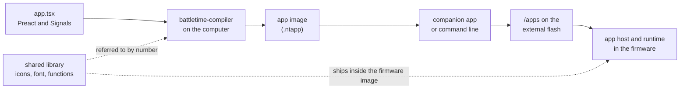
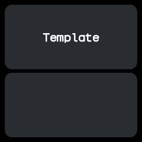
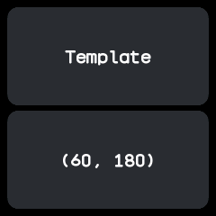

# Writing apps

BattleTime apps are written like small web apps: [Preact](https://preactjs.com) components in
TypeScript, with [Preact Signals](https://preactjs.com/guide/v10/signals/) for state. Preact never
runs on the watch. A compiler on the computer turns the source into a compact app image, and the
watch's firmware runs that image. If you know JSX and signals, you already know most of what an app
needs.

This page walks through making an app from start to finish. [app-reference.md](app-reference.md)
lists every widget, value, event and function, [compiler.md](compiler.md) the language the
compiler takes, and [app-runtime.md](app-runtime.md) how the watch runs the result.



The shared library holds what apps have in common, such as the icons, the font and the functions of
`battletime/lib`. The compiler refers to its parts by number instead of copying them into the app, and
the watch reads them in place from the firmware image.

## Setting up

Everything an app needs comes from the repository's Nix flake. In a checkout:

```sh
nix develop          # the watch's toolchain: Rust, Node and the rest
cd battletime
npm ci               # the stand-in battletime package, Preact and the test tools
```

Run cargo and npm commands for apps from inside `battletime/`. The companion app has its own shell,
`nix develop .#companion`, used below for installing.

## Making an app from the template

`battletime/apps/template` is a starting point that answers every kind of input. Copy it to a folder
named after your app's id:

```sh
cp -r apps/template apps/my-app
```

Then change `id` and `name` in `define_app`. The id must match the folder: up to 32 bytes of
lower-case words of letters and digits joined by single hyphens, such as `four-in-a-row`. The [App Builder](#the-app-builder) can make the folder for
you with **BattleTime: New App**.



The template as it opens: its name on the upper card, and the lower card empty until it receives a
touch or a swipe.

## The shape of an app

The smallest app is `battletime/apps/hello/app.tsx`:

```tsx
import { define_app } from "battletime";
import { Card } from "battletime/components";
import { icons } from "battletime/icons";
import { Icon, Label, Screen } from "battletime/widgets";

const GREETING = "Hello, world!";

function Hello() {
  return (
    <Screen padding={8} gap={6}>
      <Card grow={1} gap={16}>
        <Icon icon={icons.check} size={48} align="center" margin={24} />
        <Label text_align="center">{GREETING}</Label>
      </Card>
    </Screen>
  );
}

export default define_app({
  id: "hello",
  name: "Hello",
  group: "tools",
  icon: icons.check,
  screens: { main: Hello },
});
```


Every app has the same parts:

- **Imports** come only from `battletime` and its parts: `battletime/widgets`, `battletime/components`,
  `battletime/icons` and `battletime/lib`. `battletime` passes on `signal`, `computed` and `useSignal`.
- **State** is signals declared at the top of the file. `persisted("key", start)` is a signal that
  survives a restart.
- **Screens** are function components. `<Screen>` may only be the outermost widget of one.
- **Events** from the system are connected with `on(...)` at the top of the file.
- **`export default define_app({...})`** says who the app is: its `id`, `name`, launcher `group`,
  `icon` and `screens`, with `main` opening first. A watch face adds `kind: "face"`.
  [app-reference.md](app-reference.md#declaring-an-app) lists the fields.

Repository apps also start with a comment saying what the app is, and split the file into sections
under `// ====` banners, as the quality suite and [coding-guidelines.md](coding-guidelines.md) ask.

### State and derived values

The stopwatch keeps when it started rather than ticking, so it runs on while closed
(`battletime/apps/stopwatch/app.tsx`):

```tsx
const started_at = persisted<Instant | null>("started_at", null);
const paused_after = persisted<Duration>("paused_after", 0);

const elapsed = computed(() =>
  started_at.value !== null ? now.value - started_at.value : paused_after.value,
);
```

`now` is a system value. A label that shows `format_duration(elapsed.value, "mm:ss")` redraws once a
second while the screen is on, and at no other time; nothing in the app ticks.

### Handlers

A handler is a plain function that writes to signals. The template's swipe handler:

```tsx
function swipe(event: SwipeEvent) {
  last_event_kind.value = "swipe";
  last_direction.value =
    event.direction === "up" ? 0 : event.direction === "down" ? 1 : event.direction === "left" ? 2 : 3;
}
```

The whole handler is one transaction: its writes apply together when it returns, and a handler that
fails, such as by dividing by zero, changes nothing. Effects such as `vibrate(30)`, `go("settings")`
or `send_to_phone(...)` are calls too, carried out after the handler finishes. Connect handlers to
widgets with props such as `onClick` and `onSwipe`; an inline arrow works as well.

The side button always means back, and an app never hears it. Swipes inside an app are its own, so
a right swipe does not go back unless the app says so.

### Events in the background

Anything that would be a timer or a `useEffect` in a web app is an `on` call at the top of the file.
The remote reads its buttons each time it opens, and the alarm rings at a time held in a signal:

```tsx
on("open", read_buttons);
on("screen_on", read_buttons);
on("time", ring, { at: next_ring_at });
on("shake", roll_on_shake, { while_open: true });
```

Events other than the app's own opening and closing call their handler even while the app is
closed, unless given `while_open: true`. Changing `next_ring_at` reschedules the alarm with no other
code. [app-reference.md](app-reference.md#events) lists every event and option.

### Reading data from the phone

The phone can write files to the watch, and an app reads them by path. The remote reads the buttons
the companion chose (`battletime/apps/remote/app.tsx`):

```tsx
const button_file = signal([0, 0, 0, 0, 0, 0, 0, 0, 0, 0, 0]);

function read_buttons() {
  button_file.value = file_bytes("/remote/buttons", 11);
}

function press(button: number) {
  vibrate_pattern("tap");
  send_to_phone("remote", { button });
}
```

`TextFile` and `BitmapFile` show a text file or a one-bit picture straight from storage, and
`file_bytes` with an offset pages through a file larger than RAM.

### What the compiler refuses

The compiler takes a subset of TypeScript and JSX: each component runs once while compiling, and
the watch must be able to see how long every call runs and how much state it keeps. Numbers are
whole numbers. Its error messages name what to write instead:

| Refused | Write instead |
|---|---|
| `useState`, `useReducer`, `useRef` | `signal` at the top of the file, or `useSignal` |
| `useMemo`, `useCallback` | `computed` |
| `useEffect`, `setTimeout`, `setInterval` | `on` at the top of the file, or a binding that reads `now` |
| `while`, recursion | `for ... of` over a fixed-length array |
| `async`, `fetch`, classes | Not available; data from the phone arrives as a file or an event |
| Imports other than `battletime` | Copy the code into the app |
| A bare `/` | `Math.trunc(a / b)` or `Math.floor(a / b)`, saying which way it rounds |
| Creating a signal inside a handler | Declare it at the top of the file |

Check a source without writing an image:

```sh
nix develop -c cargo run -p battletime-compiler -- apps/my-app/app.tsx --check
```

## Previewing

### In a browser

The `battletime` package in `battletime/sdk/battletime` has a browser version of the watch. Every widget is a
Preact component drawn inside a 240x240 frame in the watch's colours, and text is drawn in the
watch's own font of lines and arcs, turned into web fonts by `tools/generate_preview_font.py`.
`battletime/preview` holds the stand-in runtime: `open(app)` opens an app, `<OpenScreen />` draws its
screen, `start_scheduler()` runs its timers from the computer's clock, and `press_button()` and
`swipe(...)` drive it. `persisted` values live in the browser's storage, and `preview_files` stands
in for the watch's files.

The preview runs real JavaScript, so it is close to the watch but not exact; the simulator below
shows the real pixels. The repository's apps use the preview in their `app.test.tsx` files, which
`npm test` runs, and `npm run check` type-checks every app.

### In the simulator

The simulator runs a compiled image on the firmware's own app host, in a desktop window:

```sh
nix develop -c cargo run -p battletime-compiler -- apps/my-app/app.tsx -o my-app.ntapp
nix develop -c cargo run -p battletime-compiler -- library -o shared.ntlib
nix develop -c cargo run -p battletime-simulator -- --app my-app.ntapp --library shared.ntlib
```

A click is a tap, a drag of 40 pixels a swipe, and Space the side button. Each effect the app asks
for is printed, such as `effect: Vibrate(30)`. [simulator.md](simulator.md) has the rest.

## The App Builder

`tools/appbuilder` is a VS Code extension for building apps. Its palette of widgets, events, effects
and values sits in a BattleTime sidebar and inserts the chosen entry with its import; the watch opens in
its own pane beside the code. Saving compiles the app with `battletime-compiler` and restarts it in
`battletime-simulator --stream`, so the pane shows exactly what the watch would, and compile errors
appear in the editor.

- **BattleTime: Open App Builder** opens the palette and runs the app in the editor.
- **BattleTime: New App** asks for an id, writes a starting app to `battletime/apps/<id>/app.tsx` and opens
  the builder on it.

Its [README](../tools/appbuilder/README.md) says how to install and develop it.

## Testing

App behaviour is tested on a test watch in `battletime/harness`, which compiles the app and runs it on
the real app host. [testing.md](testing.md) has the details.

**A tour** is a script in `battletime/tests/tours/<id>.battletime` that visits every screen of the app
and snapshots each. The template's tour:

```text
open app template
tap 60 180                  # a touch low on the left
expect text "(60, 180)"
snapshot touch
swipe left
expect text "Swipe left"
snapshot swipe
expect no failures
```



Write the pictures the first time, look at them, and run the tour again to check them:

```sh
BATTLETIME_UPDATE_SNAPSHOTS=1 cargo test -p battletime-app-testing --test tours
cargo test -p battletime-app-testing --test tours
```

**A Rust test** drives the same watch for anything a script cannot say:

```rust
let mut watch = TestWatch::open_app("stopwatch").unwrap();
watch.tap(178, 200); // the start button
watch.advance(Duration::from_secs(3));
assert!(watch.shows_text("00:03"));
```

An app in the repository also needs its page, `docs/apps/<id>.md`, showing every picture its tour
takes, and a row in [apps.md](apps.md). The smoke, quality and screenshot suites then find it by
themselves.

## Installing on a watch

The companion app installs apps over Bluetooth, from its Apps and Store screens or its command line.
From `companion/`, in `nix develop .#companion`:

```sh
npm run battletime -- apps install ../battletime/my-app.ntapp   # install, or update, an image
npm run battletime -- apps list                              # each app with the memory it needs
npm run battletime -- apps remove my-app
```

The watch checks every image as it arrives and refuses one that fails its checks or would not fit in
memory, saying why. [companion/command-line.md](companion/command-line.md) lists every command.

### Temporary apps

While developing, run an app without installing it:

```sh
npm run battletime -- apps run ../battletime/my-app.ntapp --listen
```

The companion writes the image to `/temp/<id>/` and the watch opens it over whatever shows. It never
joins the launcher and never saves state, and it closes when you go back, on `apps stop`, or when the
phone disconnects. `--data <name>=<file>` and `--text <name>=<text>` write files beside it for the
app to read, and `--listen` stays connected, printing each `send_to_phone` message the app sends,
until Ctrl+C closes it. `apps forget` deletes the cached files. `npm run battletime -- ask "Lunch now?"`
works the same way with the bundled prompt app and prints the answer.

### On the emulator

The emulator runs the whole firmware. Build a flash image holding your app and start the emulator
with it, as [testing.md](testing.md#apps-installed) shows.

## Publishing to the store

The companion's store lists every app in this repository. `tools/build_store.py` compiles each
`battletime/apps/<id>/app.tsx`, and CI publishes the result on every push to master, so an app that
lands in the repository reaches the store with no further step. Its description is the first
paragraph of its `docs/apps/<id>.md`.

Another repository can offer apps too: a GitHub release carrying `.ntapp` files is enough, and a
`battletime-store.zip` with a `store.json` adds descriptions. [app-store.md](app-store.md) describes the
format, and the companion's **Look on GitHub** finds such releases.
